# PLANS.md — Kế Hoạch Triển Khai Chi Tiết (Master Execution Plan)

**Dự án:** RetailMind AI — Production-Oriented Agentic Retail Intelligence Platform  
**Lộ trình chính thức:** Phase 0 đến Phase 9 (10 Phân kỳ chuẩn hóa)  
**Chế độ thực thi:** `EXECUTION_MODE=PHASED`  
**Cập nhật lần cuối:** 2026-10-20  

---

## 1. Kế Hoạch Tổng Thể 10 Phân Kỳ (Phases 0–9)

```mermaid
flowchart LR
    P0["P0: Research & Design Freeze<br/>(Đang thực hiện)"] --> P1["P1: Foundations & Auth"]
    P1 --> P2["P2: Catalog & Store Inventory"]
    P2 --> P3["P3: Knowledge & Qdrant RAG"]
    P3 --> P4["P4: LangGraph Shopping Advisor"]
    P4 --> P5["P5: Commerce & MVP Gate"]
    P5 --> P6["P6: Hybrid RRF & Reranker"]
    P6 --> P7["P7: Memory & Privacy Guard"]
    P7 --> P8["P8: Observability & MCP Server"]
    P8 --> P9["P9: Full E2E & Portfolio"]
```

---

## 2. Kế Hoạch Chi Tiết Phase 0: Design Freeze & Khảo Sát

### Phân Đoạn 01: Product Vision, Scope & Reference Research (`01_PRODUCT_AND_REFERENCES.md`)
* [x] **Tầm nhìn & Phạm vi:** Hoàn thành `01_PRODUCT_VISION_AND_SCOPE.md` (6 outcomes, vertical slice 10 bước).
* [x] **Tác nhân & Phân quyền:** Hoàn thành `actors.md` (3 personas: Guest, Customer, Admin).
* [x] **Danh mục ca sử dụng:** Hoàn thành `use-case-catalog.md` (Cố định 12 Use Cases UC01–UC12).
* [x] **Sơ đồ ca sử dụng:** Hoàn thành `use-case-diagram.md` (Toàn cảnh hệ thống, Agentic UC03, Concurrency UC08).
* [x] **Sổ tay tính năng ngoài phạm vi:** Hoàn thành `FUTURE_EXPANSIONS.md` (Khóa scope tuyệt đối).
* [x] **Hồ sơ 16 kho mã nguồn tham khảo:** Hoàn thành `inventory.md` (Core, Enterprise, Official SDKs).
* [x] **Ma trận bằng chứng kỹ thuật 10 cột:** Hoàn thành `evidence-matrix.md` (Đối chiếu code thật).
* [x] **Phân tích luồng giao dịch thương mại:** Hoàn thành `commerce-flow.md` (Preview token, khóa tồn kho, giá snapshot).
* [x] **Phân tích luồng điều phối công cụ tác tử:** Hoàn thành `agent-tool-flow.md` (Pydantic typed tools, LangGraph).
* [x] **Phân tích kiến trúc RAG đa tầng:** Hoàn thành `rag-flow.md` (Ingestion, Qdrant payload, xác minh 2 chiều).
* [x] **Phân tích an ninh & kỹ nghệ bền bỉ:** Hoàn thành `security-reliability.md` (PII tiếng Việt, Circuit Breaker).
* [x] **Phân tích khung đánh giá & quan sát:** Hoàn thành `evaluation.md` (Dual eval, Mock Provider, OpenTelemetry).
* [x] **Quyết định tích hợp kiến trúc:** Hoàn thành `integration-decisions.md` (8 quyết định then chốt).
* [x] **Danh mục 10 mẫu phản thiết kế bị bác bỏ:** Hoàn thành `rejected-patterns.md` (Cấm Text-to-SQL, cấm Shell).
* [x] **Báo cáo tiến độ & Sổ cái quyết định:** Hoàn thành `PROJECT_STATUS.md` & `DECISIONS.md`.
* [x] **Hiến pháp vận hành:** Hoàn thành `AGENTS.md`.

---

### Các Phân Đoạn Tiếp Theo Trong Phase 0
* [x] **P0.3 — Requirements & Use Cases Freeze:** Hoàn thành `use-case-specifications.md` (12 UCs hợp đồng 15 thuộc tính), `permissions-matrix.md` (RBAC & IDOR cho 22 bảng, 13 tools), `business-rules.md` (25 BRs phòng thủ 5 tầng).
* [x] **P0.4 — Database Design Freeze 22 Tables & ERD:** Hoàn thành 7 tài liệu thiết kế CSDL chi tiết (`docs/database/01..07.md`), PostgreSQL 16+ DDL, ERD 2 tầng, Data Dictionary, Ràng buộc khóa bi quan, Lộ trình di trú 5 phase.
* [x] **P0.5 — Architecture, Contracts & Traceability:** Hoàn thành `01_system_architecture.md` (C4 3 tầng, Polyglot Tri-Tier), `02_api_and_tool_contracts.md` (API Envelope, DTOs, 13 Typed Tools), `03_security_threat_model.md` (STRIDE 12 mối đe dọa, PII tiếng Việt), 7 ADRs (`ADR-001..007` - phê duyệt NestJS TypeORM + Next.js + Python LangGraph), và `traceability-matrix.md` (10 cột, 0 Orphan UC, 0 Unowned Table).
* [x] **P0.6 — Cổng Phê Duyệt Thiết Kế Gate P0 & Scaffolding:** Hoàn thành `ADR-007` (Chuyển đổi Stack sang NestJS TypeORM + Next.js + Python Agent), tạo cấu trúc phân rã trực tiếp tại root `core-api`, `agent-system`, `web-client`, và `docker-compose.yml` điều phối toàn diện. Sẵn sàng cho Phase 1.
