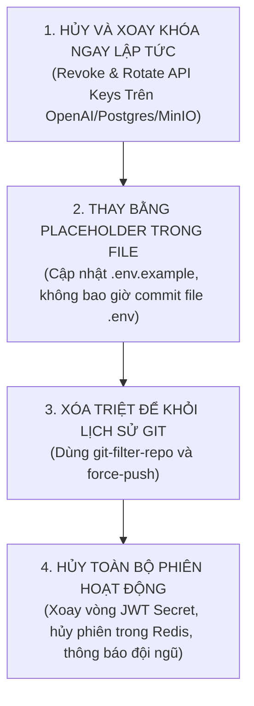

# Chính Sách An Toàn Thông Tin & Ứng Phó Sự Cố (Security Policy & Incident Runbook)

**Dự án:** RetailMind AI — Production-Oriented Agentic Retail Intelligence Platform  
**Phiên bản:** Production 2026 Edition  
**Tài liệu:** `SECURITY.md`  
**Tuân thủ pháp lý:** Nghị định 13/2023/NĐ-CP và Luật Bảo vệ dữ liệu cá nhân 91/2025/QH15  

---

## 1. Tôn Chỉ An Ninh Cốt Lõi (Core Security Directives)

1. **Ranh Giới An Toàn Tác Tử AI (Agent Execution Boundary):**
   - LLM tuyệt đối không phải là Database Client.
   - Không cấp quyền kết nối CSDL trực tiếp, không cấp quyền Shell / Docker cho Agent.
   - Mọi thao tác ghi dữ liệu (tạo đơn hàng, cập nhật kho) phải tuân thủ quy trình 2 pha: AI chỉ sinh `preview_token`, khách hàng ấn nút xác nhận tường minh trên giao diện thì Backend Service mới mở Transaction và thực thi.
2. **Bảo Vệ Dữ Liệu Cá Nhân Khách Hàng (PII Protection):**
   - Mọi thông tin CCCD (12 chữ số), số điện thoại và email khách hàng phải được quét và khử trùng bằng Regex PII Sanitizer trước khi chuyển tiếp sang LLM ngoại vi hoặc đẩy vào OpenTelemetry Traces.

---

## 2. Báo Cáo Lỗ Hổng Bảo Mật (Vulnerability Reporting)

Nếu phát hiện bất kỳ nguy cơ bảo mật, rò rỉ token hoặc lỗ hổng trong hệ thống:
* **Nghiêm cấm** mở Public Issue hoặc Pull Request công khai trên GitHub.
* Vui lòng gửi báo cáo bảo mật bảo mật riêng tư tới đội ngũ kiến trúc sư: `security@retailmind.ai`.
* Báo cáo cần nêu rõ:
  1. Loại lỗ hổng (IDOR, Prompt Injection, SQLi, Secret Exposure, SSRF).
  2. Đường dẫn tệp và dòng mã nguồn liên quan.
  3. Kịch bản tái hiện từng bước (Step-by-step reproduction).
  4. Mức độ ảnh hưởng ước tính (CVSS Score).

---

## 3. Quy Trình Ứng Phó Khẩn Cấp Khi Lộ Khóa Bí Mật (Secret Leakage Runbook)

Việc chỉ xoá key khỏi file rồi commit đè lên **hoàn toàn vô nghĩa** — giá trị khóa cũ vẫn tồn tại vĩnh viễn trong Git History và các bản clone. Kỹ sư phải thực thi theo đúng thứ tự 4 bước sống còn sau:



1. **Bước 1: Hủy và xoay khóa ngay lập tức (Revoke & Rotate):**
   - Vào bảng điều khiển OpenAI / AWS / MinIO / PostgreSQL để thu hồi (revoke) khóa bị lộ ngay lập tức.
   - Khởi tạo khóa mới với quyền hạn tối thiểu.
2. **Bước 2: Thay bằng placeholder trong file:**
   - Cập nhật `.env.example` với giá trị giả định (ví dụ: `OPENAI_API_KEY=sk-placeholder-do-not-commit`).
   - Đảm bảo file `.env` đã nằm trong `.gitignore`.
3. **Bước 3: Xóa triệt để khỏi lịch sử Git (Git History Purge):**
   ```bash
   # Sử dụng git-filter-repo để thanh lọc hoàn toàn vết tích khóa
   pip install git-filter-repo
   git filter-repo --replace-text <(echo "sk-your-leaked-key==>REDACTED") --force
   git push origin --force --all
   ```
4. **Bước 4: Hủy toàn bộ phiên đăng nhập & Thông báo:**
   - Xoay vòng `JWT_SECRET` và xóa session trong Redis để buộc toàn bộ người dùng đăng nhập lại.
   - Thông báo cho các thành viên trong dự án re-clone lại repository sạch.

---

## 4. Công Cụ Kiểm Tra Secret Tự Động Trước Khi Commit (Pre-Commit Scanner)

Để phòng chống rò rỉ secret từ đầu nguồn, dự án tích hợp lệnh quét tự động trong `Makefile`:

```bash
# Kiểm tra staged diff trước khi commit
make scan-secrets
```

Lệnh thực thi cơ chế lọc Regex:
```bash
git diff --cached | grep -iE "api[_-]?key|secret|token|password"
```
Nếu phát hiện chuỗi nghi vấn, commit sẽ bị hủy bỏ cho đến khi lập trình viên kiểm tra và làm sạch toàn bộ.
