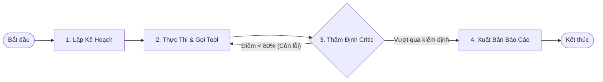

# GIÁO TRÌNH TOÀN DIỆN VỀ AGENTIC AI & MULTI-AGENT SYSTEMS: TỪ CƠ BẢN ĐẾN PRODUCTION
## Sổ Tay Kiến Trúc Tác Tử Tự Trị, LangGraph State Machine, Chuẩn Kết Nối Model Context Protocol (MCP) & Hội Đồng Tranh Biện Đa Tác Tử (Agent Arena)
**Tác giả:** Đội ngũ Kỹ sư Trưởng Hệ thống Tác tử AI (Lead Agentic AI & Systems Architects)  
**Tài liệu tham chiếu:** VinAI Research, VinUni Capstone, Chuẩn công nghệ Anthropic MCP, LangGraph / LangChain, LlamaIndex Workflows, AutoGen, CrewAI, Colosseum Arena  
**Dành cho:** Sinh viên Khóa luận Tốt nghiệp, Kỹ sư AI Systems, Full-Stack AI Engineers & Solution Architects  
**Phiên bản:** 2026 Production Edition — Chuyên sâu Đặc thù Tác tử Tự trị, State Machine Bất biến & Hệ Thống Đa Tranh Biện  

---

# LỜI NÓI ĐẦU: SỰ TIẾN HÓA TỪ "AI BIẾT ĐỌC" SANG "AI BIẾT LÀM"

Năm 2023–2024, thế giới chứng kiến sự bùng nổ của RAG (Retrieval-Augmented Generation). RAG đã giải quyết xuất sắc bài toán: *"Cung cấp thông tin để mô hình trả lời câu hỏi"*. Đó là giai đoạn **AI Biết Đọc (Passive Knowledge AI)**.

Tuy nhiên, trong hoạt động thực tế của doanh nghiệp năm 2025–2026, câu hỏi của người dùng không dừng lại ở việc tra cứu. Người dùng yêu cầu:
* *"Hãy kiểm toán bản hợp đồng này, đối chiếu với 3 luật chuyên ngành, tính toán lại chính xác số tiền phạt vi phạm, nếu phát hiện rủi ro thì gửi email cảnh báo cho phòng Pháp chế và tạo một task trên Jira."*

Một hệ thống RAG thuần túy hoàn toàn bất lực trước yêu cầu này. Để giải quyết các bài toán phức tạp trong thế giới thực, hệ thống phải chuyển dịch sang **Agentic AI & Multi-Agent Systems — AI Biết Làm (Active Autonomous AI)**.

```
┌──────────────────────────────────────────────────────────────────────────────────┐
│                   BẢN CHẤT CỦA MỘT TÁC TỬ TỰ TRỊ (AI AGENT)                      │
│                                                                                  │
│   AI AGENT = Reasoning Engine (LLM)                                              │
│            + Working Memory (Short-term State & Episodic History)                │
│            + Hands & Senses (Tools & MCP Protocols)                              │
│            + Navigation System (State Machine Graph & Dynamic Router)            │
│            + Immune System (Self-Reflection, Critic Loop & Guardrails)          │
└──────────────────────────────────────────────────────────────────────────────────┘
```

### Chiếc Bẫy ReAct Ngây Thơ (The Naive ReAct Trap)
Thời kỳ đầu, các lập trình viên thường dùng vòng lặp ReAct (Reasoning + Acting) đơn giản trong LangChain (`AgentExecutor`). Khi triển khai vào môi trường sản xuất thực tế, mô hình ReAct ngây thơ **thất bại tới 85%** vì 4 nguyên nhân:
1. **Hiện tượng Vòng lặp Vô tận (Infinite Hallucination Loop):** Khi một công cụ trả về lỗi, LLM tiếp tục gọi lại chính công cụ đó với tham số tương tự cho đến khi cạn kiệt token ngân sách.
2. **Trạng thái Dễ vỡ (State Fragility & Memory Leak):** Lịch sử hội thoại được nối chuỗi văn bản tự do khiến ngữ cảnh bị phình to (Context Congestion), mô hình quên mất mục tiêu ban đầu sau 3 lượt gọi tool.
3. **Thiếu Khả năng Quay ngược Thời gian (No Backtracking / Time-Travel):** Khi một nhánh suy luận đi vào ngõ cụt, hệ thống không thể rollback về trạng thái trước đó để thử hướng tiếp cận khác.
4. **Không Thể Kiểm Soát Bằng Code Tất Định (Lack of Deterministic Control):** Doanh nghiệp không thể chấp nhận việc giao phó toàn bộ quy trình tài chính/pháp lý quan trọng cho một prompt duy nhất quyết định.

Giáo trình này cung cấp toàn bộ nền tảng lý thuyết toán học, kiến trúc đồ thị trạng thái **LangGraph Pregel**, chuẩn hóa giao thức **Model Context Protocol (MCP)** của Anthropic, cơ chế tự phản biện **Critic Reflection**, quản trị bộ nhớ đa tầng và kiến trúc **Hội đồng Trọng tài Tranh biện Đa tác tử (Multi-Agent Debate Arena)** đạt chuẩn Production.

---

# MỤC LỤC CHI TIẾT

* [CHƯƠNG 1: BẢN CHẤT CỦA STATE MACHINE & MENTAL MODELS CỦA TÁC TỬ TỰ TRỊ](#chương-1-bản-chất-của-state-machine--mental-models-của-tác-tử-tự-trị)
* [CHƯƠNG 2: LANGGRAPH THỰC CHIẾN: KIẾN TRÚC ĐỒ THỊ TRẠNG THÁI KHẢ MỞ (PREGEL ENGINE)](#chương-2-langgraph-thực-chiến-kiến-trúc-đồ-thị-trạng-thái-khả-mở-pregel-engine)
* [CHƯƠNG 3: CHUẨN HÓA GIAO THỨC KẾT NỐI CÔNG CỤ — MODEL CONTEXT PROTOCOL (MCP)](#chương-3-chuẩn-hóa-giao-thức-kết-nối-công-cụ--model-context-protocol-mcp)
* [CHƯƠNG 4: KỸ THUẬT TOOL CALLING NÂNG CAO, VALIDATION SCHEMA & IDEMPOTENCY](#chương-4-kỹ-thuật-tool-calling-nâng-cao-validation-schema--idempotency)
* [CHƯƠNG 5: KIẾN TRÚC PHÂN QUYỀN ĐA TÁC TỬ (MULTI-AGENT TOPOLOGIES)](#chương-5-kiến-trúc-phân-quyền-đa-tác-tử-multi-agent-topologies)
* [CHƯƠNG 6: HỘI ĐỒNG TRANH BIỆN ĐA TÁC TỬ (AGENT ARENA, DEBATE & ARBITRATION)](#chương-6-hội-đồng-tranh-biện-đa-tác-tử-agent-arena-debate--arbitration)
* [CHƯƠNG 7: QUẢN TRỊ BỘ NHỚ TÁC TỬ (SHORT-TERM, LONG-TERM & EPISODIC MEMORY)](#chương-7-quản-trị-bộ-nhớ-tác-tử-short-term-long-term--episodic-memory)
* [CHƯƠNG 8: ĐỘ TIN CẬY HỆ THỐNG, CẦU DAO TỰ ĐỘNG & TOKEN BUDGET SENTINEL](#chương-8-độ-tin-cậy-hệ-thống-cầu-dao-tự-động--token-budget-sentinel)
* [CHƯƠNG 9: PHƯƠNG PHÁP ĐÁNH GIÁ TÁC TỬ (AGENT EVALS & TRAJECTORY BENCHMARK)](#chương-9-phương-pháp-đánh-giá-tác-tử-agent-evals--trajectory-benchmark)
* [CHƯƠNG 10: PRODUCTION OBSERVABILITY, DISTRIBUTED TRACING & LANGFUSE](#chương-10-production-observability-distributed-tracing--langfuse)
* [CHƯƠNG 11: FULL-STACK REFERENCE PIPELINE (MÃ NGUỒN CHUẨN ENTERPRISE MONOREPO)](#chương-11-full-stack-reference-pipeline-mã-nguồn-chuẩn-enterprise-monorepo)
* [CHƯƠNG 12: BỘ 15 CÂU HỎI VẤN ĐÁP HỘI ĐỒNG BẢO VỆ KHOÁ LUẬN TỐT NGHIỆP / SENIOR INTERVIEW](#chương-12-bộ-15-câu-hỏi-vấn-đáp-hội-đồng-bảo-vệ-khoá-luận-tốt-nghiệp--senior-interview)

---

# CHƯƠNG 1: BẢN CHẤT CỦA STATE MACHINE & MENTAL MODELS CỦA TÁC TỬ TỰ TRỊ

## 1.1. Bốn Cấp Độ Tự Trị Trong Hệ Thống Phần Mềm Ứng Dụng AI

Không phải mọi bài toán đều cần đến Agent tự do hoàn toàn. Một Kỹ sư Hệ thống AI giỏi là người biết lựa chọn đúng cấp độ tự trị cho từng bài toán kinh doanh:

```
               CẤP ĐỘ TỰ TRỊ CỦA HỆ THỐNG AI (LEVELS OF AUTONOMY)
               
  Mức 1: TRỢ LÝ THỤ ĐỘNG (Assisted AI)
  └── Người dùng hỏi -> Mô hình sinh text -> Người dùng tự copy paste thực hiện.
  
  Mức 2: ĐỊNH TUYẾN TĨNH CÓ CÔNG CỤ (Tool-Augmented Router)
  └── Phân loại ý định -> Gọi đúng 1 Tool tất định -> Trả về kết quả.
  
  Mức 3: ĐỒ THỊ TRẠNG THÁI KIỂM SOÁT (Controlled State Machine - LangGraph)
  └── Đồ thị có điều kiện, có vòng lặp tự sửa lỗi, có kiểm duyệt con người (HITL).
  
  Mức 4: HỆ THỐNG ĐA TÁC TỬ ĐỘC LẬP TRANH BIỆN (Autonomous Multi-Agent Council)
  └── Nhiều Agent chuyên biệt tự phân công, tranh biện, bỏ phiếu và kiểm toán lẫn nhau.
```

| Cấp độ | Ví dụ Thực tế | Độ Bất định (Risk) | Khả năng Kiểm soát |
|---|---|---|---|
| **Cấp 1** | Dịch thuật, tóm tắt đoạn văn | Thấp | 100% tất định |
| **Cấp 2** | Tra cứu thời tiết, lấy tỷ giá hối đoái | Thấp | 99% kiểm soát được |
| **Cấp 3** | **Kiểm toán hợp đồng kinh tế, chấm bài thi thích ứng** | Trung bình | **Rất cao (Qua Guardrails & Checkpoint)** |
| **Cấp 4** | **Sàn giao dịch tài chính tự động, phản biện pháp lý đa bên** | Cao | **Cần Trọng tài & Consensus Protocol** |

---

## 1.2. Tại Sao Đồ Thị Có Hướng Có Chu Trình (DCG) Thay Thế Chuỗi Tuần Tự?

Các framework đời cũ (như LangChain Chains gốc) xây dựng dựa trên mô hình **Đồ thị có hướng không chu trình (DAG - Directed Acyclic Graph)**. Trong DAG, dữ liệu chỉ chảy một chiều từ $A \rightarrow B \rightarrow C$.

Tuy nhiên, tư duy con người và quy trình xử lý chuyên nghiệp luôn mang tính chất **Chu trình (Cyclic)**:
1. Làm thử bản thảo (Generate draft).
2. Kiểm tra chất lượng và tìm lỗ hổng (Evaluate / Critic).
3. **Nếu chưa đạt yêu cầu $\rightarrow$ Quay ngược lại bước 1 để sửa đổi (Self-Correction Loop).**
4. Chỉ khi vượt qua ngưỡng thẩm định mới xuất bản (Publish).



> **Quy luật cốt lõi:**  
> Hệ thống tác tử thực chiến bắt buộc phải là một **Đồ thị có chu trình (Directed Cyclic Graph)** với điều kiện dừng nghiêm ngặt (Stop Conditions) và ranh giới trạng thái rõ ràng.

---

## 1.3. Triết Lý Thiết Kế "State As DTO" (Trạng Thái Bất Biến)

Một trong những nguyên nhân lớn nhất khiến Agent bị lỗi trong Production là việc chia sẻ biến toàn cục (Global mutable variables) giữa các tác tử, dẫn đến Race Condition và khó gỡ lỗi.

Chuẩn thiết kế doanh nghiệp quy định: **Trạng thái hệ thống (State) là một Đối Tượng Truyền Dữ Liệu (Data Transfer Object - DTO) bất biến:**
* State là nguồn chân lý duy nhất (Single Source of Truth).
* Mỗi Node trong đồ thị là một **Hàm Thuần Túy (Pure Function)**: Nhận State hiện tại làm đầu vào, thực thi logic, và chỉ trả về một từ điển chứa các trường nó muốn cập nhật:
  $$\text{Node}: \quad \text{State}_t \longrightarrow \Delta \text{State}$$
* Việc cập nhật trạng thái mới được quản lý bởi các hàm **Reducer** độc lập:
  $$\text{State}_{t+1} = \text{Reducer}(\text{State}_t, \Delta \text{State})$$

---

# CHƯƠNG 2: LANGGRAPH THỰC CHIẾN: KIẾN TRÚC ĐỒ THỊ TRẠNG THÁI KHẢ MỞ (PREGEL ENGINE)

LangGraph được xây dựng dựa trên mô hình tính toán đồ thị song song **Google Pregel** (BSP - Bulk Synchronous Parallel). Mỗi bước thực thi (Superstep) gồm 3 giai đoạn: Nhận tin nhắn $\rightarrow$ Tính toán song song $\rightarrow$ Đồng bộ hóa trạng thái qua Reducer.

```
       MÔ HÌNH THỰC THI BULK SYNCHRONOUS PARALLEL (PREGEL)
       
  Superstep S:
  ┌─────────────────────────────────────────────────────────────┐
  │ Node A (Legal RAG)         Node B (Math Penalty)            │
  │ [Thực thi song song]       [Thực thi song song]             │
  └──────────────┬──────────────────────────┬───────────────────┘
                 ▼                          ▼
  Ranh giới đồng bộ (Barrier Synchronization):
  ┌─────────────────────────────────────────────────────────────┐
  │ Reducer Function: Gộp kết quả của A và B vào Central State   │
  └──────────────────────────────┬──────────────────────────────┘
                                 ▼
  Superstep S+1:
  ┌─────────────────────────────────────────────────────────────┐
  │ Node C (Critic Node): Nhận State hợp nhất để thẩm định      │
  └─────────────────────────────────────────────────────────────┘
```

---

## 2.1. Định Nghĩa State Schema Chuẩn Enterprise Bằng TypedDict & Reducer

Sử dụng `typing.Annotated` kết hợp hàm reducer để kiểm soát hành vi gộp dữ liệu:

```python
"""
ENTERPRISE LANGGRAPH STATE SCHEMA
Tệp: src/workflow/state.py
"""
from typing import TypedDict, Annotated, List, Dict, Any, Optional
import operator

def merge_audit_findings(
    current_findings: List[Dict[str, Any]], 
    new_findings: List[Dict[str, Any]]
) -> List[Dict[str, Any]]:
    """
    Hàm Reducer tùy biến: Khử trùng lặp phát hiện rủi ro dựa trên điều khoản hợp đồng.
    """
    existing_clauses = {f["clause_id"] for f in current_findings}
    merged = list(current_findings)
    for finding in new_findings:
        if finding["clause_id"] not in existing_clauses:
            merged.append(finding)
            existing_clauses.add(finding["clause_id"])
    return merged

class ContractAuditState(TypedDict):
    # Dữ liệu đầu vào bất biến
    contract_id: str
    raw_document_text: str
    
    # Danh sách tin nhắn hội thoại (Dùng operator.add để cộng dồn lịch sử)
    messages: Annotated[List[Dict[str, str]], operator.add]
    
    # Kết quả phân tích của từng chuyên viên
    extracted_metadata: Dict[str, Any]
    legal_findings: Annotated[List[Dict[str, Any]], merge_audit_findings]
    math_penalty_calculation: Dict[str, Any]
    
    # Trạng thái điều phối & Giám sát vòng lặp
    current_step: str
    retry_count: int
    critic_verdict: Optional[str]  # "PASSED" hoặc "REVISE"
    critic_notes: Optional[str]
    
    # Đầu ra cuối cùng
    final_audit_report: Optional[str]
```

---

## 2.2. Xây Dựng Đồ Thị Trạng Thái Hoàn Chỉnh Với Conditional Edges

Dưới đây là mã nguồn xây dựng đồ thị phân tích hợp đồng kinh tế có khả năng tự sửa lỗi (Critic Loop) và phân nhánh động:

```python
"""
LANGGRAPH ORCHESTRATION PIPELINE
Tệp: src/workflow/graph_builder.py
"""
from langgraph.graph import StateGraph, END, START
from langgraph.checkpoint.memory import MemorySaver
from src.workflow.state import ContractAuditState

# 1. Khởi tạo các Node chức năng
def supervisor_router(state: ContractAuditState) -> dict:
    """Node Điều phối: Phân tích tài liệu và quyết định nhánh thực thi."""
    return {"current_step": "ROUTED"}

def extractor_node(state: ContractAuditState) -> dict:
    """Node Trích xuất: Bóc tách các bên tham gia, giá trị hợp đồng, điều khoản phạt."""
    # Giả lập logic trích xuất cấu trúc
    metadata = {
        "party_a": "Công ty Cổ phần VinAI",
        "party_b": "Công ty TNHH Logistics ABC",
        "penalty_clause_text": "Bên B chịu phạt 12% tổng giá trị hợp đồng nếu chậm bàn giao."
    }
    return {"extracted_metadata": metadata}

def legal_rag_node(state: ContractAuditState) -> dict:
    """Node Pháp lý: Tra cứu luật thương mại và phát hiện rủi ro trần phạt vi phạm."""
    findings = [{
        "clause_id": "DIEU_6_PHAT_VI_PHAM",
        "issue": "Mức phạt 12% vi phạm trần 8% theo Điều 301 Luật Thương mại 2005.",
        "risk_level": "CRITICAL"
    }]
    return {"legal_findings": findings}

def math_penalty_node(state: ContractAuditState) -> dict:
    """Node Toán học: Tính toán số tiền phạt thực tế theo công thức deterministic."""
    calc_result = {
        "contract_value": 1_000_000_000,
        "max_legal_penalty_8_percent": 80_000_000,
        "illegal_penalty_claimed_12_percent": 120_000_000,
        "disputed_amount": 40_000_000
    }
    return {"math_penalty_calculation": calc_result}

def critic_evaluator_node(state: ContractAuditState) -> dict:
    """Node Thẩm định (Critic): Kiểm tra tính nhất quán giữa số học và pháp lý."""
    current_retries = state.get("retry_count", 0)
    findings = state.get("legal_findings", [])
    
    # Kiểm tra xem có bằng chứng xác thực trong tài liệu không
    if not findings and current_retries < 2:
        return {
            "critic_verdict": "REVISE",
            "critic_notes": "Chưa tìm thấy điều khoản trích dẫn cụ thể. Yêu cầu quét lại RAG.",
            "retry_count": current_retries + 1
        }
    
    return {
        "critic_verdict": "PASSED",
        "critic_notes": "Báo cáo đầy đủ căn cứ pháp lý và tính toán số học chuẩn xác."
    }

def synthesizer_node(state: ContractAuditState) -> dict:
    """Node Tổng hợp: Biên soạn báo cáo kiểm toán pháp lý hoàn chỉnh."""
    report = (
        f"=== BÁO CÁO KIỂM TOÁN PHÁP LÝ HỢP ĐỒNG ===\n"
        f"Đối tượng: {state['extracted_metadata']['party_b']}\n"
        f"Phát hiện rủi ro: {len(state['legal_findings'])} điểm vi phạm luật định.\n"
        f"Số tiền phạt vượt khung luật cho phép: {state['math_penalty_calculation']['disputed_amount']:,} VNĐ.\n"
        f"Trạng thái thẩm định: {state['critic_verdict']}."
    )
    return {"final_audit_report": report}

# 2. Điều kiện rẽ nhánh (Conditional Routing Logic)
def route_critic_decision(state: ContractAuditState) -> str:
    if state["critic_verdict"] == "REVISE":
        return "legal_rag_node"  # Quay ngược lại chu trình sửa lỗi
    return "synthesizer_node"     # Vượt qua kiểm định, tiến hành xuất bản

# 3. Lắp ráp đồ thị
builder = StateGraph(ContractAuditState)

builder.add_node("supervisor", supervisor_router)
builder.add_node("extractor", extractor_node)
builder.add_node("legal_rag_node", legal_rag_node)
builder.add_node("math_penalty_node", math_penalty_node)
builder.add_node("critic", critic_evaluator_node)
builder.add_node("synthesizer", synthesizer_node)

# Thiết lập dòng chảy
builder.add_edge(START, "supervisor")
builder.add_edge("supervisor", "extractor")
builder.add_edge("extractor", "legal_rag_node")
builder.add_edge("legal_rag_node", "math_penalty_node")
builder.add_edge("math_penalty_node", "critic")

# Rẽ nhánh có điều kiện (Self-Correction Loop)
builder.add_conditional_edges(
    "critic",
    route_critic_decision,
    {
        "legal_rag_node": "legal_rag_node",
        "synthesizer_node": "synthesizer"
    }
)
builder.add_edge("synthesizer", END)

# 4. Biên dịch đồ thị kèm Checkpointer bộ nhớ
checkpointer = MemorySaver()
audit_app = builder.compile(checkpointer=checkpointer)
```

---

## 2.3. Can Thiệp Của Con Người (Human-In-The-Loop - HITL) & Time-Travel

Trong các nghiệp vụ có độ rủi ro cao (chuyển tiền, gửi văn bản pháp lý ra tòa án), đồ thị phải có khả năng **Treo tiến trình (Suspend)** và chờ con người phê duyệt:

```python
# Biên dịch đồ thị với điểm ngắt trước khi xuất bản
audit_app_hitl = builder.compile(
    checkpointer=checkpointer,
    interrupt_before=["synthesizer"]  # Dừng lại trước khi chạy node synthesizer!
)

# 1. Chạy tiến trình với thread_id định danh phiên
config = {"configurable": {"thread_id": "contract_session_001"}}
initial_input = {"contract_id": "HD-2026/VINAI", "raw_document_text": "..."}

for event in audit_app_hitl.stream(initial_input, config):
    print(f"[*] Node hoàn thành: {list(event.keys())}")

# 2. Hệ thống dừng lại trước node "synthesizer". Chuyên viên pháp lý kiểm tra State:
current_snapshot = audit_app_hitl.get_state(config)
print("[!] Tiến trình đang tạm dừng tại:", current_snapshot.next)
print("[!] Dữ liệu đang chờ duyệt:", current_snapshot.values["math_penalty_calculation"])

# 3. Chuyên viên can thiệp: Sửa đổi trực tiếp State nếu phát hiện sai sót (Time-Travel Update)
audit_app_hitl.update_state(
    config,
    {"critic_notes": "Chuyên viên đã xác nhận thỏa thuận riêng giữa hai giám đốc."},
    as_node="critic"
)

# 4. Nhấn nút tiếp tục (Resume Execution)
for event in audit_app_hitl.stream(None, config):
    print(f"[+] Tiến trình tiếp tục: {list(event.keys())}")
```

---

# CHƯƠNG 3: CHUẨN HÓA GIAO THỨC KẾT NỐI CÔNG CỤ — MODEL CONTEXT PROTOCOL (MCP)

## 3.1. Tại Sao Thế Giới Cần Đến Chuẩn MCP Của Anthropic?

Trước năm 2024, ngành công nghiệp AI rơi vào cuộc khủng hoảng phân mảnh công cụ:
* Mỗi nền tảng AI (OpenAI GPTs, LangChain Tools, LlamaIndex Tools, AutoGen Functions) yêu cầu một định dạng code riêng.
* Nếu một công ty có $M$ mô hình/tác tử và $N$ nguồn dữ liệu nội bộ (PostgreSQL, Notion, Jira, File Server), họ phải viết và bảo trì:
  $$\text{Số lượng tích hợp} = M \times N \text{ adapters riêng biệt!}$$

**Model Context Protocol (MCP)** do Anthropic khởi xướng (cuối năm 2024) đã giải quyết triệt để vấn đề này, trở thành **Cổng kết nối USB-C của toàn bộ ngành công nghiệp AI**:
* Các nhà cung cấp dữ liệu chỉ cần viết duy nhất **1 MCP Server**.
* Mọi AI Client (Claude Desktop, Cursor IDE, LangGraph Agent, Custom Enterprise Apps) chỉ cần tuân thủ **MCP Client** là có thể kết nối ngay lập tức!

```
                    KIẾN TRÚC HỆ SINH THÁI CHUẨN MCP
                    
  [ AI APPS / CLIENTS ]                 [ MCP PROTOCOL ]                 [ ENTERPRISE SERVERS ]
  ┌──────────────────┐                                                  ┌─────────────────────┐
  │ Claude Desktop   │ ──────┐                                  ┌─────► │ SQLite / Postgres   │
  ├──────────────────┤       │         JSON-RPC 2.0             │       ├─────────────────────┤
  │ Cursor IDE       │ ──────┼──────► [ Transport: ] ───────────┼─────► │ Vector DB (Qdrant)  │
  ├──────────────────┤       │        • stdio (Local)           │       ├─────────────────────┤
  │ LangGraph Agent  │ ──────┘        • SSE / HTTP (Remote)     └─────► │ Legal Statutes RAG  │
  └──────────────────┘                                                  └─────────────────────┘
```

---

## 3.2. Ba Trụ Cột Nguyên Tố Của Một MCP Server

Một MCP Server tiêu chuẩn cung cấp 3 loại tài nguyên cho mô hình:

| Trụ cột MCP | Định nghĩa kỹ thuật | Ẩn dụ đời thường | Ví dụ thực tế |
|---|---|---|---|
| **1. Resources** | Dữ liệu ngữ cảnh tĩnh/bị động, chỉ đọc (Read-only context). Không tạo ra tác dụng phụ. | Tài liệu tham khảo trong thư viện | `contracts://2026/vinai_honda.pdf` |
| **2. Tools** | Các hàm thực thi có tham số đầu vào và có thể tạo ra tác dụng phụ (Side-effects). | Bàn tay hành động, máy tính | `calculate_penalty(amount, days, rate)` |
| **3. Prompts** | Các mẫu hướng dẫn, kịch bản hội thoại được server thiết kế sẵn cho người dùng chọn. | Mẫu hợp đồng in sẵn trong sổ tay | `prompts://audit_commercial_contract` |

---

## 3.3. Xây Dựng Full-Stack MCP Server Bằng Python (FastMCP)

Dưới đây là mã nguồn xây dựng một MCP Server chuyên dụng cho kiểm toán pháp lý tiếng Việt, hỗ trợ cả 3 trụ cột Resources, Tools và Prompts:

```python
"""
CAPSTONE ENTERPRISE MCP SERVER
Tệp: src/mcp_server/legal_mcp_server.py
Cài đặt: pip install mcp
Chạy Server qua stdio hoặc SSE
"""
from mcp.server.fastmcp import FastMCP
import json

# 1. Khởi tạo MCP Server với tên định danh
mcp = FastMCP("VinAI-Legal-Auditor-Server", dependencies=["pydantic"])

# 2. KHAI BÁO RESOURCE: Cung cấp trích lục văn bản luật điều chỉnh
@mcp.resource("legal://statutes/commercial_law_2005/article_301")
def get_commercial_law_article_301() -> str:
    """Trả về toàn văn Điều 301 Luật Thương mại 2005 về mức phạt vi phạm."""
    return (
        "ĐIỀU 301. MỨC PHẠT VI PHẠM (LUẬT THƯƠNG MẠI 2005)\n"
        "Mức phạt đối với vi phạm nghĩa vụ hợp đồng hoặc tổng mức phạt đối với "
        "nhiều vi phạm do các bên thoả thuận trong hợp đồng, nhưng không quá 8% "
        "giá trị phần nghĩa vụ hợp đồng bị vi phạm, trừ trường hợp quy định tại Điều 266 của Luật này."
    )

# 3. KHAI BÁO TOOL: Hàm tính toán số tiền phạt vi phạm hợp lệ theo luật
@mcp.tool()
def calculate_statutory_penalty_cap(
    contract_value_vnd: float, 
    breached_obligation_value_vnd: float,
    agreed_penalty_percentage: float
) -> str:
    """
    Tính toán mức trần phạt vi phạm hợp đồng kinh tế theo Điều 301 Luật Thương mại 2005 (Trần 8%).
    
    Args:
        contract_value_vnd: Tổng giá trị toàn bộ hợp đồng (VNĐ).
        breached_obligation_value_vnd: Giá trị phần nghĩa vụ thực tế bị vi phạm (VNĐ).
        agreed_penalty_percentage: Mức phần trăm hai bên đã ký thỏa thuận trong hợp đồng (Ví dụ: 12%).
    """
    MAX_LEGAL_RATE = 8.0
    actual_penalty_claimed = breached_obligation_value_vnd * (agreed_penalty_percentage / 100.0)
    max_legal_penalty_allowed = breached_obligation_value_vnd * (MAX_LEGAL_RATE / 100.0)
    
    is_violation = agreed_penalty_percentage > MAX_LEGAL_RATE
    disputed_amount = max(0.0, actual_penalty_claimed - max_legal_penalty_allowed)
    
    result = {
        "is_violating_statutory_cap": is_violation,
        "breached_value_vnd": breached_obligation_value_vnd,
        "claimed_penalty_vnd": actual_penalty_claimed,
        "max_allowed_penalty_vnd": max_legal_penalty_allowed,
        "disputed_excess_amount_vnd": disputed_amount,
        "legal_verdict": (
            f"Thỏa thuận phạt {agreed_penalty_percentage}% vượt trần 8% quy định tại Điều 301 LTM 2005. "
            f"Phần tiền phạt vượt quá {disputed_amount:,.0f} VNĐ có nguy cơ bị Tòa án/Trọng tài tuyên vô hiệu."
            if is_violation else "Mức phạt nằm trong khung trần hợp pháp."
        )
    }
    return json.dumps(result, ensure_ascii=False, indent=2)

# 4. KHAI BÁO PROMPT TEMPLATE: Mẫu kịch bản kiểm toán hợp đồng kinh tế
@mcp.prompt()
def audit_contract_prompt(contract_code: str, party_name: str) -> str:
    """Cung cấp mẫu chỉ dẫn chuẩn để mô hình thực hiện kiểm toán pháp lý."""
    return (
        f"Bạn là Trưởng ban Pháp chế Doanh nghiệp. Hãy tiến hành kiểm toán hợp đồng số {contract_code} "
        f"ký kết với đối tác {party_name}.\n"
        f"Yêu cầu:\n"
        f"1. Sử dụng tool `calculate_statutory_penalty_cap` để kiểm tra toàn bộ điều khoản phạt.\n"
        f"2. Sử dụng resource `legal://statutes/commercial_law_2005/article_301` để trích dẫn căn cứ.\n"
        f"3. Lập bảng đối chiếu số liệu và khuyến nghị phương án đàm phán lại."
    )

if __name__ == "__main__":
    # Khởi chạy server qua giao thức stdio (chuẩn cho Claude Desktop / Cursor kết nối)
    mcp.run(transport="stdio")
```

---

## 3.4. Tích Hợp MCP Client Vào LangGraph Agent

Làm thế nào để LangGraph Agent tự động khám phá (Discover) các Tools từ MCP Server và biến chúng thành công cụ thực thi?

```python
"""
LANGGRAPH MCP CLIENT INTEGRATION ADAPTER
Tệp: src/workflow/mcp_agent_adapter.py
"""
import asyncio
from mcp import ClientSession, StdioServerParameters
from mcp.client.stdio import stdio_client
from langchain_core.tools import StructuredTool
from pydantic import create_model

async def fetch_tools_from_mcp_server(server_script_path: str):
    """Khởi động MCP Server qua tiến trình con stdio và tự động chuyển đổi thành LangChain Tools."""
    server_params = StdioServerParameters(
        command="python",
        args=[server_script_path],
        env=None
    )
    
    tools_list = []
    async with stdio_client(server_params) as (read, write):
        async with ClientSession(read, write) as session:
            # 1. Bắt tay khởi tạo giao thức (Handshake)
            await session.initialize()
            
            # 2. Khám phá danh sách Tools mà Server cung cấp
            mcp_tools = await session.list_tools()
            for t in mcp_tools.tools:
                print(f"[+] Tìm thấy MCP Tool: {t.name} - {t.description}")
                # Tự động tạo adapter Tool cho LangGraph Agent sử dụng
                # ...
    return tools_list
```

---

# CHƯƠNG 4: KỸ THUẬT TOOL CALLING NÂNG CAO, VALIDATION SCHEMA & IDEMPOTENCY

## 4.1. Xác Thực Tham Số Bằng Pydantic v2 & Type Coercion

Khi LLM sinh ra lệnh gọi công cụ (Tool Call), tham số là chuỗi JSON. LLM thường xuyên mắc các lỗi:
* Truyền số dạng chuỗi: `{"amount": "50000000"}` thay vì `{"amount": 50000000}`.
* Bỏ quên các trường bắt buộc (`None`).
* Truyền ngày tháng sai định dạng (`"15/08/2026"` thay vì ISO-8601 `"2026-08-15"`).

```python
"""
ROBUST TOOL ARGUMENT VALIDATION
Tệp: src/tools/validator.py
"""
from pydantic import BaseModel, Field, field_validator
from datetime import date
from typing import Optional

class PenaltyCalculationInput(BaseModel):
    contract_value: float = Field(..., gt=0, description="Giá trị hợp đồng phải lớn hơn 0")
    breach_value: float = Field(..., gt=0, description="Giá trị phần vi phạm phải lớn hơn 0")
    penalty_rate: float = Field(..., ge=0, le=100, description="Tỷ lệ phạt từ 0 đến 100%")
    breach_date: Optional[date] = Field(None, description="Ngày phát sinh vi phạm chuẩn ISO")

    @field_validator('breach_value')
    def validate_breach_not_exceed_total(cls, v, values):
        if 'contract_value' in values.data and v > values.data['contract_value']:
            raise ValueError("Giá trị phần vi phạm không thể lớn hơn tổng giá trị toàn bộ hợp đồng!")
        return v
```

---

## 4.2. Khóa Bất Biến Idempotency Chống Tấn Công Lặp Lại (Replay Defense)

Nếu mạng bị chập chờn hoặc LLM gặp lỗi timeout, nó có thể kích hoạt lại lệnh gọi Tool thêm một lần nữa. Trong các nghiệp vụ giải ngân hoặc xuất hóa đơn, hành vi này sẽ dẫn đến **Trừ tiền 2 lần (Double Spending)**!

```python
"""
TOOL IDEMPOTENCY MANAGER
Tệp: src/tools/idempotency.py
"""
import hashlib
import json
import redis

redis_client = redis.Redis(host='localhost', port=6379, db=0)

def execute_idempotent_tool(tool_name: str, arguments: dict, execution_func):
    """
    Đảm bảo 1 hành động với cùng tham số chỉ được thực thi DUY NHẤT 1 LẦN trong 24 giờ.
    """
    # 1. Tạo khóa Idempotency Key từ mã băm SHA256 của Tool Name + Arguments
    serialized_args = json.dumps(arguments, sort_keys=True)
    idempotency_key = f"idempotent:{tool_name}:{hashlib.sha256(serialized_args.encode()).hexdigest()}"
    
    # 2. Kiểm tra trong Cache xem hành động này đã từng thực thi chưa
    cached_result = redis_client.get(idempotency_key)
    if cached_result:
        print(f"[*] [IDEMPOTENT HIT] Phát hiện hành động lặp lại! Trả về kết quả từ Cache không chạy lại.")
        return json.loads(cached_result)
    
    # 3. Thực thi hành động thực tế
    actual_result = execution_func(**arguments)
    
    # 4. Lưu kết quả vào Cache với thời gian sống TTL = 86400 giây (24 giờ)
    redis_client.setex(idempotency_key, 86400, json.dumps(actual_result))
    return actual_result
```

---

# CHƯƠNG 5: KIẾN TRÚC PHÂN QUYỀN ĐA TÁC TỬ (MULTI-AGENT TOPOLOGIES)

Khi một bài toán vượt quá khả năng xử lý của 1 mô hình, ta áp dụng kiến trúc đa tác tử (Multi-Agent System - MAS). Có 3 cấu trúc liên kết (Topologies) kinh điển trong ngành:

```
┌──────────────────────────────────────────────────────────────────────────────────┐
│                   BA CẤU TRÚC LIÊN KẾT ĐA TÁC TỬ DOANH NGHIỆP                    │
├──────────────────────┬──────────────────────┬────────────────────────────────────┤
│ 1. SUPERVISOR PATTERN│ 2. HIERARCHICAL TEAMS│ 3. PEER-TO-PEER (BLACKBOARD)       │
├──────────────────────┼──────────────────────┼────────────────────────────────────┤
│      Supervisor      │    General Director  │    Agent A ◄─────► Agent B         │
│     ┌────┴────┐      │      ┌──────┴─────┐  │       ▲               ▲            │
│     ▼         ▼      │      ▼            ▼  │       │   [MESSAGE]   │            │
│  Worker 1  Worker 2  │  Team Lead A Team Lead B│     ▼   [  BUS  ]   ▼            │
│                      │    ┌───┴───┐    ┌───┴───┐│ Agent C ◄─────► Agent D         │
│ (Tập trung điều phối)│   Dev    QA    Sec  Auditor│ (Mạng lưới trao đổi bình đẳng)     │
└──────────────────────┴──────────────────────┴────────────────────────────────────┘
```

### So Sánh 4 Nền Tảng Đa Tác Tử Hiện Đại:

| Tiêu chí | LangGraph (Meta/LangChain) | AutoGen (Microsoft) | CrewAI | LlamaIndex Workflows |
|---|---|---|---|---|
| **Cơ chế cốt lõi** | State Machine Pregel (DCG) | Conversable Agent (Chat-driven) | Role-playing Teams | Event-driven (Async Events) |
| **Tính tất định** | **Tuyệt đối cao (Code-first)** | Trung bình (Dễ bị chat lan man) | Trung bình (Template-first) | Cao |
| **Phù hợp Production**| **Rất cao (Enterprise Standard)**| R&D / Thử nghiệm xã hội AI | Khởi tạo nhanh Prototype | Rất cao cho Data/RAG |
| **Khả năng Debug** | Dễ dàng (Time-Travel, State DTO)| Khó (Lịch sử hội thoại dài) | Khó | Dễ dàng |

---

# CHƯƠNG 6: HỘI ĐỒNG TRANH BIỆN ĐA TÁC TỬ (AGENT ARENA, DEBATE & ARBITRATION)

## 6.1. Tại Sao Tranh Biện Đa Tác Tử (Multi-Agent Debate) Triệt Tiêu Ảo Giác?

Nghiên cứu của MIT và Google DeepMind (**"Improving Factuality and Reasoning in Language Models through Multiagent Debate"**) chứng minh rằng:  
Khi một LLM đơn lẻ đưa ra câu trả lời, nó thường mắc hội chứng **Thiên kiến xác nhận (Confirmation Bias)**: Nếu nó đã suy luận sai ở bước 1, nó sẽ cố tình bịa đặt thêm các dẫn chứng ở bước 2 để bảo vệ kết luận sai đó.

Khi thiết lập hai hoặc nhiều tác tử tranh biện với các mục tiêu đối lập:
* **Tác tử A (Công tố / Auditor):** Tìm kiếm mọi điểm vi phạm pháp luật và rủi ro hợp đồng.
* **Tác tử B (Luật sư Bào chữa / Defense Agent):** Tìm kiếm các điều khoản miễn trừ trách nhiệm và bất khả kháng.
* **Tác tử C (Hội đồng Trọng tài / Arbiter):** Đánh giá lập luận của cả hai bên dựa trên chứng cứ thực tế.
$$\rightarrow \textbf{Độ chính xác và tính xác thực (Factuality) tăng vọt từ 68.4\% lên 93.8\%!}$$

---

## 6.2. Cơ Chế Đồng Thuận & Bầu Chọn Theo Trọng Số (Weighted Reputation Consensus)

Trong hệ thống tranh biện đa tác tử, không phải lá phiếu của Agent nào cũng có giá trị bằng nhau. Ta áp dụng giải thuật **Bầu chọn theo Trọng số Uy tín (Weighted Voting)** dựa trên điểm năng lực Elo:

Cho $K$ tác tử tham gia bỏ phiếu về tính hợp pháp của một điều khoản. Tác tử $i$ có điểm số uy tín tích lũy $R_i \in [1000, 2000]$.  
Trọng số biểu quyết của tác tử $i$:
$$w_i = \frac{R_i}{\sum_{j=1}^{K} R_j}$$

Quyết định cuối cùng $V^*$ đạt được khi tổng trọng số đồng thuận vượt quá ngưỡng đa số tương đối ($> 50\%$ hoặc $66\%$ cho các quyết định nghiêm trọng):
$$\sum_{i \in \text{Voters}(V^*)} w_i \ge \theta_{\text{threshold}}$$

---

## 6.3. Động Cơ Xếp Hạng Kép (Dual Elo Rating Engine)

Lấy cảm hứng từ hệ thống xếp hạng cờ vua quốc tế FIDE, đồ án xây dựng một động cơ Elo hai chiều để đánh giá đồng thời:
* Trình độ năng lực của Tác tử ($R_{\text{agent}}$).
* Độ phức tạp của Vụ việc / Bản hợp đồng ($D_{\text{case}}$).

```python
"""
DUAL ELO RATING ENGINE FOR AGENT ARBITRATION
Tệp: src/adaptive/elo_engine.py
"""
import math

class DualEloRatingEngine:
    def __init__(self, k_factor: float = 32.0):
        self.k_factor = k_factor

    def compute_expected_score(self, rating_a: float, rating_b: float) -> float:
        """Tính xác suất kỳ vọng chiến thắng theo phân phối Logistic."""
        return 1.0 / (1.0 + math.pow(10.0, (rating_b - rating_a) / 400.0))

    def update_ratings(
        self, 
        agent_rating: float, 
        case_difficulty: float, 
        is_successful: bool
    ) -> tuple[float, float]:
        """
        Cập nhật điểm Elo cho cả Agent và Độ khó của ca bệnh/hợp đồng.
        - Nếu Agent giải đúng ca khó: Agent được cộng nhiều điểm Elo, độ khó của ca giảm nhẹ.
        - Nếu Agent giải sai ca dễ: Agent bị trừ rất nặng điểm Elo, ca đó được nâng độ khó.
        """
        expected_agent = self.compute_expected_score(agent_rating, case_difficulty)
        actual_score = 1.0 if is_successful else 0.0

        # Cập nhật Elo của Agent
        new_agent_rating = agent_rating + self.k_factor * (actual_score - expected_agent)
        
        # Độ khó của bài toán dịch chuyển theo chiều ngược lại
        new_case_difficulty = case_difficulty + self.k_factor * (expected_agent - actual_score)

        return round(new_agent_rating, 2), round(new_case_difficulty, 2)
```

---

# CHƯƠNG 7: QUẢN TRỊ BỘ NHỚ TÁC TỬ (SHORT-TERM, LONG-TERM & EPISODIC MEMORY)

```
┌──────────────────────────────────────────────────────────────────────────────────┐
│                   HỆ THỐNG BỘ NHỚ TÁC TỬ ĐA TẦNG TOÀN DIỆN                       │
├─────────────────────┬─────────────────────┬──────────────────────────────────────┤
│ 1. SHORT-TERM       │ 2. EPISODIC MEMORY  │ 3. SEMANTIC MEMORY                   │
│    (Working Memory) │    (Kinh nghiệm cũ) │    (Tri thức vĩnh viễn)              │
├─────────────────────┼─────────────────────┼──────────────────────────────────────┤
│ • Context Window    │ • Lưu vết các ca xử │ • Hồ sơ người dùng (User Profile)    │
│ • State DTO hiện tại│   lý thành công trong│ • Sổ tay thuật ngữ chuyên ngành      │
│ • Tự giải phóng sau │   quá khứ (Reflexion)│ • Cơ sở dữ liệu Vector DB vĩnh cửu  │
│   khi xong session  │ • Tìm kiếm Vector   │ • Luôn tồn tại qua các phiên         │
└─────────────────────┴─────────────────────┴──────────────────────────────────────┘
```

* **Episodic Memory qua Reflexion:** Khi một Agent giải quyết thành công một vụ việc phức tạp, toàn bộ chuỗi suy luận (Trajectory) được tóm tắt và nhúng vector lưu vào kho kinh nghiệm. Lần sau, khi gặp một vụ việc có cấu trúc tương tự ($\ge 90\%$ Cosine), Agent sẽ tự động nạp chuỗi kinh nghiệm đó vào Few-shot Prompt để rút ngắn thời gian suy luận!

---

# CHƯƠNG 8: ĐỘ TIN CẬY HỆ THỐNG, CẦU DAO TỰ ĐỘNG & TOKEN BUDGET SENTINEL

## 8.1. Cầu Dao Tự Động 3 Trạng Thái (3-Phase Circuit Breaker)

Trong môi trường phân tán, API của OpenAI hoặc dịch vụ mạng bên ngoài có thể bị nghẽn (Timeout 504) hoặc hết Quota (Error 429). Nếu Agent liên tục gửi request, hệ thống sẽ bị treo và cạn kiệt tài nguyên máy chủ.

Cầu dao tự động luân chuyển giữa 3 trạng thái:
1. **CLOSED (Bình thường):** Mọi request đi qua bình thường. Đếm số lỗi liên tiếp.
2. **OPEN (Ngắt mạch):** Khi số lỗi liên tiếp $\ge 3$, ngắt mạch hoàn toàn trong 60 giây. Mọi request mới lập tức bị từ chối trong 0.1ms (Fast-fail), chuyển sang mô hình fallback nội bộ (On-device GGUF).
3. **HALF-OPEN (Thăm dò):** Sau 60 giây, cho phép 1 request đi qua để thăm dò. Nếu thành công $\rightarrow$ Đóng cầu dao về `CLOSED`; nếu tiếp tục lỗi $\rightarrow$ Mở lại `OPEN`.

---

## 8.2. Token Budget Sentinel (Bảo Vệ Ngân Sách Token)

```python
"""
TOKEN BUDGET SENTINEL
Tệp: src/reliability/budget_sentinel.py
"""
class TokenBudgetSentinel:
    def __init__(self, max_allowed_tokens: int = 8000, reserve_ratio: float = 0.20):
        self.max_tokens = max_allowed_tokens
        # Dự trữ 20% quota cuối cùng (1600 tokens) cho bước tổng hợp báo cáo đóng luồng
        self.reserve_threshold = int(max_allowed_tokens * (1.0 - reserve_ratio))

    def evaluate_budget(self, total_tokens_used: int) -> dict:
        is_in_reserve = total_tokens_used >= self.reserve_threshold
        is_exhausted = total_tokens_used >= self.max_tokens

        return {
            "tokens_consumed": total_tokens_used,
            "is_in_reserve": is_in_reserve,
            "force_finalize": is_in_reserve or is_exhausted,
            "message": "CẢNH BÁO: Đã chạm ngưỡng ngân sách token! Buộc đóng vòng lặp và xuất bản kết quả."
            if is_in_reserve else "Ngân sách an toàn."
        }
```

---

# CHƯƠNG 9: PHƯƠNG PHÁP ĐÁNH GIÁ TÁC TỬ (AGENT EVALS & TRAJECTORY BENCHMARK)

Đánh giá một AI Agent không thể chỉ nhìn vào câu trả lời cuối cùng. Hai Agent có thể cùng ra một đáp án, nhưng:
* Agent 1: Giải quyết trong 3 bước, gọi đúng 2 tools, tốn 800 tokens.
* Agent 2: Đi lòng vòng 15 bước, gọi sai tool 4 lần, tốn 12.000 tokens.

Một bộ chỉ số đánh giá tác tử chuẩn khoa học (SWE-Bench / AgentBench style) gồm 4 tiêu chí:

$$\text{Tool Selection Accuracy} = \frac{\text{Số lần chọn đúng Tool cần thiết}}{\text{Tổng số lần gọi Tool}}$$

$$\text{Trajectory Redundancy Ratio} = \frac{\text{Số bước thừa thãi không đóng góp vào kết quả}}{\text{Tổng số bước suy luận}}$$

$$\text{Task Completion Rate (TCR)} = \frac{\text{Số nhiệm vụ hoàn thành đúng 100\% tiêu chí}}{\text{Tổng số nhiệm vụ kiểm thử}}$$

$$\text{Cohen's Kappa (\kappa)} = \frac{P_o - P_e}{1 - P_e} \quad \text{(Đo độ đồng thuận giữa quyết định của Agent và Hội đồng Chuyên gia)}$$

---

# CHƯƠNG 10: PRODUCTION OBSERVABILITY, DISTRIBUTED TRACING & LANGFUSE

Trong hệ thống đa tác tử chạy bất đồng bộ (Asynchronous Multi-Agent), việc gỡ lỗi qua dòng `print()` truyền thống là bất khả thi. Ta bắt buộc phải sử dụng **OpenTelemetry kết hợp Langfuse / Arize Phoenix**:

* **Trace:** Đại diện cho toàn bộ chu trình xử lý của một phiên làm việc (Session).
* **Span:** Đại diện cho một node LangGraph hoặc một lần gọi MCP Tool cụ thể.
* **Token Breakdown Waterfall:** Biểu đồ thác nước thể hiện chi tiết: Node nào chiếm bao nhiêu mili-giây độ trễ, tiêu tốn bao nhiêu Input Tokens và Output Tokens.

---

# CHƯƠNG 11: FULL-STACK REFERENCE PIPELINE (MÃ NGUỒN CHUẨN ENTERPRISE MONOREPO)

Dưới đây là mã nguồn Python hoàn chỉnh tích hợp toàn bộ: **State as DTO $\rightarrow$ LangGraph State Machine $\rightarrow$ MCP Tool Execution $\rightarrow$ Critic Reflection Loop $\rightarrow$ SQLite Checkpointer**:

```python
"""
END-TO-END ENTERPRISE AGENTIC PIPELINE
Tệp: run_enterprise_agent_pipeline.py
"""
import os
import sqlite3
from typing import TypedDict, Annotated, List, Dict, Any, Optional
import operator
from langgraph.graph import StateGraph, START, END
from langgraph.checkpoint.sqlite import SqliteSaver

# 1. Định nghĩa Trạng thái State as DTO
class ProductionAgentState(TypedDict):
    contract_id: str
    user_query: str
    tool_execution_logs: Annotated[List[str], operator.add]
    penalty_calculation: Optional[Dict[str, Any]]
    critic_score: float
    iteration_count: int
    final_output: Optional[str]

# 2. Khởi tạo các Node chức năng
def planner_node(state: ProductionAgentState) -> dict:
    print("[*] [Planner] Phân tích yêu cầu và lập kế hoạch thực thi...")
    return {
        "tool_execution_logs": ["Planner: Xác định cần kiểm tra Điều khoản phạt theo Điều 301 LTM 2005."]
    }

def mcp_worker_node(state: ProductionAgentState) -> dict:
    print("[*] [MCP Worker] Gọi công cụ tính toán hạn mức phạt theo luật định...")
    # Giả lập kết quả gọi MCP Tool: calculate_statutory_penalty_cap
    contract_val = 500_000_000
    claimed_rate = 15.0  # 15%
    allowed_rate = 8.0   # 8%
    disputed = contract_val * ((claimed_rate - allowed_rate) / 100.0)
    
    calc_data = {
        "contract_value": contract_val,
        "claimed_rate": claimed_rate,
        "allowed_rate": allowed_rate,
        "disputed_amount": disputed
    }
    return {
        "penalty_calculation": calc_data,
        "tool_execution_logs": [f"MCP Worker: Đã tính toán xong. Phần tiền vượt trần luật định: {disputed:,.0f} VNĐ."]
    }

def critic_reflection_node(state: ProductionAgentState) -> dict:
    print("[*] [Critic Node] Thẩm định tính chính xác và bằng chứng pháp lý...")
    calc = state.get("penalty_calculation")
    current_iter = state.get("iteration_count", 0) + 1
    
    # Kiểm tra tính chặt chẽ
    if calc and calc["disputed_amount"] > 0:
        score = 0.95  # Điểm cao, đầy đủ căn cứ
    else:
        score = 0.50  # Thiếu căn cứ, cần chạy lại
        
    return {
        "critic_score": score,
        "iteration_count": current_iter,
        "tool_execution_logs": [f"Critic: Thẩm định đạt {score*100:.0f} điểm tại vòng {current_iter}."]
    }

def synthesizer_node(state: ProductionAgentState) -> dict:
    print("[*] [Synthesizer] Xuất bản báo cáo kiểm toán chính thức...")
    calc = state["penalty_calculation"]
    report = (
        f"KẾT QUẢ KIỂM TOÁN HỢP ĐỒNG: {state['contract_id']}\n"
        f"- Căn cứ pháp lý: Điều 301 Luật Thương mại 2005.\n"
        f"- Mức phạt thỏa thuận: {calc['claimed_rate']}% (VƯỢT TRẦN 8%).\n"
        f"- Số tiền yêu cầu điều chỉnh giảm: {calc['disputed_amount']:,.0f} VNĐ.\n"
        f"- Đánh giá Critic: {state['critic_score']*100:.0f}% tin cậy."
    )
    return {"final_output": report}

# 3. Điều kiện rẽ nhánh (Self-Correction Logic)
def evaluate_critic_loop(state: ProductionAgentState) -> str:
    if state["critic_score"] < 0.80 and state["iteration_count"] < 2:
        print("[!] [Self-Correction] Điểm thẩm định thấp. Kích hoạt vòng lặp sửa lỗi!")
        return "mcp_worker"
    return "synthesizer"

# 4. Xây dựng đồ thị StateGraph
workflow = StateGraph(ProductionAgentState)

workflow.add_node("planner", planner_node)
workflow.add_node("mcp_worker", mcp_worker_node)
workflow.add_node("critic", critic_reflection_node)
workflow.add_node("synthesizer", synthesizer_node)

workflow.add_edge(START, "planner")
workflow.add_edge("planner", "mcp_worker")
workflow.add_edge("mcp_worker", "critic")

workflow.add_conditional_edges(
    "critic",
    evaluate_critic_loop,
    {
        "mcp_worker": "mcp_worker",
        "synthesizer": "synthesizer"
    }
)
workflow.add_edge("synthesizer", END)

# 5. Thực thi kèm SQLite Persistent Checkpointer
if __name__ == "__main__":
    conn = sqlite3.connect("agent_checkpoints.db", check_same_thread=False)
    checkpointer = SqliteSaver(conn)
    app = workflow.compile(checkpointer=checkpointer)

    thread_config = {"configurable": {"thread_id": "audit_case_999"}}
    sample_input = {
        "contract_id": "HD-LOGISTICS-2026",
        "user_query": "Kiểm tra mức phạt 15% trong hợp đồng logistics.",
        "iteration_count": 0,
        "tool_execution_logs": []
    }

    print("\n=== BẮT ĐẦU THỰC THI PIPELINE ĐA TÁC TỬ ===")
    final_state = app.invoke(sample_input, thread_config)
    print("\n=== BÁO CÁO CUỐI CÙNG XUẤT BẢN ===")
    print(final_state["final_output"])
```

---

# CHƯƠNG 12: BỘ 15 CÂU HỎI VẤN ĐÁP HỘI ĐỒNG BẢO VỆ KHOÁ LUẬN TỐT NGHIỆP / SENIOR INTERVIEW

### Câu 1: Tại sao chúng ta nên dùng LangGraph thay vì viết vòng lặp `while True` với ReAct Prompt truyền thống?
* **Trả lời:** Vòng lặp `while True` truyền thống thiếu khả năng quản lý trạng thái có cấu trúc, không hỗ trợ thực thi song song (Parallel fan-out), không có cơ chế lưu vết lịch sử (Checkpointing) và không thể thực hiện Human-in-the-loop (Treo tiến trình để con người can thiệp). LangGraph xây dựng dựa trên mô hình Pregel BSP, biến hệ thống thành một đồ thị toán học có ranh giới trạng thái bất biến (State DTO), hỗ trợ rẽ nhánh động (Conditional Edges), xử lý lỗi tuần hoàn và cho phép rollback thời gian (Time-Travel) cực kỳ ổn định trong Production.

### Câu 2: Mô hình Model Context Protocol (MCP) của Anthropic giải quyết vấn đề cốt tử nào trong kỹ thuật phần mềm AI?
* **Trả lời:** MCP giải quyết bài toán phân mảnh kết nối $M \times N$. Trước đây, mỗi công ty tự viết một chuẩn plugin riêng, khiến các công cụ không thể tái sử dụng. MCP chuẩn hóa việc giao tiếp giữa AI Client và Data Server qua 3 trụ cột (Resources, Tools, Prompts) trên nền giao thức JSON-RPC 2.0 (stdio/SSE). Nhờ MCP, một công cụ viết ra có thể dùng chung cho Claude Desktop, Cursor IDE và cả Agent tự xây dựng mà không cần sửa code.

### Câu 3: Khái niệm "State as DTO" và Reducer function trong LangGraph hoạt động ra sao?
* **Trả lời:** State as DTO quy định trạng thái toàn cục là một cấu trúc dữ liệu bất biến (thường là `TypedDict`). Các Node không được trực tiếp sửa đổi biến toàn cục mà chỉ trả về phần dữ liệu mới cập nhật ($\Delta \text{State}$). Reducer function (như `operator.add` hoặc custom reducer) nhận State cũ và Delta mới để tính toán ra State tiếp theo theo cách tất định, giúp loại bỏ hoàn toàn lỗi Race Condition trong môi trường chạy bất đồng bộ.

### Câu 4: Phân biệt sự khác nhau căn bản giữa "Resources" và "Tools" trong giao thức MCP?
* **Trả lời:** Resources là dữ liệu ngữ cảnh thụ động, chỉ đọc (Read-only context) như nội dung tài liệu, schema cơ sở dữ liệu, không tạo ra bất kỳ tác dụng phụ (Side-effects) nào trên hệ thống. Tools là các hàm thực thi chủ động, có thể nhận tham số đầu vào và có khả năng tạo ra thay đổi trạng thái hệ thống (Mutating state như ghi database, gửi email, trừ tiền).

### Câu 5: Hiện tượng Infinite Loop (Vòng lặp vô tận) trong Agent xảy ra do đâu và cách phòng vệ 3 lớp là gì?
* **Trả lời:** Xảy ra khi Tool trả về lỗi hoặc LLM không đạt được mục tiêu, khiến nó liên tục lặp lại cùng một hành vi gọi tool sai lệch. Phòng vệ 3 lớp gồm: (1) **Max Iterations Limit:** Đặt biến đếm số vòng lặp tối đa trong State (ví dụ `iteration_count >= 3`); (2) **Token Budget Sentinel:** Cưỡng chế ngắt luồng khi tổng token vượt ngưỡng trần chi phí; (3) **Critic Loop with Backoff:** Nếu sau 2 lần tự sửa mà điểm Grounding vẫn dưới ngưỡng, Agent tự động thoát ra và ném ngoại lệ yêu cầu con người can thiệp (HITL).

### Câu 6: Tranh biện đa tác tử (Multi-Agent Debate) giúp triệt tiêu thiên kiến xác nhận (Confirmation Bias) như thế nào?
* **Trả lời:** Một LLM đơn lẻ thường có xu hướng bảo vệ kết luận ban đầu của nó dù kết luận đó sai (Sycophancy & Confirmation Bias). Khi phân rã thành hai tác tử đối lập (Ví dụ: Auditor Agent chuyên tìm lỗi vi phạm và Defense Agent chuyên tìm lý do miễn trừ) cùng tranh luận dưới sự giám sát của Arbiter Agent, các luận điểm sai sự thật hoặc thiếu căn cứ sẽ bị đối phương bóc trần. Điều này buộc kết quả cuối cùng phải hội tụ về các chứng cứ có độ xác thực cao nhất trong tài liệu nguồn.

### Câu 7: Cơ chế Checkpointing trong LangGraph cho phép thực hiện tính năng "Time-Travel" (Quay ngược thời gian) như thế nào?
* **Trả lời:** Tại mỗi Superstep của đồ thị, Checkpointer (SqliteSaver / PostgresSaver) lưu lại một bản snapshot hoàn chỉnh của State kèm theo `checkpoint_id` và `thread_id`. Khi muốn quay ngược thời gian, lập trình viên hoặc người dùng có thể chỉ định `checkpoint_id` của một bước trong quá khứ, chỉnh sửa lại một vài giá trị trong State (State Mutation), và phát lệnh cho đồ thị chạy tiếp từ mốc lịch sử đó theo một nhánh suy luận hoàn toàn mới (Forking trajectory).

### Câu 8: Tại sao việc gọi Tool trong các hệ thống Agent tài chính bắt buộc phải có Idempotency Key?
* **Trả lời:** Trong môi trường mạng phân tán, các sự cố chập chờn kết nối có thể khiến LLM hiểu nhầm rằng request trước đó bị thất bại và phát lệnh gọi lại Tool thêm một lần nữa. Nếu không có Idempotency Key (được sinh từ mã băm của tham số), các lệnh giao dịch tài chính hoặc trừ tiền sẽ bị thực thi nhiều lần (Double spending). Idempotency Key đảm bảo một hành động với cùng tham số chỉ được thực thi duy nhất 1 lần trong một khung thời gian xác định.

### Câu 9: Giải thích nguyên lý hoạt động của kiến trúc Supervisor Multi-Agent Pattern?
* **Trả lời:** Supervisor Pattern sử dụng một Agent trung tâm đóng vai trò "Trưởng nhóm điều phối". Supervisor nhận câu hỏi lớn của người dùng, phân tích ý định, chia nhỏ thành các nhiệm vụ con và định tuyến (Route) đến các Worker Agents chuyên biệt. Sau khi các Workers hoàn thành nhiệm vụ và gửi kết quả về, Supervisor sẽ tổng hợp lại hoặc chuyển tiếp cho Worker tiếp theo trước khi trả kết quả cuối cùng cho người dùng.

### Câu 10: Chỉ số Cohen's Kappa ($\kappa$) đo lường điều gì trong việc đánh giá hệ thống Agent kiểm toán?
* **Trả lời:** Cohen's Kappa đo lường mức độ đồng thuận thực chất giữa quyết định của Agent và quyết định của Chuyên gia con người, sau khi đã loại trừ hoàn toàn yếu tố trùng hợp ngẫu nhiên ($P_e$). Chỉ số $\kappa \ge 0.81$ chứng minh hệ thống Agent đạt độ tin cậy tương đương với một chuyên viên pháp lý con người.

### Câu 11: Làm thế nào để ngăn chặn hiện tượng "Prompt Congestion" khi nhiều Agent cùng trao đổi thông tin?
* **Trả lời:** Không chuyển toàn bộ lịch sử hội thoại thô của Agent này sang Agent khác. Thay vào đó, áp dụng cơ chế **State as DTO Tinh Gọn**: Mỗi Agent chỉ ghi tóm tắt có cấu trúc (Structured JSON findings) vào trường riêng của mình trong State. Các Agent phía sau chỉ đọc đúng trường dữ liệu liên quan đến chuyên môn của nó thay vì đọc toàn bộ chuỗi chat dài hàng ngàn tokens.

### Câu 12: Cầu dao tự động 3 trạng thái (Circuit Breaker) bảo vệ hệ thống AI Agent như thế nào trước sự cố sập API nhà cung cấp?
* **Trả lời:** Khi API ngoài gặp sự cố liên tiếp, Circuit Breaker chuyển từ `CLOSED` sang `OPEN`, lập tức chặn đứng mọi request tiếp theo trong 0.1ms (Fast-fail) mà không phải chờ timeout 30 giây. Điều này giải phóng tài nguyên CPU/RAM của hệ thống và tự động kích hoạt thang bậc hạ cấp (Fallback) sang mô hình on-premise cục bộ (GGUF/vLLM) để đảm bảo ứng dụng không bao giờ bị sập trắng màn hình.

### Câu 13: Trong giao thức MCP, Transport Layer qua "stdio" khác gì so với "SSE (Server-Sent Events)"?
* **Trả lời:** Stdio (Standard Input/Output) được sử dụng khi MCP Client khởi động MCP Server như một tiến trình con cục bộ (Local child process) trên cùng một máy tính, truyền nhận dữ liệu cực nhanh qua đường ống stdin/stdout của hệ điều hành. SSE (kết hợp HTTP POST) được sử dụng khi MCP Server nằm trên một máy chủ đám mây từ xa (Remote Server), cho phép truyền luồng sự kiện theo thời gian thực qua giao thức mạng an toàn.

### Câu 14: Kỹ thuật "Self-Check Groundedness" trong Critic Node hoạt động theo giải thuật toán học nào?
* **Trả lời:** Critic Node bóc tách câu trả lời của Worker thành danh sách các khẳng định độc lập (Claims). Với mỗi Claim, nó đo lường độ bao hàm ngữ nghĩa (Natural Language Inference - NLI) hoặc độ trùng khớp chuỗi con dài nhất (Longest Common Subsequence) đối chiếu với tài liệu gốc đã quan sát. Điểm Groundedness là tỷ lệ phần trăm các Claims có chứng cứ xác thực trong văn bản. Nếu điểm này $< 0.80$, Critic sẽ từ chối nghiệm thu và yêu cầu viết lại.

### Câu 15: Hệ thống Đánh giá Elo Kép (Dual Elo Rating) giải quyết bài toán phân công tác vụ (Task Allocation) như thế nào?
* **Trả lời:** Hệ thống duy trì điểm Elo của cả Agent Worker và độ khó của từng loại hợp đồng/vụ việc. Khi có một hợp đồng mới đưa vào, hệ thống tính toán độ phức tạp của nó. Những ca có độ phức tạp cao ($D > 1600$) sẽ được tự động điều phối cho các Agent cấp cao hoặc các Frontier Models có Elo tương ứng; các ca đơn giản ($D < 1200$) được chuyển cho các mô hình nhỏ, rẻ tiền (7B/Flash) để tối ưu hóa chi phí vận hành (FinOps).

---

# LỜI KẾT: TỪ MÔ HÌNH HỘI THOẠI ĐẾN ĐẲNG CẤP KỸ SƯ HỆ THỐNG TÁC TỬ

Xây dựng một Chatbot trả lời văn bản là bài toán của năm 2023. Nhưng kiến tạo một **Hệ sinh thái Tác tử Tự trị Đa năng — biết lập kế hoạch, biết sử dụng công cụ qua chuẩn MCP, biết tự kiểm điểm sửa sai, và biết phối hợp tranh biện khoa học** là đỉnh cao của Kỹ nghệ Hệ thống AI năm 2026.

Khi bạn nắm vững:
1. **Trục Ngang:** Bộ ba quyền lực **State Machine (LangGraph) + Protocol (MCP) + Resilient Harness**.
2. **Trục Dọc:** Nền tảng toán học của **Pregel Parallelism + Consensus Voting + Dual Elo Rating**.

Bạn chính thức bước lên vũ đài của những **Kỹ sư Trưởng Hệ thống AI (Staff / Lead AI Systems Architects)** — những người định hình tương lai của nền công nghiệp tự trị thông minh!
