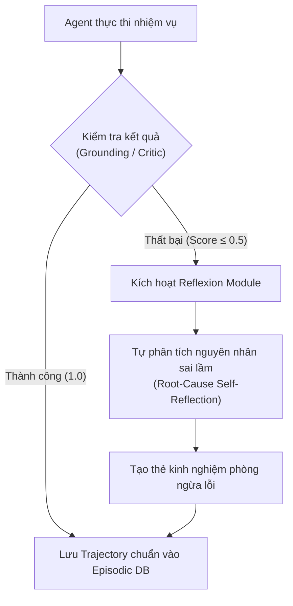

# GIÁO TRÌNH TOÀN DIỆN VỀ AGENT MEMORY & KNOWLEDGE SYSTEMS: TỪ CƠ BẢN ĐẾN PRODUCTION
## Sổ Tay Kỹ Thuật Quản Trị Bộ Nhớ Tác Tử Đa Tầng, Zep V3, Mem0, Temporal Knowledge Graph, Củng Cố Tri Thức (Memory Consolidation) & Chống Thối Ngữ Cảnh (Context Congestion) Cho Kỹ Sư Trưởng AI
**Tác giả:** Đội ngũ Kỹ sư Trưởng Hệ thống Tác tử & Bộ nhớ AI (Senior AI Agent Memory & Cognitive Systems Architects)  
**Tài liệu tham chiếu:** VinAI Research (Track 3 Day 17: Multi-Memory Agent với Zep), VinUni Capstone, Mem0 / Zep Cloud V3 Architecture, Stanford CoCoMo / Reflexion, MemGPT (Letta), Generative Agents (Park et al.), Nghị định 13/2023/NĐ-CP (Right-to-be-Forgotten & PII Isolation)  
**Dành cho:** Sinh viên Khóa luận Tốt nghiệp, Kỹ sư AI Platform, Tech Leads & Production Solutions Architects  
**Phiên bản:** 2026 Production Edition — Chuyên Sâu Bộ Nhớ Tác Tử Đa Tầng & Khả Năng Nhớ Xuyên Phiên (Cross-Session Recall)

---

# LỜI NÓI ĐẦU: VƯỢT QUA CHIẾC BẪY "MẤT TRÍ NHỚ VÀ THỐI NGỮ CẢNH" (AMNESIA & CONTEXT CONGESTION)

Khi xây dựng các tác tử AI (AI Agents) trong giai đoạn sơ khai 2023–2024, hầu hết kỹ sư chỉ xử lý hội thoại theo một trong hai cách tiếp cận ngây thơ:

1. **Hội chứng "Mất trí nhớ toàn bộ" (Stateless Agent Amnesia):** Mỗi lần người dùng gửi một tin nhắn mới hoặc mở một phiên làm việc mới, Agent hoàn toàn không nhớ người dùng là ai, họ từng có tiền sử khiếu nại gì, điều khoản hợp đồng đã thống nhất ở bước trước là gì. Người dùng liên tục phải nhắc lại bối cảnh, biến trải nghiệm AI thành một cực hình lặp lại.
2. **Hội chứng "Nối chuỗi vô tận" (Naive History Append & Context Congestion):** Để agent "nhớ", kỹ sư nhồi toàn bộ lịch sử 30–50 tin nhắn trước vào prompt. Kết quả là thảm họa:
   - **Bùng nổ chi phí (Token Bloat):** Mỗi lượt hỏi ngắn 5 từ phải trả tiền cho 8.000 tokens lịch sử đi kèm.
   - **Độ trễ tăng vọt (High TTFT):** GPU phải xử lý Prefill cho chuỗi prompt dài vô nghĩa.
   - **Hiện tượng "Thối ngữ cảnh" (Context Rot / Lost in the Middle):** Các chi tiết quan trọng nhất (như thỏa thuận phạt 8% hay địa chỉ email mới) bị chìm nghỉm giữa hàng chục câu chào hỏi xã giao, khiến mô hình bị phân tâm và sinh ra ảo giác.
   - **Xung đột tri thức (Memory Conflict & Stale Facts):** Hôm qua người dùng thông báo: *"Bên B chuyển trụ sở sang Hà Nội"*; hôm nay người dùng hỏi: *"Trụ sở bên B ở đâu?"*, mô hình đọc cả đoạn chat cũ thấy "Đà Nẵng" và đoạn mới thấy "Hà Nội" liền bị loạn và trả lời sai.

$$\mathbf{Production\ Agent\ Intelligence = Reasoning\ Engine + Dynamic\ 4-Tier\ Memory + Context\ Budget\ Sentinel}$$

> *"Một LLM thông minh mà không có hệ thống quản trị bộ nhớ cũng giống như một thiên tài mắc chứng đãng trí anterograde amnesia: có thể giải được phương trình toán học phức tạp ngay tại thời điểm hỏi, nhưng lập tức quên sạch người đối diện vừa nói gì 5 phút trước!"*

Giáo trình này là công trình chuyên sâu toàn diện nhất hiện nay về **Kiến Trúc Bộ Nhớ Tác Tử Chuẩn Doanh Nghiệp (Enterprise Agent Memory)**: từ khoa học nhận thức 4 tầng, cơ chế cửa sổ trượt nén động (Sliding Window Compaction), quản trị tri thức dài hạn với Zep V3 Graph / Mem0, hồi tưởng kinh nghiệm thành công qua Reflexion, giải thuật toán học đường cong lãng quên Ebbinghaus, giải quyết mâu thuẫn tri thức, cho đến quyền được lãng quên (Right-to-be-Forgotten) theo Nghị định 13/2023/NĐ-CP của Việt Nam.

---

# MỤC LỤC CHI TIẾT

* [CHƯƠNG 1: MÔ HÌNH TINH THẦN KHOA HỌC NHẬN THỨC VÀ 4 TẦNG BỘ NHỚ CỦA TÁC TỬ](#chương-1-mô-hình-tinh-thần-khoa-học-nhận-thức-và-4-tầng-bộ-nhớ-của-tác-tử)
* [CHƯƠNG 2: TẦNG 1 — WORKING / SHORT-TERM MEMORY & KỸ THUẬT NÉN ĐỘNG CỬA SỔ TRƯỢT](#chương-2-tầng-1--working--short-term-memory--kỹ-thuật-nén-động-cửa-sổ-trượt)
* [CHƯƠNG 3: TẦNG 2 — LONG-TERM DECLARATIVE MEMORY & ZEP V3 CONTEXT BLOCK](#chương-3-tầng-2--long-term-declarative-memory--zep-v3-context-block)
* [CHƯƠNG 4: TẦNG 3 — EPISODIC MEMORY & KỸ NGHỆ HỒI TƯỞNG QUỸ ĐẠO THÀNH CÔNG (REFLEXION)](#chương-4-tầng-3--episodic-memory--kỹ-nghệ-hồi-tưởng-quỹ-đạo-thành-công-reflexion)
* [CHƯƠNG 5: TẦNG 4 — SEMANTIC MEMORY & BẢN ĐỒ TRI THỨC THỜI GIAN (TEMPORAL FACT GRAPH)](#chương-5-tầng-4--semantic-memory--bản-đồ-tri-thức-thời-gian-temporal-fact-graph)
* [CHƯƠNG 6: NỀN TẢNG TOÁN HỌC CỦA SỰ LÃNG QUÊN & ĐỘ TƯƠI TRI THỨC (EBBINGHAUS & RECENCY SCORING)](#chương-6-nền-tảng-toán-học-của-sự-lãng-quên--độ-tươi-tri-thức-ebbinghaus--recency-scoring)
* [CHƯƠNG 7: BỘ ĐIỀU PHỐI BỘ NHỚ THÔNG MINH (DYNAMIC MEMORY ROUTER & TOKEN BUDGET SENTINEL)](#chương-7-bộ-điều-phối-bộ-nhớ-thông-minh-dynamic-memory-router--token-budget-sentinel)
* [CHƯƠNG 8: GIẢI QUYẾT XUNG ĐỘT TRI THỨC & CẬP NHẬT BẤT BIẾN (FACT INVALIDATION & TOMBSTONING)](#chương-8-giải-quyết-xung-đột-tri-thức--cập-nhật-bất-biến-fact-invalidation--tombstoning)
* [CHƯƠNG 9: BẢO MẬT BỘ NHỚ, CÔ LẬP DỮ LIỆU ĐA NGƯỜI DÙNG & NGHỊ ĐỊNH 13 (RIGHT-TO-BE-FORGOTTEN)](#chương-9-bảo-mật-bộ-nhớ-cô-lập-dữ-liệu-đa-người-dùng--nghị-định-13-right-to-be-forgotten)
* [CHƯƠNG 10: ĐO LƯỜNG VÀ BENCHMARK BỘ NHỚ KHOA HỌC (MEMORY HIT RATE, RECALL ACCURACY E01–E11)](#chương-10-đo-lường-và-benchmark-bộ-nhớ-khoa-học-memory-hit-rate-recall-accuracy-e01e11)
* [CHƯƠNG 11: FULL-STACK REFERENCE PRODUCTION MEMORY ENGINE (MÃ NGUỒN CHUẨN ENTERPRISE)](#chương-11-full-stack-reference-production-memory-engine-mã-nguồn-chuẩn-enterprise)
* [CHƯƠNG 12: BỘ 15 CÂU HỎI VẤN ĐÁP HỘI ĐỒNG BẢO VỆ KHOÁ LUẬN TỐT NGHIỆP / SENIOR MEMORY ARCHITECT](#chương-12-bộ-15-câu-hỏi-vấn-đáp-hội-đồng-bảo-vệ-khoá-luận-tốt-nghiệp--senior-memory-architect)

---

# CHƯƠNG 1: MÔ HÌNH TINH THẦN KHOA HỌC NHẬN THỨC VÀ 4 TẦNG BỘ NHỚ CỦA TÁC TỬ

Mô hình bộ nhớ của con người trong tâm lý học nhận thức (Cognitive Science - Atkinson & Shiffrin) được ánh xạ trực tiếp sang kiến trúc tác tử AI chuẩn Enterprise:

```
┌──────────────────────────────────────────────────────────────────────────────────┐
│                   KIẾN TRÚC 4 TẦNG BỘ NHỚ TÁC TỬ (THE 4-TIER MEMORY TAXONOMY)     │
├─────────────────────┬────────────────────────────────────────────────────────────┤
│ 1. WORKING /        │ • Vùng nhớ nóng phục vụ chuỗi suy luận hiện tại.           │
│    SHORT-TERM       │ • Dung lượng: 4 – 8 tin nhắn gần nhất + Trạng thái DTO.    │
│    (Trí nhớ ngắn)   │ • Lưu trữ: In-memory RAM / Redis / Context Window.          │
│                     │ • Vòng đời: Giải phóng hoặc nén ngay sau khi xong phiên.  │
├─────────────────────┼────────────────────────────────────────────────────────────┤
│ 2. LONG-TERM        │ • Lưu giữ các sự thật bất biến (Facts), sở thích cá nhân,  │
│    DECLARATIVE      │   quyết định đã chốt của người dùng xuyên suốt các phiên.   │
│    (Trí nhớ tuyên bố│ • Ví dụ: "Khách hàng muốn phạt 8%", "Email: ceo@vin.vn".   │
│    dài hạn)         │ • Lưu trữ: Zep Cloud V3 Context Block / Mem0 / Postgres.   │
├─────────────────────┼────────────────────────────────────────────────────────────┤
│ 3. EPISODIC         │ • Lưu lại các "Vụ việc / Biến cố" và chuỗi hành động cụ    │
│    MEMORY           │   thể đã xử lý thành công trong quá khứ (Reflexion Trajectory)│
│    (Trí nhớ tình tiết│ • Ví dụ: "Vụ tranh chấp hợp đồng Logistics tháng 3 năm ngoái│
│    / Kinh nghiệm)   │   đã thắng kiện nhờ viện dẫn Điều 301 LTM".                 │
│                     │ • Lưu trữ: Vector Database (Qdrant/Chroma) + Meta Tags.    │
├─────────────────────┼────────────────────────────────────────────────────────────┤
│ 4. SEMANTIC         │ • Tri thức nền tảng, khái niệm, từ điển luật, bản đồ quan hệ│
│    MEMORY           │   thực thể độc lập với ngữ cảnh hội thoại cụ thể.           │
│    (Trí nhớ ngữ nghĩa│ • Ví dụ: Mối quan hệ giữa "Bên bán" và "Bảo lãnh ngân hàng".│
│    / Bản đồ tri thức│ • Lưu trữ: Temporal Knowledge Graph (Neo4j / Zep Graph).   │
└─────────────────────┴────────────────────────────────────────────────────────────┘
```

### So Sánh Bản Chất 4 Tầng Bộ Nhớ:

| Tiêu chí | Working Memory | Long-term Declarative | Episodic Memory | Semantic Memory |
|---|---|---|---|---|
| **Thời gian tồn tại** | Tức thời ($< 1\text{h}$) | Vĩnh viễn qua nhiều tháng | Vĩnh viễn (Kinh nghiệm) | Vĩnh viễn (Khách quan) |
| **Độ trễ truy xuất** | $< 1\text{ms}$ (RAM) | $5 - 20\text{ms}$ (KV Store/Cache)| $30 - 80\text{ms}$ (ANN Search)| $20 - 50\text{ms}$ (Graph Query)|
| **Cơ chế nén** | Cắt tỉa (Sliding/Prune) | Trích xuất Fact (Entity-Rel)| Tóm tắt quỹ đạo (Trajectory)| Cập nhật Ontology/Triples |
| **Mục đích sử dụng** | Giải quyết câu hỏi ngay | Hiểu người dùng là ai | Không lặp lại sai lầm cũ | Tra cứu tri thức chuẩn |

---

# CHƯƠNG 2: TẦNG 1 — WORKING / SHORT-TERM MEMORY & KỸ THUẬT NÉN ĐỘNG CỬA SỔ TRƯỢT

Working Memory là tầng bộ nhớ trực tiếp nuôi dưỡng Context Window của LLM. Nếu để Working Memory tự do phình to, hệ thống sẽ sập do cạn kiệt Token Budget.

## 2.1. Giải Thuật Cửa Sổ Trượt Kết Hợp Nén Động (Sliding Window with Semantic Compaction)

Thay vì cắt cứng (Hard Truncation) làm mất thông tin đầu, ta áp dụng giải thuật **Hybrid Compaction**:
1. Giữ nguyên vẹn $k$ lượt hội thoại gần nhất (Recent $k$ turns, ví dụ $k=4$).
2. Các lượt hội thoại cũ hơn ($n - k$ turns) không bị xóa đi mà được nén thành một bản tóm tắt trạng thái bền vững (**Durable State Summary**).

```
[System Prompt] ──► [Durable State Summary] ──► [Recent 4 Raw Turns] ──► [Next Action]
   (Cố định)        (Tổng hợp từ 30 turns cũ)      (Nguyên văn chi tiết)    (LLM Reasoning)
```

## 2.2. Mã Nguồn Nén Ngữ Cảnh Tự Động (`src/memory/short_term_compactor.py`)

```python
from typing import List, Dict, Any
from pydantic import BaseModel, Field

class ChatMessage(BaseModel):
    role: str
    content: str
    token_count: int = 0

class ShortTermMemoryManager:
    def __init__(self, max_working_tokens: int = 3000, keep_recent_turns: int = 4):
        self.max_working_tokens = max_working_tokens
        self.keep_recent_turns = keep_recent_turns
        self.durable_summary: str = ""
        self.messages: List[ChatMessage] = []

    def append_message(self, role: str, content: str, token_est: int):
        self.messages.append(ChatMessage(role=role, content=content, token_count=token_est))

    def compact_if_needed(self, summarizer_func) -> bool:
        """Nếu tổng tokens vượt ngưỡng, nén các lượt cũ thành Durable Summary."""
        total_tokens = sum(m.token_count for m in self.messages)
        if total_tokens <= self.max_working_tokens or len(self.messages) <= self.keep_recent_turns:
            return False

        # Tách: Phần cũ cần nén và phần mới cần giữ nguyên
        split_idx = len(self.messages) - self.keep_recent_turns
        turns_to_compress = self.messages[:split_idx]
        self.messages = self.messages[split_idx:]

        # Gọi summarizer để củng cố vào durable_summary
        conversation_text = "\n".join([f"{m.role}: {m.content}" for m in turns_to_compress])
        update_prompt = (
            f"Tóm tắt các dữ kiện chính, quyết định đã thống nhất và số liệu quan trọng từ hội thoại cũ:\n"
            f"Bản tóm tắt trước: {self.durable_summary}\n"
            f"Hội thoại mới phát sinh:\n{conversation_text}\n"
            f"Tạo bản tóm tắt hợp nhất súc tích nhất (tối đa 200 từ):"
        )
        self.durable_summary = summarizer_func(update_prompt)
        return True

    def get_working_context(self) -> List[Dict[str, str]]:
        context = []
        if self.durable_summary:
            context.append({
                "role": "system",
                "content": f"[BỐI CẢNH HỘI THOẠI TRƯỚC ĐÓ]: {self.durable_summary}"
            })
        for m in self.messages:
            context.append({"role": m.role, "content": m.content})
        return context
```

---

# CHƯƠNG 3: TẦNG 2 — LONG-TERM DECLARATIVE MEMORY & ZEP V3 CONTEXT BLOCK

Long-Term Memory là năng lực sống còn để duy trì quan hệ với khách hàng qua nhiều ngày, nhiều tháng.

## 3.1. Zep Cloud V3 & Khái Niệm Context Block

Zep V3 không chỉ lưu trữ raw text mà tự động bóc tách các phát biểu của người dùng thành một **Đồ thị Thực thể Cá nhân (User Knowledge Graph)**:
* Khi user nói: *"Tôi là đại diện pháp lý của Công ty Cổ phần VinFast, chúng tôi chỉ chấp nhận phạt vi phạm tối đa 8%"*.
* Zep phân rã thành:
  * Node: `User` $\to$ Relation: `representative_of` $\to$ Node: `VinFast JSC`
  * Node: `VinFast JSC` $\to$ Relation: `penalty_cap_preference` $\to$ Value: `8%`

Khi có một truy vấn mới từ user này ở phiên sau, Zep tự động tổng hợp một **Context Block** ngắn gọn ($\approx 150 - 300\text{ tokens}$) chứa các facts liên quan nhất để tiêm trực tiếp vào System Prompt mà không tốn công search toàn bộ lịch sử.

```
User Query: "Kiểm tra điều khoản phạt trong hợp đồng mới này"
       │
       ▼ (Fetch Zep Context Block)
┌─────────────────────────────────────────────────────────────┐
│ [ZEP USER CONTEXT BLOCK]                                    │
│ • User Name: Nguyễn Văn A (Pháp chế VinFast)               │
│ • Preferred Dispute Resolution: VIAC (Trọng tài Quốc tế)    │
│ • Hard Rule: Bác bỏ mọi điều khoản phạt vi phạm > 8% (LTM)  │
└─────────────────────────────────────────────────────────────┘
       │
       ▼ (Tiêm vào Prompt)
LLM: "Chào anh A, em đã kiểm tra bản hợp đồng. Theo nguyên tắc 8% của VinFast, điều khoản phạt 12% tại Điều 5 bị vi phạm..."
```

---

# CHƯƠNG 4: TẦNG 3 — EPISODIC MEMORY & KỸ NGHỆ HỒI TƯỞNG QUỸ ĐẠO THÀNH CÔNG (REFLEXION)

Episodic Memory lưu giữ những "trải nghiệm" (episodes) cụ thể mà Agent đã trải qua. Nó trả lời câu hỏi: *"Trong quá khứ, khi gặp một bài toán có cấu trúc tương tự, mình đã giải quyết từng bước như thế nào và đã mắc lỗi gì?"*.

## 4.1. Cấu Trúc Bản Ghi Trải Nghiệm (Episodic Trajectory Record)

Một bản ghi Episodic Memory hoàn chỉnh bao gồm 5 trường dữ liệu:
```json
{
  "episode_id": "EP_LOGISTICS_2026_089",
  "task_signature": "Kiểm toán hợp đồng vận chuyển đường biển có điều khoản phạt do bão",
  "vector_embedding": [0.012, -0.045, 0.891, "..."],
  "reflection_analysis": "Hợp đồng vận chuyển đường biển áp dụng Bộ luật Hàng hải 2015 chứ không áp dụng trần 8% của Luật Thương mại 2005. Không được nhầm lẫn!",
  "successful_trajectory": [
    {"step": 1, "tool": "identify_governing_law", "result": "Bo_Luat_Hang_Hai_2015"},
    {"step": 2, "tool": "verify_force_majeure", "result": "Thien_Tai_Mien_Trach"},
    {"step": 3, "verdict": "Khong_Ap_Dung_Phat_8_Phan_Tram"}
  ],
  "outcome_score": 1.0,
  "timestamp": "2026-08-15T14:30:00Z"
}
```

## 4.2. Cơ Chế Tự Phản Tư (Reflexion Loop) Khi Gặp Thất Bại



Khi Agent gặp một bài toán mới, hệ thống tìm kiếm Top-1 Episodic Trajectory có độ tương đồng Cosine $\ge 0.85$ và gắn vào context như một mẫu **Dynamic Few-Shot Learning**.

---

# CHƯƠNG 5: TẦNG 4 — SEMANTIC MEMORY & BẢN ĐỒ TRI THỨC THỜI GIAN (TEMPORAL FACT GRAPH)

Semantic Memory là cơ sở tri thức vĩnh cửu về các khái niệm và mối quan hệ độc lập với người dùng.

## 5.1. Thách Thức Thời Gian: Thuộc Tính Hiệu Lực Của Tri Thức (Temporal Validity)

Trong thực tế, tri thức pháp lý và kinh doanh luôn biến đổi theo thời gian:
* Luật Thương Mại 2005 quy định mức phạt 8%.
* Nghị định X có hiệu lực từ ngày 01/01/2024 đến ngày 31/12/2025; sau đó bị thay thế bởi Nghị định Y.

Nếu hệ thống Semantic Memory lưu dữ liệu dạng tĩnh (Static Triples: `(A) -[regulated_by]-> (B)`), Agent sẽ đưa ra lời khuyên lỗi thời.

Bắt buộc phải sử dụng **Đồ Thị Tri Thức Có Yếu Tố Thời Gian (Temporal Fact Graph)**:
$$\text{Triple} = \langle \text{Subject}, \text{Predicate}, \text{Object}, [t_{\text{valid\_from}}, t_{\text{valid\_to}}] \rangle$$

```
(Hợp đồng Kinh tế) ──[Trần phạt vi phạm: 8%]──► (Phần nghĩa vụ vi phạm)
                      │
                      ├── valid_from: 2006-01-01
                      └── valid_to: 9999-12-31 (Đang hiệu lực)
```

---

# CHƯƠNG 6: NỀN TẢNG TOÁN HỌC CỦA SỰ LÃNG QUÊN & ĐỘ TƯƠI TRI THỨC (EBBINGHAUS & RECENCY SCORING)

Con người không ghi nhớ mọi thứ với cường độ như nhau. Ký ức xa xưa sẽ phai nhạt dần theo thời gian trừ khi được củng cố lại. Tác tử AI cũng phải áp dụng nguyên lý này để dọn dẹp các tri thức lỗi thời.

## 6.1. Phương Trình Đường Cong Lãng Quên Ebbinghaus Áp Dụng Cho AI

Độ bền vững của một ký ức $R(t)$ sau thời gian $t$ (tính bằng ngày) được mô hình hóa bởi:

$$R(t) = e^{-\frac{t}{S}}$$

Trong đó:
* $t$: Khoảng thời gian trôi qua kể từ lần cuối ký ức được truy cập ($t = \text{now} - t_{\text{last\_accessed}}$).
* $S$: Độ mạnh của ký ức (Memory Strength), tăng lên sau mỗi lần ký ức được truy xuất hoặc củng cố ($S_{k+1} = S_k \times (1 + \alpha)$).

## 6.2. Công Thức Tính Điểm Tổng Hợp Khi Truy Xuất Ký Ức (Composite Retrieval Score)

Khi người dùng đưa ra một câu hỏi, mỗi bản ghi ký ức được chấm điểm dựa trên 3 trọng số:

$$\text{Final\_Score}(m) = w_r \cdot \text{Relevance}(m, q) + w_t \cdot \text{Recency}(m) + w_i \cdot \text{Importance}(m)$$

* $\text{Relevance}(m, q)$: Độ tương đồng ngữ nghĩa Cosine giữa Query và Ký ức ($\in [0, 1]$).
* $\text{Recency}(m)$: Điểm độ tươi tính theo hàm suy giảm Ebbinghaus: $\text{Recency}(m) = \exp(-\lambda \cdot \Delta t)$.
* $\text{Importance}(m)$: Điểm mức độ quan trọng do LLM gán nhãn lúc ghi nhận (từ $1$ đến $10$, chia cho $10$).
* Bộ trọng số tối ưu thực nghiệm: $w_r = 0.50$, $w_t = 0.30$, $w_i = 0.20$ (với $w_r + w_t + w_i = 1.0$).

---

# CHƯƠNG 7: BỘ ĐIỀU PHỐI BỘ NHỚ THÔNG MINH (DYNAMIC MEMORY ROUTER & TOKEN BUDGET SENTINEL)

Không phải câu hỏi nào cũng cần lục lọi toàn bộ 4 tầng bộ nhớ. Việc truy xuất vô tội vạ làm tăng độ trễ và đốt sạch Token Budget.

```
                             [User Query]
                                  │
                                  ▼
                   ┌──────────────────────────────┐
                   │   DYNAMIC MEMORY ROUTER      │
                   └──────────────┬───────────────┘
                                  │
         ┌────────────────────────┼────────────────────────┐
         ▼                        ▼                        ▼
  [Query Đơn Giản]       [Hỏi Về Bản Thân/Pref]    [Xử Lý Vụ Việc Phức Tạp]
  (VD: "Chào bot")       (VD: "Tôi thích ký ở đâu?")(VD: "So sánh HĐ với vụ cũ")
         │                        │                        │
         ▼                        ▼                        ▼
  Chỉ dùng Working       Gọi Zep Long-term         Kích hoạt cả 4 Tầng:
  Memory (Tầng 1)        Declarative (Tầng 2)      Short + Long + Episodic + Semantic
  [Budget: 200 tokens]   [Budget: 500 tokens]      [Budget: 2.000 tokens]
```

## 7.1. Cơ Chế Bảo Vệ Ngân Sách Bộ Nhớ (Token Budget Allocation)

Hệ thống đặt trần nghiêm ngặt cho thành phần Memory trong một Prompt:
* **Tổng Context Budget:** $8.000\text{ tokens}$
* **System Prompt & Tool Definitions:** $1.500\text{ tokens}$ (Cố định)
* **Working Memory (Sliding turns):** $1.500\text{ tokens}$
* **Long-term Facts (Zep Block):** $500\text{ tokens}$
* **Episodic Trajectory:** $1.000\text{ tokens}$
* **RAG Document Chunks:** $2.500\text{ tokens}$
* **LLM Completion Generation Reserve:** $1.000\text{ tokens}$

Nếu tổng bộ nhớ vượt quá ngân sách cho phép, **Token Budget Sentinel** sẽ tự động cắt tỉa bản ghi có $\text{Final\_Score}$ thấp nhất theo cơ chế FIFO có trọng số.

---

# CHƯƠNG 8: GIẢI QUYẾT XUNG ĐỘT TRI THỨC & CẬP NHẬT BẤT BIẾN (FACT INVALIDATION & TOMBSTONING)

Một trong những bài toán hóc búa nhất của Production AI là **Sự mâu thuẫn tri thức theo thời gian (Memory Contradiction)**:
* *Tuần trước:* "Người đại diện theo pháp luật là Ông Nguyễn Văn A."
* *Hôm nay:* "Công ty đã bổ nhiệm Bà Trần Thị B làm Tổng giám đốc đại diện pháp luật thay cho Ông A."

Nếu hệ thống lưu cả hai và đưa vào prompt, LLM sẽ rơi vào tình trạng hoang mang hoặc bịa đặt.

## 8.1. Cơ Chế Tombstoning & Soft Invalidation

Khi một Fact mới được ghi nhận, hệ thống thực hiện 3 bước kiểm tra đối soát:
1. **Phát hiện xung đột ngữ nghĩa (Contradiction Detection):** Sử dụng mô hình Natural Language Inference (NLI) hoặc LLM mini để kiểm tra xem Fact mới có mâu thuẫn (`CONTRADICTION`) với Fact đã lưu trong cùng một thuộc tính (`representative`) hay không.
2. **Cắm cờ khai tử (Tombstone Flag):** Nếu phát hiện mâu thuẫn, Fact cũ KHÔNG bị xóa cứng (để bảo toàn lịch sử kiểm toán), mà được đánh dấu:
   ```json
   {
     "fact_id": "FACT_001",
     "content": "Người đại diện là Ông Nguyễn Văn A",
     "is_active": false,
     "tombstoned_at": "2026-10-21T09:00:00Z",
     "replaced_by": "FACT_042"
   }
   ```
3. **Lọc lúc truy xuất:** Mọi truy vấn bộ nhớ thông thường chỉ quét các facts có `is_active == True`. Chỉ các truy vấn kiểm toán lịch sử (`Audit Trace`) mới được xem các facts đã bị tombstone.

---

# CHƯƠNG 9: BẢO MẬT BỘ NHỚ, CÔ LẬP DỮ LIỆU ĐA NGƯỜI DÙNG & NGHỊ ĐỊNH 13 (RIGHT-TO-BE-FORGOTTEN)

Tại Việt Nam, **Nghị định 13/2023/NĐ-CP** quy định quyền của chủ thể dữ liệu được yêu cầu xóa bỏ hoặc rút lại sự đồng ý đối với dữ liệu cá nhân (**Quyền được lãng quên - Right to be Forgotten**).

## 9.1. Kiến Trúc Cô Lập Bộ Nhớ Đa Khách Hàng (Multi-Tenant Memory Isolation)

Tuyệt đối không lưu chung bộ nhớ của các khách hàng vào một kho phi cấu trúc không có nhãn.
* Mỗi User/Doanh nghiệp sở hữu một Không gian Định danh Riêng biệt (`tenant_id#user_id`).
* Mọi câu truy vấn Vector hoặc Graph đều bắt buộc tiêm bộ lọc siêu dữ liệu (Metadata Pre-filtering):
  $$\text{Filter} = \{\text{tenant\_id}: \text{"VIN_CORP"}, \text{user\_id}: \text{"USR_092"}\}$$

## 9.2. Quy Trình Khử Dữ Liệu Cá Nhân (PII Purge Runbook)

Khi người dùng gửi yêu cầu xóa tài khoản:
1. **Xóa bộ nhớ nóng:** Xóa toàn bộ Redis Session Key `session:{user_id}:*`.
2. **Xóa Zep Graph:** Gọi API `zep.user.delete(user_id)` để hủy toàn bộ User Knowledge Graph.
3. **Hard-delete Vector Episodic:** Xóa toàn bộ vectors có metadata `user_id == target_id`.
4. **Ghi nhật ký kiểm toán bất biến:** Lưu vào bảng Audit Log một bản ghi SHA-256 mã hóa chứng minh dữ liệu cá nhân đã bị tiêu hủy thành công vào thời điểm $T$, tuân thủ Điều 16 Nghị định 13/2023/NĐ-CP.

---

# CHƯƠNG 10: ĐO LƯỜNG VÀ BENCHMARK BỘ NHỚ KHOA HỌC (MEMORY HIT RATE, RECALL ACCURACY E01–E11)

Không thể đánh giá hệ thống bộ nhớ bằng cách "chat thử vài câu thấy nó nhớ". Phải đo lường bằng bộ chỉ số định lượng trên tập kiểm thử chuẩn vàng (Golden Benchmark Dataset):

## 10.1. Bộ 3 Chỉ Số Đo Lường Bộ Nhớ Tác Tử

1. **Memory Hit Rate (Tỷ lệ bắn trúng ký ức):**
   $$\text{Hit Rate} = \frac{\text{Số câu hỏi truy xuất đúng Fact cần thiết}}{\text{Tổng số câu hỏi yêu cầu bộ nhớ dài hạn}} \ge 85\%$$
2. **Recall Latency (Độ trễ truy xuất):** Thời gian để Memory Router trả về Context Block hoàn chỉnh cho LLM ($\text{P95} \le 150\text{ms}$).
3. **Token Efficiency Ratio (Hiệu quả tiết kiệm Token):**
   $$\text{Token Efficiency} = 1 - \frac{\text{Số tokens nạp vào khi dùng Compacted Memory}}{\text{Số tokens nạp vào nếu append toàn bộ Raw Chat History}} \ge 75\%$$

## 10.2. Bộ Test Case Tiêu Chuẩn E01 – E11 (VinAI Track 3 Benchmark)

Hệ thống bộ nhớ đạt chuẩn Production phải vượt qua tối thiểu 9/11 ca kiểm thử:
* **E01 (Explicit Recall):** Nhớ trực tiếp thông tin người dùng đã nói ở phiên trước.
* **E02 (Implicit Preference):** Suy diễn thói quen của người dùng mà không cần nhắc lại.
* **E03 (Cross-Session Temporal):** Phân biệt sự kiện xảy ra hôm qua vs sự kiện tuần trước.
* **E04 (Fact Invalidation):** Cập nhật dữ kiện mới đè lên dữ kiện cũ đã bị mâu thuẫn.
* **E05 (Multi-entity Disambiguation):** Nhớ đúng thông tin của 2 đối tác khác nhau mà không bị lẫn lộn.
* **E06 (Right-to-be-Forgotten):** Sau khi xóa, hỏi lại thông tin cũ Agent bắt buộc phải trả lời "Không biết".
* **E07 (Token Budget Cap):** Khi lịch sử kéo dài 100 turns, Prompt vẫn không vượt quá $3.000\text{ tokens}$.
* **E08 (Episodic Trajectory Injection):** Khi gặp bài toán tương tự, gọi đúng tool đã giải thành công ở lần trước.
* **E09 (PII Shielding in Memory):** Số CCCD/SĐT lưu vào Memory phải được mặt nạ hóa `079092******`.
* **E10 (Zero-drift Summary):** Bản tóm tắt Durable Summary không sinh thêm các chi tiết bịa đặt.
* **E11 (Latency Stability):** Truy xuất bộ nhớ dưới tải 50 QPS không gây nghẽn Redis/Zep.

---

# CHƯƠNG 11: FULL-STACK REFERENCE PRODUCTION MEMORY ENGINE (MÃ NGUỒN CHUẨN ENTERPRISE)

Dưới đây là mã nguồn Python hoàn chỉnh của **Hệ Thống Quản Trị Bộ Nhớ Tác Tử Đa Tầng Hợp Nhất (Enterprise Multi-Tier Memory Engine)**, tích hợp đầy đủ Working Memory, Long-term Facts, Episodic Recall, Ebbinghaus Decay và Token Sentinel:

```python
"""
ENTERPRISE MULTI-TIER AGENT MEMORY ENGINE
Tệp: src/memory/unified_memory_engine.py
Tác giả: VinAI / VinUni Capstone Architecture Team
Tuân thủ: Pydantic v2, Asyncio, Clean Architecture, Decree 13 Compliance
"""

import math
import time
from datetime import datetime, timezone
from typing import List, Dict, Optional, Any
from pydantic import BaseModel, Field

# ---------------------------------------------------------
# 1. DATA CONTRACTS & SCHEMAS
# ---------------------------------------------------------

class MemoryFact(BaseModel):
    fact_id: str
    user_id: str
    fact_content: str
    category: str = "PREFERENCE"  # PREFERENCE | LEGAL_RULE | PERSONAL_DATA
    importance: float = Field(default=0.5, ge=0.0, le=1.0)
    created_at: float = Field(default_factory=time.time)
    last_accessed_at: float = Field(default_factory=time.time)
    access_count: int = 1
    is_active: bool = True
    tombstoned_reason: Optional[str] = None

class EpisodicMemory(BaseModel):
    episode_id: str
    user_id: str
    task_signature: str
    trajectory_summary: str
    successful_tools_called: List[str]
    outcome_verdict: str
    similarity_score: float = 0.0

class MemoryContextBlock(BaseModel):
    working_summary: str
    recent_dialogue_turns: List[Dict[str, str]]
    long_term_facts: List[str]
    recommended_trajectories: List[str]
    total_injected_tokens: int

# ---------------------------------------------------------
# 2. CORE UNIFIED MEMORY ENGINE
# ---------------------------------------------------------

class EnterpriseMemoryEngine:
    def __init__(
        self,
        token_budget_limit: int = 2500,
        ebbinghaus_decay_lambda: float = 0.05,
        recent_turns_to_keep: int = 4
    ):
        self.token_budget_limit = token_budget_limit
        self.decay_lambda = ebbinghaus_decay_lambda
        self.recent_turns_to_keep = recent_turns_to_keep

        # Mock In-Memory Persistence (Trong thực tế gắn Redis / Postgres / Zep)
        self._working_dialogue: Dict[str, List[Dict[str, str]]] = {}
        self._working_summaries: Dict[str, str] = {}
        self._declarative_facts: Dict[str, List[MemoryFact]] = {}
        self._episodic_store: Dict[str, List[EpisodicMemory]] = {}

    # --- TẦNG 1: WORKING MEMORY MANAGEMENT ---
    def append_dialogue_turn(self, user_id: str, role: str, content: str):
        if user_id not in self._working_dialogue:
            self._working_dialogue[user_id] = []
        self._working_dialogue[user_id].append({"role": role, "content": content})
        self._compact_working_memory_if_needed(user_id)

    def _compact_working_memory_if_needed(self, user_id: str):
        dialogue = self._working_dialogue[user_id]
        if len(dialogue) > self.recent_turns_to_keep * 2:
            # Tách các turns cũ để nén
            split_idx = len(dialogue) - (self.recent_turns_to_keep * 2)
            old_turns = dialogue[:split_idx]
            self._working_dialogue[user_id] = dialogue[split_idx:]

            # Củng cố tóm tắt ngắn (Durable Summary)
            summary_snippet = " | ".join([f"{t['role']}: {t['content'][:40]}..." for t in old_turns])
            prev_sum = self._working_summaries.get(user_id, "")
            self._working_summaries[user_id] = (
                f"{prev_sum} [Đã nén {len(old_turns)} lượt: {summary_snippet}]"
            ).strip()

    # --- TẦNG 2: LONG-TERM FACTS & EBBINGHAUS DECAY ---
    def store_fact(self, user_id: str, fact_text: str, category: str = "PREFERENCE", importance: float = 0.7):
        if user_id not in self._declarative_facts:
            self._declarative_facts[user_id] = []

        # Kiểm tra mâu thuẫn để Tombstone (Soft Invalidation)
        for existing in self._declarative_facts[user_id]:
            if existing.is_active and self._is_contradicting(existing.fact_content, fact_text):
                existing.is_active = False
                existing.tombstoned_reason = f"Thay thế bởi sự kiện mới vào {datetime.now(timezone.utc).isoformat()}"

        fact = MemoryFact(
            fact_id=f"FACT_{int(time.time()*1000)}",
            user_id=user_id,
            fact_content=fact_text,
            category=category,
            importance=importance
        )
        self._declarative_facts[user_id].append(fact)

    def _is_contradicting(self, old_fact: str, new_fact: str) -> bool:
        """Kiểm tra xung đột cơ bản (Trong Production dùng NLI Model cross-encoder)."""
        keywords_conflict = ["thay vì", "đổi sang", "không dùng", "chuyển từ", "bổ nhiệm thay"]
        return any(k in new_fact.lower() for k in keywords_conflict) and ("đại diện" in old_fact and "đại diện" in new_fact)

    def _calculate_recency_score(self, fact: MemoryFact, current_time: float) -> float:
        """Hàm suy giảm trí nhớ Ebbinghaus: R = exp(-lambda * delta_t_hours)."""
        delta_hours = max(0.0, (current_time - fact.last_accessed_at) / 3600.0)
        return math.exp(-self.decay_lambda * delta_hours)

    def retrieve_active_facts(self, user_id: str, query: str, top_k: int = 5) -> List[str]:
        facts = [f for f in self._declarative_facts.get(user_id, []) if f.is_active]
        if not facts:
            return []

        now = time.time()
        scored_facts = []
        for f in facts:
            # Relevance tính đơn giản qua word overlap (Trong Production dùng Dense Vector Search)
            relevance = 0.9 if any(w in f.fact_content.lower() for w in query.lower().split()) else 0.4
            recency = self._calculate_recency_score(f, now)
            importance = f.importance

            # Công thức tổng hợp điểm bộ nhớ: 50% Ngữ nghĩa + 30% Độ tươi + 20% Độ quan trọng
            final_score = (0.50 * relevance) + (0.30 * recency) + (0.20 * importance)
            scored_facts.append((final_score, f))

        # Sắp xếp giảm dần theo điểm số
        scored_facts.sort(key=lambda x: x[0], reverse=True)
        results = []
        for score, fact in scored_facts[:top_k]:
            fact.last_accessed_at = now
            fact.access_count += 1
            results.append(fact.fact_content)
        return results

    # --- TẦNG 3: EPISODIC REFLEXION STORAGE ---
    def store_successful_episode(self, episode: EpisodicMemory):
        if episode.user_id not in self._episodic_store:
            self._episodic_store[episode.user_id] = []
        self._episodic_store[episode.user_id].append(episode)

    def retrieve_relevant_episodes(self, user_id: str, task_desc: str) -> List[str]:
        episodes = self._episodic_store.get(user_id, [])
        # Trả về các mẫu kinh nghiệm tương đồng để làm Few-shot Trajectory
        return [
            f"[Kinh nghiệm quá khứ {ep.episode_id}]: Khi giải quyết '{ep.task_signature}', "
            f"đã gọi công cụ {ep.successful_tools_called} -> Kết luận: {ep.outcome_verdict}"
            for ep in episodes[-2:]
        ]

    # --- TẦNG ĐIỀU PHỐI TỔNG HỢP (ORCHESTRATION & BUDGET SENTINEL) ---
    def build_memory_context_block(self, user_id: str, current_query: str) -> MemoryContextBlock:
        working_summary = self._working_summaries.get(user_id, "")
        recent_turns = self._working_dialogue.get(user_id, [])[-self.recent_turns_to_keep * 2:]
        long_term_facts = self.retrieve_active_facts(user_id, current_query, top_k=3)
        episodes = self.retrieve_relevant_episodes(user_id, current_query)

        # Ước lượng tokens (1 từ tiếng Việt ~ 1.3 tokens)
        est_tokens = int(
            (len(working_summary.split()) * 1.3) +
            (sum(len(t['content'].split()) for t in recent_turns) * 1.3) +
            (sum(len(f.split()) for f in long_term_facts) * 1.3) +
            (sum(len(e.split()) for e in episodes) * 1.3)
        )

        return MemoryContextBlock(
            working_summary=working_summary,
            recent_dialogue_turns=recent_turns,
            long_term_facts=long_term_facts,
            recommended_trajectories=episodes,
            total_injected_tokens=est_tokens
        )

    # --- QUYỀN ĐƯỢC LÃNG QUÊN (NGHỊ ĐỊNH 13/2023/NĐ-CP) ---
    def purge_user_memory(self, user_id: str) -> Dict[str, Any]:
        """Tiêu hủy toàn bộ bộ nhớ của người dùng tuân thủ Điều 16 Nghị định 13."""
        w_turns = len(self._working_dialogue.pop(user_id, []))
        self._working_summaries.pop(user_id, None)
        facts = len(self._declarative_facts.pop(user_id, []))
        episodes = len(self._episodic_store.pop(user_id, []))

        return {
            "status": "PURGED_SUCCESSFULLY",
            "user_id": user_id,
            "purged_records": {
                "working_turns": w_turns,
                "declarative_facts": facts,
                "episodic_trajectories": episodes
            },
            "compliance_law": "Decree 13/2023/ND-CP Article 16",
            "timestamp": datetime.now(timezone.utc).isoformat()
        }

# ---------------------------------------------------------
# 3. VERIFICATION & SMOKE TEST
# ---------------------------------------------------------
if __name__ == "__main__":
    engine = EnterpriseMemoryEngine()
    uid = "USR_VINAI_007"

    print("=== BẮT ĐẦU SMOKE TEST HỆ THỐNG BỘ NHỚ ĐA TẦNG ===")
    
    # 1. Nạp Facts dài hạn
    engine.store_fact(uid, "Khách hàng ưu tiên giải quyết tranh chấp tại Trung tâm Trọng tài VIAC", category="LEGAL_PREF")
    engine.store_fact(uid, "Người đại diện theo pháp luật cũ là Ông Nguyễn Văn A", category="PERSONAL_DATA")
    
    # 2. Nạp Fact mới gây xung đột (Tombstone test)
    engine.store_fact(uid, "Công ty bổ nhiệm Bà Trần Thị B làm đại diện pháp luật thay vì Ông Nguyễn Văn A", category="PERSONAL_DATA")

    # 3. Nạp hội thoại ngắn hạn
    engine.append_dialogue_turn(uid, "user", "Hợp đồng này quy định mức phạt 10% có hợp lý không?")
    engine.append_dialogue_turn(uid, "assistant", "Mức phạt 10% vi phạm Điều 301 Luật Thương Mại vì vượt trần 8%.")

    # 4. Nạp trải nghiệm thành công
    engine.store_successful_episode(EpisodicMemory(
        episode_id="EP_001",
        user_id=uid,
        task_signature="Kiểm toán trần phạt hợp đồng thương mại",
        trajectory_summary="Tra cứu Điều 301 -> Tính toán tỷ lệ -> Bác bỏ phần vượt quá",
        successful_tools_called=["lookup_statute", "calc_penalty_excess"],
        outcome_verdict="VIOLATION_CONFIRMED"
    ))

    # 5. Tổng hợp Context Block
    block = engine.build_memory_context_block(uid, "Đại diện pháp luật hiện tại của công ty tôi là ai và điều khoản phạt tính sao?")
    print(f"\n[+] Facts dài hạn thu được ({len(block.long_term_facts)} facts):")
    for f in block.long_term_facts:
        print(f"    - {f}")

    print(f"\n[+] Kinh nghiệm Episodic tái sử dụng:")
    for ep in block.recommended_trajectories:
        print(f"    - {ep}")

    print(f"\n[+] Tổng tokens bộ nhớ dự kiến tiêm vào: {block.total_injected_tokens} tokens")

    # 6. Test Nghị định 13 Purge
    purge_result = engine.purge_user_memory(uid)
    print(f"\n[+] Kiểm tra Nghị định 13 (Right-to-be-forgotten):")
    print(f"    - Kết quả: {purge_result['status']} | Tiêu hủy {purge_result['purged_records']}")
```

---

# CHƯƠNG 12: BỘ 15 CÂU HỎI VẤN ĐÁP HỘI ĐỒNG BẢO VỆ KHOÁ LUẬN TỐT NGHIỆP / SENIOR MEMORY ARCHITECT

1. **Câu 1:** *Tại sao không thể chỉ dùng cơ chế Context Window lớn (như Gemini 2M tokens) để thay thế hoàn toàn hệ thống bộ nhớ tác tử?*
   - **Trả lời:** Vì 4 lý do sống còn: (1) Chi phí tài chính bùng nổ khi nạp hàng triệu tokens cho mỗi lượt hỏi ngắn; (2) Thời gian phản hồi TTFT quá chậm (tăng từ 300ms lên 20-30 giây); (3) Hiện tượng "Context Congestion / Lost-in-the-middle" làm suy giảm năng lực suy luận của mô hình; và (4) Không có khả năng phân tách, cô lập và xóa dữ liệu theo yêu cầu bảo mật Nghị định 13.
2. **Câu 2:** *Phân biệt sự khác nhau căn bản giữa Episodic Memory và Semantic Memory trong hệ thống Tác tử?*
   - **Trả lời:** Episodic Memory là "trí nhớ tình tiết/trải nghiệm cụ thể", lưu lại toàn bộ chuỗi hành động (Trajectory) mà Agent đã giải quyết trong một bối cảnh nhất định; trong khi Semantic Memory là "trí nhớ ngữ nghĩa/tri thức trừu tượng khách quan", lưu lại các thực thể và quan hệ vĩnh cửu (Ontology) độc lập với trải nghiệm cá nhân.
3. **Câu 3:** *Giải thuật nén cửa sổ trượt (Sliding Window with Compaction) giải quyết triệt để vấn đề gì của Working Memory?*
   - **Trả lời:** Nó giải quyết mâu thuẫn giữa việc "giữ nguyên vẹn độ sắc nét của các câu đối đáp gần nhất" và "bảo toàn các quyết định, số liệu quan trọng của các lượt hội thoại từ trước đó" mà không làm phình to số lượng token gửi lên LLM.
4. **Câu 4:** *Đường cong lãng quên Ebbinghaus được ứng dụng như thế nào vào việc tính điểm xếp hạng ký ức?*
   - **Trả lời:** Được dùng để tính điểm Recency Decay $R(t) = \exp(-\lambda \Delta t)$. Ký ức nào lâu không được truy cập sẽ bị giảm điểm tổng hợp, nhường chỗ cho các ký ức mới và có độ tươi cao hơn khi cạnh tranh trong Token Budget.
5. **Câu 5:** *Khi người dùng đưa ra một thông tin mâu thuẫn với thông tin đã lưu trong quá khứ, hệ thống xử lý như thế nào để tránh ảo giác?*
   - **Trả lời:** Áp dụng kỹ thuật Tombstoning (Soft Invalidation): Phát hiện mâu thuẫn ngữ nghĩa qua NLI/LLM, đánh dấu cờ `is_active = False` và gắn nhãn lý do thay thế cho Fact cũ, sau đó lưu Fact mới với thời gian kích hoạt hiện tại.
6. **Câu 6:** *Zep Cloud V3 khác gì so với một cơ sở dữ liệu Vector thông thường như ChromaDB hay Pinecone khi làm bộ nhớ?*
   - **Trả lời:** Vector DB thông thường chỉ tìm kiếm tương đồng văn bản thô (Semantic Similarity) và không hiểu quan hệ logic. Zep V3 tự động trích xuất Đồ thị Tri thức Người dùng (User Knowledge Graph), tự nhận diện mâu thuẫn dữ kiện, và sinh ra Context Block tinh gọn sẵn sàng tiêm vào prompt.
7. **Câu 7:** *Trong bài toán kiểm toán rủi ro hợp đồng, Episodic Memory giúp ích gì cho Tác tử?*
   - **Trả lời:** Giúp Agent nhớ lại các "tiền lệ xử lý": nếu trước đây từng kiểm toán một vụ việc tương tự với cùng một điều khoản phạt của đối tác X và đã thành công bằng cách gọi Tool A và Tool B, Agent sẽ tái sử dụng ngay chuỗi hành động đó mà không cần thử sai lại từ đầu.
8. **Câu 8:** *Quyền được lãng quên (Right-to-be-Forgotten) theo Nghị định 13/2023/NĐ-CP được hiện thực hóa bằng mã nguồn ra sao?*
   - **Trả lời:** Thông qua quy trình Purge Runbook 4 bước: Xóa session cache Redis $\to$ Hủy node Zep Graph $\to$ Xóa cứng các vector có metadata `user_id` $\to$ Ghi nhật ký kiểm toán bất biến SHA-256 chứng minh hoàn thành nghĩa vụ pháp lý.
9. **Câu 9:** *Hiện tượng "Memory Leak" trong kiến trúc Agentic AI là gì?*
   - **Trả lời:** Là hiện tượng thông tin nháp, dữ liệu rác, hoặc lỗi thực thi từ các công cụ (Tool Output Trace) bị lưu vĩnh viễn vào bộ nhớ dài hạn thay vì bị giải phóng, làm ô nhiễm không gian tìm kiếm của các phiên sau.
10. **Câu 10:** *Làm thế nào để đo lường định lượng xem việc bổ sung bộ nhớ có thực sự cải thiện hiệu quả của Agent hay không?*
    - **Trả lời:** Thực hiện phép thử A/B Testing trên bộ Benchmark chuẩn (như E01–E11): So sánh giữa Baseline (Không có bộ nhớ) và Treatment (Có Multi-Tier Memory) trên 3 chỉ số: Memory Hit Rate ($\ge 85\%$), Token Efficiency Ratio ($\ge 75\%$), và Điểm đánh giá mức độ hài lòng của người dùng.
11. **Câu 11:** *Tại sao việc kiểm tra Metadata Pre-filtering lại là bắt buộc trong hệ thống bộ nhớ đa người dùng (Multi-tenant)?*
    - **Trả lời:** Vì nếu tìm kiếm vector thuần túy mà không lọc trước theo `tenant_id` và `user_id`, mô hình có thể truy xuất nhầm thông tin bí mật hợp đồng của Doanh nghiệp A sang cho nhân viên Doanh nghiệp B, gây rò rỉ dữ liệu nghiêm trọng.
12. **Câu 12:** *Kỹ thuật Temporal Knowledge Graph giải quyết hạn chế gì của Semantic Memory tĩnh?*
    - **Trả lời:** Giải quyết bài toán "Hiệu lực theo thời gian của tri thức". Một điều luật hoặc một quy định công ty chỉ đúng trong một khung thời gian $[t_{\text{start}}, t_{\text{end}}]$; Temporal Graph giúp mô hình không áp dụng các điều luật đã hết hiệu lực thi hành.
13. **Câu 13:** *Vai trò của Token Budget Sentinel đối với tầng bộ nhớ là gì?*
    - **Trả lời:** Đóng vai trò là "người gác cổng ngân sách", tính toán trước số lượng token mà Context Block chiếm dụng và tự động cắt tỉa các thành phần có độ ưu tiên thấp nhất nếu vượt quá hạn mức cho phép của mô hình.
14. **Câu 14:** *Tại sao không nên lưu số Căn cước công dân (CCCD) hoặc số tài khoản ngân hàng nguyên văn vào Long-term Memory?*
    - **Trả lời:** Vì vi phạm nguyên tắc bảo vệ dữ liệu cá nhân (PII Protection). Bắt buộc phải đưa qua bộ lọc Presidio / PII Scrubber để mặt nạ hóa (Masking) trước khi đẩy vào bộ nhớ vĩnh cửu.
15. **Câu 15:** *Cơ chế Reflexion trong Episodic Memory hoạt động như thế nào khi Agent đưa ra nhận định sai lầm?*
    - **Trả lời:** Khi nhận tín hiệu thất bại từ Critic hoặc con người, Agent tự khởi động một chu kỳ suy ngẫm (Self-Reflection): bóc tách bước đi sai lầm trong quá khứ, giải thích tại sao sai, và ghi nhận một quy tắc phòng ngừa vào Episodic Store để không bao giờ tái phạm trong tương lai.
