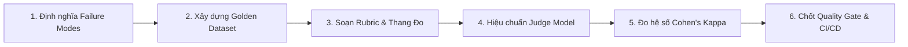

# GIÁO TRÌNH TOÀN DIỆN VỀ AI PRODUCT MANAGEMENT, FINOPS & MONETIZATION: TỪ CƠ BẢN ĐẾN ENTERPRISE
## Sổ Tay Kỹ Nghệ Sản Phẩm Trí Tuệ Nhân Tạo Doanh Nghiệp, Mô Hình Tài Chính Đơn Vị GPU/Token, Đánh Giá Độc Lập & Chiến Lược Ra Mắt Thị Trường Cho AI Product Managers & Kỹ Sư Trưởng
**Tác giả:** Đội ngũ Giám đốc Sản phẩm & Kỹ sư Trưởng Giải pháp AI (Lead AI Product Managers & Principal Solution Architects)  
**Tài liệu tham chiếu:** VinAI Research (Track 1: Day 16 – Day 28), VinUni Capstone, Khung Đánh giá AI Khoa học 6 Pha, Tiêu chuẩn EU AI Act & Nghị định 13/2023/NĐ-CP, Mô hình Kinh tế Đơn vị SaaS/AI (Bessemer, Andreessen Horowitz a16z)  
**Dành cho:** Sinh viên Khóa luận Tốt nghiệp, AI Product Managers (AI PMs), AI Solution Architects, Tech Leads & Sáng lập viên AI Startups  
**Phiên bản:** 2026 Enterprise Edition — Cột Trụ Kinh Tế & Giá Trị Nghiệp Vụ Của Hệ Sinh Thái AI  

---

# LỜI NÓI ĐẦU: KHÁCH HÀNG KHÔNG MUA THAM SỐ, HỌ MUA GIÁ TRỊ VÀ SỰ BẢO ĐẢM KINH TẾ

Trong giai đoạn đầu phát triển ứng dụng AI, phần lớn kỹ sư và học viên thường tự hào về các thông số kỹ thuật trừu tượng:
* *"Hệ thống của em dùng mô hình 70 tỷ tham số!"*
* *"Em nhồi prompt dài 32.000 tokens và nối 5 tác tử LangGraph!"*

Tuy nhiên, khi mang sản phẩm ra gặp Giám đốc Tài chính (CFO), Giám đốc Vận hành (COO) hoặc Hội đồng Bảo vệ Đồ án cấp Doanh nghiệp, bạn sẽ ngay lập tức đối mặt với những câu hỏi sống còn:
1. *"Một tài liệu hợp đồng phân tích xong tốn bao nhiêu cent chi phí GPU/API? Có lãi không?"*
2. *"Tại sao chi phí hóa đơn Cloud tháng này tăng gấp 4 lần trong khi số lượng khách hàng trả phí chỉ tăng 20%?"*
3. *"Làm thế nào bạn chứng minh mô hình không vi phạm bảo mật theo Nghị định 13/2023/NĐ-CP và gây thiệt hại pháp lý cho khách hàng?"*
4. *"Nếu tỷ lệ rời bỏ (Churn) của người dùng là 8%/tháng, sản phẩm của bạn còn bao nhiêu tháng Runway trước khi cạn tiền mặt?"*

$$\mathbf{Enterprise\ AI\ Product = Real\ Customer\ Value \times Validated\ Unit\ Economics \times Resilient\ Governance}$$
> *"Không ai trả tiền cho số lượng tham số hay độ phức tạp của mô hình; Khách hàng chỉ chi tiền cho Nỗi đau được gỡ bỏ và Giá trị nghiệp vụ hoàn tất."*

Nếu không có **Track 1 (AI Product & FinOps)**, hệ thống AI của bạn dù công nghệ có tiên tiến đến đâu cũng sẽ rơi vào chiếc bẫy **"Càng nhiều người dùng thì công ty càng nhanh phá sản"** do chi phí biên (Marginal Cost) của token ăn mòn toàn bộ doanh thu.

Giáo trình này cung cấp toàn bộ bộ khung kỹ nghệ sản phẩm: từ phương pháp bóc tách vấn đề (Problem Discovery), tạo mẫu không cần code (Wizard-of-Oz), khung đánh giá độc lập chuẩn khoa học (Calibrated Judge), hệ thống giữ chân người dùng (Retention Loops), mô hình tài chính đơn vị (Unit Economics), chiến lược đóng gói giá (Pricing & GTM), cho đến bảng điều khiển vận hành thời gian thực.

---

# MỤC LỤC CHI TIẾT

* [CHƯƠNG 1: TÔN CHỈ KỸ NGHỆ SẢN PHẨM AI & SỰ KHÁC BIỆT GIỮA SAAS TRUYỀN THỐNG VS AI PRODUCT](#chương-1-tôn-chỉ-kỹ-nghệ-sản-phẩm-ai--sự-khác-biệt-giữa-saas-truyền-thống-vs-ai-product)
* [CHƯƠNG 2: KHÁM PHÁ VẤN ĐỀ, PRODUCT TEARDOWN & TẠO MẪU ĐA PHƯƠNG ÁN (WIZARD-OF-OZ)](#chương-2-khám-phá-vấn-đề-product-teardown--tạo-mẫu-đa-phương-án-wizard-of-oz)
* [CHƯƠNG 3: KHUNG ĐÁNH GIÁ SẢN PHẨM AI KHOA HỌC 6 GIAI ĐOẠN & THẨM ĐỊNH VIÊN HIỆU CHUẨN (CALIBRATED JUDGE)](#chương-3-khung-đánh-giá-sản-phẩm-ai-khoa-học-6-giai-đoạn--thẩm-định-viên-hiệu-chuẩn-calibrated-judge)
* [CHƯƠNG 4: HỆ THỐNG ĐO LƯỜNG SẢN PHẨM AI, CORE ACTION CARDS & CHỐNG HAO MÒN NGẦM (TOKEN CHURN)](#chương-4-hệ-thống-đo-lường-sản-phẩm-ai-core-action-cards--chống-hao-mòn-ngầm-token-churn)
* [CHƯƠNG 5: MÔ HÌNH TÀI CHÍNH SẢN PHẨM AI & KỸ NGHỆ ĐƠN VỊ KINH TẾ (AI UNIT ECONOMICS & FINOPS)](#chương-5-mô-hình-tài-chính-sản-phẩm-ai--kỹ-nghệ-đơn-vị-kinh-tế-ai-unit-economics--finops)
* [CHƯƠNG 6: CHIẾN LƯỢC GO-TO-MARKET (GTM), HÀNH LANG ĐỊNH GIÁ & MÔ HÌNH ĐÓNG GÓI DOANH THU](#chương-6-chiến-lược-go-to-market-gtm-hành-lang-định-giá--mô-hình-đóng-gói-doanh-thu)
* [CHƯƠNG 7: BẢNG ĐIỀU KHIỂN VẬN HÀNH & HỆ CHẨN ĐOÁN "ĐÈN NÀO BẬT TRƯỚC?" (OPERATING DASHBOARD)](#chương-7-bảng-điều-khiển-vận-hành--hệ-chẩn-đoán-đèn-nào-bật-trước-operating-dashboard)
* [CHƯƠNG 8: QUẢN TRỊ STAKEHOLDER, CƠ CẤU SQUAD TÁC TỬ & KỊCH BẢN PITCH DOANH NGHIỆP](#chương-8-quản-trị-stakeholder-cơ-cấu-squad-tác-tử--kịch-bản-pitch-doanh-nghiệp)
* [CHƯƠNG 9: MÃ NGUỒN PYTHON THAM CHIẾU: ĐỘNG CƠ TÍNH TOÁN FINOPS & UNIT ECONOMICS TOÀN CẢNH](#chương-9-mã-nguồn-python-tham-chiếu-động-cơ-tính-toán-finops--unit-economics-toàn-cảnh)
* [CHƯƠNG 10: BỘ 15 CÂU HỎI VẤN ĐÁP HỘI ĐỒNG BẢO VỆ KHOÁ LUẬN TỐT NGHIỆP / SENIOR AI PRODUCT ARCHITECT](#chương-10-bộ-15-câu-hỏi-vấn-đáp-hội-đồng-bảo-vệ-khoá-luận-tốt-nghiệp--senior-ai-product-architect)

---

# CHƯƠNG 1: TÔN CHỈ KỸ NGHỆ SẢN PHẨM AI & SỰ KHÁC BIỆT GIỮA SAAS TRUYỀN THỐNG VS AI PRODUCT

## 1.1. Sự Khác Biệt Sống Còn: Traditional SaaS vs. Enterprise AI Product

Trong phần mềm SaaS truyền thống (như CRM, HRM, ERP), chi phí biên để phục vụ thêm một người dùng gần như bằng 0 (Zero Marginal Cost). Một truy vấn cơ sở dữ liệu chỉ tốn vài micro-giây CPU.

Ngược lại, Sản phẩm AI sở hữu đặc thù **Chi phí biên biến đổi (Variable Marginal Cost)** cực kỳ nguy hiểm:

| Tiêu chí | Phần Mềm SaaS Truyền Thống | Sản Phẩm Enterprise AI |
|---|---|---|
| **Chi phí biên / Request** | $\approx \$0.00001$ (Bỏ qua được) | $\$0.005 - \$0.08$ (Đắt gấp hàng ngàn lần) |
| **Tính chất đầu ra** | Tất định 100% (Deterministic CRUD) | Xác suất (Stochastic - Cần Guardrails kiểm chứng) |
| **Độ trễ trung bình** | $50 - 200\text{ms}$ | $1.500 - 8.000\text{ms}$ (Cần Streaming UX) |
| **Biên lợi nhuận gộp** | $80\% - 90\%$ | $50\% - 65\%$ (Bị ăn mòn bởi GPU/Token) |
| **Nguy cơ phá sản khi Scale**| Càng nhiều User $\to$ Càng lãi | Nếu giá bán cố định thấp hơn chi phí token $\to$ Càng đông User càng nhanh phá sản! |

## 1.2. Tam Giác Vàng Hợp Nhất 3 Track

```
                    🎯 TRACK 1: AI PRODUCT & BUSINESS VALUE
                     (Khách hàng, Định giá, FinOps, Retention)
                                  ▲
                                 ╱ ╲
                                ╱   ╲
                               ╱     ╲
                              ╱       ╲
                             ▼         ▼
     🏗️ TRACK 2: DATA & LLMOPS       🧠 TRACK 3: AGENTIC AI
     (Serving, Lakehouse, Telemetry)   (LangGraph, MCP, Multi-Agent)
```

- **Track 1 trả lời câu hỏi:** *"Tại sao chúng ta làm tính năng này? Nó giải quyết nỗi đau gì của khách hàng? Một lượt dùng tốn bao nhiêu tiền và ai sẽ trả phí?"*
- **Track 2 bảo đảm:** *"Hạ tầng phục vụ suy luận có sập không? Độ trễ P99 là bao nhiêu? Dữ liệu có nguồn gốc bất biến không?"*
- **Track 3 thực thi:** *"Agent dùng công cụ gì? Phối hợp đa tác tử ra sao để giải quyết trọn vẹn nghiệp vụ phức tạp?"*

---

# CHƯƠNG 2: KHÁM PHÁ VẤN ĐỀ, PRODUCT TEARDOWN & TẠO MẪU ĐA PHƯƠNG ÁN (WIZARD-OF-OZ)

## 2.1. Bản Thiết Kế 3 Phương Án (Three-Option Design Sheet)

Khi đứng trước một bài toán nghiệp vụ (ví dụ: Soát xét rủi ro hợp đồng), một Product Manager xuất sắc không bao giờ lao vào dùng Agent ngay lập tức. Họ phải lập bảng so sánh 3 phương án trên cùng một hợp đồng:

```
┌────────────────────────────────────────────────────────────────────────┐
│ BẢNG SO SÁNH 3 PHƯƠNG ÁN THIẾT KẾ (THREE-OPTION DESIGN SHEET)          │
├─────────────────┬──────────────────────────────────────────────────────┤
│ PHƯƠNG ÁN 1:    │ • KHÔNG DÙNG AI (NO-AI / DETERMINISTIC RULES)        │
│                 │ • Dùng Regex tìm từ khóa "phạt vi phạm", "8%".       │
│                 │ • Ưu điểm: Chi phí = $0, Tốc độ = 5ms, 100% tất định.│
│                 │ • Nhược điểm: Bỏ sót điều khoản diễn đạt ẩn ý.        │
├─────────────────┼──────────────────────────────────────────────────────┤
│ PHƯƠNG ÁN 2:    │ • AI HỖ TRỢ NGƯỜI DÙNG (USER-LED / COPILOT)          │
│                 │ • AI tự động tô sáng các điều khoản nghi vấn, con     │
│                 │   người tự đọc và nhấn duyệt từng mục.               │
│                 │ • Ưu điểm: An toàn tuyệt đối, chi phí token thấp.    │
├─────────────────┼──────────────────────────────────────────────────────┤
│ PHƯƠNG ÁN 3:    │ • AI TỰ HÀNH TOÀN PHẦN (AI-LED / AUTONOMOUS AGENT)   │
│                 │ • LangGraph Multi-Agent tự đọc, đối soát 3 luật,     │
│                 │   tự tính toán và xuất báo cáo PDF hoàn chỉnh.       │
│                 │ • Ưu điểm: Tiết kiệm 95% thời gian con người.        │
│                 │ • Nhược điểm: Chi phí token cao, cần Harness bảo vệ. │
└─────────────────┴──────────────────────────────────────────────────────┘
```

## 2.2. Kỹ Thuật Wizard-of-Oz: Thẩm Định Nhu Cầu Trước Khi Viết Mã Nguồn

Trước khi bỏ ra 3 tháng và 10.000 USD tiền GPU để huấn luyện mô hình, đội ngũ sản phẩm áp dụng kỹ thuật **Wizard-of-Oz**:
- Xây dựng một giao diện Web đơn giản cho phép người dùng tải lên hợp đồng và hứa hẹn "Hệ thống AI siêu trí tuệ sẽ phân tích trong 10 phút".
- Đằng sau hậu trường (Behind the Curtain), **một chuyên gia con người (Luật sư / Chuyên viên) thực hiện việc đọc và gõ kết quả trả về giao diện**.
- **Mục đích:** Đo lường chính xác xem người dùng có thực sự sẵn sàng trả tiền cho kết quả đó không, họ bấm vào tính năng nào nhiều nhất, và văn phong báo cáo như thế nào khiến họ hài lòng nhất — **trước khi viết dù chỉ một dòng code AI!**

---

# CHƯƠNG 3: KHUNG ĐÁNH GIÁ SẢN PHẨM AI KHOA HỌC 6 GIAI ĐOẠN & THẨM ĐỊNH VIÊN HIỆU CHUẨN (CALIBRATED JUDGE)

## 3.1. Khung Đánh Giá 6 Giai Đoạn (6-Phase AI Evaluation Framework)

Một sản phẩm AI không thể ra mắt thị trường chỉ bằng vài lời khen ngợi cảm tính: *"Em thấy bot trả lời mượt lắm"*. Quy trình kiểm thử chuẩn khoa học gồm 6 bước:



1. **Phase 1: Bóc tách các dạng lỗi (Failure Modes Mapping):** Liệt kê 5 lỗi chết người: Bịa đặt số liệu (Hallucination), Trích dẫn sai điều luật (Misattribution), Lộ PII khách hàng (Data Leakage), Trôi cấu trúc JSON, Văng lỗi HTTP 500.
2. **Phase 2: Xây dựng tập dữ liệu vàng (Golden Dataset):** Tối thiểu 100 mẫu dữ liệu đại diện, bao gồm cả mẫu bình thường, mẫu gài bẫy và mẫu tài liệu biên giới (Edge Cases).
3. **Phase 3: Xây dựng Rubric chấm điểm định lượng (1 – 5 điểm):** Rõ ràng, không mơ hồ.
4. **Phase 4: Thiết kế Prompt cho Thẩm định viên (Calibrated Judge):** Ép Judge phải trích dẫn bằng chứng trước khi cho điểm.
5. **Phase 5: Đo hệ số đồng thuận giữa Con người và AI (Cohen's Kappa $\kappa$):**
   $$\kappa = \frac{P_o - P_e}{1 - P_e}$$
   Hệ thống chỉ được phép dùng LLM-as-a-Judge tự động khi hệ số đồng thuận giữa AI và Chuyên gia con người đạt **$\kappa \ge 0.81$ (Almost Perfect Agreement)**.
6. **Phase 6: Cổng kiểm soát chất lượng (Quality Gate):** Nếu đợt release mới có điểm trung bình $< 4.5/5.0$ hoặc tỷ lệ Hallucination $> 1\%$, lệnh deploy lên production lập tức bị chặn lại tự động.

---

# CHƯƠNG 4: HỆ THỐNG ĐO LƯỜNG SẢN PHẨM AI, CORE ACTION CARDS & CHỐNG HAO MÒN NGẦM (TOKEN CHURN)

## 4.1. Core Action Card & Hành Động Giá Trị Cốt Lõi

Khách hàng đăng nhập vào app không có nghĩa là họ nhận được giá trị. Ta phải định nghĩa **Hành Động Giá Trị Cốt Lõi (Core Action)**:
- **Core Action:** *"Người dùng tải lên một hợp đồng và xuất thành công một Báo cáo Kiểm toán Rủi ro đã được giải quyết (Resolved Audit Report)."*
- **Quy tắc hoàn tất (Completion Rule 3 Điều kiện):**
  1. Tài liệu được bóc tách và kiểm toán $\ge 10$ điều khoản.
  2. Thời gian phản hồi hoàn tất trong vòng $\le 15$ giây.
  3. Người dùng nhấn nút "Tải PDF Báo cáo" hoặc "Đồng ý đề xuất sửa đổi".

## 4.2. Phân Biệt Sống Còn: User Churn vs. Token Churn (Hao Mòn Ngầm)

Trong sản phẩm AI, có một hiện tượng cực kỳ nguy hiểm gọi là **Token Churn (Hao mòn ngầm)**:
- **User Churn:** Khách hàng hủy gói cước hoặc xóa tài khoản (Dễ nhận biết).
- **Token Churn:** Khách hàng vẫn trả tiền hàng tháng, nhưng **số lượng token họ tiêu thụ mỗi ngày giảm dần đều** (từ 50.000 tokens/ngày xuống còn 2.000 tokens/ngày).
  $\Rightarrow$ Đây là tín hiệu báo trước rằng chất lượng câu trả lời của AI đang suy giảm, người dùng bắt đầu mất niềm tin và chắc chắn sẽ hủy đăng ký (Cancel Subscription) trong 30 ngày tới!
  $\Rightarrow$ **Hệ thống Telemetry phải kích hoạt còi báo động ngay khi Token Cadence giảm $\ge 40\%$ trong 7 ngày liên tiếp.**

---

# CHƯƠNG 5: MÔ HÌNH TÀI CHÍNH SẢN PHẨM AI & KỸ NGHỆ ĐƠN VỊ KINH TẾ (AI UNIT ECONOMICS & FINOPS)

## 5.1. Năm Cấu Phần Chi Phí Của Sản Phẩm AI (The 5 AI Cost Components)

$$\mathbf{Total\ COGS} = C_{\text{Tokens}} + C_{\text{Hardware/GPU}} + C_{\text{VectorDB}} + C_{\text{Network}} + C_{\text{Human-in-the-Loop}}$$

1. **Chi phí Token LLM ($C_{\text{Tokens}}$):** Tiền trả cho OpenAI/Claude API hoặc chi phí điện/hao mòn GPU khi tự host vLLM.
2. **Chi phí Hạ tầng & GPU Compute ($C_{\text{Hardware}}$):** Chi phí thuê instance Kubernetes GPU (A10G, A100) theo giờ.
3. **Chi phí Bộ nhớ Vector & Feature Store ($C_{\text{VectorDB}}$):** Chi phí RAM cho Qdrant, Redis và lưu trữ Delta Lake S3.
4. **Chi phí Băng thông Mạng ($C_{\text{Network}}$):** Chi phí truyền tải tài liệu PDF và Server-Sent Events (SSE) Streaming qua Internet.
5. **Chi phí Duyệt của Con người ($C_{\text{Human}}$):** Chi phí trả cho luật sư / kiểm toán viên khi tác vụ rơi vào cổng Human-In-The-Loop.

## 5.2. Vạch Trần AI Hidden Costs: Chi Phí Ẩn Luôn $\ge 30\%$ Chi Phí Token

Rất nhiều nhà sáng lập AI phá sản vì chỉ tính toán chi phí theo công thức ngây thơ: `Số lượng từ * Giá token niêm yết của OpenAI`. Trong thực tế sản xuất, chi phí luôn đội thêm tối thiểu 30% – 50% do **Chi Phí Ẩn (Hidden Costs)**:
- **Failed Retries ($\approx 10\%$):** Khi mô hình trả về JSON méo mó hoặc API bị timeout, hệ thống phải retry 2–3 lần.
- **Guardrails & Evaluation Overhead ($\approx 15\%$):** Chi phí gọi các mô hình phụ trợ như Llama Guard, AST Scanner, bóc tách PII và Embeddings.
- **Context Compaction & Memory Sync ($\approx 8\%$):** Chi phí tóm tắt lịch sử hội thoại khi context window bị đầy.

## 5.3. Ba Tỷ Lệ Vàng Sống Còn Trong Mô Hình Tài Chính AI

Một đồ án hoặc startup AI chỉ được đánh giá là khả thi khi chứng minh được 3 con số tài chính:

$$\mathbf{1.\ LTV / CAC \ge 3.0}$$
*(Giá trị vòng đời khách hàng trên Lợi nhuận gộp phải gấp tối thiểu 3 lần chi phí để tìm kiếm khách hàng đó).*
$$LTV = \frac{\text{ARPU} \times \text{Gross Margin \%}}{\text{Monthly Churn Rate}}$$

$$\mathbf{2.\ Payback\ Period < 12\text{ Tháng}}$$
*(Thời gian để thu hồi lại toàn bộ chi phí bán hàng và marketing cho một khách hàng mới phải dưới 1 năm).*

$$\mathbf{3.\ Financial\ Runway \ge 12\text{ Tháng}}$$
*(Với lượng tiền mặt hiện có trong ngân hàng chia cho tốc độ đốt tiền hàng tháng - Net Burn Rate, công ty phải duy trì sự sống ít nhất 1 năm).*

---

# CHƯƠNG 6: CHIẾN LƯỢC GO-TO-MARKET (GTM), HÀNH LANG ĐỊNH GIÁ & MÔ HÌNH ĐÓNG GÓI DOANH THU

## 6.1. Hành Lang Định Giá (Pricing Corridor): Giá Sàn vs. Giá Trần

```
┌────────────────────────────────────────────────────────────────────────┐
│ HÀNH LANG ĐỊNH GIÁ SẢN PHẨM AI DOANH NGHIỆP                            │
├────────────────────────────────────────────────────────────────────────┤
│ GIÁ TRẦN (CEILING) = $500 / Hợp đồng                                   │
│ • Giá trị kinh tế mà khách hàng nhận được (Giá thuê Luật sư con người)  │
│ • Nếu bán đắt hơn $500, khách hàng sẽ thuê người làm cho an toàn.      │
├────────────────────────────────────────────────────────────────────────┤
│                      VÙNG LỢI NHUẬN DOANH NGHIỆP                       │
│                      (Target Price: $49 / Hợp đồng)                    │
├────────────────────────────────────────────────────────────────────────┤
│ GIÁ SÀN (FLOOR) = $1.50 / Hợp đồng                                     │
│ • Chi phí biên tối thiểu (COGS: GPU + Token + Hidden Costs + Buffer)   │
│ • Bán dưới $1.50 là TỰ SÁT TÀI CHÍNH (Càng bán càng lỗ).               │
└────────────────────────────────────────────────────────────────────────┘
```

## 6.2. Ba Mô Hình Đóng Gói Doanh Thu (Monetization Models)

1. **Thu Phí Cố Định Theo Tháng (Flat-rate SaaS Subscription):** $49/tháng không giới hạn.
   - *Cực kỳ nguy hiểm cho AI:* Một "Power User" có thể cắm script quét 10.000 hợp đồng mỗi ngày, đốt cháy 2.000 USD tiền token trong khi chỉ trả 49 USD!
2. **Thu Phí Thuần Theo Mức Tiêu Dụ (Pure Usage-Based):** Trả tiền theo từng 1.000 tokens hoặc từng megabyte dữ liệu.
   - *Nhược điểm:* Khách hàng doanh nghiệp sợ hãi vì không thể dự báo trước ngân sách hàng tháng (Bill Shock).
3. **MÔ HÌNH LAI TỐI ƯU (HYBRID PRICING MODEL - KHUYÊN DÙNG):**
   - **Phí nền tảng cơ bản:** $99/tháng (Bao gồm hạn mức 200 lượt kiểm toán chuẩn).
   - **Tín dụng vượt mức (Overage Credits):** Nếu dùng quá 200 lượt, tính phí $0.50 cho mỗi lượt kiểm toán tiếp theo.
   $\Rightarrow$ **Bảo đảm dòng tiền ổn định (MRR) và bảo vệ công ty trước rủi ro người dùng lạm dụng tài nguyên!**

---

# CHƯƠNG 7: BẢNG ĐIỀU KHIỂN VẬN HÀNH & HỆ CHẨN ĐOÁN "ĐÈN NÀO BẬT TRƯỚC?" (OPERATING DASHBOARD)

## 7.1. Hệ Chẩn Đoán 3 Tầng Tín Hiệu

Khi vận hành hệ thống AI, đội ngũ quản trị phải theo dõi bảng điều khiển chẩn đoán theo thứ tự ưu tiên nghiêm ngặt:

```
┌────────────────────────────────────────────────────────────────────────┐
│ TẦNG 1: TÍN HIỆU ĐẦU VÀO (INPUT SIGNALS) - KIỂM TRA ĐẦU TIÊN           │
│ • Đèn Đỏ: Số lượng tài liệu tải lên giảm đột ngột > 30%?               │
│ • Nguyên nhân: Giao diện Upload bị lỗi, hoặc mạng khách hàng bị chặn.  │
└───────────────────────────────────┬────────────────────────────────────┘
                                    ▼
┌────────────────────────────────────────────────────────────────────────┐
│ TẦNG 2: TÍN HIỆU QUY TRÌNH (PROCESS SIGNALS) - KIỂM TRA THỨ HAI        │
│ • Đèn Vàng: Độ trễ P99 tăng vọt > 15s? Tỷ lệ Circuit Breaker TRIP?     │
│ • Chi phí Token trên mỗi lượt thành công tăng bất thường?              │
│ • Nguyên nhân: LLM bị rơi vào runaway loop, hoặc nhà cung cấp API lag. │
└───────────────────────────────────┬────────────────────────────────────┘
                                    ▼
┌────────────────────────────────────────────────────────────────────────┐
│ TẦNG 3: TÍN HIỆU ĐẦU RA (OUTPUT SIGNALS) - KẾT QUẢ KINH DOANH          │
│ • Tỷ lệ hoàn tất Core Action, Điểm đánh giá CSAT, Tỷ lệ gia hạn gói.  │
└────────────────────────────────────────────────────────────────────────┘
```

## 7.2. Quy Tắc 3 Cổng Gác Sinh Tử (30-60-90 Day Kill Criteria)

Để tránh lãng phí nguồn lực công ty vào một tính năng AI không có tương lai, nhóm phát triển áp dụng nguyên tắc Cổng gác sinh tử (Kill Switch):
- **Cột mốc 30 Ngày:** Tỷ lệ kích hoạt (Activation Rate) của người dùng dùng thử phải $\ge 25\%$. Nếu dưới $10\% \to$ Lập tức dừng lại để phỏng vấn lại khách hàng.
- **Cột mốc 60 Ngày:** Tỷ lệ người dùng thực hiện Core Action ít nhất 2 lần/tuần phải $\ge 15\%$.
- **Cột mốc 90 Ngày:** Tỷ lệ giữ chân người dùng tháng thứ 3 (Month-3 Retention) phải $\ge 20\%$ và Biên lợi nhuận gộp phải $\ge 50\%$. **Nếu không đạt các chỉ số này, dự án PHẢI BỊ HỦY BỎ (KILL) để chuyển hướng nguồn lực.**

---

# CHƯƠNG 8: QUẢN TRỊ STAKEHOLDER, CƠ CẤU SQUAD TÁC TỬ & KỊCH BẢN PITCH DOANH NGHIỆP

## 8.1. Cơ Cấu Tổ Chức Squad Tác Tử (Agent Squad RACI)

Trong môi trường AI hiện đại, một nhóm phát triển tính năng tác tử gồm 4 vai trò nòng cốt:

```
┌────────────────────────────────────────────────────────────────────────┐
│ SQUAD TÁC TỬ AI DOANH NGHIỆP (THE 4-PILLAR AGENT SQUAD)                │
├─────────────────────┬──────────────────────────────────────────────────┤
│ 1. AI PRODUCT LEAD  │ • Chịu trách nhiệm về P&L (Doanh thu & Chi phí). │
│    (Accountable)    │ • Định nghĩa Core Action, Rubric và Unit Cost.   │
├─────────────────────┼──────────────────────────────────────────────────┤
│ 2. AGENT ARCHITECT  │ • Thiết kế State Machine LangGraph, Prompt Ops.  │
│    (Responsible)    │ • Chống runaway loop, tối ưu hóa Context Window. │
├─────────────────────┼──────────────────────────────────────────────────┤
│ 3. LLMOPS ENGINEER  │ • Quản trị cụm vLLM GPU, Cache và Hạ tầng mạng.  │
│    (Responsible)    │ • Giám sát SLA P99, OpenTelemetry và K8s KEDA.   │
├─────────────────────┼──────────────────────────────────────────────────┤
│ 4. DOMAIN EXPERT    │ • Luật sư / Chuyên viên Kế toán thực tế.         │
│    (Consulted)      │ • Xây dựng Golden Dataset và dán nhãn chuẩn hóa. │
└─────────────────────┴──────────────────────────────────────────────────┘
```

## 8.2. Kịch Bản Pitch Doanh Nghiệp Theo Cấu Trúc "Conclusion First"

Khi trình bày trước Ban Giám Đốc hoặc Hội Đồng Khoa Học, đừng bắt đầu bằng việc giải thích Transformer hay Attention là gì. Hãy áp dụng cấu trúc **"Kết Luận Đi Trước (Conclusion First)"**:
1. **Kết quả định lượng (The Big Number):** *"Hệ thống giúp phòng Pháp chế giảm 85% thời gian soát xét hợp đồng và tiết kiệm 1,2 tỷ VNĐ chi phí nhân sự mỗi năm."*
2. **Bảo đảm an toàn pháp lý & tài chính:** *"Tuân thủ 100% Nghị định 13/2023/NĐ-CP, tỷ lệ ảo giác được kiểm soát dưới 0.8% nhờ bộ giáp Harness 7 lớp, và chi phí vận hành chỉ 3.200 VNĐ cho mỗi hợp đồng."*
3. **Bằng chứng thực nghiệm (Live Proof):** Thực hiện live demo ngay một hợp đồng gài bẫy và cho thấy hệ thống bắt sống rủi ro trong 5 giây.

---

# CHƯƠNG 9: MÃ NGUỒN PYTHON THAM CHIẾU: ĐỘNG CƠ TÍNH TOÁN FINOPS & UNIT ECONOMICS TOÀN CẢNH

Dưới đây là module Python chuẩn mực triển khai **Động Cơ Tính Toán Tài Chính Sản Phẩm AI (AI FinOps Engine)**, hỗ trợ mô phỏng 3 kịch bản kinh doanh và tính toán LTV/CAC:

```python
"""
Module: ai_finops_engine.py
Mô tả: Động cơ tính toán tài chính đơn vị, mô phỏng điểm hòa vốn và phân tích LTV/CAC cho sản phẩm AI
Chuẩn: Pydantic v2, Clean Architecture, Tính toán Tài chính Khoa học
"""

from typing import Dict, Any, List
from pydantic import BaseModel, Field

class UsageProfileDTO(BaseModel):
    monthly_active_users: int = Field(ge=1, description="Số người dùng hoạt động hàng tháng")
    queries_per_user_per_month: int = Field(ge=1, description="Số lượt kiểm toán trung bình mỗi user")
    avg_input_tokens: int = Field(default=3500, description="Số token prompt đầu vào trung bình")
    avg_output_tokens: int = Field(default=800, description="Số token sinh ra trung bình")
    cache_hit_rate: float = Field(default=0.35, ge=0.0, le=1.0, description="Tỷ lệ hit Semantic Cache")

class CostParametersDTO(BaseModel):
    cost_per_1k_input_tokens: float = Field(default=0.0015, description="Chi phí API input / 1K tokens")
    cost_per_1k_output_tokens: float = Field(default=0.0020, description="Chi phí API output / 1K tokens")
    hidden_cost_multiplier: float = Field(default=1.30, description="Hệ số chi phí ẩn (30% cho retry/evals)")
    fixed_infra_monthly_cost: float = Field(default=250.0, description="Chi phí cố định (Vector DB, Redis, VM)")
    monthly_subscription_fee_per_user: float = Field(default=49.0, description="Giá gói thuê bao người dùng trả")
    customer_acquisition_cost: float = Field(default=120.0, description="Chi phí tìm kiếm 1 khách hàng (CAC)")
    monthly_churn_rate: float = Field(default=0.06, ge=0.01, le=1.0, description="Tỷ lệ người dùng rời bỏ / tháng")

class FinOpsAnalysisResult(BaseModel):
    total_monthly_queries: int
    net_cogs_per_query_usd: float
    monthly_total_cogs_usd: float
    monthly_gross_revenue_usd: float
    monthly_gross_profit_usd: float
    gross_margin_percentage: float
    customer_lifetime_value_usd: float
    ltv_to_cac_ratio: float
    is_financially_viable: bool
    verdict_summary: str

class AIFinOpsEngine:
    @staticmethod
    def calculate_unit_economics(usage: UsageProfileDTO, cost: CostParametersDTO) -> FinOpsAnalysisResult:
        total_queries = usage.monthly_active_users * usage.queries_per_user_per_month
        
        # 1. Tính toán chi phí Token cơ sở cho một truy vấn không Cache
        base_input_cost = (usage.avg_input_tokens / 1000.0) * cost.cost_per_1k_input_tokens
        base_output_cost = (usage.avg_output_tokens / 1000.0) * cost.cost_per_1k_output_tokens
        raw_query_cost = base_input_cost + base_output_cost
        
        # 2. Áp dụng tỷ lệ Cache Hit và Hệ số Chi Phí Ẩn (Hidden Costs)
        # Các request hit cache chỉ tốn ~5% chi phí (Redis lookup)
        blended_query_cost = (raw_query_cost * (1.0 - usage.cache_hit_rate)) + (raw_query_cost * 0.05 * usage.cache_hit_rate)
        real_query_cogs = blended_query_cost * cost.hidden_cost_multiplier
        
        # 3. Tính toán toàn cục hàng tháng
        total_variable_cogs = total_queries * real_query_cogs
        total_monthly_cogs = total_variable_cogs + cost.fixed_infra_monthly_cost
        total_revenue = usage.monthly_active_users * cost.monthly_subscription_fee_per_user
        gross_profit = total_revenue - total_monthly_cogs
        gross_margin = (gross_profit / total_revenue) * 100.0 if total_revenue > 0 else -100.0
        
        # 4. Tính toán LTV trên Lợi Nhuận Gộp (Gross Margin Basis)
        arpu = cost.monthly_subscription_fee_per_user
        gross_margin_fraction = max(0.0, gross_margin / 100.0)
        ltv = (arpu * gross_margin_fraction) / cost.monthly_churn_rate
        ltv_cac_ratio = ltv / cost.customer_acquisition_cost if cost.customer_acquisition_cost > 0 else 0.0
        
        # 5. Đánh giá tính khả thi kinh tế (Sống còn)
        viable = (ltv_cac_ratio >= 3.0) and (gross_margin >= 50.0)
        
        if viable:
            verdict = f"Mô hình tài chính LÀNH MẠNH. Biên lợi nhuận gộp đạt {gross_margin:.1f}%, LTV/CAC đạt {ltv_cac_ratio:.2f}x (≥ 3.0x)."
        else:
            verdict = f"CẢNH BÁO TỬ THẦN: LTV/CAC ({ltv_cac_ratio:.2f}x) hoặc Biên lợi nhuận ({gross_margin:.1f}%) quá thấp! Cần tăng giá gói, tăng Cache Hit hoặc giảm chi phí token."
            
        return FinOpsAnalysisResult(
            total_monthly_queries=total_queries,
            net_cogs_per_query_usd=round(real_query_cogs, 4),
            monthly_total_cogs_usd=round(total_monthly_cogs, 2),
            monthly_gross_revenue_usd=round(total_revenue, 2),
            monthly_gross_profit_usd=round(gross_profit, 2),
            gross_margin_percentage=round(gross_margin, 2),
            customer_lifetime_value_usd=round(ltv, 2),
            ltv_to_cac_ratio=round(ltv_cac_ratio, 2),
            is_financially_viable=viable,
            verdict_summary=verdict
        )
```

---

# CHƯƠNG 10: BỘ 15 CÂU HỎI VẤN ĐÁP HỘI ĐỒNG BẢO VỆ KHOÁ LUẬN TỐT NGHIỆP / SENIOR AI PRODUCT ARCHITECT

1. **Câu 1:** *Tại sao mô hình thu phí thuê bao cố định (Flat-rate Subscription) lại tiềm ẩn rủi ro phá sản cực lớn cho các công ty AI?*
   - **Trả lời:** Vì phần mềm AI có chi phí biên biến đổi trên từng token. Một nhóm nhỏ người dùng lạm dụng (Power Users) có thể gửi hàng nghìn truy vấn dài mỗi ngày, đẩy chi phí COGS vượt xa giá gói thuê bao $49/tháng, dẫn tới hiện tượng "Càng nhiều người dùng thì công ty càng lỗ nặng".
2. **Câu 2:** *Khái niệm Token Churn khác gì so với User Churn và tại sao nó lại là tín hiệu cảnh báo sớm quan trọng nhất?*
   - **Trả lời:** User Churn là khi khách hàng hủy tài khoản. Token Churn là hiện tượng người dùng vẫn trả tiền nhưng giảm dần tần suất sử dụng sản phẩm. Đây là triệu chứng của việc mất niềm tin vào chất lượng mô hình, báo trước việc hủy gói cước trong 30 ngày tới.
3. **Câu 3:** *Làm thế nào để tính toán giá trị vòng đời khách hàng (LTV) một cách trung thực cho một sản phẩm AI?*
   - **Trả lời:** Bắt buộc phải tính LTV trên cơ sở Lợi Nhuận Gộp (Gross Margin Basis): $LTV = \frac{ARPU \times \text{Gross Margin \%}}{\text{Churn Rate}}$, không được tính trên doanh thu thuần (Revenue Basis) vì chi phí token ăn mòn một phần lớn doanh thu.
4. **Câu 4:** *Tại sao tỷ lệ LTV/CAC phải đạt tối thiểu $\ge 3.0$ trong kinh tế phần mềm AI?*
   - **Trả lời:** Tỉ lệ $3.0\times$ bảo đảm rằng sau khi bù đắp chi phí tìm kiếm khách hàng (CAC) và chi phí vận hành token/GPU (COGS), công ty vẫn còn đủ lợi nhuận để trang trải chi phí nghiên cứu R&D, lương kỹ sư và duy trì ít nhất 12 tháng Runway.
5. **Câu 5:** *Kỹ thuật Wizard-of-Oz giúp đội ngũ sản phẩm tiết kiệm nguồn lực như thế nào trước khi xây dựng hệ thống tác tử?*
   - **Trả lời:** Bằng cách dùng con người đóng giả AI sau hậu trường để kiểm chứng xem khách hàng có thực sự cần tính năng đó và có chịu trả tiền hay không, tránh việc dành 3 tháng lập trình một hệ thống AI phức tạp mà không ai sử dụng.
6. **Câu 6:** *Hệ số đồng thuận Cohen's Kappa ($\kappa$) có ý nghĩa gì trong việc kiểm thử chất lượng LLM?*
   - **Trả lời:** Đo lường mức độ đồng thuận giữa đánh giá của LLM-as-a-Judge và chuyên gia con người sau khi đã loại trừ yếu tố trùng hợp ngẫu nhiên. Chỉ khi $\kappa \ge 0.81$ (Almost Perfect), ta mới có thể tin tưởng giao phó việc chấm điểm tự động cho LLM trong CI/CD.
7. **Câu 7:** *Khái niệm "Three-Option Design Sheet" bao gồm những lựa chọn nào?*
   - **Trả lời:** (1) No-AI (Dùng luật tất định/Regex); (2) User-led (Copilot hỗ trợ con người); và (3) AI-led (Agent tự hành toàn phần). Nó giúp ngăn chặn căn bệnh "Lạm dụng AI" vào những tác vụ đơn giản.
8. **Câu 8:** *Tại sao chi phí ẩn (Hidden Costs) trong ứng dụng LLM luôn chiếm từ 30% đến 50% tổng hóa đơn token?*
   - **Trả lời:** Do chi phí của các lượt gọi lại khi gặp lỗi (Failed Retries), chi phí chạy các mô hình Guardrails quét bảo mật/PII, chi phí tạo embeddings vector, và chi phí nén ngữ cảnh (Context Compaction) khi hội thoại kéo dài.
9. **Câu 9:** *Hành lang định giá (Pricing Corridor) được xác định bởi hai ranh giới nào?*
   - **Trả lời:** Giá sàn (Floor) xác định bởi tổng chi phí biên COGS để không bị lỗ; Giá trần (Ceiling) xác định bởi giá trị kinh tế mà khách hàng nhận được (hoặc chi phí thuê con người làm công việc đó). Giá bán tối ưu phải nằm ở giữa hai mốc này.
10. **Câu 10:** *Quy tắc 30-60-90 Day Kill Criteria có vai trò gì trong quản trị danh mục sản phẩm AI?*
    - **Trả lời:** Đặt ra các cổng gác định lượng sống còn về tỷ lệ kích hoạt (Day 30), tần suất sử dụng Core Action (Day 60) và tỷ lệ giữ chân/biên lợi nhuận (Day 90). Nếu không đạt, đội ngũ buộc phải "khai tử" tính năng đó để tránh lãng phí tiền bạc.
11. **Câu 11:** *Khi người dùng phàn nàn rằng "AI phản hồi quá chậm", giải pháp sản phẩm nào hiệu quả hơn việc nâng cấp GPU đắt tiền?*
    - **Trả lời:** Triển khai Server-Sent Events (SSE) Streaming để hiển thị token đầu tiên trong vòng $< 800\text{ms}$ (tối ưu hóa cảm nhận thời gian của người dùng); kết hợp với Semantic Cache để trả về kết quả tức thời cho các câu hỏi phổ biến.
12. **Câu 12:** *Mô hình định giá Hybrid Pricing (Phí nền tảng + Tín dụng tiêu dùng) giải quyết xung đột nào giữa Doanh nghiệp và Khách hàng?*
    - **Trả lời:** Giải quyết bài toán "Dự báo ngân sách" cho khách hàng (nhờ phí cố định cơ bản) đồng thời "Bảo vệ biên lợi nhuận" cho doanh nghiệp (nhờ thu phí bổ sung khi khách hàng vượt hạn mức quy định).
13. **Câu 13:** *Vai trò của Domain Expert (Chuyên gia nghiệp vụ) trong Squad Tác tử AI là gì?*
    - **Trả lời:** Xây dựng tập dữ liệu vàng (Golden Dataset), thiết lập tiêu chí đánh giá nghiệp vụ (Rubric) và trực tiếp thẩm định các trường hợp biên giới (Edge Cases), ngăn chặn việc kỹ sư AI "tự biên tự diễn" các logic sai thực tế.
14. **Câu 14:** *Cấu trúc thuyết trình "Conclusion First" mang lại ưu thế gì khi bảo vệ đồ án hoặc pitch dự án trước lãnh đạo?*
    - **Trả lời:** Thu hút sự chú ý ngay lập tức bằng các con số tác động kinh tế và giá trị giải phóng sức lao động thực tế, trước khi đi sâu vào chi tiết kỹ thuật, tạo dựng niềm tin vững chắc về tính thực tiễn của sản phẩm.
15. **Câu 15:** *Làm thế nào để cân bằng giữa sự an toàn pháp lý (Compliance) và trải nghiệm mượt mà của người dùng trong sản phẩm AI?*
    - **Trả lời:** Áp dụng cơ chế phân cấp rủi ro (Risk-based Routing): Với tác vụ đọc tra cứu thông thường, cho phép chạy tự động tốc độ cao; với tác vụ sửa đổi dữ liệu hoặc có rủi ro pháp lý cao, bắt buộc đưa qua cổng Human-In-The-Loop với giải thích minh bạch lý do cần con người phê duyệt.
