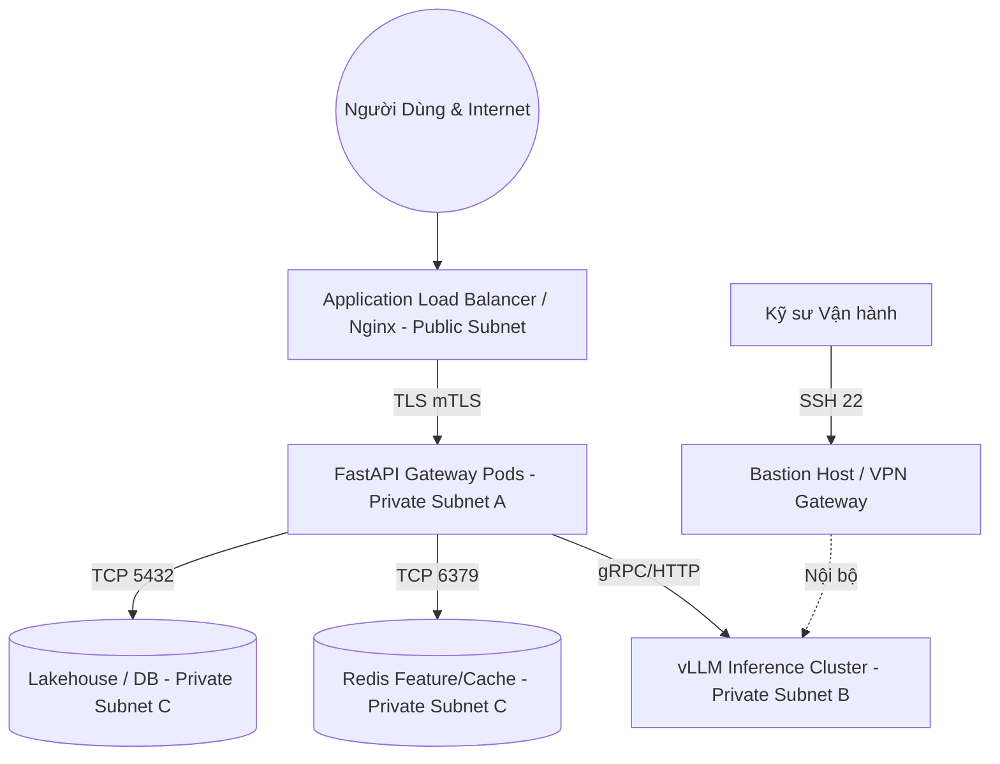

# GIÁO TRÌNH TOÀN DIỆN VỀ DATA INFRASTRUCTURE & LLMOPS: TỪ CƠ BẢN ĐẾN PRODUCTION
## Sổ Tay Kỹ Thuật Nền Tảng Dữ Liệu Doanh Nghiệp, Hồ Tri Thức Lakehouse, Feature Store, Model Serving vLLM, Distributed Tracing & Khôi Phục Thảm Họa Cho Kỹ Sư AI Platform
**Tác giả:** Đội ngũ Kỹ sư Trưởng Hạ tầng Dữ liệu & Nền tảng LLMOps (Senior Data Infra & LLMOps Platform Architects)  
**Tài liệu tham chiếu:** VinAI Research (Track 2: Day 16 – Day 28), VinUni Capstone, vLLM / PagedAttention SIG, Apache Iceberg, Delta Lake, Feast Feature Store, OpenTelemetry GenAI, Prometheus & Grafana Labs  
**Dành cho:** Sinh viên Khóa luận Tốt nghiệp, Kỹ sư AI Platform, Data Engineers, MLOps/LLMOps Engineers & Enterprise Solution Architects  
**Phiên bản:** 2026 Production Edition — Nền Móng Dữ Liệu & Hạ Tầng Phục Vụ Tác Tử Tự Trị Quy Mô Lớn  

---

# LỜI NÓI ĐẦU: KHÔNG CÓ HẠ TẦNG VỮNG CHẮC, AI CHỈ LÀ LÂU ĐÀI TRÊN CÁT

Trong kỷ nguyên Generative AI 2025–2026, 90% các bài viết công nghệ và khóa học đại trà chỉ tập trung vào tầng ngọn: viết prompt sao cho hay, ghép nối vài chuỗi LangChain, hoặc gọi API mô hình thương mại.

Tuy nhiên, khi bước vào thực tế sản xuất tại các tập đoàn lớn phục vụ hàng triệu người dùng, các kỹ sư nhận ra một chân lý khắc nghiệt:
$$\mathbf{Production\ AI = Reliable\ Data\ Substrate + Deterministic\ Serving + Resilient\ Platform\ Harness}$$
> *"Models are Commodities; Infrastructure, Observability & Data Lineage are the Fortress."*  
> *(Mô hình ngôn ngữ rồi sẽ trở thành hàng hóa đại trà được thay thế liên tục; Duy chỉ có Hạ tầng dữ liệu, Khả năng quan sát phân tán và Nguồn gốc dữ liệu bất biến mới là pháo đài trường tồn của doanh nghiệp!)*

Nếu không có **Track 2 (Data Infra & LLMOps)**:
1. **Dữ liệu RAG bị rác và trôi dạt (Data Drift & Poisoning):** Không có kiến trúc Medallion (Bronze/Silver/Gold) và Data Contract, dữ liệu phi cấu trúc đưa vào Vector DB sẽ chứa trùng lặp, thông tin hết hạn hoặc bị tiêm nhiễm mã độc.
2. **Khủng hoảng độ trễ và sập GPU VRAM (Inference Bottleneck):** Phục vụ LLM mà không hiểu bản chất Prefill (Compute-bound) vs Decode (Memory-bound), không có PagedAttention và Continuous Batching sẽ khiến cụm GPU sập vì OOM (Out Of Memory) ngay khi lượng truy vấn đồng thời tăng nhẹ.
3. **Mất dấu vết khi mô hình suy luận sai (Lack of Lineage & Tracing):** Khi Agent đưa ra quyết định sai lầm gây thiệt hại tiền tỷ, nếu không có chuỗi 11 Spans OpenTelemetry và Delta Lake Time-Travel, bạn hoàn toàn không thể chứng minh lỗi do tài liệu nào, prompt phiên bản nào hay do LLM hallucination.
4. **Sập hệ thống không thể phục hồi (Zero Disaster Recovery):** Khi trung tâm dữ liệu hoặc API upstream gặp sự cố, hệ thống không có cơ chế chuyển vùng (Failover Runbook) và tính toán RTO/RPO sẽ làm gián đoạn toàn bộ hoạt động kinh doanh.

Giáo trình này là bản thiết kế hoàn chỉnh từ gốc rễ: từ kiến trúc hồ dữ liệu Lakehouse (Iceberg/Delta Lake), kho đặc trưng thời gian thực Feast, kỹ nghệ phục vụ suy luận mô hình vLLM/K8s, đường ống CI/CD/CT cho AI, quản trị prompt hub, cho đến hệ thống quan sát OpenTelemetry và kỹ nghệ hỗn loạn (Chaos Engineering).

---

# MỤC LỤC CHI TIẾT

* [CHƯƠNG 1: TÔN CHỈ KỸ NGHỆ HẠ TẦNG & MÔ HÌNH TINH THẦN 4 TẦNG](#chương-1-tôn-chỉ-kỹ-nghệ-hạ-tầng--mô-hình-tinh-thần-4-tầng)
* [CHƯƠNG 2: HẠ TẦNG ĐÁM MÂY DƯỚI DẠNG MÃ NGUỒN & ZERO-TRUST TOPOLOGY (TERRAFORM IAC & VLLM RUNTIME)](#chương-2-hạ-tầng-đám-mây-dưới-dạng-mã-nguồn--zero-trust-topology-terraform-iac--vllm-runtime)
* [CHƯƠNG 3: ĐƯỜNG ỐNG DỮ LIỆU HIỆN ĐẠI & KIẾN TRÚC MEDALLION (AIRFLOW, DBT & IN-PROCESS DUCKDB)](#chương-3-đường-ống-dữ-liệu-hiện-đại--kiến-trúc-medallion-airflow-dbt--in-process-duckdb)
* [CHƯƠNG 4: HỒ TRI THỨC DOANH NGHIỆP: DELTA LAKE & APACHE ICEBERG (ACID TRANSACTIONS & TIME-TRAVEL)](#chương-4-hồ-tri-thức-doanh-nghiệp-delta-lake--apache-iceberg-acid-transactions--time-travel)
* [CHƯƠNG 5: KHO ĐẶC TRƯNG & TÌM KIẾM VECTOR LAI (FEAST FEATURE STORE & QDRANT)](#chương-5-kho-đặc-trưng--tìm-kiếm-vector-lai-feast-feature-store--qdrant)
* [CHƯƠNG 6: BẢN CHẤT TOÁN HỌC CỦA MODEL SERVING: PREFILL VS DECODE & VLLM RUNTIME](#chương-6-bản-chất-toán-học-của-model-serving-prefill-vs-decode--vllm-runtime)
* [CHƯƠNG 7: ĐIỀU PHỐI CỤM GPU QUY MÔ LỚN TRÊN KUBERNETES (K8S, KEDA & RAY OPERATOR)](#chương-7-điều-phối-cụm-gpu-quy-mô-lớn-trên-kubernetes-k8s-keda--ray-operator)
* [CHƯƠNG 8: CI/CD/CT CHO HỆ THỐNG AI & QUẢN TRỊ PHIÊN BẢN PROMPT (MLFLOW, DVC & PROMPT HUB)](#chương-8-cicdct-cho-hệ-thống-ai--quản-trị-phiên-bản-prompt-mlflow-dvc--prompt-hub)
* [CHƯƠNG 9: GIÁM SÁT TOÀN DIỆN: 11 SPANS OPENTELEMETRY GENAI, PROMETHEUS & GRAFANA](#chương-9-giám-sát-toàn-diện-11-spans-opentelemetry-genai-prometheus--grafana)
* [CHƯƠNG 10: KHÔI PHỤC THẢM HỌA (DISASTER RECOVERY), RTO/RPO & KỸ NGHỆ HỖN LOẠN (CHAOS DRILL)](#chương-10-khôi-phục-thảm-họa-disaster-recovery-rtorpo--kỹ-nghệ-hỗn-loạn-chaos-drill)
* [CHƯƠNG 11: FULL-STACK REFERENCE PIPELINE (MÃ NGUỒN CHUẨN DOANH NGHIỆP)](#chương-11-full-stack-reference-pipeline-mã-nguồn-chuẩn-doanh-nghiệp)
* [CHƯƠNG 12: BỘ 15 CÂU HỎI VẤN ĐÁP HỘI ĐỒNG BẢO VỆ KHOÁ LUẬN TỐT NGHIỆP / SENIOR LLMOPS ARCHITECT](#chương-12-bộ-15-câu-hỏi-vấn-đáp-hội-đồng-bảo-vệ-khoá-luận-tốt-nghiệp--senior-llmops-architect)

---

# CHƯƠNG 1: TÔN CHỈ KỸ NGHỆ HẠ TẦNG & MÔ HÌNH TINH THẦN 4 TẦNG

## 1.1. Bốn Tầng Kiến Trúc Hợp Nhất (4-Layer Enterprise Architecture)

Mọi nền tảng AI doanh nghiệp vận hành ở quy mô lớn đều được cấu trúc thành 4 tầng ranh giới rõ ràng:

```
┌────────────────────────────────────────────────────────────────────────┐
│ 1. CLIENT CONSUMPTION & ORCHESTRATION LAYER (Track 3)                  │
│    • LangGraph Multi-Agent Workflows, MCP Clients, Tool Sandbox        │
│    • SSE Streaming API, Correlation ID Tracing                         │
└───────────────────────────────────┬────────────────────────────────────┘
                                    ▼
┌────────────────────────────────────────────────────────────────────────┐
│ 2. RESILIENT PLATFORM GATEWAY & POLICY (Harness / Security)             │
│    • 7-Layer Onion Middleware, PII Decree 13 Redaction, AST Scanner    │
│    • 3-Phase Circuit Breakers, Request Hedging, Hierarchical Cache     │
└───────────────────────────────────┬────────────────────────────────────┘
                                    ▼
┌────────────────────────────────────────────────────────────────────────┐
│ 3. INFERENCE & SERVING INFRASTRUCTURE (Track 2 - LLMOps)               │
│    • vLLM Engine, PagedAttention, Continuous Batching                  │
│    • Disaggregated Prefill-Decode (PD Disaggregation), Tensor Parallel │
│    • Kubernetes KEDA Autoscaling, Triton / Ray Serve Cluster           │
└───────────────────────────────────┬────────────────────────────────────┘
                                    ▼
┌────────────────────────────────────────────────────────────────────────┐
│ 4. DATA SUBSTRATE, LAKEHOUSE & FEATURE STORE (Track 2 - Data Infra)    │
│    • Medallion Architecture: Bronze (Raw) → Silver (Clean) → Gold (OLAP)│
│    • Apache Iceberg & Delta Lake ACID Metadata, Z-Order, Time-Travel   │
│    • Feast Feature Store (Redis Online < 2ms, DuckDB Offline)          │
│    • OpenTelemetry 11 Spans, Prometheus Metrics, SQLite Audit Log      │
└────────────────────────────────────────────────────────────────────────┘
```

## 1.2. Ma Trận Đối Soát Kỹ Thuật 13 Phân Hệ (Day 16 – Day 28)

| Phân hệ / Day | Trọng tâm công nghệ | Thước đo kỹ thuật cốt tử (SLI/SLA) |
|---|---|---|
| **Day 16: Cloud IaC** | Terraform, VPC, Bastion, vLLM Runtime | Zero Public Ingress cho Worker, Provisioning < 15m |
| **Day 17: Data Pipeline** | Airflow, dbt, DuckDB In-Memory OLAP | Tính lũy đẳng 100% (Idempotency), Lookback late data |
| **Day 18: Lakehouse** | Delta Lake, Apache Iceberg, Z-Order | Triệt tiêu Small Files, Time-Travel `versionAsOf` |
| **Day 19: Feature Store** | Feast, Online Redis, Offline Parquet | Online Feature Retrieval Latency < 2ms (P99) |
| **Day 20: Serving & Latency**| vLLM, PagedAttention, GGUF Quant | TTFT P95 < 800ms, TPOT > 35 tokens/s |
| **Day 21: CI/CD/CT** | DVC, MLflow Registry, GitHub Actions | Cổng kiểm thử tự động, Quality Gate Pass 100% |
| **Day 22: Prompt Ops** | LangSmith Hub, A/B Traffic Splitting | Prompt Drift Detection, Canary Rollout 90/10 |
| **Day 23: Disaster Recovery**| Multi-Region Active-Active, Chaos Drill | RTO < 60s, RPO = 0 (Zero Data Loss) |
| **Day 24: Data Governance**| Nghị định 13 PII, RBAC/ABAC, Masking | Data Lineage truy xuất 100% nguồn gốc tài liệu |
| **Day 25: GPU FinOps** | DuckDB Ledger, GPU Slicing, Carbon | COGS / Query < $0.005, Tỷ lệ Cache Hit $\ge 40\%$ |
| **Day 27: Observability** | OpenTelemetry GenAI 11 Spans | Distributed Trace bao phủ 100% vòng đời truy vấn |
| **Day 28: Platform Lab** | Enterprise Monorepo Platform | Tích hợp hoàn chỉnh Data $\leftrightarrow$ Serving $\leftrightarrow$ Agent |

---

# CHƯƠNG 2: HẠ TẦNG ĐÁM MÂY DƯỚI DẠNG MÃ NGUỒN & ZERO-TRUST TOPOLOGY (TERRAFORM IAC & VLLM RUNTIME)

## 2.1. Thiết Kế Tô-pô Mạng Phân Tán (VPC, Subnets & Ingress)

Trong môi trường doanh nghiệp chuẩn ngân hàng và viễn thông, cụm GPU và cơ sở dữ liệu vector **tuyệt đối không bao giờ được cấp IP công khai (Public IP)**.



* **Public Subnet:** Chỉ chứa Application Load Balancer (ALB) hoặc Nginx Reverse Proxy. Nơi đây thực hiện TLS Termination, Rate Limiting cấp IP và bảo vệ chống tấn công DDoS.
* **Private App Subnet:** Chứa các container nghiệp vụ (FastAPI Gateway, Celery Task Workers).
* **Private Inference Subnet:** Cụm máy chủ GPU chạy vLLM / Triton / Ollama. Tách biệt subnet này để đảm bảo băng thông mạng nội bộ cao nhất (RoCE / InfiniBand) cho liên lạc Tensor Parallel giữa các GPU.
* **Database Subnet:** Khép kín hoàn toàn, chỉ cho phép kết nối từ App Subnet thông qua Security Group nội bộ.

---

# CHƯƠNG 3: ĐƯỜNG ỐNG DỮ LIỆU HIỆN ĐẠI & KIẾN TRÚC MEDALLION (AIRFLOW, DBT & IN-PROCESS DUCKDB)

## 3.1. Kiến Trúc Medallion 3 Tầng Cho RAG & Tác Tử

Một trong những sai lầm lớn nhất của các dự án AI là đổ thẳng file PDF thô vào Vector DB. Kiến trúc Medallion chuẩn hóa luồng dữ liệu thành 3 tầng tinh khiết:

```
┌────────────────────────────────────────────────────────────────────────┐
│ 🥉 BRONZE LAYER (RAW / IMMUTABLE SUBSTRATE)                            │
│    • Tiếp nhận file PDF, Word, Email, HTML từ nguồn thô.               │
│    • Giữ nguyên vẹn 100% byte gốc, mã hóa sha256, lưu theo partition:   │
│      `s3://lakehouse/bronze/ingest_date=2026-10-20/`                   │
│    • Bất biến (Append-only), không chỉnh sửa.                          │
└───────────────────────────────────┬────────────────────────────────────┘
                                    ▼
┌────────────────────────────────────────────────────────────────────────┐
│ 🥈 SILVER LAYER (CLEANED, DEDUPLICATED & ENRICHED)                     │
│    • Bóc tách cấu trúc theo Nghị định 30/2020/NĐ-CP (Điều, Khoản, Điểm).│
│    • Khử ký tự vô hình Unicode Zero-Width, làm sạch mã độc.            │
│    • Khử định danh PII theo Nghị định 13/2023/NĐ-CP (Mask CCCD, Phone).│
│    • Khử trùng lặp nội dung (Exact & Near-Deduplication qua MinHash).   │
└───────────────────────────────────┬────────────────────────────────────┘
                                    ▼
┌────────────────────────────────────────────────────────────────────────┐
│ 🥇 GOLD LAYER (VECTORIZED, GRAPH EMBEDDED & AGGREGATED OLAP)            │
│    • Chunks phân tầng có gắn Breadcrumbs (Contextual Retrieval).       │
│    • Vector Embeddings sinh từ PhoBERT / BGE-m3.                       │
│    • Thực thể và quan hệ đưa vào GraphRAG.                             │
│    • Bảng tổng hợp chi phí FinOps phục vụ truy vấn OLAP qua DuckDB.    │
└────────────────────────────────────────────────────────────────────────┘
```

## 3.2. Tính Lũy Đẳng (Idempotency) Trong Đường Ống Dữ Liệu

> **Định nghĩa:** Một thao tác được gọi là **Lũy đẳng (Idempotent)** nếu việc thực thi nó 1 lần hay 1.000 lần liên tiếp với cùng một dữ liệu đầu vào đều cho ra đúng một trạng thái duy nhất của hệ thống ($f(f(x)) = f(x)$).

Khi Airflow chạy lại (retry) một task bóc tách văn bản bị lỗi mạng, nếu không có tính lũy đẳng:
- Vector DB sẽ bị nhân đôi chunks (Duplication).
- Số lượng tài liệu kiểm toán bị sai lệch.

**Giải pháp kỹ thuật chuẩn:**
Dùng khóa xác thực nội dung (**Content-Addressable Hash - SHA-256**) làm ID định danh duy nhất cho từng Chunk:
```python
import hashlib

def generate_chunk_id(doc_id: str, section_idx: int, chunk_content: str) -> str:
    payload = f"{doc_id}::{section_idx}::{chunk_content.strip()}".encode("utf-8")
    return hashlib.sha256(payload).hexdigest()
```
Khi insert vào Vector DB hoặc DuckDB, luôn áp dụng cơ chế `UPSERT` hoặc `INSERT OR REPLACE INTO ... ON CONFLICT (chunk_id) DO UPDATE`.

---

# CHƯƠNG 4: HỒ TRI THỨC DOANH NGHIỆP: DELTA LAKE & APACHE ICEBERG (ACID TRANSACTIONS & TIME-TRAVEL)

## 4.1. Giao Thức ACID Transaction & `_delta_log/` Commit Protocol

Khi hàng trăm tác tử AI vừa đọc dữ liệu tri thức vừa ghi nhận kết quả kiểm toán đồng thời, cơ sở dữ liệu file thông thường (JSON, Parquet thuần) sẽ bị hỏng do xung đột ghi (Write Conflicts).

Delta Lake và Apache Iceberg giải quyết triệt để vấn đề này thông qua cơ chế **Optimistic Concurrency Control (OCC)** và nhật ký giao dịch nguyên tử:
- Mọi thao tác ghi mới đều tạo ra một file Parquet độc lập và một bản ghi commit dạng JSON trong thư mục `_delta_log/00000000000000000001.json`.
- Thao tác commit là nguyên tử (Atomic): Nếu có 2 worker cùng ghi đè một partition, engine sẽ tự động kiểm tra conflict và retry thao tác sau.

## 4.2. Khả Năng Quay Ngược Thời Gian (Time-Travel)

Khi khách hàng khiếu nại rằng: *"Tại sao hợp đồng kinh tế ký ngày 15/09/2026 được AI kết luận an toàn, nhưng hôm nay kiểm tra lại bị báo vi phạm Điều 301?"*, kỹ sư cần khôi phục chính xác trạng thái tri thức tại thời điểm ngày 15/09/2026:

```python
# Truy vấn kho tri thức chính xác tại phiên bản quá khứ bằng DuckDB / Delta Lake
import duckdb

con = duckdb.connect()
# Truy vấn Delta Lake theo phiên bản hoặc theo mốc thời gian (Timestamp)
con.execute("""
    SELECT chunk_id, content, legal_statute 
    FROM delta_scan('s3://lakehouse/gold/legal_knowledge')
    WHERE versionAsOf = 42
""")
historical_chunks = con.fetchall()
```

---

# CHƯƠNG 5: KHO ĐẶC TRƯNG & TÌM KIẾM VECTOR LAI (FEAST FEATURE STORE & QDRANT)

## 5.1. Kiến Trúc Kép Feast: Offline Store vs. Online Store

Trong hệ thống AI sản xuất, một Tác tử Kiểm toán cần 2 loại thông tin:
1. **Dữ liệu tĩnh / lịch sử (Offline Features):** Hồ sơ tín nhiệm của đối tác trong 3 năm qua, lịch sử 50 vụ kiện quá khứ (lưu trong DuckDB / Parquet S3 để phân tích theo lô).
2. **Dữ liệu thời gian thực (Online Features):** Hạn mức token còn lại của tài khoản trong ngày, trạng thái mở/đóng của Circuit Breaker, số lần vi phạm trong 5 phút qua (lưu trong Redis với độ trễ $< 2\text{ms}$).

Feast Feature Store đóng vai trò thống nhất định nghĩa đặc trưng (**Single Source of Truth**), ngăn chặn hiện tượng rò rỉ dữ liệu (Data Leakage) khi huấn luyện mô hình và phục vụ runtime:

```python
from feast import Entity, FeatureView, Field, FileSource
from feast.types import Int64, String, Float32
from datetime import timedelta

# Định nghĩa Entity Doanh nghiệp
partner_entity = Entity(name="partner_id", join_keys=["partner_id"])

# Định nghĩa Feature View từ kho Offline DuckDB đồng bộ sang Online Redis
partner_risk_fv = FeatureView(
    name="partner_risk_features",
    entities=[partner_entity],
    ttl=timedelta(days=30),
    schema=[
        Field(name="dispute_count_3y", dtype=Int64),
        Field(name="late_payment_rate", dtype=Float32),
        Field(name="credit_tier", dtype=String),
    ],
    online=True,
    source=FileSource(path="data/gold/partner_features.parquet", timestamp_field="event_timestamp")
)
```

---

# CHƯƠNG 6: BẢN CHẤT TOÁN HỌC CỦA MODEL SERVING: PREFILL VS DECODE & VLLM RUNTIME

## 6.1. Sự Phân Cực: Prefill (Compute-Bound) vs. Decode (Memory-Bound)

Khi triển khai mô hình ngôn ngữ lớn trên GPU (Nvidia A100/H100 hoặc RTX 3050/4090), quá trình suy luận chia làm 2 pha hoàn toàn khác biệt về mặt phần cứng:

```
┌────────────────────────────────────────────────────────────────────────┐
│ PHA 1: PREFILL PHASE (XỬ LÝ PROMPT ĐẦU VÀO)                            │
│ • Nhận toàn bộ $N$ tokens của Prompt (ví dụ: Hợp đồng 4.000 tokens).   │
│ • Tính toán ma trận Attention song song: $Q K^T / \sqrt{d_k}$.        │
│ • BẢN CHẤT: COMPUTE-BOUND (Nghẽn năng lực tính toán FLOPs của GPU).    │
│ • Đo lường bằng: TTFT (Time To First Token).                           │
└───────────────────────────────────┬────────────────────────────────────┘
                                    ▼
┌────────────────────────────────────────────────────────────────────────┐
│ PHA 2: DECODE PHASE (SINH TỪ TỰ HỒI QUY - AUTOREGRESSIVE)              │
│ • Sinh từng token một: $x_t \sim P(x_t | x_{<t})$.                    │
│ • Mỗi bước phải đọc lại toàn bộ KV-Cache của các token trước từ VRAM.  │
│ • BẢN CHẤT: MEMORY BANDWIDTH-BOUND (Nghẽn băng thông đọc bộ nhớ VRAM). │
│ • Đo lường bằng: TPOT (Time Per Output Token) hoặc ITL (Inter-token).  │
└────────────────────────────────────────────────────────────────────────┘
```

$$\text{Arithmetic Intensity} = \frac{\text{FLOPs (Số phép tính toán)}}{\text{Bytes Transferred (Số bytes đọc từ VRAM)}}$$

Trong pha Decode, Arithmetic Intensity cực kỳ thấp ($\approx 1 - 2\text{ FLOP/byte}$). GPU dành hầu hết thời gian để **chờ nạp trọng số và KV-Cache từ VRAM vào Compute Cores**, khiến 90% sức mạnh tính toán của chip bị lãng phí nếu chạy từng request đơn lẻ.

## 6.2. Thuật Toán PagedAttention & Continuous Batching Trong vLLM

- **Continuous Batching (Orca / vLLM):** Không chờ một batch hoàn tất mới nhận batch mới. Ngay khi Request A sinh xong và trả về token cuối cùng, vị trí trống trên GPU lập tức được nhường cho Request C bắt đầu chạy Prefill.
- **PagedAttention:** Giải quyết triệt để hiện tượng phân mảnh bộ nhớ VRAM (Fragmentation). Thay vì cấp phát một khối VRAM tĩnh liên tục cho chiều dài tối đa của câu (Max Context Length 8K), PagedAttention chia KV-Cache thành các trang (Pages) cố định (16 hoặc 32 tokens), tương tự như cơ chế Phân trang Bộ nhớ Ảo (Virtual Memory Paging) trong Hệ điều hành Linux.
  $\Rightarrow$ **Tăng thông lượng (Throughput) của hệ thống lên gấp 3 – 5 lần trên cùng một phần cứng GPU!**

---

# CHƯƠNG 7: ĐIỀU PHỐI CỤM GPU QUY MÔ LỚN TRÊN KUBERNETES (K8S, KEDA & RAY OPERATOR)

## 7.1. Kiến Trúc Tự Động Co Giãn Theo Hàng Đợi (KEDA Autoscaling)

Không thể scale pod GPU dựa trên CPU % hoặc Memory % truyền thống của Kubernetes vì khi vLLM khởi động, nó đã chiếm trước 90% VRAM làm KV-Cache (`gpu_memory_utilization = 0.9`).

**Giải pháp chuẩn:** Co giãn Pod GPU dựa trên số lượng request đang chờ trong hàng đợi vLLM (**vLLM Waiting Requests Metrics**):

```yaml
apiVersion: keda.sh/v1alpha1
kind: ScaledObject
metadata:
  name: vllm-gpu-scaler
  namespace: ai-platform
spec:
  scaleTargetRef:
    apiVersion: apps/v1
    kind: Deployment
    name: vllm-qwen-7b
  minReplicaCount: 1
  maxReplicaCount: 8
  cooldownPeriod: 300
  triggers:
  - type: prometheus
    metadata:
      serverAddress: http://prometheus-k8s.monitoring:9090
      metricName: vllm_num_requests_waiting
      query: sum(vllm:num_requests_waiting{model_name="qwen-7b"})
      threshold: '5' # Khi có hơn 5 request đang xếp hàng chờ GPU, lập tức bật thêm Pod GPU mới
```

---

# CHƯƠNG 8: CI/CD/CT CHO HỆ THỐNG AI & QUẢN TRỊ PHIÊN BẢN PROMPT (MLFLOW, DVC & PROMPT HUB)

## 8.1. Phiên Bản Hóa Dữ Liệu Lớn Bằng DVC & Git

Mã nguồn Python nhẹ thì đưa vào Git; nhưng tập dữ liệu hợp đồng pháp lý 50GB và trọng số mô hình LoRA 500MB **tuyệt đối không commit trực tiếp vào Git repo**.

DVC (Data Version Control) đóng vai trò tạo cầu nối:
- File nhị phân lưu trên S3 / MinIO: `s3://ai-datasets/contracts_v2.tar.gz`.
- Git chỉ lưu con trỏ `.dvc` nhỏ vài chục bytes chứa mã hash SHA-256:
```bash
# Thêm thư mục dữ liệu vào DVC
dvc add data/silver/contracts_corpus/
git add data/silver/contracts_corpus.dvc .gitignore
git commit -m "chore(data): version 2.4 of validated contracts dataset"
dvc push
```

## 8.2. Quản Trị Phiên Bản Prompt (Prompt Hub) & Định Tuyến A/B

Prompt là mã nguồn logic mới (Prompt is Code). Mọi thay đổi prompt kiểm toán phải có:
1. Số hiệu phiên bản ngữ nghĩa (SemVer: `prompt_legal_audit:v1.2.0`).
2. Tác giả và lý do thay đổi (Changelog).
3. Tỷ lệ phân luồng giao thông A/B Canary (90% lưu lượng đi vào `v1.2.0`, 10% đi vào `v1.3.0-rc1` để theo dõi độ trôi định dạng).

---

# CHƯƠNG 9: GIÁM SÁT TOÀN DIỆN: 11 SPANS OPENTELEMETRY GENAI, PROMETHEUS & GRAFANA

## 9.1. Chuỗi 11 Spans Chuẩn Hóa Theo OpenTelemetry GenAI SIG

Để có thể truy vết chính xác một truy vấn từ lúc người dùng nhấn nút "Kiểm toán" đến khi kết quả hiển thị, hệ thống phân rã thành **11 Spans lồng nhau**:

```
[Trace: correlation_id = "req_vinai_987654"]
 ├── 1. Span: "http.request.ingress" (FastAPI Gateway tiếp nhận request)
 │    ├── 2. Span: "guardrails.zero_width_sanitizer" (Lọc mã độc Unicode)
 │    ├── 3. Span: "guardrails.pii_redaction" (Mặt nạ hóa số CCCD, Phone NĐ 13)
 │    ├── 4. Span: "cache.semantic_lookup" (Kiểm tra Redis Semantic Cache)
 │    ├── 5. Span: "orchestrator.plan_step" (LangGraph xác định workflow)
 │    │    ├── 6. Span: "retrieval.hybrid_search" (Tìm kiếm Qdrant Dense + BM25)
 │    │    ├── 7. Span: "retrieval.cross_encoder_rerank" (Chấm điểm mức độ liên quan)
 │    │    ├── 8. Span: "harness.circuit_breaker_check" (Kiểm tra trạng thái cầu dao)
 │    │    └── 9. Span: "inference.llm_call" (vLLM Prefill & Decode Streaming)
 │    ├── 10. Span: "guardrails.verbatim_citation_check" (So khớp nguyên văn NFKC)
 │    └── 11. Span: "audit.db_commit" (Ghi nhận giao dịch vào SQLite Audit Store)
```

## 9.2. Bộ Chỉ Số Độ Trễ & Hiệu Năng Chuẩn Doanh Nghiệp

| Chỉ số | Tên đầy đủ | Ý nghĩa thực tế | Ngưỡng cam kết (SLA) |
|---|---|---|---|
| **TTFT** | Time To First Token | Thời gian từ khi bấm gửi đến khi chữ đầu tiên hiện lên màn hình | $\le 800\text{ms}$ |
| **TPOT** | Time Per Output Token | Thời gian sinh mỗi token tiếp theo (tương đương tốc độ đọc) | $\le 30\text{ms/token}$ ($\ge 33\text{ tps}$) |
| **E2E Latency** | End-to-End Latency | Tổng thời gian hoàn tất toàn bộ câu trả lời | $\le 5.0\text{s}$ (với 150 tokens) |
| **P99 Tail Latency** | 99th Percentile Latency | 1% số request chậm nhất của hệ thống | $\le 10.0\text{s}$ |
| **Cache Hit Rate** | Semantic Cache Hit Ratio | Tỷ lệ câu hỏi trùng lặp được giải quyết ngay tại Cache | $\ge 35\%$ |

---

# CHƯƠNG 10: KHÔI PHỤC THẢM HỌA (DISASTER RECOVERY), RTO/RPO & KỸ NGHỆ HỖN LOẠN (CHAOS DRILL)

## 10.1. Bộ Đôi Chỉ Số Sống Còn: RTO và RPO

Khi trung tâm dữ liệu chính (Primary Region - Hà Nội) bị mất điện hoặc cáp quang biển bị cắt đứt:
- **RTO (Recovery Time Objective):** Thời gian tối đa cho phép hệ thống chuyển vùng sang Secondary Region (TP.HCM) và phục hồi hoàn toàn khả năng phục vụ. Cam kết: **$\text{RTO} \le 60\text{ giây}$**.
- **RPO (Recovery Point Objective):** Lượng dữ liệu tối đa chấp nhận bị mất mát tính theo đơn vị thời gian. Với giao dịch kiểm toán pháp lý, cam kết: **$\text{RPO} = 0$** (Nhờ cơ chế đồng bộ giao dịch bất biến SQLite WAL / Kafka MirrorMaker).

## 10.2. Kịch Bản Diễn Tập Hỗn Loạn (Chaos Engineering Drill)

Kỹ sư trưởng không bao giờ tin vào lời hứa của nhà cung cấp hạ tầng; họ chủ động "bắn hạ" dịch vụ đang chạy để kiểm chứng độ bền:
1. **Mô phỏng `SIGKILL` vLLM GPU Worker:** Trong lúc hệ thống đang chịu tải 100 queries đồng thời, gửi lệnh giết tiến trình GPU. Hệ thống phải kích hoạt Circuit Breaker trong vòng 500ms, hạ cấp sang mô hình cục bộ hoặc trả về thông điệp Graceful Degradation mà không crash API Gateway.
2. **Mô phỏng đứt cáp DNS:** Cố tình ngắt kết nối mạng ra ngoài Internet; kiểm tra xem các Tác tử có tự động chuyển sang sử dụng Cache và kho tri thức ngoại tuyến hay không.

---

# CHƯƠNG 11: FULL-STACK REFERENCE PIPELINE (MÃ NGUỒN CHUẨN DOANH NGHIỆP)

Dưới đây là mã nguồn Python chuẩn mực triển khai **Pipeline ETL Medallion In-Process** kết hợp **DuckDB OLAP** và **Hệ thống giám sát Metrics**:

```python
"""
Module: pipeline_medallion_duckdb.py
Mô tả: Đường ống dữ liệu chuẩn Medallion (Bronze -> Silver -> Gold) cho văn bản pháp lý
Đạt chuẩn: Idempotent, In-Memory DuckDB OLAP, OpenTelemetry Spans, Type-safe Pydantic v2
"""

import os
import hashlib
import duckdb
from datetime import datetime, timezone
from typing import List, Dict, Any
from pydantic import BaseModel, Field

class RawDocumentDTO(BaseModel):
    doc_id: str
    filename: str
    raw_content: str
    source_uri: str
    ingested_at: datetime = Field(default_factory=lambda: datetime.now(timezone.utc))

class CleanChunkDTO(BaseModel):
    chunk_id: str
    doc_id: str
    section_title: str
    clean_text: str
    token_count: int
    content_hash: str

class MedallionDataPipeline:
    def __init__(self, db_path: str = ":memory:"):
        self.con = duckdb.connect(database=db_path)
        self._init_tables()

    def _init_tables(self):
        """Khởi tạo cấu trúc bảng 3 tầng Medallion với ràng buộc khóa chính"""
        self.con.execute("""
            -- TẦNG 1: BRONZE (Append-Only Raw Table)
            CREATE TABLE IF NOT EXISTS bronze_raw_documents (
                doc_id VARCHAR PRIMARY KEY,
                filename VARCHAR,
                raw_content TEXT,
                source_uri VARCHAR,
                ingested_at TIMESTAMP
            );

            -- TẦNG 2: SILVER (Cleaned & De-identified Table)
            CREATE TABLE IF NOT EXISTS silver_chunks (
                chunk_id VARCHAR PRIMARY KEY,
                doc_id VARCHAR,
                section_title VARCHAR,
                clean_text TEXT,
                token_count INTEGER,
                content_hash VARCHAR,
                processed_at TIMESTAMP,
                FOREIGN KEY (doc_id) REFERENCES bronze_raw_documents(doc_id)
            );

            -- TẦNG 3: GOLD (Aggregated Metrics OLAP Table)
            CREATE TABLE IF NOT EXISTS gold_document_analytics (
                doc_id VARCHAR PRIMARY KEY,
                total_chunks INTEGER,
                total_tokens INTEGER,
                avg_chunk_tokens DOUBLE,
                analyzed_at TIMESTAMP
            );
        """)

    def ingest_bronze(self, doc: RawDocumentDTO) -> bool:
        """Nạp dữ liệu vào tầng Bronze với tính lũy đẳng (Idempotent Insert)"""
        self.con.execute("""
            INSERT OR REPLACE INTO bronze_raw_documents 
            VALUES (?, ?, ?, ?, ?)
        """, [doc.doc_id, doc.filename, doc.raw_content, doc.source_uri, doc.ingested_at])
        return True

    def transform_to_silver(self, doc_id: str, sections: List[Dict[str, str]]) -> List[CleanChunkDTO]:
        """Làm sạch, bóc tách cấu trúc và lưu vào tầng Silver"""
        processed_chunks: List[CleanChunkDTO] = []
        now = datetime.now(timezone.utc)

        for idx, sec in enumerate(sections):
            text = sec["content"].strip()
            # Tính Content Hash SHA-256 để chống trùng lặp tuyệt đối
            c_hash = hashlib.sha256(text.encode("utf-8")).hexdigest()
            chunk_id = f"{doc_id}_{idx}_{c_hash[:8]}"
            approx_tokens = len(text.split())

            chunk = CleanChunkDTO(
                chunk_id=chunk_id,
                doc_id=doc_id,
                section_title=sec.get("title", f"Mục {idx+1}"),
                clean_text=text,
                token_count=approx_tokens,
                content_hash=c_hash
            )
            processed_chunks.append(chunk)

            # Insert lũy đẳng vào tầng Silver
            self.con.execute("""
                INSERT OR REPLACE INTO silver_chunks
                VALUES (?, ?, ?, ?, ?, ?, ?)
            """, [chunk.chunk_id, chunk.doc_id, chunk.section_title, 
                  chunk.clean_text, chunk.token_count, chunk.content_hash, now])

        # Kích hoạt tính toán tầng Gold ngay sau khi Silver hoàn tất
        self._aggregate_gold(doc_id)
        return processed_chunks

    def _aggregate_gold(self, doc_id: str):
        """Tính toán tổng hợp OLAP siêu tốc cho tầng Gold"""
        self.con.execute("""
            INSERT OR REPLACE INTO gold_document_analytics
            SELECT 
                doc_id,
                COUNT(chunk_id) as total_chunks,
                SUM(token_count) as total_tokens,
                AVG(token_count) as avg_chunk_tokens,
                CURRENT_TIMESTAMP as analyzed_at
            FROM silver_chunks
            WHERE doc_id = ?
            GROUP BY doc_id
        """, [doc_id])

    def query_gold_metrics(self) -> List[Dict[str, Any]]:
        """Truy vấn báo cáo phân tích toàn cục cho ban quản trị"""
        cursor = self.con.execute("""
            SELECT doc_id, total_chunks, total_tokens, avg_chunk_tokens, analyzed_at
            FROM gold_document_analytics
        """)
        cols = [desc[0] for desc in cursor.description]
        return [dict(zip(cols, row)) for row in cursor.fetchall()]
```

---

# CHƯƠNG 12: BỘ 15 CÂU HỎI VẤN ĐÁP HỘI ĐỒNG BẢO VỆ KHOÁ LUẬN TỐT NGHIỆP / SENIOR LLMOPS ARCHITECT

Dưới đây là 15 câu hỏi sát sườn được tổng hợp từ các kỳ bảo vệ Khóa luận Tốt nghiệp tại VinUni, Viện VinAI và các kỳ phỏng vấn Kỹ sư Trưởng Hạ tầng AI:

1. **Câu 1:** *Tại sao không lưu trực tiếp vector và tài liệu thô vào cùng một Database mà phải tách thành kiến trúc Medallion (Bronze/Silver/Gold)?*
   - **Trả lời:** Tách lớp giúp bảo toàn dữ liệu gốc bất biến (Bronze); cho phép thử nghiệm nhiều thuật toán chunking và làm sạch PII khác nhau (Silver) mà không cần nạp lại từ nguồn; và tối ưu hóa chi phí phần cứng (Gold cho Vector/OLAP truy vấn nhanh, Bronze lưu trên Object Storage S3 giá rẻ).
2. **Câu 2:** *Tại sao pha Decode của LLM lại bị nghẽn băng thông bộ nhớ (Memory Bandwidth-Bound) trong khi pha Prefill lại Compute-Bound?*
   - **Trả lời:** Prefill xử lý đồng thời $N$ tokens đầu vào nên tận dụng tối đa phép nhân ma trận song song trên Tensor Cores. Decode sinh tuần tự từng token một, tại mỗi bước phải nạp toàn bộ trọng số mô hình và KV-Cache từ VRAM vào nhân xử lý, tỉ số FLOP/byte rất thấp dẫn tới nghẽn băng thông nạp dữ liệu.
3. **Câu 3:** *PagedAttention trong vLLM giải quyết triệt để vấn đề gì so với HuggingFace Transformers truyền thống?*
   - **Trả lời:** Giải quyết vấn đề lãng phí và phân mảnh bộ nhớ VRAM (lên tới 60-80% do cấp phát tĩnh theo chiều dài context tối đa). PagedAttention chia KV-Cache thành các trang nhỏ cấp phát động, cho phép phục vụ nhiều batch đồng thời hơn với thông lượng tăng gấp 3–5 lần.
4. **Câu 4:** *Tính lũy đẳng (Idempotency) trong Data Pipeline cho AI được thực hiện như thế nào nếu một tài liệu PDF bị nạp lại 2 lần?*
   - **Trả lời:** Bằng cách băm nội dung tài liệu bằng SHA-256 để tạo mã khóa bất biến (`content_hash`) cho từng chunk. Trong câu lệnh ghi cơ sở dữ liệu luôn dùng `INSERT OR REPLACE` hoặc `ON CONFLICT DO UPDATE`, đảm bảo trạng thái hệ thống không bị nhân đôi.
5. **Câu 5:** *Feature Store như Feast mang lại giá trị gì cho ứng dụng Tác tử AI (AI Agents)?*
   - **Trả lời:** Giải quyết bài toán Point-in-time Correctness (chống rò rỉ dữ liệu lịch sử) và cung cấp kiến trúc kép: Offline Store (DuckDB/Parquet) cho xử lý lô và Online Store (Redis) cho truy xuất đặc trưng thời gian thực với độ trễ $< 2\text{ms}$.
6. **Câu 6:** *Khái niệm Disaggregated Prefill-Decode (PD Disaggregation) là gì và tại sao các hệ thống lớn năm 2026 bắt buộc phải triển khai?*
   - **Trả lời:** Là kiến trúc tách biệt cụm GPU chuyên làm Prefill (cần năng lực tính toán FLOPs cao) và cụm GPU chuyên làm Decode (cần băng thông bộ nhớ VRAM lớn). Tránh việc 1 request dài đang làm Prefill gây nghẽn (Head-of-Line Blocking) toàn bộ các request ngắn đang sinh từ ở pha Decode.
7. **Câu 7:** *Làm thế nào để cấu hình HPA (Horizontal Pod Autoscaler) cho cụm vLLM trên Kubernetes khi GPU Memory luôn hiển thị 90%?*
   - **Trả lời:** Dùng KEDA để đọc metric từ Prometheus exporter của vLLM: `vllm:num_requests_waiting` (số request đang xếp hàng chờ). Khi metric này vượt ngưỡng (ví dụ $> 5$), Kubernetes sẽ tự động scale-out thêm Pod GPU mới.
8. **Câu 8:** *Khi nào nên dùng Apache Iceberg / Delta Lake thay cho Parquet files thông thường trên S3?*
   - **Trả lời:** Khi có nhiều worker cùng đọc và ghi đồng thời (cần giao dịch ACID để tránh corrupt dữ liệu); khi cần tính năng Time-Travel để tái hiện lịch sử kiểm toán quá khứ; và khi cần bảo trì tối ưu hóa tập tin nhỏ (Z-Order Compaction).
9. **Câu 9:** *Chuỗi 11 Spans của OpenTelemetry GenAI khác gì so với APM truyền thống (Datadog/NewRelic)?*
   - **Trả lời:** OTel GenAI chuẩn hóa các thuộc tính ngữ nghĩa đặc thù cho AI: `gen_ai.prompt.tokens`, `gen_ai.completion.tokens`, `gen_ai.response.model`, `gen_ai.temperature`, và bóc tách riêng độ trễ TTFT với TPOT trong từng span con của đồ thị suy luận tác tử.
10. **Câu 10:** *Chỉ số RTO và RPO trong khôi phục thảm họa hệ thống AI được đo lường thực tế ra sao?*
    - **Trả lời:** RTO là thời gian bấm giờ từ khi node chính sập đến khi node phụ nhận request đầu tiên thành công qua DNS failover. RPO là khoảng cách thời gian giữa bản sao lưu trạng thái gần nhất và thời điểm sập, bảo đảm không có giao dịch kiểm toán nào bị biến mất.
11. **Câu 11:** *Tại sao việc kiểm tra tính lũy biến (Idempotency) là bắt buộc đối với Audit Store của Tác tử AI?*
    - **Trả lời:** Vì mạng mạng chập chờn khiến client có thể gửi lại request 2 lần (Retry). Nếu Audit Store không lũy biến, một hợp đồng sẽ bị ghi nhận phạt 2 lần, gây sai lệch báo cáo tài chính và sổ cái kế toán.
12. **Câu 12:** *Khi gặp mã lỗi HTTP 429 Too Many Requests từ API thượng nguồn, giải thuật lùi mạng nào là tối ưu nhất?*
    - **Trả lời:** Exponential Backoff kết hợp Full Jitter: $T = \text{random}(0, \min(T_{\max}, T_{\text{base}} \times 2^{\text{attempt}}))$. Tránh hiện tượng "Bão giông thức giấc" (Thundering Herd Problem) khi hàng ngàn client cùng retry tại một thời điểm chính xác.
13. **Câu 13:** *Chiến lược A/B Testing cho Prompt (Prompt Versioning) được triển khai như thế nào mà không làm gián đoạn người dùng?*
    - **Trả lời:** Sử dụng Prompt Registry (như LangSmith Hub) kết hợp Dynamic Router tại Gateway. Gateway băm `user_id` thành số nguyên modulo 100: nếu $< 90$ thì gọi Prompt v1 (Stable), nếu $\ge 90$ thì gọi Prompt v2 (Canary) và ghi nhận song song các metric đánh giá để đối soát.
14. **Câu 14:** *Cơ chế Small File Problem trong Data Lake ảnh hưởng thế nào đến hiệu năng RAG và cách khắc phục?*
    - **Trả lời:** Hàng nghìn file JSON/Parquet dung lượng vài KB khiến NameNode của HDFS hoặc S3 API bị nghẽn metadata listing. Khắc phục bằng tác vụ bảo trì định kỳ `OPTIMIZE table COMPACT` để gộp các file nhỏ thành các file chuẩn 128MB–512MB.
15. **Câu 15:** *Một hệ thống AI phục vụ 1 triệu truy vấn/ngày cần đo lường những thông số FinOps nào để không bị phá sản?*
    - **Trả lời:** (1) Unit Cost trên mỗi lượt giải quyết thành công (COGS/Resolved Query); (2) Tỷ lệ Cache Hit Rate; (3) Tỷ lệ chi phí ẩn (Hidden Costs: retry, guardrails, context compaction); và (4) Điểm hòa vốn giữa việc thuê GPU tự host (vLLM) so với việc gọi API trả phí theo token.
