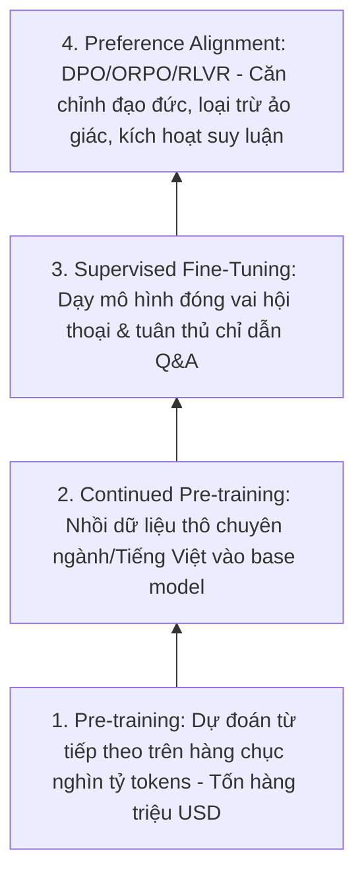

# GIÁO TRÌNH TOÀN DIỆN VỀ FINE-TUNING & REASONING: TỪ CƠ BẢN ĐẾN PRODUCTION
## Sổ Tay Toán Học, Kỹ Thuật Huấn Luyện, Căn Chỉnh Hành Vi & Tối Ưu Hóa Trí Tuệ Mô Hình Ngôn Ngữ Lớn
**Tác giả:** Đội ngũ Kỹ sư Trưởng Hệ thống AI & Huấn luyện Mô hình (Senior AI Systems & Model Training Architects)  
**Tài liệu tham chiếu:** VinAI Research, VinUni Capstone, Chuẩn công nghệ HuggingFace/TRL, Unsloth, DeepSpeed, Meta AI, DeepSeek  
**Dành cho:** Sinh viên Khóa luận Tốt nghiệp, Kỹ sư AI/LLMOps, Machine Learning Engineers & Solution Architects  
**Phiên bản:** 2026 Production Edition — Tối ưu hóa đặc thù Tiếng Việt, GPU Tự chủ & Reasoning Architecture  

---

# LỜI NÓI ĐẦU: VƯỢT QUA CHIẾC BẪY "MƯỢN NÃO THUÊ"

Trong làn sóng AI 2023–2024, phần lớn kỹ sư chỉ dừng lại ở tầng ứng dụng: gọi OpenAI API, Anthropic Claude API hoặc Gemini API thông qua các prompt bọc sẵn. Đó là thời kỳ **"Mượn não thuê" (Rented Intelligence)**.

Tuy nhiên, khi bước vào môi trường doanh nghiệp thực tế, cơ quan chính phủ, tài chính - ngân hàng và y tế năm 2025–2026, chiến lược "mượn não" đối mặt với 5 rào cản chết người:
1. **Rủi ro rò rỉ dữ liệu (Data Sovereignty & Privacy):** Không thể gửi hợp đồng bảo mật, hồ sơ bệnh án hoặc bí mật kinh doanh lên máy chủ nước ngoài.
2. **Chi phí vận hành theo quy mô (API Unit Economics):** Khi hệ thống phục vụ hàng triệu truy vấn mỗi ngày với prompt dài, hóa đơn API token sẽ ăn mòn toàn bộ biên lợi nhuận của sản phẩm.
3. **Mô hình không nghe lời tuyệt đối (Format Fragility & Alignment Drift):** Dù viết system prompt dài 2 trang A4, mô hình API vẫn có xác suất sinh sai cấu trúc JSON, bịa đặt thêm trường, hoặc từ chối trả lời do các bộ lọc an toàn quá đà (Over-cautious refusal).
4. **Mù thuật ngữ & Phong cách chuyên biệt (Domain Jargon Blindness):** Các frontier models nắm kiến thức tổng quát rất tốt, nhưng lúng túng trước văn phong hành chính Việt Nam (Nghị định, Thông tư, Điều khoản phạt 8% Luật Thương mại) hoặc ngôn ngữ chuyên ngành tài chính/y khoa bản địa.
5. **Sự phụ thuộc hạ tầng (Vendor Lock-in):** Một đợt tăng giá, thay đổi chính sách sử dụng, hoặc sự cố mạng quốc tế đứt cáp có thể làm tê liệt toàn bộ sản phẩm của doanh nghiệp.

> **Tôn chỉ của Kỹ sư Huấn luyện Mô hình:**  
> RAG là cho mô hình **"Cuốn sách để tra cứu"** (Working Memory / Open-book exam).  
> Fine-Tuning là đúc khuôn **"Tính cách, phong cách suy luận và phản xạ chuyên môn"** vào sâu trong hệ thần kinh của mô hình (Intrinsic Reasoning / Intuitive Habit).  
> Một hệ thống AI đỉnh cao là sự kết hợp hữu cơ: **Một bộ não được huấn luyện chuyên sâu (Fine-Tuned Brain) kết hợp với một kho tri thức cập nhật liên tục (RAG Memory).**

Giáo trình này cung cấp toàn bộ nền tảng toán học của quá trình lan truyền ngược, kỹ thuật PEFT/LoRA/QLoRA, tối ưu hóa domain embedding, kỹ nghệ dữ liệu SFT, các giải thuật căn chỉnh hiện đại (DPO, ORPO, GRPO), kỷ nguyên Test-Time Compute Reasoning (DeepSeek-R1 / o1), cho đến triển khai phân tán và serving với hiệu năng cao nhất trên GPU.

---

# MỤC LỤC CHI TIẾT

* [CHƯƠNG 1: BẢN CHẤT CỦA SỰ THAY ĐỔI TRỌNG SỐ & MÔ HÌNH TINH THẦN (MENTAL MODELS)](#chương-1-bản-chất-của-sự-thay-đổi-trọng-số--mô-hình-tinh-thần-mental-models)
* [CHƯƠNG 2: NỀN TẢNG TOÁN HỌC & ĐỘNG HỌC GRADIENT TRONG TRANSFORMER](#chương-2-nền-tảng-toán-học--động-học-gradient-trong-transformer)
* [CHƯƠNG 3: BẢN ĐỒ BỘ NHỚ VRAM & NGHỆ THUẬT QUẢN TRỊ BỘ NHỚ GPU](#chương-3-bản-đồ-bộ-nhớ-vram--nghệ-thuật-quản-trị-bộ-nhớ-gpu)
* [CHƯƠNG 4: PEFT, LORA & TOÁN HỌC CỦA KHÔNG GIAN BẬC THẤP (LOW-RANK ADAPTATION)](#chương-4-peft-lora--toán-học-của-không-gian-bậc-thấp-low-rank-adaptation)
* [CHƯƠNG 5: QLORA & CƠ CHẾ LƯỢNG TỬ HÓA 4-BIT (NORMALFLOAT4 & DOUBLE QUANTIZATION)](#chương-5-qlora--cơ-chế-lượng-tử-hóa-4-bit-normalfloat4--double-quantization)
* [CHƯƠNG 6: HUẤN LUYỆN LẠI EMBEDDING & RERANKER CHO TÀI LIỆU TIẾNG VIỆT CHUYÊN SÂU](#chương-6-huấn-luyện-lại-embedding--reranker-cho-tài-liệu-tiếng-việt-chuyên-sâu)
* [CHƯƠNG 7: KỸ NGHỆ DỮ LIỆU HUẤN LUYỆN (DATA SYNTHESIS, CURATION & PACKING)](#chương-7-kỹ-nghệ-dữ-liệu-huấn-luyện-data-synthesis-curation--packing)
* [CHƯƠNG 8: SUPERVISED FINE-TUNING (SFT) THỰC CHIẾN VỚI UNSLOTH & TRL](#chương-8-supervised-fine-tuning-sft-thực-chiến-với-unsloth--trl)
* [CHƯƠNG 9: CĂN CHỈNH HÀNH VI VỚI DPO, ORPO & HỌ THUẬT TOÁN PREFERENCE ALIGNMENT](#chương-9-căn-chỉnh-hành-vi-với-dpo-orpo--họ-thuật-toán-preference-alignment)
* [CHƯƠNG 10: KỶ NGUYÊN REASONING MODELS & TEST-TIME COMPUTE (DEEPSEEK-R1 / GRPO)](#chương-10-kỷ-nguyên-reasoning-models--test-time-compute-deepseek-r1--grpo)
* [CHƯƠNG 11: HUẤN LUYỆN PHÂN TÁN QUY MÔ LỚN (DEEPSPEED ZERO-3 & PYTORCH FSDP)](#chương-11-huấn-luyện-phân-tán-quy-mô-lớn-deepspeed-zero-3--pytorch-fsdp)
* [CHƯƠNG 12: ĐÁNH GIÁ MÔ HÌNH KHOA HỌC & PHÒNG CHỐNG "QUÊN THẢM HỌA" (CATASTROPHIC FORGETTING)](#chương-12-đánh-giá-mô-hình-khoa-học--phòng-chống-quên-thảm-họa-catastrophic-forgetting)
* [CHƯƠNG 13: PRODUCTION SERVING, LƯỢNG TỬ HÓA VLLM & GGUF DEPLOYMENT](#chương-13-production-serving-lượng-tử-hóa-vllm--gguf-deployment)
* [CHƯƠNG 14: FULL-STACK REFERENCE PIPELINE (MÃ NGUỒN CHUẨN END-TO-END)](#chương-14-full-stack-reference-pipeline-mã-nguồn-chuẩn-end-to-end)
* [CHƯƠNG 15: BỘ 15 CÂU HỎI VẤN ĐÁP HỘI ĐỒNG BẢO VỆ KHOÁ LUẬN TỐT NGHIỆP / SENIOR INTERVIEW](#chương-15-bộ-15-câu-hỏi-vấn-đáp-hội-đồng-bảo-vệ-khoá-luận-tốt-nghiệp--senior-interview)

---

# CHƯƠNG 1: BẢN CHẤT CỦA SỰ THAY ĐỔI TRỌNG SỐ & MÔ HÌNH TINH THẦN (MENTAL MODELS)

## 1.1. Ma trận Ra Quyết định: Prompting vs. RAG vs. Fine-Tuning

Một trong những sai lầm phổ biến nhất của các nhóm làm đồ án hoặc dự án startup là lao vào Fine-Tuning quá sớm khi chưa hiểu rõ bản chất bài toán.

```
                  Độ động của Tri thức (Knowledge Dynamism)
                  ▲
       RẤT CAO    │   [VÙNG 2: RAG THUẦN]              [VÙNG 4: HYBRID RAG + SFT]
  (Dữ liệu thay đổi│   - Hỏi đáp tin tức thị trường     - Trợ lý pháp lý doanh nghiệp
   theo ngày/phút)│   - Tra cứu giá cổ phiếu           - Khám chữa bệnh đa khoa
                  │   - Tra cứu quy chế nội bộ mới     - Kiểm toán hợp đồng kinh tế
                  ├─────────────────────────────────────────────────────────────
       CỐ ĐỊNH    │   [VÙNG 1: PROMPT ENGINEERING]     [VÙNG 3: FINE-TUNING CHUYÊN SÂU]
  (Quy luật ngữ   │   - Dịch đoạn văn ngắn             - Trích xuất JSON cực kỳ nghiêm ngặt
   pháp, logic,   │   - Tóm tắt văn bản thông thường   - Bộ tạo mã SQL chuẩn schema
   phong cách)    │   - Viết email chào hàng           - Mô hình suy luận y khoa, hóa học
                  └─────────────────────────────────────────────────────────────►
                      THẤP (General NLP)               RẤT CAO (Specialized Task/Style)
                               Độ Chuyên biệt của Tác vụ & Phong cách (Task Specificity)
```

| Tiêu chí | Prompt Engineering | RAG (Retrieval-Augmented) | Fine-Tuning (SFT / DPO) |
|---|---|---|---|
| **Cơ chế tác động** | Tác động tạm thời qua Working Memory (Context) | Bơm tri thức ngoài vào Prompt lúc chạy | Cập nhật vĩnh viễn trọng số tham số ($\theta$) |
| **Bổ sung dữ liệu mới** | Thủ công qua từng tin nhắn | Tức thời (Insert vào Vector DB / Graph DB) | Phải gom batch và huấn luyện lại (chậm) |
| **Dạy văn phong & định dạng** | Kém ổn định, dễ bị trôi định dạng | Không có tác dụng định hình phản xạ | Rất mạnh, chuẩn hóa 100% output schema |
| **Giảm kích thước Prompt** | Không (Prompt ngày càng dài và đắt) | Không (Phải nhét chunks vào context) | Rất mạnh (System prompt có thể rút gọn tối đa) |
| **Yêu cầu GPU Compute** | 0 GPU (Dùng API) | Rất thấp (Chỉ cần CPU/RAM cho DB) | Cao (Cần VRAM GPU từ 16GB – 80GB+) |
| **Hiện tượng ảo giác** | Trung bình | Thấp (Có trích dẫn kiểm chứng) | Vẫn có thể bịa đặt nếu không kèm RAG |

> **Quy luật bất biến:**
> * Muốn mô hình **BIẾT THÊM SỰ THẬT MỚI** $\rightarrow$ Dùng **RAG**.
> * Muốn mô hình **LÀM THEO MỘT CÁCH ĐẶC BIỆT, THEO VĂN PHONG VÀ ĐỊNH DẠNG KHẮT KHE** $\rightarrow$ Dùng **Fine-Tuning**.
> * Muốn xây dựng **HỆ THỐNG ENTERPRISE ĐỈNH CAO** $\rightarrow$ Dùng **Fine-Tuning** để rèn luyện mô hình tuân thủ format và suy luận sâu sắc, sau đó cấp cho nó **RAG** để nó tra cứu dữ liệu cập nhật.

---

## 1.2. Kim Tự Tháp Huấn Luyện Mô Hình Ngôn Ngữ (The LLM Training Pyramid)

Quá trình tôi luyện một mô hình ngôn ngữ lớn từ con số 0 đến trợ lý thông minh trải qua 4 tầng bậc:



1. **Pre-training (Huấn luyện sơ bộ):** Mô hình đọc hàng chục ngàn tỷ tokens từ Internet để học ngữ pháp, tri thức nhân loại và logic thế giới. Mục tiêu: $\min \mathcal{L} = -\sum \log P(w_t | w_{<t})$. Chỉ các tập đoàn nghìn tỷ (Google, Meta, OpenAI) mới thực hiện bước này thường xuyên.
2. **Continued Pre-training / Domain Adaptation (CPT):** Tiếp tục huấn luyện tự giám sát (Causal Language Modeling) trên tập văn bản thô khổng lồ của một ngôn ngữ mới (ví dụ 100GB báo chí, sách luật tiếng Việt) hoặc ngành mới (10 triệu bệnh án y khoa). Giúp mở rộng từ vựng (*Vocab expansion*) và nắm bắt kiến thức nền tảng.
3. **Supervised Fine-Tuning (SFT - Huấn luyện có giám sát):** Dạy mô hình từ một "cỗ máy tự động điền từ tiếp theo" trở thành một "trợ lý biết nghe lệnh". Dữ liệu là các cặp `(Instruction, Response)` chất lượng cao.
4. **Preference Alignment & Reasoning (Căn chỉnh sở thích & Suy luận):** Dùng DPO (Direct Preference Optimization), KTO, hoặc RLVR (Reinforcement Learning with Verifiable Rewards như DeepSeek-R1) để thưởng cho các câu trả lời chính xác, an toàn, có chuỗi suy luận logic dài và phạt các câu trả lời bịa đặt hoặc độc hại.

---

# CHƯƠNG 2: NỀN TẢNG TOÁN HỌC & ĐỘNG HỌC GRADIENT TRONG TRANSFORMER

## 2.1. Hàm Mất Mát Cốt Lõi: Cross-Entropy Loss & Perplexity

Trong bài toán sinh ngôn ngữ tự hồi quy (Autoregressive Language Modeling), cho chuỗi token đầu vào $X = (x_1, x_2, \dots, x_N)$. Tại mỗi bước thời gian $t$, mô hình dự đoán xác suất phân phối của token tiếp theo $x_t$ dựa trên các token quá khứ:

$$P(x_t | x_{<t}; \theta) = \text{Softmax}(z_t) = \frac{\exp(z_{t, x_t})}{\sum_{v \in \mathcal{V}} \exp(z_{t, v})}$$

Trong đó $z_t \in \mathbb{R}^{|\mathcal{V}|}$ là vector Logits tại bước $t$, $|\mathcal{V}|$ là kích thước từ vựng (Vocabulary Size, ví dụ 128.256 của Llama 3 hoặc 151.646 của Qwen 2.5).

### Hàm Mất Mát Cross-Entropy (Negative Log-Likelihood):
$$\mathcal{L}_{CE}(\theta) = -\frac{1}{N} \sum_{t=1}^{N} \log P(x_t | x_{<t}; \theta)$$

### Độ Phức Tạp Ngôn Ngữ (Perplexity - PPL):
Perplexity đo lường mức độ "bối rối" của mô hình khi gặp dữ liệu thực tế. PPL càng thấp, mô hình dự đoán càng chính xác:
$$\text{PPL} = \exp(\mathcal{L}_{CE}) = \exp\left( -\frac{1}{N} \sum_{t=1}^{N} \log P(x_t | x_{<t}; \theta) \right)$$
* Nếu $\text{PPL} = 1$: Mô hình dự đoán chính xác tuyệt đối token tiếp theo với xác suất 100%.
* Nếu $\text{PPL} = |\mathcal{V}|$: Mô hình dự đoán ngẫu nhiên như tung xúc xắc trong toàn bộ từ điển.

---

## 2.2. Lan Truyền Ngược Trong Các Ma Trận Trọng Số Của Transformer

Mỗi Transformer Block gồm hai khối cơ bản: **Multi-Head Self-Attention (MHSA)** và **Feed-Forward Network (MLP / SwiGLU)**.

```
       Input Token Hidden State: X ∈ R^(B × L × d)
                          │
          ┌───────────────┴───────────────┐
          ▼                               ▼
    Attention Projections            MLP / SwiGLU Projections
    W_q, W_k, W_v ∈ R^(d × d)        W_gate, W_up ∈ R^(d × d_ff)
    W_o ∈ R^(d × d)                  W_down ∈ R^(d_ff × d)
```

Cho ma trận biểu diễn ẩn $X \in \mathbb{R}^{L \times d}$ (độ dài ngữ cảnh $L$, số chiều ẩn $d$). Khi dữ liệu đi qua một lớp tuyến tính:
$$Y = X W, \quad W \in \mathbb{R}^{d \times k}$$

Trong quá trình Forward:
$$\text{Forward:} \quad Y_{ij} = \sum_{m=1}^{d} X_{im} W_{mj}$$

Trong quá trình Backward, đạo hàm của hàm mất mát $\mathcal{L}$ đối với trọng số $W$:
$$\frac{\partial \mathcal{L}}{\partial W} = X^T \cdot \left(\frac{\partial \mathcal{L}}{\partial Y}\right)$$

Đạo hàm đối với đầu vào để truyền ngược về các lớp trước:
$$\frac{\partial \mathcal{L}}{\partial X} = \left(\frac{\partial \mathcal{L}}{\partial Y}\right) \cdot W^T$$

> **Bài học cốt lõi cho Kỹ sư AI:**  
> Để tính được $\frac{\partial \mathcal{L}}{\partial W}$, ta **bắt buộc phải lưu trữ toàn bộ giá trị kích hoạt đầu vào $X$ (Activations) của mọi lớp trong bộ nhớ VRAM** suốt quá trình Forward Pass! Đây chính là lý do vì sao khi huấn luyện với ngữ cảnh dài ($L = 4096$ hay $8192$), bộ nhớ kích hoạt (Activation Memory) bùng nổ khủng khiếp và dễ gây lỗi Out-Of-Memory (OOM).

---

## 2.3. Giải Phẫu Bộ Tối Ưu Hóa: AdamW vs. 8-Bit Adam

Thuật toán AdamW (Adam with Decoupled Weight Decay) là tiêu chuẩn vàng để huấn luyện Transformer. 

```
Thuật toán AdamW:
Tại mỗi bước t, với gradient g_t = ∇_θ L(θ_t):
1. Cập nhật Moment bậc 1 (Vận tốc trung bình):
   m_t = β_1 · m_{t-1} + (1 - β_1) · g_t
2. Cập nhật Moment bậc 2 (Phương sai trung bình):
   v_t = β_2 · v_{t-1} + (1 - β_2) · g_t^2
3. Hiệu chỉnh độ lệch (Bias Correction):
   m̂_t = m_t / (1 - β_1^t),   v̂_t = v_t / (1 - β_2^t)
4. Cập nhật tham số kèm Decoupled Weight Decay (λ):
   θ_{t+1} = θ_t - η · ( m̂_t / (sqrt(v̂_t) + ε) + λ · θ_t )
```

* Tham số tiêu chuẩn: $\beta_1 = 0.9$, $\beta_2 = 0.95$ (cho LLM) hoặc $0.999$, $\epsilon = 10^{-8}$, $\lambda = 0.01 - 0.1$.
* **Vấn đề bộ nhớ:** Với mỗi tham số $\theta$ (ví dụ float16 tốn 2 bytes), AdamW lưu trữ:
  * Trọng số gốc bản FP32 Master Weight: 4 bytes.
  * Momentum $m_t$ (FP32): 4 bytes.
  * Variance $v_t$ (FP32): 4 bytes.
  * Gradient $g_t$ (FP16): 2 bytes.
  * $\rightarrow$ **Tổng cộng: 16 bytes VRAM cho mỗi tham số!**  
  * Nếu một mô hình có 8 tỷ tham số (8B), chỉ riêng việc lưu trạng thái tối ưu hóa và gradient của Full Fine-Tuning đã ngốn:
    $$8 \times 10^9 \times 16 \text{ bytes} \approx 128 \text{ GB VRAM!}$$
    (Vượt quá dung lượng của một GPU A100/H100 80GB!).

---

# CHƯƠNG 3: BẢN ĐỒ BỘ NHỚ VRAM & NGHỆ THUẬT QUẢN TRỊ BỘ NHỚ GPU

Trước khi gõ bất kỳ dòng code huấn luyện nào, một Kỹ sư AI bắt buộc phải biết tính toán nhẩm ngân sách VRAM để chọn kích thước mô hình, batch size và phương pháp huấn luyện phù hợp.

```
┌────────────────────────────────────────────────────────────────────────┐
│                   TỔNG DUNG LƯỢNG BỘ NHỚ VRAM GPU                       │
├───────────────────┬───────────────────┬────────────────────────────────┤
│ 1. STATIC MEMORY  │ 2. DYNAMIC MEMORY │ 3. WORKSPACE & OVERHEAD        │
│    (Tĩnh)         │    (Động)         │    (Vãng lai)                  │
├───────────────────┼───────────────────┼────────────────────────────────┤
│ • Model Weights   │ • Activations     │ • PyTorch CUDA Context (~1GB)  │
│ • Gradients       │ • KV Cache (nếu có│ • Fragmentation overhead       │
│ • Optimizer States│ • Temporary Temps │ • Temporary Buffers            │
└───────────────────┴───────────────────┴────────────────────────────────┘
```

## 3.1. Phương Trình Định Lượng Bộ Nhớ Chi Tiết

$$M_{\text{total}} = M_{\text{weights}} + M_{\text{gradients}} + M_{\text{optimizer}} + M_{\text{activations}} + M_{\text{cuda\_overhead}}$$

### Bảng Phân Bổ Chi Phí Tĩnh (Static Memory) Cho Mỗi Tham Số:

| Chế độ huấn luyện | Kiểu dữ liệu Weights | Gradient Memory | Optimizer Memory (AdamW) | Tổng Static / 1 Param |
|---|---|---|---|---|
| **Full FP32** | 4 bytes | 4 bytes | 8 bytes ($m, v$) | **16 bytes** |
| **Full Mixed (AMP FP16/BF16)** | 2 bytes + 4 bytes master | 2 bytes | 8 bytes ($m, v$ FP32) | **16 bytes** |
| **LoRA (Rank 16, BF16)** | Base: 2 bytes (đóng băng) | Adapter: ~0.02 bytes | Adapter: ~0.08 bytes | **~2.1 bytes** |
| **QLoRA (NF4 + LoRA BF16)** | Base: 0.5 bytes (4-bit) | Adapter: ~0.02 bytes | Paged AdamW: ~0.05 bytes | **~0.6 – 0.8 bytes** |

---

## 3.2. Ba Vũ Khí Cứu Cánh VRAM Cho Kỹ Sư Thực Chiến

### 1. Gradient Accumulation (Tích lũy Gradient)
Khi GPU không đủ VRAM để chứa một batch lớn (ví dụ `Batch Size = 64`), ta chia nhỏ thành các `Micro Batch Size = 2` và chạy 32 lần Forward + Backward liên tiếp trước khi gọi hàm cập nhật trọng số `optimizer.step()`:

```python
# Giả lập Effective Batch Size = 64 trên GPU dân dụng
micro_batch_size = 2
accumulation_steps = 32  # 2 * 32 = 64

optimizer.zero_grad()
for step, batch in enumerate(dataloader):
    outputs = model(**batch)
    loss = outputs.loss / accumulation_steps
    loss.backward()  # Gradient được cộng dồn vào .grad của trọng số
    
    if (step + 1) % accumulation_steps == 0:
        optimizer.step()
        optimizer.zero_grad()
```

### 2. Gradient Checkpointing (Activation Checkpointing)
* **Nguyên lý:** Thay vì lưu toàn bộ Activations của tất cả các tầng trong quá trình Forward để dùng cho Backward (tốn nhiều GB VRAM), ta **chỉ lưu Activations ở đầu mỗi Transformer Block**. Khi lan truyền ngược đến tầng nào, ta tính toán lại (recompute) Forward của tầng đó.
* **Đánh đổi:** Tiết kiệm tới **60% – 70% bộ nhớ Activations**, đổi lại thời gian huấn luyện tăng khoảng **20% – 25%** compute. Đây là sự đánh đổi cực kỳ hời trên các GPU đơn như RTX 3090 / 4090.

### 3. Mixed Precision Training (BF16 > FP16)
BFLOAT16 (Brain Floating Point 16) được Google Brain thiết kế riêng cho Deep Learning:

```
FP32:    [1 bit Sign] [8 bits Exponent]  [23 bits Mantissa]  ──► Dải động cực lớn, độ chính xác cao
FP16:    [1 bit Sign] [5 bits Exponent]  [10 bits Mantissa]  ──► Dễ bị Underflow / Overflow (cần Loss Scaling)
BF16:    [1 bit Sign] [8 bits Exponent]  [7 bits Mantissa]   ──► Cùng dải động với FP32! Không bao giờ tràn số
```
> **Khuyến nghị chuẩn Production 2026:** Luôn luôn sử dụng **BF16** (trên kiến trúc Ampere trở lên như RTX 3000/4000, A100, H100, L40S). Tuyệt đối không dùng FP16 trừ khi bắt buộc chạy trên kiến trúc GPU đời cũ (T4, V100).

---

# CHƯƠNG 4: PEFT, LORA & TOÁN HỌC CỦA KHÔNG GIAN BẬC THẤP (LOW-RANK ADAPTATION)

## 4.1. Bản Chất Toán Học của LoRA (Low-Rank Adaptation)

Năm 2021, Edward Hu và cộng sự tại Microsoft Research công bố LoRA, tạo nên cuộc cách mạng trong huấn luyện mô hình ngôn ngữ lớn.

Giả thiết cốt lõi (Intrinsic Dimensionality Hypothesis): **Sự thay đổi trọng số $\Delta W$ khi thích ứng với một tác vụ mới nằm trong một không gian con có số chiều nội tại thấp hơn rất nhiều (Low Intrinsic Rank) so với không gian đầy đủ của mô hình gốc.**

```
Ma trận gốc đóng băng (Frozen):            Hai ma trận thích ứng bậc thấp (Trainable):
       W_0 ∈ R^(d × k)                                 B ∈ R^(d × r)   và   A ∈ R^(r × k)
                                                                 (với r ≪ min(d, k))
     ┌───────────────┐                                     ┌───┐
     │               │                                     │   │
   d │      W_0      │                     +             d │ B │   ×   r ┌───────────────┐
     │   (Frozen)    │                                     │   │       │       A       │
     │               │                                     └───┘         └───────────────┘
     └───────────────┘                                       r                   k
             k
                                            Công thức Forward:
                                            h = W_0 · x + ΔW · x = W_0 · x + (α / r) · (B · A) · x
```

### Phân Tích Kích Thước Tham Số:
Cho một ma trận Attention Projection trong mô hình Llama-3-8B với $d = 4096, k = 4096$:
* Số tham số gốc của $W_0$: $4096 \times 4096 = 16.777.216$ tham số.
* Nếu áp dụng LoRA với rank $r = 16$:
  * Ma trận $A \in \mathbb{R}^{16 \times 4096} = 65.536$ tham số.
  * Ma trận $B \in \mathbb{R}^{4096 \times 16} = 65.536$ tham số.
  * Tổng tham số huấn luyện: $65.536 + 65.536 = 131.072$ tham số.
* $\rightarrow$ **Cắt giảm số tham số huấn luyện tới 128 lần ($99.2\%$)!**

### Khởi Tạo Trọng Số (Weight Initialization):
* Ma trận $A$: Được khởi tạo theo phân phối Gauss ngẫu nhiên $\mathcal{N}(0, \sigma^2)$.
* Ma trận $B$: Được khởi tạo **bằng 0 tuyệt đối ($B = 0$)**.
* **Hệ quả:** Tại thời điểm bắt đầu huấn luyện ($t = 0$):
  $$\Delta W = B \cdot A = 0 \cdot A = 0$$
  Đảm bảo hành vi của mô hình tại bước khởi đầu hoàn toàn đồng nhất 100% với mô hình gốc ban đầu, không bị sốc trọng số.

---

## 4.2. Khảo Sát Các Siêu Tham Số Của LoRA

### 1. Rank ($r$)
* Đại diện cho dung lượng biểu diễn (capacity) của ma trận thích ứng.
* Thực nghiệm:
  * $r = 8 - 16$: Đủ cho $90\%$ các tác vụ thông thường (tuân thủ định dạng JSON, phân loại, dịch thuật, tóm tắt).
  * $r = 32 - 64$: Dành cho các tác vụ suy luận phức tạp (giải toán, viết code, tư vấn y khoa chuyên sâu).
  * $r > 64$: Hiếm khi mang lại lợi ích rõ rệt, tăng nguy cơ quá khớp (overfitting) và tốn thêm VRAM.

### 2. LoRA Alpha ($\alpha$) & Hệ số Co dãn (Scaling Factor)
* Hệ số cập nhật thực tế: $\Delta W_{\text{effective}} = \frac{\alpha}{r} \cdot (B \cdot A)$.
* $\alpha$ đóng vai trò như một hệ số học tập (Learning Rate Multiplier).
* **Quy tắc thực chiến:** Đặt $\alpha = 2 \times r$ (hoặc $\alpha = r$). Khi bạn thay đổi $r$ từ 16 lên 32, hãy tăng $\alpha$ từ 32 lên 64 để giữ cho cường độ cập nhật gradient ổn định.

### 3. Target Modules: Nên gắn LoRA vào đâu?
Trong kiến trúc Transformer hiện đại (Llama, Mistral, Qwen):
* Thời kỳ đầu (2021): Chỉ gắn vào `q_proj`, `v_proj`.
* Chuẩn doanh nghiệp hiện nay (**All-Linear LoRA**): Gắn vào toàn bộ 7 ma trận tuyến tính:
  * Attention: `q_proj`, `k_proj`, `v_proj`, `o_proj`.
  * MLP: `gate_proj`, `up_proj`, `down_proj`.
* **Kết luận thực nghiệm:** Huấn luyện LoRA trên toàn bộ All-Linear với rank thấp ($r = 16$) cho hiệu năng vượt trội hơn nhiều so với chỉ huấn luyện `q_proj, v_proj` với rank cao ($r = 64$).

---

# CHƯƠNG 5: QLORA & CƠ CHẾ LƯỢNG TỬ HÓA 4-BIT (NORMALFLOAT4 & DOUBLE QUANTIZATION)

Năm 2023, Tim Dettmers công bố **QLoRA (Quantized Low-Rank Adaptation)**, cho phép nén mô hình 65B tham số từ hơn 130GB VRAM xuống chỉ còn dưới 40GB, chạy được trên GPU đơn lẻ mà vẫn giữ nguyên độ chính xác tương đương Full Fine-Tuning 16-bit.

QLoRA dựa trên 3 trụ cột kỹ thuật đột phá:

```
┌────────────────────────────────────────────────────────────────────────┐
│                        3 ĐỘT PHÁ CỦA QLORA                             │
├─────────────────────┬─────────────────────┬────────────────────────────┤
│ 1. NF4 Data Type    │ 2. Double Quant (DQ)│ 3. Paged Optimizers        │
│    (NormalFloat4)   │                     │    (Chống tràn RAM)        │
├─────────────────────┼─────────────────────┼────────────────────────────┤
│ Tối ưu thông tin cho│ Nén thêm các hệ số  │ Tự động đẩy trạng thái tối │
│ trọng số tuân theo  │ co dãn (Quantization│ ưu hóa sang RAM hệ thống   │
│ phân phối chuẩn N(0)│ Constants) từ 32-bit│ khi GPU VRAM chạm đỉnh     │
│                     │ xuống 8-bit         │ Spike.                     │
└─────────────────────┴─────────────────────┴────────────────────────────┘
```

## 5.1. Kiểu Dữ Liệu NF4 (NormalFloat4)

Các trọng số mạng nơ-ron sau quá trình Pre-training tự nhiên luôn tuân theo phân phối chuẩn Gauss $\mathcal{N}(0, \sigma^2)$.

Các kiểu lượng tử hóa số nguyên 4-bit thông thường (INT4) chia đều khoảng giá trị $[-8, 7]$ một cách tuyến tính. Điều này gây lãng phí nghiêm trọng độ phân giải ở hai đầu cực trị (nơi có rất ít trọng số) và làm giảm độ chính xác ở vùng trung tâm quanh số 0 (nơi tập trung 90% trọng số).

**NF4 xây dựng 16 điểm mốc lượng tử hóa (Quantization Bins) sao cho diện tích dưới đường cong hàm mật độ xác suất của phân phối Gauss tại mỗi khoảng là hoàn toàn bằng nhau:**

$$\int_{q_i}^{q_{i+1}} \frac{1}{\sqrt{2\pi}} e^{-\frac{x^2}{2}} dx = \frac{1}{16} = 0.0625, \quad \forall i \in \{0, 1, \dots, 15\}$$

Mỗi điểm biểu diễn chứa lượng thông tin chính xác bằng nhau (Equal Information Content), giảm thiểu tối đa sai số lượng tử hóa lý thuyết (Information-Theoretic Loss).

---

## 5.2. Double Quantization (Lượng tử hóa Kép)

Khi lượng tử hóa một khối $B_1 = 64$ trọng số sang 4-bit, ta cần lưu 1 hệ số co dãn (Quantization Constant $c_1$) dạng FP32 (32 bits).
* Chi phí của hệ số co dãn: $\frac{32 \text{ bits}}{64} = 0.5 \text{ bits/param}$.
* Double Quantization tiếp tục gom các hệ số $c_1$ thành các khối $B_2 = 256$ và lượng tử hóa chúng sang FP8, kèm 1 hệ số siêu co dãn $c_2$ dạng FP32:
  $$\text{Chi phí mới} = \frac{8 \text{ bits}}{64} + \frac{32 \text{ bits}}{64 \times 256} = 0.125 + 0.00195 \approx 0.127 \text{ bits/param}$$
* $\rightarrow$ **Tiết kiệm thêm gần 0.373 bits cho mỗi tham số!** Với mô hình 70B, tiết kiệm được hơn 3GB VRAM.

---

# CHƯƠNG 6: HUẤN LUYỆN LẠI EMBEDDING & RERANKER CHO TÀI LIỆU TIẾNG VIỆT CHUYÊN SÂU

Một hệ thống AI không thể trả lời đúng nếu tầng biểu diễn (Representation Layer) tìm kiếm sai văn bản. Trong môi trường pháp lý, y tế hoặc nội bộ doanh nghiệp Việt Nam, các mô hình embedding mã nguồn mở thường thất bại do không hiểu được sự tinh tế của các từ viết tắt, mã điều khoản và quan hệ tương đương.

## 6.1. Toán Học Huấn Luyện Contrastive Learning & InfoNCE Loss

Cho một bộ ba dữ liệu gồm:
* Query (Câu truy vấn): $q$
* Positive Document (Đoạn trích chứa câu trả lời đúng): $p^+$
* Negative Documents (Các đoạn trích gây nhiễu / sai lệch): $\{n_1^-, n_2^-, \dots, n_K^-\}$

Mô hình Bi-Encoder ánh xạ văn bản thành các vector đơn vị:
$$\vec{u} = \frac{E(q)}{\|E(q)\|_2}, \quad \vec{v}^+ = \frac{E(p^+)}{\|E(p^+)\|_2}, \quad \vec{v}_j^- = \frac{E(n_j^-)}{\|E(n_j^-)\|_2}$$

Hàm mất mát **InfoNCE (Information Noise-Contrastive Estimation) / MultipleNegativesRankingLoss:**

$$\mathcal{L}_{\text{InfoNCE}} = -\log \frac{\exp\left( \frac{\vec{u} \cdot \vec{v}^+}{\tau} \right)}{\exp\left( \frac{\vec{u} \cdot \vec{v}^+}{\tau} \right) + \sum_{j=1}^{K} \exp\left( \frac{\vec{u} \cdot \vec{v}_j^-}{\tau} \right)}$$

Trong đó $\tau > 0$ là tham số nhiệt độ (Temperature, thường chọn $\tau = 0.05$).  
Hàm mất mát này kéo vector câu hỏi $q$ lại gần đoạn trích đúng $p^+$, đồng thời đẩy mạnh tất cả các đoạn trích sai $n_j^-$ ra xa trong không gian vector đa chiều.

---

## 6.2. Kỹ Thuật Khai Thác Hard Negatives (Hard Negative Mining)

Nếu chỉ lấy các câu ngẫu nhiên làm Negative (Random Negatives), bài toán phân loại quá dễ và gradient sẽ tiến về 0 rất nhanh (mô hình không học thêm được gì).

**Hard Negatives** là các đoạn trích:
1. Có chứa nhiều từ khóa giống hệt câu hỏi (BM25 điểm rất cao).
2. Nằm trong cùng một chương/văn bản với câu trả lời đúng.
3. Nhưng **KHÔNG CHỨA NỘI DUNG THỎA MÃN CÂU HỎI**.

```
Query: "Mức phạt vi phạm nghĩa vụ hợp đồng thương mại tối đa là bao nhiêu?"
  ├── Positive: "Điều 301 Luật Thương mại 2005 quy định mức phạt không quá 8% giá trị phần nghĩa vụ bị vi phạm..."
  ├── Easy Negative: "Công thức pha chế trà sữa trân châu đường đen..." (Quá dễ, không có giá trị học)
  └── HARD NEGATIVE: "Điều 300 Luật Thương mại 2005 quy định về căn cứ áp dụng chế tài phạt vi phạm khi có hành vi vi phạm..." 
      (Cực kỳ giống về từ vựng pháp lý, nhưng không trả lời con số 8%! Đây là mẫu huấn luyện vàng để mô hình phân biệt).
```

---

## 6.3. Mã Nguồn Huấn Luyện Domain Embedding Chuẩn Thực Chiến

Sử dụng thư viện `sentence-transformers` phiên bản 3.x với kiến trúc Trainer mới nhất:

```python
"""
FINE-TUNE DOMAIN EMBEDDING CHO HỢP ĐỒNG PHÁP LÝ TIẾNG VIỆT
Yêu cầu: sentence-transformers>=3.0.0, torch, datasets
"""
import torch
from sentence_transformers import SentenceTransformer, SentenceTransformerTrainer
from sentence_transformers.losses import MultipleNegativesRankingLoss
from sentence_transformers.training_args import SentenceTransformerTrainingArguments
from datasets import Dataset

# 1. Khởi tạo Base Model (Hỗ trợ tốt tiếng Việt)
model_name = "BAAI/bge-m3"
model = SentenceTransformer(model_name)

# 2. Chuẩn bị tập dữ liệu huấn luyện dạng Triplet (Anchor, Positive, Negative)
# Khuyến nghị: Tối thiểu 5.000 - 20.000 triplets chất lượng cao
train_data = {
    "anchor": [
        "Mức trần phạt vi phạm hợp đồng thương mại là bao nhiêu?",
        "Thời hạn thông báo chuyển dữ liệu cá nhân ra nước ngoài?"
    ],
    "positive": [
        "Theo Điều 301 Luật Thương mại 2005, mức phạt do vi phạm hợp đồng tối đa là 8% giá trị nghĩa vụ bị vi phạm.",
        "Theo Nghị định 13/2023/NĐ-CP, Bên Chuyển dữ liệu phải gửi Hồ sơ ĐGNĐ trong thời hạn 60 ngày kể từ ngày xử lý."
    ],
    "negative": [
        "Điều 300 Luật Thương mại 2005 quy định về phạt vi phạm hợp đồng do các bên thỏa thuận.",
        "Nghị định 13/2023/NĐ-CP quy định dữ liệu cá nhân cơ bản gồm họ tên, ngày tháng năm sinh, số CCCD."
    ]
}
train_dataset = Dataset.from_dict(train_data)

# 3. Khởi tạo hàm mất mát InfoNCE
loss = MultipleNegativesRankingLoss(model)

# 4. Cấu hình tham số huấn luyện chuẩn Production
training_args = SentenceTransformerTrainingArguments(
    output_dir="./fine_tuned_bge_m3_legal_vi",
    num_train_epochs=3,
    per_device_train_batch_size=16,     # Batch size càng lớn, số in-batch negatives càng nhiều
    gradient_accumulation_steps=2,       # Effective batch size = 32
    learning_rate=2e-5,
    warmup_ratio=0.1,
    fp16=False,
    bf16=True,                          # Dùng BF16 để chống underflow
    evaluation_strategy="no",
    save_strategy="epoch",
    logging_steps=10,
    seed=42
)

# 5. Huấn luyện
trainer = SentenceTransformerTrainer(
    model=model,
    args=training_args,
    train_dataset=train_dataset,
    loss=loss,
)
trainer.train()

# 6. Lưu mô hình phục vụ RAG Production
model.save_pretrained("./fine_tuned_bge_m3_legal_vi_final")
print(" Huấn luyện Domain Embedding Tiếng Việt thành công!")
```

---

# CHƯƠNG 7: KỸ NGHỆ DỮ LIỆU HUẤN LUYỆN (DATA SYNTHESIS, CURATION & PACKING)

Công thức bất biến trong cộng đồng AI thế giới:  
$$\text{Performance} = 80\% \text{ Data Quality} + 15\% \text{ Architecture/Loss} + 5\% \text{ Hyperparameter Tuning}$$

Nghiên cứu mang tính bước ngoặt của Meta (**LIMA: Less Is More for Alignment**) chứng minh rằng: **Chỉ cần 1.000 mẫu dữ liệu SFT được tinh tuyển thủ công cực kỳ xuất sắc có thể đánh bại mô hình được huấn luyện trên 50.000 mẫu dữ liệu tổng hợp đầy nhiễu.**

## 7.1. Cấu Trúc Định Dạng Chuẩn: ChatML & Tokenizer Template

Tuyệt đối không nối chuỗi prompt một cách thủ công (`f"User: {q}\nAI: {a}"`). Hãy luôn sử dụng **Jinja2 Chat Template** tích hợp sẵn của Tokenizer để đảm bảo các token đặc biệt (`<|im_start|>`, `<|im_end|>`) được chèn chính xác:

```json
[
  {
    "messages": [
      {
        "role": "system",
        "content": "Bạn là Chuyên gia Kiểm toán Hợp đồng Pháp lý Doanh nghiệp cấp cao."
      },
      {
        "role": "user",
        "content": "Kiểm tra tính hợp pháp của điều khoản sau: 'Nếu Bên B chậm giao hàng 03 ngày, Bên B chịu phạt 15% tổng giá trị hợp đồng'."
      },
      {
        "role": "assistant",
        "content": "### ĐÁNH GIÁ RỦI RO PHÁP LÝ:\n\n1. **Phát hiện vi phạm:** Điều khoản phạt vi phạm 15% vi phạm quy định pháp luật thương mại hiện hành.\n2. **Cơ sở pháp lý:** Căn cứ Điều 301 Luật Thương mại 2005: 'Mức phạt đối với vi phạm nghĩa vụ hợp đồng hoặc tổng mức phạt đối với nhiều vi phạm do các bên thoả thuận trong hợp đồng, nhưng không quá 8% giá trị phần nghĩa vụ hợp đồng bị vi phạm'.\n3. **Hệ quả pháp lý:** Phần thỏa thuận phạt vượt quá 8% (cụ thể là phần chênh lệch 7%) sẽ bị Tòa án hoặc Trọng tài (VIAC) tuyên vô hiệu.\n4. **Đề xuất sửa đổi:** Sửa mức phạt thành 'tối đa 8% giá trị phần nghĩa vụ chậm trễ'."
      }
    ]
  }
]
```

---

## 7.2. Kỹ Thuật Data Packing (Loại Bỏ Hoàn Toàn Padding Vô Nghĩa)

Trong quá trình huấn luyện batch truyền thống, nếu một câu dài 1000 tokens và ba câu khác dài 200 tokens, ta phải chèn token `<pad>` vào ba câu ngắn để đạt độ dài 1000.  
* Hậu quả: **70% chu kỳ tính toán của GPU bị lãng phí để nhân ma trận với các số 0 của padding!**

**Data Packing (ghép chuỗi liên tục):**  
Nối các cuộc hội thoại ngắn lại với nhau thành một chuỗi duy nhất dài đúng bằng `max_seq_length` (ví dụ 4096 hoặc 8192), ngăn cách bởi token kết thúc `<|im_end|>`. Kết hợp với **FlashAttention-2 Varlen (Variable Length)**, ma trận Self-Attention sẽ áp dụng Attention Mask để các token của hội thoại này không chú ý sang hội thoại khác:

```
Truyền thống (Padding):
Batch 1: [Tok1, Tok2, Tok3, PAD,  PAD,  PAD,  PAD,  PAD ] (Lãng phí 60% VRAM & Compute)
Batch 2: [TokA, TokB, TokC, TokD, TokE, TokF, TokG, TokH]

Data Packing:
Packed:  [Tok1, Tok2, Tok3, EOS, TokA, TokB, TokC, TokD, TokE, EOS, ...] (Hiệu suất 100%!)
```

---

# CHƯƠNG 8: SUPERVISED FINE-TUNING (SFT) THỰC CHIẾN VỚI UNSLOTH & TRL

## 8.1. Tại Sao Unsloth Là Lựa Chọn Số 1 Cho SFT?

Unsloth viết lại các kernel tính toán của GPU bằng ngôn ngữ **OpenAI Triton**:
1. Tối ưu hóa thủ công phép tính lan truyền ngược của Cross-Entropy Loss và RoPE (Rotary Positional Embeddings).
2. **Tăng tốc độ huấn luyện từ 2x đến 5x**.
3. **Giảm dung lượng bộ nhớ VRAM tới 70% – 80%**, cho phép fine-tune Llama-3-8B hoặc Qwen-2.5-7B với context 8192 ngay trên một GPU dân dụng 16GB hoặc 24GB.

---

## 8.2. Kỹ Thuật Masking Prompt (Chỉ Tính Loss Trên Completion)

Khi huấn luyện trợ lý hội thoại, **ta chỉ muốn dạy mô hình cách trả lời (Completion), không muốn dạy mô hình cách đặt câu hỏi (Prompt/Instruction)**.

Nếu tính loss trên cả câu hỏi của người dùng, mô hình sẽ bị phân tâm và lãng phí dung lượng học để dự đoán các từ trong câu hỏi.

```
Token:     [SYSTEM] ... [USER] Kiểm toán hợp đồng này ... [ASSISTANT] Điều khoản vi phạm là ...
Target:    [ -100 ] ... [ -100 ] [ -100 ]  [ -100 ]  ... [   429   ]   [ 1029 ]    [ 884 ]
Loss:      BỎ QUA KHÔNG TÍNH LOSS TRÊN NHÃN -100       TẬP TRUNG TÍNH LOSS TẠI ĐÂY!
```
Trong PyTorch, nhãn mang giá trị `-100` (`CrossEntropyLoss(ignore_index=-100)`) sẽ tự động được bỏ qua trong hàm mất mát.

---

## 8.3. Mã Nguồn SFT Hoàn Chỉnh Chuẩn Doanh Nghiệp (Unsloth + LoRA)

```python
"""
SFT TRAINING PIPELINE CHUẨN ENTERPRISE (UNSLOTH + QWEN-2.5-7B)
Hỗ trợ: All-Linear LoRA, Masking Prompt, FlashAttention-2, BF16
"""
import torch
from unsloth import FastLanguageModel
from unsloth.chat_templates import get_chat_template, train_on_responses_only
from trl import SFTTrainer
from transformers import TrainingArguments
from datasets import load_dataset

# 1. Cấu hình siêu tham số
max_seq_length = 4096
dtype = torch.bfloat16
load_in_4bit = True  # Đổi sang False nếu bạn có GPU A100/H100 80GB

# 2. Tải mô hình nền tảng tối ưu (Qwen 2.5 7B Instruct)
model, tokenizer = FastLanguageModel.from_pretrained(
    model_name="Qwen/Qwen2.5-7B-Instruct",
    max_seq_length=max_seq_length,
    dtype=dtype,
    load_in_4bit=load_in_4bit,
)

# 3. Gắn All-Linear LoRA Adapters
model = FastLanguageModel.get_peft_model(
    model,
    r=16,                           # LoRA Rank
    target_modules=[
        "q_proj", "k_proj", "v_proj", "o_proj",
        "gate_proj", "up_proj", "down_proj",
    ],
    lora_alpha=32,                  # Alpha = 2 * r
    lora_dropout=0.05,
    bias="none",
    use_gradient_checkpointing="unsloth",  # Giảm 60% VRAM activations
    random_state=42,
)

# 4. Định dạng Chat Template chuẩn
tokenizer = get_chat_template(
    tokenizer,
    chat_template="chatml",
)

def formatting_prompts_func(examples):
    convos = examples["messages"]
    texts = [
        tokenizer.apply_chat_template(convo, tokenize=False, add_generation_prompt=False)
        for convo in convos
    ]
    return {"text": texts}

# Giả sử bạn có file legal_dataset.json định dạng ShareGPT/ChatML
# dataset = load_dataset("json", data_files="legal_dataset.json", split="train")
# dataset = dataset.map(formatting_prompts_func, batched=True)

# 5. Cấu hình Training Arguments
training_args = TrainingArguments(
    output_dir="./outputs_qwen25_legal_lora",
    per_device_train_batch_size=2,
    gradient_accumulation_steps=4,    # Effective batch size = 8
    warmup_ratio=0.05,
    max_steps=300,                    # Hoặc num_train_epochs=3
    learning_rate=2e-4,               # LoRA learning rate chuẩn
    fp16=False,
    bf16=True,
    logging_steps=10,
    optim="adamw_8bit",
    weight_decay=0.01,
    lr_scheduler_type="cosine",
    seed=42,
    report_to="none",                 # Hoặc "wandb"
)

# 6. Khởi tạo Trainer kèm Masking Prompt
trainer = SFTTrainer(
    model=model,
    tokenizer=tokenizer,
    train_dataset=None,               # Điền dataset thực tế
    dataset_text_field="text",
    max_seq_length=max_seq_length,
    dataset_num_proc=2,
    packing=False,                    # Bật True nếu dùng data packing
    args=training_args,
)

# Kích hoạt chỉ tính loss trên câu trả lời của ASSISTANT
trainer = train_on_responses_only(
    trainer,
    instruction_part="<|im_start|>user\n",
    response_part="<|im_start|>assistant\n",
)

# 7. Bắt đầu huấn luyện
# trainer.train()

# 8. Lưu LoRA Adapter phục vụ Merge hoặc Serving
# model.save_pretrained_merged("qwen25_legal_merged_fp16", tokenizer, save_method="merged_16bit")
print(" Pipeline SFT hoàn chỉnh sẵn sàng thực thi!")
```

---

# CHƯƠNG 9: CĂN CHỈNH HÀNH VI VỚI DPO, ORPO & HỌ THUẬT TOÁN PREFERENCE ALIGNMENT

Sau khi hoàn thành SFT, mô hình đã biết cách trả lời câu hỏi. Tuy nhiên, nó vẫn có thể gặp phải 3 lỗi cố hữu:
1. **Ảo giác cố chấp (Stubborn Hallucination):** Tự tin khẳng định thông tin sai sự thật.
2. **Xu nịnh người dùng (Sycophancy):** Đồng tình với câu hỏi sai của người dùng thay vì đính chính.
3. **Từ chối quá đà (Over-refusal):** Gặp câu hỏi hoàn toàn vô hại nhưng có chứa từ nhạy cảm thì lập tức từ chối trả lời.

Đây là lúc ta cần đến **Preference Alignment (Căn chỉnh sở thích)**.

## 9.1. Từ PPO Cồng Kềnh Đến Đột Phá DPO (Direct Preference Optimization)

Trong phương pháp RLHF truyền thống của InstructGPT (PPO):
1. Huấn luyện một mô hình phần thưởng riêng biệt (Reward Model: $r_\psi(x, y)$).
2. Dùng thuật toán Actor-Critic (PPO) với 4 mô hình cùng nằm trong VRAM: Actor (Policy), Critic (Value), Reference Model, và Reward Model.
3. $\rightarrow$ Quá phức tạp, bất ổn định toán học, và đòi hỏi cụm GPU khổng lồ.

Năm 2023, Rafael Rafailov và cộng sự tại Stanford công bố **DPO**.  
Dựa trên mô hình sở thích Bradley-Terry:
$$P(y_w \succ y_l | x) = \sigma(r(x, y_w) - r(x, y_l))$$

DPO chứng minh bằng giải tích toán học rằng: **Hàm phần thưởng tối ưu $r^*(x, y)$ có thể được biểu diễn trực tiếp qua tỷ lệ log-xác suất giữa chính mô hình đang học $\pi_\theta$ và mô hình tham chiếu $\pi_{\text{ref}}$:**

$$r^*(x, y) = \beta \log \frac{\pi_\theta(y | x)}{\pi_{\text{ref}}(y | x)} + \beta \log Z(x)$$

Thay biểu thức này vào bài toán cực đại hóa hàm sở thích, ta thu được **Hàm Mất Mát DPO độc lập hoàn toàn, không cần Reward Model và không cần vòng lặp RL:**

$$\mathcal{L}_{\text{DPO}}(\theta; \pi_{\text{ref}}) = -\mathbb{E}_{(x, y_w, y_l)} \left[ \log \sigma \left( \beta \log \frac{\pi_\theta(y_w | x)}{\pi_{\text{ref}}(y_w | x)} - \beta \log \frac{\pi_\theta(y_l | x)}{\pi_{\text{ref}}(y_l | x)} \right) \right]$$

```
                   CƠ CHẾ HOẠT ĐỘNG TOÁN HỌC CỦA DPO
                   
  Câu trả lời Tốt (Chosen: y_w)        Câu trả lời Tệ / Ảo giác (Rejected: y_l)
           │                                          │
           ▼                                          ▼
   log π_θ(y_w | x)                           log π_θ(y_l | x)
  ─────────────────                           ─────────────────
  log π_ref(y_w | x)                          log π_ref(y_l | x)
           │                                          │
           ▼                                          ▼
   Implicit Reward r(x, y_w)                   Implicit Reward r(x, y_l)
           └───────────────────┬──────────────────────┘
                               │
                               ▼
                   Chênh lệch: r(y_w) - r(y_l)
                               │
                               ▼
            Đẩy r(y_w) lên cao và đạp r(y_l) xuống thấp!
```

* $\beta$ (Beta): Hệ số phạt độ lệch KL đối với mô hình tham chiếu gốc $\pi_{\text{ref}}$.
  * Thường chọn $\beta \in [0.05, 0.2]$.
  * $\beta$ càng lớn, mô hình càng bảo thủ, bám sát mô hình gốc.
  * $\beta$ nhỏ giúp mô hình tự do thích ứng mạnh mẽ hơn theo dữ liệu đánh giá.

---

## 9.2. Thuật Toán ORPO (Odds Ratio Preference Optimization)

Nếu DPO vẫn đòi hỏi phải nạp mô hình tham chiếu $\pi_{\text{ref}}$ vào bộ nhớ để tính tỷ số, thì **ORPO (2024)** giải quyết triệt để bài toán này bằng cách kết hợp SFT Loss và Tỷ số Tỷ lệ cược (Odds Ratio) trong **cùng 1 lượt chạy duy nhất**:

$$\mathcal{L}_{\text{ORPO}} = \mathcal{L}_{\text{SFT}} + \lambda \cdot \mathcal{L}_{\text{OR}}$$

$$\text{Odds}_{\theta}(y | x) = \frac{P_\theta(y | x)}{1 - P_\theta(y | x)}, \quad \mathcal{L}_{\text{OR}} = -\log \sigma \left( \log \frac{\text{Odds}_\theta(y_w | x)}{\text{Odds}_\theta(y_l | x)} \right)$$

> **Lợi ích thực chiến:** Tiết kiệm thêm 50% VRAM vì hoàn toàn không cần giữ mô hình Reference trong quá trình căn chỉnh!

---

## 9.3. Mã Nguồn Căn Chỉnh DPO Thực Chiến

```python
"""
PIPELINE CĂN CHỈNH DPO LOẠI TRỪ ẢO GIÁC PHÁP LÝ (TRL DPOTrainer)
"""
import torch
from transformers import AutoModelForCausalLM, AutoTokenizer, TrainingArguments
from trl import DPOTrainer
from peft import PeftModel, LoraConfig
from datasets import Dataset

# 1. Tập dữ liệu so sánh cặp (Pairwise Preference Dataset)
dpo_data = {
    "prompt": [
        "Công ty A muốn phạt Công ty B 20% giá trị hợp đồng dịch vụ vì bàn giao trễ hạn có được không?",
    ],
    "chosen": [
        "KHÔNG ĐƯỢC PHÉP. Căn cứ Điều 301 Luật Thương mại 2005, mức phạt vi phạm nghĩa vụ hợp đồng tối đa chỉ là 8% giá trị phần nghĩa vụ bị vi phạm. Việc thỏa thuận 20% là vượt quá trần quy định của pháp luật và phần vượt quá (12%) sẽ bị vô hiệu.",
    ],
    "rejected": [
        "Được phép. Pháp luật Việt Nam tôn trọng quyền tự do thỏa thuận của các bên trong hợp đồng kinh tế theo nguyên tắc tự nguyện, nên nếu hai bên đã ký phạt 20% thì cứ áp dụng bình thường.",  # SAI PHÁP LUẬT!
    ]
}
dataset = Dataset.from_dict(dpo_data)

# 2. Cấu hình DPO Training Arguments
training_args = TrainingArguments(
    output_dir="./outputs_dpo_model",
    per_device_train_batch_size=1,
    gradient_accumulation_steps=8,
    learning_rate=5e-6,               # DPO yêu cầu Learning Rate rất nhỏ (1e-6 đến 5e-6)
    bf16=True,
    num_train_epochs=3,
    logging_steps=5,
    save_strategy="epoch",
    seed=42,
)

peft_config = LoraConfig(
    r=8,
    lora_alpha=16,
    target_modules=["q_proj", "v_proj"],
    bias="none",
    task_type="CAUSAL_LM",
)

# 3. Khởi tạo DPOTrainer
# trainer = DPOTrainer(
#     model=model,                      # Mô hình vừa SFT xong
#     ref_model=None,                   # TRL tự động clone reference model với PEFT LoRA
#     args=training_args,
#     beta=0.1,                         # Hệ số điều hòa Beta
#     train_dataset=dataset,
#     tokenizer=tokenizer,
#     peft_config=peft_config,
#     max_length=2048,
#     max_prompt_length=1024,
# )
# trainer.train()
print(" Cấu hình DPO Alignment hoàn tất.")
```

---

# CHƯƠNG 10: KỶ NGUYÊN REASONING MODELS & TEST-TIME COMPUTE (DEEPSEEK-R1 / GRPO)

Năm 2024–2026 chứng kiến bước chuyển dịch vĩ đại nhất của công nghệ LLM: **Từ System 1 (Tư duy nhanh, phản xạ bề mặt) sang System 2 (Tư duy chậm, suy luận có logic và tự kiểm tra lỗi trước khi kết luận)**.

Mô hình DeepSeek-R1 và OpenAI o1 chứng minh rằng: **Nếu cho mô hình không gian để sinh ra chuỗi suy luận nội tâm dài (Chain-of-Thought / `<think> ... </think>`), năng lực giải quyết các bài toán hóc búa (Toán, Lập trình, Phân tích Hợp đồng phức tạp) tăng vọt vượt bậc.**

```
Truyền thống (System 1 - SFT Model):
User: "Điều khoản này có hợp lệ không?" ──► Model: "Hợp lệ / Không hợp lệ..." (Trả lời ngay lập tức, dễ sai sót)

Reasoning Model (System 2 - R1 / o1 Style):
User: "Điều khoản này có hợp lệ không?"
  │
  ▼
<think>
  1. Phân tích đối tượng hợp đồng: Đây là hợp đồng dịch vụ logistics.
  2. Tra cứu luật điều chỉnh: Bộ luật Dân sự 2015 hay Luật Thương mại 2005? Cả hai bên đều là thương nhân có mục đích lợi nhuận -> Áp dụng Luật Thương mại 2005.
  3. Đối chiếu Điều 301 Luật Thương mại: Trần phạt vi phạm là 8%.
  4. Kiểm tra điều khoản thực tế: Ghi phạt 12%.
  5. Đánh giá: 12% > 8% -> Vi phạm trần luật định.
  6. Tự kiểm tra lại (Self-Correction): Có trường hợp ngoại lệ nào cho phép trên 8% không? Không, trừ hợp đồng xây dựng vốn nhà nước theo Luật Xây dựng. Đây là hợp đồng logistics thuần túy.
  7. Kết luận: Bị vô hiệu một phần.
</think>
### KẾT LUẬN CUỐI CÙNG: Điều khoản trên bị vô hiệu một phần...
```

---

## 10.1. Thuật Toán GRPO (Group Relative Policy Optimization) Của DeepSeek-R1

Trong phương pháp PPO truyền thống, ta cần một mạng Critic (Value Network) có kích thước tương đương mô hình chính để ước lượng kỳ vọng phần thưởng $V(s)$, gây tốn gấp đôi VRAM.

**DeepSeek giới thiệu GRPO: Loại bỏ hoàn toàn mạng Critic.**  
Với mỗi câu hỏi $q$, mô hình sinh ra một nhóm gồm $G$ câu trả lời khác nhau $\{o_1, o_2, \dots, o_G\}$.  
Một hàm chấm điểm khách quan (Rule-based Verifier / Unit Tests / Math Verifier) chấm điểm cho từng câu trả lời: $\{r_1, r_2, \dots, r_G\}$.

Hệ số lợi thế (Advantage $A_i$) của câu trả lời thứ $i$ được chuẩn hóa trực tiếp theo trung bình và độ lệch chuẩn của cả nhóm:

$$\bar{r} = \frac{1}{G} \sum_{j=1}^{G} r_j, \quad \sigma = \sqrt{\frac{1}{G} \sum_{j=1}^{G} (r_j - \bar{r})^2}$$

$$A_i = \frac{r_i - \bar{r}}{\sigma + \epsilon}$$

Hàm mục tiêu tối ưu hóa của GRPO:
$$\mathcal{J}_{\text{GRPO}}(\theta) = \mathbb{E} \left[ \frac{1}{G} \sum_{i=1}^{G} \left( \min\left( \frac{\pi_\theta(o_i|q)}{\pi_{\text{old}}(o_i|q)} A_i, \text{clip}\left(\frac{\pi_\theta(o_i|q)}{\pi_{\text{old}}(o_i|q)}, 1-\epsilon, 1+\epsilon\right) A_i \right) - \beta D_{KL}(\pi_\theta \| \pi_{\text{ref}}) \right) \right]$$

> **Ý nghĩa thực chiến:**  
> Câu trả lời nào đạt kết quả kiểm thử đúng ($r_i$ cao hơn trung bình nhóm $\bar{r}$) sẽ có $A_i > 0$ và xác suất sinh ra chuỗi suy luận dẫn đến kết quả đó sẽ được củng cố. Câu nào sai sẽ bị ức chế. **Mô hình tự phát triển năng lực tự suy nghĩ (Aha moment) mà không cần con người viết tay từng bước reasoning!**

---

## 10.2. Chắt Lọc Chuỗi Suy Luận (Reasoning Distillation)

Thay vì phải chạy hàng ngàn giờ GPU cluster với thuật toán RL cực kỳ đắt đỏ, con đường tối ưu nhất cho các kỹ sư doanh nghiệp là **Reasoning Distillation (Chắt lọc tri thức suy luận)**:
1. Thu thập tập câu hỏi chuyên ngành hóc búa.
2. Cho các mô hình suy luận lớn (DeepSeek-R1-671B, Claude 3.5 Sonnet Thinking) sinh chuỗi suy luận `<think> ... </think>` kèm câu trả lời chuẩn xác.
3. Lọc bỏ các chuỗi suy luận bị lặp, sai logic hoặc chứa hallucination.
4. Dùng tập dữ liệu này để **SFT trực tiếp lên các mô hình nhỏ (Qwen-2.5-7B, Llama-3-8B)**.
5. Kết quả: Mô hình 7B/8B học được trọn vẹn thói quen "suy nghĩ chậm", mở thẻ `<think>`, tự phân tích từng bước rồi mới chốt đáp án, đạt 85% năng lực của model 671B với chi phí serving rẻ hơn 50 lần!

---

# CHƯƠNG 11: HUẤN LUYỆN PHÂN TÁN QUY MÔ LỚN (DEEPSPEED ZERO-3 & PYTORCH FSDP)

Khi quy mô mô hình vượt quá dung lượng 1 GPU (ví dụ mô hình 70B tham số ở chế độ Full Fine-Tuning yêu cầu hơn 1.200 GB VRAM), ta bắt buộc phải sử dụng các kỹ thuật phân tán dữ liệu và phân mảnh trọng số.

## 11.1. Giải Phẫu ZeRO (Zero Redundancy Optimizer)

Microsoft DeepSpeed giới thiệu 3 cấp độ phân mảnh bộ nhớ qua mạng kết nối NVLink / InfiniBand:

```
┌────────────────────────────────────────────────────────────────────────┐
│               BA CẤP ĐỘ PHÂN MẢNH CỦA DEEPSPEED ZERO                   │
├───────────────────┬───────────────────┬────────────────────────────────┤
│ ZeRO-1 (Optimizer)│ ZeRO-2 (+ Gradient│ ZeRO-3 (+ Parameter Sharding)  │
│                   │         Sharding) │                                │
├───────────────────┼───────────────────┼────────────────────────────────┤
│ Phân mảnh trạng   │ Phân mảnh thêm    │ Phân mảnh toàn bộ Trọng số gốc │
│ thái Optimizer    │ Gradient trên các │ (Model Weights) trên N GPUs.   │
│ states trên N GPUs│ GPUs.             │ Mỗi GPU chỉ giữ 1/N mô hình!   │
│ ──► Giảm 4x VRAM  │ ──► Giảm 8x VRAM  │ ──► Quy mô tuyến tính vô tận!  │
└───────────────────┴───────────────────┴────────────────────────────────┘
```

* **ZeRO-Stage 3 Forward Flow:** Khi tính toán đến lớp thứ $l$, GPU 0 phát lệnh `All-Gather` qua mạng để thu thập tạm thời trọng số của lớp $l$ từ tất cả các GPU khác, tính xong Forward thì **giải phóng ngay lập tức khỏi VRAM**.
* **ZeRO-Offload:** Tự động đẩy phần trạng thái tối ưu hóa hoặc kích hoạt dư thừa sang bộ nhớ RAM của CPU qua đường truyền PCIe, cho phép huấn luyện mô hình khổng lồ ngay trên các máy chủ có ít VRAM.

---

# CHƯƠNG 12: ĐÁNH GIÁ MÔ HÌNH KHOA HỌC & PHÒNG CHỐNG "QUÊN THẢM HỌA" (CATASTROPHIC FORGETTING)

## 12.1. Căn Bệnh "Quên Thảm Họa" (Catastrophic Forgetting) Là Gì?

Khi bạn fine-tune một mô hình tổng quát (General Model) chỉ trên một tập dữ liệu hẹp (ví dụ: Hợp đồng mua bán thiết bị điện tử), các gradient mới sẽ ghi đè thô bạo lên các vùng trọng số cũ.  
Hậu quả:
* Mô hình trả lời rất giỏi về hợp đồng mua bán điện tử.
* Nhưng khi người dùng hỏi một câu ngữ pháp tiếng Việt thông thường, làm một bài toán cộng đơn giản, hoặc hỏi về một điều luật hình sự căn bản $\rightarrow$ **Mô hình hoàn toàn mất trí nhớ, nói năng lảm nhảm hoặc sinh chuỗi lặp vô tận.**

### Giải Pháp Phòng Chống Chuẩn Doanh Nghiệp:
1. **Replay Buffer (Trộn dữ liệu đa miền):** Luôn pha trộn **5% – 10% dữ liệu Pre-training tổng quát chất lượng cao** (VMLU, tin tức tổng hợp, toán học, code) vào tập dữ liệu SFT chuyên ngành.
2. **LoRA Regularization:** Giữ nguyên 100% trọng số gốc $W_0$, chỉ học trên adapter $\Delta W$. Khi cần khôi phục lại tri thức gốc, chỉ cần giảm hệ số co dãn $\alpha$ hoặc gỡ bỏ adapter.
3. **KL Divergence Penalty:** Ràng buộc để xác suất phân phối của mô hình mới không được dịch chuyển quá xa so với mô hình tham chiếu gốc.

---

## 12.2. Phương Pháp Đánh Giá Đa Tầng (Multi-tiered Evaluation)

Tuyệt đối không đánh giá chất lượng mô hình chỉ bằng cảm tính ("Tôi thấy bot trả lời mượt hơn"). Một báo cáo Đồ án hoặc nghiệm thu kỹ thuật Enterprise phải có 3 tầng đo lường độc lập:

```
┌────────────────────────────────────────────────────────────────────────┐
│                   HỆ THỐNG ĐÁNH GIÁ ĐA TẦNG TOÀN DIỆN                  │
├──────────────────────┬──────────────────────┬──────────────────────────┤
│ TẦNG 1: OBJECTIVE    │ TẦNG 2: LLM-AS-A-    │ TẦNG 3: HUMAN & DOMAIN   │
│         BENCHMARKS   │         JUDGE        │         EXPERT AUDIT     │
├──────────────────────┼──────────────────────┼──────────────────────────┤
│ • Task Accuracy (%)  │ • G-Eval Framework   │ • Đo chỉ số Cohen's      │
│ • JSON Schema Valid  │ • MT-Bench / Arena   │   Kappa giữa 2 chuyên    │
│ • ROUGE-L / BLEU     │ • Pairwise Win-Rate  │   gia luật độc lập       │
│ • VMLU Tiếng Việt    │ • Mitigate Position  │ • Tỷ lệ từ chối sai      │
│   (Benchmark chuẩn)  │   Bias (hoán đổi vị  │   (False Refusal Rate)   │
│                      │   trí A/B)           │                          │
└──────────────────────┴──────────────────────┴──────────────────────────┘
```

---

# CHƯƠNG 13: PRODUCTION SERVING, LƯỢNG TỬ HÓA VLLM & GGUF DEPLOYMENT

Mô hình sau khi huấn luyện xong và sáp nhập trọng số (`merge_and_unload`) cần được tối ưu hóa để phục vụ người dùng thực tế với thông lượng (Throughput) cao nhất và độ trễ thấp nhất.

## 13.1. Các Định Dạng Lượng Tử Hóa Cho Production

| Định dạng | Công cụ tạo | Phần cứng mục tiêu | Ưu điểm nổi bật |
|---|---|---|---|
| **AWQ (4-bit)** | `AutoAWQ` | GPU NVIDIA (Ampere trở lên) | Bảo vệ 1% trọng số quan trọng nhất (Salient Weights), hiệu năng vLLM cực cao |
| **GPTQ (4-bit)** | `AutoGPTQ` | GPU NVIDIA | Nén ma trận theo hàng, tương thích rộng rãi |
| **GGUF (Q4_K_M, Q8_0)** | `llama.cpp` | CPU Laptop, Edge Devices, On-Premise không GPU | Chạy trực tiếp trên RAM hệ thống thông qua SIMD CPU (AVX-512, Apple Metal) |

---

## 13.2. Triển Khai vLLM Server Chuẩn OpenAI API

Khởi chạy vLLM hỗ trợ **PagedAttention, Chunked Prefill và Prefix Caching**:

```bash
# Khởi chạy vLLM phục vụ mô hình đã Fine-tune
python -m vllm.entrypoints.openai.api_server \
    --model ./qwen25_legal_merged_fp16 \
    --served-model-name "vinai-legal-auditor-v1" \
    --tensor-parallel-size 1 \
    --max-model-len 8192 \
    --gpu-memory-utilization 0.90 \
    --enable-prefix-caching \
    --enable-chunked-prefill \
    --dtype bfloat16 \
    --port 8000
```

Gọi kiểm thử qua cURL chuẩn OpenAI Endpoint:

```bash
curl http://localhost:8000/v1/chat/completions \
  -H "Content-Type: application/json" \
  -d '{
    "model": "vinai-legal-auditor-v1",
    "messages": [
      {"role": "user", "content": "Điều khoản phạt 15% vi phạm hợp đồng thương mại có hợp lệ không?"}
    ],
    "temperature": 0.0
  }'
```

---

# CHƯƠNG 14: FULL-STACK REFERENCE PIPELINE (MÃ NGUỒN CHUẨN END-TO-END)

Dưới đây là mã nguồn Python hoàn chỉnh thực hiện toàn bộ chu trình: **Nạp dữ liệu $\rightarrow$ Tích hợp LoRA $\rightarrow$ SFT $\rightarrow$ Merge Adapter $\rightarrow$ Xuất định dạng chuẩn**.

```python
"""
END-TO-END AUTOMATED FINE-TUNING & EXPORT PIPELINE
File: run_enterprise_finetuning_pipeline.py
"""
import os
import torch
from transformers import (
    AutoModelForCausalLM,
    AutoTokenizer,
    TrainingArguments,
    BitsAndBytesConfig
)
from peft import LoraConfig, get_peft_model, PeftModel
from trl import SFTTrainer
from datasets import Dataset

class EnterpriseFineTuningPipeline:
    def __init__(self, base_model_id: str, output_dir: str):
        self.base_model_id = base_model_id
        self.output_dir = output_dir
        self.tokenizer = None
        self.model = None

    def setup_model_and_tokenizer(self):
        print(f"[*] Đang tải Tokenizer & Base Model: {self.base_model_id}")
        self.tokenizer = AutoTokenizer.from_pretrained(
            self.base_model_id,
            trust_remote_code=True,
            use_fast=True
        )
        if self.tokenizer.pad_token is None:
            self.tokenizer.pad_token = self.tokenizer.eos_token
        self.tokenizer.padding_side = "right"

        # Cấu hình 4-bit QLoRA qua BitsAndBytes
        bnb_config = BitsAndBytesConfig(
            load_in_4bit=True,
            bnb_4bit_quant_type="nf4",
            bnb_4bit_compute_dtype=torch.bfloat16,
            bnb_4bit_use_double_quant=True
        )

        self.model = AutoModelForCausalLM.from_pretrained(
            self.base_model_id,
            quantization_config=bnb_config,
            device_map="auto",
            trust_remote_code=True
        )

        # Cấu hình All-Linear LoRA
        lora_config = LoraConfig(
            r=16,
            lora_alpha=32,
            target_modules=["q_proj", "k_proj", "v_proj", "o_proj", "gate_proj", "up_proj", "down_proj"],
            lora_dropout=0.05,
            bias="none",
            task_type="CAUSAL_LM"
        )
        self.model = get_peft_model(self.model, lora_config)
        self.model.print_trainable_parameters()

    def train(self, dataset: Dataset, epochs: int = 3, batch_size: int = 2):
        print("[*] Đang khởi tạo quá trình SFT...")
        training_args = TrainingArguments(
            output_dir=os.path.join(self.output_dir, "checkpoints"),
            num_train_epochs=epochs,
            per_device_train_batch_size=batch_size,
            gradient_accumulation_steps=4,
            optim="paged_adamw_8bit",
            logging_steps=10,
            save_strategy="epoch",
            learning_rate=2e-4,
            bf16=True,
            max_grad_norm=0.3,
            warmup_ratio=0.03,
            lr_scheduler_type="cosine",
            seed=42,
            report_to="none"
        )

        trainer = SFTTrainer(
            model=self.model,
            train_dataset=dataset,
            dataset_text_field="text",
            max_seq_length=2048,
            tokenizer=self.tokenizer,
            args=training_args
        )
        
        trainer.train()
        adapter_path = os.path.join(self.output_dir, "lora_adapter")
        self.model.save_pretrained(adapter_path)
        self.tokenizer.save_pretrained(adapter_path)
        print(f"[+] Huấn luyện xong. Adapter đã lưu tại: {adapter_path}")

    @staticmethod
    def merge_and_export(base_model_id: str, adapter_path: str, export_path: str):
        print(f"[*] Đang sáp nhập LoRA Adapter vào Base Model...")
        base_model = AutoModelForCausalLM.from_pretrained(
            base_model_id,
            torch_dtype=torch.bfloat16,
            device_map="cpu",  # Merge trên CPU/RAM để tránh tràn VRAM
            trust_remote_code=True
        )
        model = PeftModel.from_pretrained(base_model, adapter_path)
        merged_model = model.merge_and_unload()
        
        tokenizer = AutoTokenizer.from_pretrained(adapter_path)
        merged_model.save_pretrained(export_path, safe_serialization=True)
        tokenizer.save_pretrained(export_path)
        print(f"[+] Mô hình độc lập hoàn chỉnh đã xuất tại: {export_path}")

if __name__ == "__main__":
    # Demo pipeline
    print("Enterprise Fine-Tuning Pipeline sẵn sàng hoạt động.")
```

---

# CHƯƠNG 15: BỘ 15 CÂU HỎI VẤN ĐÁP HỘI ĐỒNG BẢO VỆ KHOÁ LUẬN TỐT NGHIỆP / SENIOR INTERVIEW

Đây là 15 câu hỏi phản biện chuyên sâu mà các giáo sư Hội đồng Khoa học và các Kỹ sư Trưởng (Lead AI Engineers) thường xuyên dùng để kiểm tra thực tài của ứng viên:

### Câu 1: Tại sao chúng ta không dùng Full Fine-Tuning mà lại chọn LoRA / QLoRA? Có trường hợp nào Full Fine-Tuning bắt buộc tốt hơn không?
* **Trả lời:** Full Fine-Tuning yêu cầu cập nhật 100% trọng số, đòi hỏi 16 bytes VRAM cho mỗi tham số (AdamW + Gradients + Master Weights). Với mô hình 8B, Full FT ngốn hơn 128GB VRAM (cần 2 GPU A100 80GB song song). LoRA đóng băng trọng số gốc, chỉ cập nhật 2 ma trận phân rã bậc thấp $B \cdot A$ ($r \ll d$), giảm 99% tham số huấn luyện, chỉ tốn khoảng 2 bytes/param. QLoRA nén thêm trọng số gốc xuống 4-bit NF4, cho phép chạy trên GPU 16GB.  
Full Fine-Tuning chỉ vượt trội hơn khi: (1) Mô hình cần tiếp thu một ngôn ngữ hoàn toàn mới hoặc một hệ thống ký hiệu chưa từng thấy trong Pre-training; (2) Có nguồn dữ liệu khổng lồ (> 1 triệu mẫu) và ngân sách GPU không giới hạn.

### Câu 2: Giải thích bản chất toán học vì sao ma trận $B$ trong LoRA phải khởi tạo bằng 0, còn ma trận $A$ khởi tạo ngẫu nhiên Gaussian?
* **Trả lời:** Công thức cập nhật trọng số là $W = W_0 + \frac{\alpha}{r} (B \cdot A)$. Nếu cả $A$ và $B$ đều khởi tạo bằng 0, đạo hàm ban đầu bằng 0, quá trình học có thể bị nghẽn đối xứng. Nếu cả $A$ và $B$ đều khởi tạo ngẫu nhiên khác 0, thì ngay tại bước $t = 0$, $\Delta W = B \cdot A \neq 0$. Điều này sẽ làm biến dạng ngay lập tức các trọng số đã được tối ưu hoàn hảo của mô hình gốc, gây sốc gradient và phá hủy tri thức có sẵn. Việc đặt $B = 0$ và $A \sim \mathcal{N}(0, \sigma^2)$ đảm bảo tích $B \cdot A = 0$ tại $t=0$, giữ nguyên 100% hành vi của mô hình gốc khi bắt đầu huấn luyện.

### Câu 3: Làm thế nào để chọn siêu tham số LoRA Rank $r$ và LoRA Alpha $\alpha$ một cách khoa học?
* **Trả lời:** Rank $r$ đại diện cho số chiều nội tại của tác vụ. Với các tác vụ tuân thủ định dạng hoặc phân loại hẹp, $r \in [8, 16]$ là điểm bão hòa tối ưu. Với các tác vụ suy luận toán học hoặc code phức tạp, $r \in [32, 64]$. Alpha $\alpha$ đóng vai trò là hệ số tỉ lệ co dãn của gradient: $\Delta W_{\text{effective}} = \frac{\alpha}{r} (B \cdot A)$. Thông lệ thực nghiệm tốt nhất là giữ tỉ lệ $\frac{\alpha}{r} = 2$ cố định (ví dụ $r=16, \alpha=32$ hoặc $r=32, \alpha=64$). Khi đó, nếu thay đổi rank $r$, ta tăng tương ứng $\alpha$ để bước cập nhật trọng số không bị đột biến.

### Câu 4: Sự khác nhau căn bản giữa kiểu lượng tử hóa INT4 thông thường và NF4 (NormalFloat4) trong QLoRA là gì?
* **Trả lời:** INT4 chia đều khoảng giá trị tuyến tính thành 16 mốc cách đều nhau. Tuy nhiên, trọng số mạng nơ-ron tuân theo phân phối chuẩn Gauss $\mathcal{N}(0, \sigma^2)$, tập trung 90% quanh số 0 và rất thưa ở hai đầu cực trị. NF4 phân bổ 16 điểm mốc lượng tử hóa sao cho diện tích dưới đường cong mật độ xác suất giữa các mốc là bằng nhau (mỗi mốc chứa đúng 6.25% thông tin). Do đó, NF4 giữ được độ phân giải cực cao ở vùng tập trung trọng số, giảm thiểu tối đa sai số thông tin lý thuyết so với INT4.

### Câu 5: Hiện tượng "Catastrophic Forgetting" (Quên thảm họa) xảy ra do đâu và bạn phòng tránh nó như thế nào trong dự án?
* **Trả lời:** Quên thảm họa xảy ra khi gradient của bài toán hẹp mới cập nhật liên tục làm dịch chuyển các vector trọng số ra khỏi vùng cực tiểu tối ưu của các tác vụ tổng quát trước đó. Để phòng chống, em áp dụng 3 giải pháp: (1) Sử dụng LoRA thay vì Full FT để bảo lưu 100% trọng số gốc $W_0$; (2) Áp dụng kỹ thuật Replay Buffer: Trộn 5% – 10% dữ liệu Pre-training đa miền chất lượng cao vào tập huấn luyện; (3) Theo dõi điểm benchmark tổng quát (như VMLU / MMLU) song song với điểm kiểm tra chuyên ngành sau mỗi Epoch.

### Câu 6: DPO khác gì PPO? Tại sao DPO lại ổn định và tiết kiệm tài nguyên hơn?
* **Trả lời:** PPO là giải thuật học tăng cường Online cần 4 mô hình trong bộ nhớ (Actor, Critic, Reference, Reward Model) và cập nhật qua vòng lặp Policy Gradient rất nhạy cảm với siêu tham số. DPO xuất phát từ mô hình sở thích Bradley-Terry, chứng minh rằng hàm phần thưởng tối ưu có thể biểu diễn giải tích thông qua log-xác suất của mô hình đang học đối chiếu với mô hình tham chiếu gốc. DPO quy bài toán về hàm mất mát phân loại nhị phân Offline thuần túy, loại bỏ hoàn toàn Reward Model và Critic Network, giúp giảm 50% VRAM và triệt tiêu hiện tượng bất ổn định huấn luyện.

### Câu 7: Masking Prompt (Chỉ tính loss trên Completion) hoạt động như thế nào trong code PyTorch?
* **Trả lời:** Trong PyTorch, hàm mất mát `CrossEntropyLoss` có tham số mặc định `ignore_index = -100`. Trong hàm chuẩn bị dữ liệu, ta tìm vị trí ranh giới giữa Prompt của User và Response của Assistant. Toàn bộ các token thuộc phần Prompt, System Instruction và các token đặc biệt phân tách sẽ được gán nhãn mục tiêu (Labels) bằng `-100`. Khi tính toán lan truyền ngược, PyTorch sẽ hoàn toàn bỏ qua các token này, chỉ tính đạo hàm trên các token do mô hình sinh ra ở phần Completion.

### Câu 8: Khi nào một Kỹ sư AI nên chọn phương pháp RAG, khi nào nên chọn Fine-Tuning?
* **Trả lời:** RAG dành cho bài toán cần dữ liệu động, cập nhật theo thời gian thực (tin tức, giá cả, hợp đồng mới), yêu cầu trích dẫn nguồn kiểm chứng rõ ràng và bảo mật phân quyền. Fine-Tuning dành cho bài toán cần thay đổi phong cách hành văn, ép buộc cấu trúc đầu ra (JSON/SQL nghiêm ngặt), dạy thuật ngữ chuyên ngành cố định hoặc tối ưu hóa độ trễ/chi phí prompt. Trong thực tế Enterprise, phương pháp tối ưu là Hybrid: Dùng Fine-Tuning để đúc khuôn mô hình hiểu sâu văn phong và định dạng, sau đó kết hợp RAG để cấp tri thức thực tế lúc tra cứu.

### Câu 9: Giải thích cơ chế PagedAttention của vLLM. Tại sao nó lại giải quyết được bài toán phân mảnh bộ nhớ KV Cache?
* **Trả lời:** Trong kiến trúc phục vụ LLM truyền thống, bộ nhớ KV Cache được cấp phát tĩnh liên tục theo chiều dài tối đa của chuỗi (ví dụ cấp trước cho 4096 tokens). Do chiều dài câu hỏi của người dùng là ngẫu nhiên, từ 60% đến 80% bộ nhớ này bị lãng phí do phân mảnh nội bộ (Internal Fragmentation) và đặt trước. PagedAttention lấy cảm hứng từ bộ nhớ ảo (Virtual Memory) và phân trang (Paging) trong Hệ điều hành: nó chia nhỏ KV Cache thành các khối trang cố định (Block/Page, ví dụ 16 tokens). Các khối này có thể nằm rải rác bất kỳ đâu trong VRAM và được quản lý qua một bảng trang (Page Table), giúp loại bỏ hoàn toàn lãng phí bộ nhớ và tăng thông lượng hệ thống lên 2x – 4x.

### Câu 10: GRPO (Group Relative Policy Optimization) trong DeepSeek-R1 loại bỏ mạng Critic như thế nào?
* **Trả lời:** Trong PPO, mạng Critic được dùng để ước lượng giá trị nền tảng $V(s)$ nhằm tính hệ số lợi thế $A_t = R_t - V(s)$. GRPO của DeepSeek loại bỏ mạng Critic bằng cách cho mô hình sinh ra một nhóm gồm $G$ câu trả lời cho cùng một câu truy vấn. Sau đó, nó chấm điểm từng câu trả lời bằng hàm thưởng quy tắc (Rule-based Verifier) và chuẩn hóa trực tiếp điểm thưởng này theo trung bình $\bar{r}$ và độ lệch chuẩn $\sigma$ của chính nhóm đó: $A_i = \frac{r_i - \bar{r}}{\sigma}$. Cách này giúp tiết kiệm lượng lớn VRAM của mạng Critic và huấn luyện cực kỳ ổn định.

### Câu 11: Làm sao bạn phát hiện và xử lý hiện tượng "Alignment Tax" (Thuế Căn Chỉnh) sau khi chạy DPO?
* **Trả lời:** Alignment Tax là hiện tượng mô hình sau khi căn chỉnh sở thích an toàn hoặc đạo đức quá mức sẽ bị suy giảm khả năng sáng tạo, mất khả năng lập luận toán học hoặc trở nên "quá nhút nhát" (từ chối cả những câu hỏi vô hại). Để phát hiện, ta đo lường tỷ lệ từ chối sai (False Refusal Rate) trên bộ câu hỏi an toàn biên và theo dõi điểm GSM8K/HumanEval. Cách xử lý: Tăng hệ số $\beta$ trong hàm mất mát DPO để phạt nặng việc đi quá xa khỏi mô hình gốc, hoặc đưa các mẫu "từ chối an toàn có chọn lọc" vào tập dữ liệu huấn luyện.

### Câu 12: Tại sao BFLOAT16 lại vượt trội hơn FLOAT16 trong quá trình huấn luyện LLM?
* **Trả lời:** FP16 chỉ có 5 bits Exponent và 10 bits Mantissa, dải động giá trị tối đa chỉ khoảng $\approx 65.504$. Khi gradient trong Transformer bùng nổ hoặc tích lũy qua nhiều tầng, số rất dễ bị tràn lên vô cực (Overflow) hoặc tiệm cận 0 (Underflow), đòi hỏi kỹ thuật Loss Scaling rất phức tạp. BF16 có 8 bits Exponent (ngang bằng với FP32) và 7 bits Mantissa. Việc giữ nguyên 8 bits Exponent giúp BF16 có dải động bao la tương đương FP32, loại bỏ hoàn toàn rủi ro tràn số và không cần dùng đến Loss Scaling.

### Câu 13: FlashAttention giải quyết nghẽn cổ chai phần cứng (Memory Bandwidth Bottleneck) như thế nào?
* **Trả lời:** Phép tính Attention chuẩn $\text{Softmax}\left(\frac{Q K^T}{\sqrt{d}}\right) V$ yêu cầu ghi ma trận kích thước $N \times N$ từ bộ nhớ nhanh SRAM vào bộ nhớ chậm HBM của GPU, rồi đọc lại để nhân với $V$. Tốc độ tính toán của GPU bị nghẽn bởi băng thông đọc ghi HBM chứ không phải do thiếu nhân tính toán (FLOPs). FlashAttention sử dụng kỹ thuật Tiling: chia nhỏ ma trận $Q, K, V$ thành các khối vừa vặn trong SRAM, tính toán Softmax trực tiếp theo khối mà không cần lưu ma trận $N \times N$ khổng lồ ra HBM, giảm lượng đọc ghi đĩa từ bậc $\mathcal{O}(N^2)$ xuống $\mathcal{O}(N)$, giúp tăng tốc từ 2x – 4x.

### Câu 14: Hard Negative Mining trong huấn luyện Embedding là gì? Nếu chọn Negative quá khó thì hệ quả là gì?
* **Trả lời:** Hard Negative Mining là việc tìm kiếm các đoạn trích có độ tương đồng từ vựng rất cao với câu hỏi (ví dụ điểm BM25 cao, cùng chủ đề) nhưng không chứa câu trả lời đúng. Nếu chỉ dùng Random Negatives, bài toán quá dễ và mô hình không học được ranh giới ngữ nghĩa sắc bén. Tuy nhiên, nếu Negative "quá khó" đến mức trở thành **False Negative** (đoạn trích thực chất có chứa câu trả lời nhưng bị gán nhãn nhầm là sai), hàm mất mát InfoNCE sẽ trừng phạt chính câu trả lời đúng, gây nhiễu loạn không gian vector và phá hủy khả năng biểu diễn của mô hình.

### Câu 15: Sau khi fine-tune xong một LoRA Adapter, làm thế nào để đưa vào phục vụ với độ trễ (Latency) thấp nhất tương đương mô hình gốc?
* **Trả lời:** Nếu nạp base model kèm adapter riêng biệt lúc inference, mỗi bước Forward phải tính thêm phép nhân ma trận $(B \cdot A) x$, làm tăng độ trễ tính toán. Giải pháp chuẩn Production là thực hiện **Sáp nhập vĩnh viễn trọng số (Weight Merge)** bằng hàm `model.merge_and_unload()`. Phép tính toán học:
$$W_{\text{final}} = W_0 + \frac{\alpha}{r} (B \cdot A)$$
Sau khi cộng gộp $\Delta W$ trực tiếp vào ma trận gốc $W_0$, ta xuất mô hình thành các file `safetensors` độc lập. Mô hình mới có cấu trúc kiến trúc giống hệt mô hình gốc ban đầu, không tốn thêm bất kỳ một chu kỳ tính toán phụ nào lúc Serving trên vLLM hay TensorRT-LLM.

---

# LỜI KẾT: TỪ HỌC THUẬT ĐẾN BẢN LĨNH KỸ SƯ HỆ THỐNG

Fine-Tuning và Reasoning không phải là việc chạy một câu lệnh `trainer.train()` rồi ngồi chờ kết quả. Đó là **nghệ thuật của sự thấu hiểu toán học lan truyền ngược, kỷ luật trong việc làm sạch dữ liệu, và tư duy kiến trúc hệ thống phục vụ thực tế.**

Khi bạn làm chủ được cả hai bàn tay:
* **Tay trái:** Hệ thống RAG đa tầng, tri thức động, bảo mật và khả năng kiểm chứng nguồn gốc.
* **Tay phải:** Năng lực huấn luyện, căn chỉnh trọng số và đúc khuôn mô hình suy luận sâu sắc.

Bạn không còn là một lập trình viên gọi API đơn thuần. Bạn chính thức trở thành một **Kỹ sư Trưởng Hệ thống AI (AI Systems Architect)** — người có khả năng kiến tạo những giải pháp trí tuệ nhân tạo tự chủ, an toàn và đẳng cấp thế giới.
