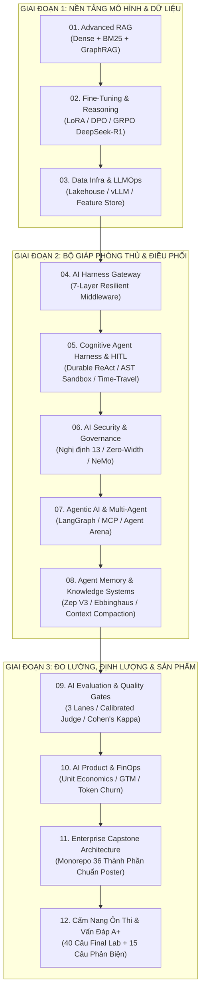

# 📚 TỔNG HỢP GIÁO TRÌNH & SỔ TAY KỸ THUẬT AI CHUẨN PRODUCTION (VINAI / VINUNI CAPSTONE)

Thư mục này tập hợp toàn bộ các giáo trình chuyên sâu, sổ tay kiến trúc và cẩm nang thực chiến được thiết kế dành cho kỹ sư AI, nghiên cứu sinh và sinh viên làm đồ án tốt nghiệp (Capstone Project) theo tiêu chuẩn công nghiệp Enterprise.

---

## 🗺️ Bản Đồ Lộ Trình Học Tập & Triển Khai Toàn Diện (Full Learning Pathway)

---

## 📖 Danh Mục Giáo Trình Chi Tiết (12 Phân Hệ Chuyên Sâu)

| STT | Tên Giáo Trình | File Liên Kết | Trọng Tâm Kiến Thức Chuyên Sâu |
| :---: | :--- | :--- | :--- |
| **01** | **RAG Toàn Diện: Từ Cơ Bản Đến Production-Grade** | [GIAO_TRINH_RAG_TOAN_DIEN_TU_CO_BAN_DEN_PRODUCTION.md](file:///c:/Users/Admin/Desktop/KLTN/VinAI/Giao_Trinh/GIAO_TRINH_RAG_TOAN_DIEN_TU_CO_BAN_DEN_PRODUCTION.md) | Chunking phân tầng NĐ 30, Contextual Retrieval, Hybrid Search (Dense + BM25 RRF), Cross-Encoder Re-ranking, Semantic Caching, GraphRAG tri thức đồ thị. |
| **02** | **Fine-Tuning & Reasoning Toàn Diện** | [GIAO_TRINH_FINE_TUNING_VA_REASONING_TOAN_DIEN.md](file:///c:/Users/Admin/Desktop/KLTN/VinAI/Giao_Trinh/GIAO_TRINH_FINE_TUNING_VA_REASONING_TOAN_DIEN.md) | SFT, LoRA/QLoRA 4-bit, DPO, ORPO, GRPO (DeepSeek-R1 style CoT), Tối ưu VRAM GPU, Domain Embedding MRL, vLLM multi-LoRA hot-swapping. |
| **03** | **Data Infrastructure & LLMOps Toàn Diện (Track 2)** | [GIAO_TRINH_DATA_INFRA_VA_LLMOPS_TOAN_DIEN.md](file:///c:/Users/Admin/Desktop/KLTN/VinAI/Giao_Trinh/GIAO_TRINH_DATA_INFRA_VA_LLMOPS_TOAN_DIEN.md) | Kiến trúc Medallion (Bronze/Silver/Gold), Lakehouse Delta Lake/Iceberg (ACID & Time-Travel), Feast Feature Store, Model Serving vLLM (Prefill vs Decode, PagedAttention), K8s KEDA, OTel 11 Spans, Disaster Recovery (RTO/RPO). |
| **04** | **Kiến Trúc AI Harness & Resilient Gateway** | [GIAO_TRINH_KIEN_TRUC_AI_HARNESS_CHUAN_PRODUCTION.md](file:///c:/Users/Admin/Desktop/KLTN/VinAI/Giao_Trinh/GIAO_TRINH_KIEN_TRUC_AI_HARNESS_CHUAN_PRODUCTION.md) | Middleware 7 lớp kiên cố, Circuit Breaker 3 pha, Dynamic Model Routing, Request Hedging triệt tiêu trễ P99, FinOps Telemetry (DuckDB), Chuẩn OpenTelemetry GenAI. |
| **05** | **Cognitive Agent Harness, HITL & Điều Phối Đa Tác Tử** | [GIAO_TRINH_COGNITIVE_AGENT_HARNESS_VA_HITL_CHUAN_PRODUCTION.md](file:///c:/Users/Admin/Desktop/KLTN/VinAI/Giao_Trinh/GIAO_TRINH_COGNITIVE_AGENT_HARNESS_VA_HITL_CHUAN_PRODUCTION.md) | Durable Execution (State as DTO / Replay), AST Security Sandbox chống RCE, Human-in-the-Loop Approval Gate, Bộ nhớ phân tầng, Runaway Loop Breaker. |
| **06** | **AI Security, Guardrails & Governance Toàn Diện** | [GIAO_TRINH_AI_SECURITY_GUARDRAILS_VA_GOVERNANCE_TOAN_DIEN.md](file:///c:/Users/Admin/Desktop/KLTN/VinAI/Giao_Trinh/GIAO_TRINH_AI_SECURITY_GUARDRAILS_VA_GOVERNANCE_TOAN_DIEN.md) | Phòng thủ OWASP Top 10 for LLMs, Khử ký tự vô hình Zero-Width Unicode, PII Scrubbing tiếng Việt tuân thủ Nghị định 13/2023/NĐ-CP, NeMo Guardrails Colang 2.0. |
| **07** | **Agentic AI & Multi-Agent Systems Toàn Diện (Track 3)** | [GIAO_TRINH_AGENTIC_AI_VA_MULTI_AGENT_SYSTEMS_TOAN_DIEN.md](file:///c:/Users/Admin/Desktop/KLTN/VinAI/Giao_Trinh/GIAO_TRINH_AGENTIC_AI_VA_MULTI_AGENT_SYSTEMS_TOAN_DIEN.md) | LangGraph Pregel Engine State Machine, Model Context Protocol (MCP), Phân rã mục tiêu (ReAct), Tranh biện đa tác tử (Agent Arena), Zep Long-term Memory. |
| **08** | **Agent Memory & Knowledge Systems Toàn Diện** | [GIAO_TRINH_AGENT_MEMORY_VA_KNOWLEDGE_SYSTEMS_TOAN_DIEN.md](file:///c:/Users/Admin/Desktop/KLTN/VinAI/Giao_Trinh/GIAO_TRINH_AGENT_MEMORY_VA_KNOWLEDGE_SYSTEMS_TOAN_DIEN.md) | Quản trị bộ nhớ 4 tầng (Working, Long-term Facts, Episodic Reflexion, Semantic Temporal Graph), Zep Cloud V3, Hàm suy giảm lãng quên Ebbinghaus, Invalidation Tombstone, Quyền được lãng quên NĐ 13. |
| **09** | **AI Evaluation, Benchmark & Quality Gates Toàn Diện** | [GIAO_TRINH_AI_EVALUATION_BENCHMARK_VA_QUALITY_GATES_TOAN_DIEN.md](file:///c:/Users/Admin/Desktop/KLTN/VinAI/Giao_Trinh/GIAO_TRINH_AI_EVALUATION_BENCHMARK_VA_QUALITY_GATES_TOAN_DIEN.md) | Ba Làn Đánh Giá (Code Checks, Calibrated Judge, Human Baseline), Ma trận bao phủ 5 chiều, Hệ số Cohen's Kappa ($\kappa \ge 0.81$), Bộ 4 chỉ số RAGAS, Đánh giá quỹ đạo Agent, Quality Gates CI/CD. |
| **10** | **AI Product Management, FinOps & Monetization (Track 1)** | [GIAO_TRINH_AI_PRODUCT_FINOPS_VA_MONETIZATION_TOAN_DIEN.md](file:///c:/Users/Admin/Desktop/KLTN/VinAI/Giao_Trinh/GIAO_TRINH_AI_PRODUCT_FINOPS_VA_MONETIZATION_TOAN_DIEN.md) | Khám phá vấn đề & Wizard-of-Oz, Core Action Card, Chống Token Churn, Mô hình tài chính GPU/Token, LTV/CAC $\ge 3.0$, GTM & Định giá Hybrid. |
| **11** | **Kiến Trúc AI Capstone & Khung Đồ Án 36 Thành Phần** | [GIAO_TRINH_KIEN_TRUC_AI_CAPSTONE_CHO_SINH_VIEN.md](file:///c:/Users/Admin/Desktop/KLTN/VinAI/Giao_Trinh/GIAO_TRINH_KIEN_TRUC_AI_CAPSTONE_CHO_SINH_VIEN.md) & [HUONG_DAN_KIEN_TRUC_VA_CODE_DO_AN_CUOI_KHOA.md](file:///c:/Users/Admin/Desktop/KLTN/VinAI/Giao_Trinh/HUONG_DAN_KIEN_TRUC_VA_CODE_DO_AN_CUOI_KHOA.md) | Khung mã nguồn Monorepo Clean Architecture khớp 100% Poster VinAI 36 thành phần, FastAPI SSE Streaming, Pydantic v2 Contracts, Docker Compose. |
| **12** | **Cẩm Nang Ôn Thi & Bộ 55 Câu Vấn Đáp Bảo Vệ Tốt Nghiệp** | [CAM_NANG_ON_THI_VA_VAN_DAP_TOT_NGHIEP_VINAI.md](file:///c:/Users/Admin/Desktop/KLTN/VinAI/Giao_Trinh/CAM_NANG_ON_THI_VA_VAN_DAP_TOT_NGHIEP_VINAI.md) | Giải mã toàn bộ 40 câu trắc nghiệm & tình huống thực chiến Final Lab VinAI, Bộ 15 câu hỏi phản biện bảo vệ điểm A+, Kịch bản Live Demo 10 phút "WOW" Hội đồng. |

---

## 🛠️ Tài Liệu Tham Khảo Cấu Trúc & Khái Niệm Bổ Trợ
- [Cấu Trúc Thư Mục Dự Án AI Chuẩn Production](file:///c:/Users/Admin/Desktop/KLTN/VinAI/Giao_Trinh/CAU_TRUC_THU_MUC_DU_AN_AI_CHUAN_PRODUCTION.md): Quy chuẩn tổ chức Monorepo chuẩn Enterprise.
- [Giải Thích Bản Đồ Khái Niệm Agentic AI](file:///c:/Users/Admin/Desktop/KLTN/VinAI/Giao_Trinh/agentic_ai_khai_niem_va_vi_du.md): Diễn giải đời thường 36 khái niệm trong Poster VinAI.

---

## 🎯 Hướng Dẫn Sử Dụng
- Các giáo trình trên đều có cấu trúc tự hoàn chỉnh bao gồm: **Lý thuyết nền tảng & toán học $\to$ Kiến trúc hệ thống $\to$ Mã nguồn Python thực chiến $\to$ Chiến lược kiểm thử & tối ưu production $\to$ Bộ câu hỏi vấn đáp hội đồng.**
- Khi ôn tập hoặc triển khai một phân hệ cụ thể, mở trực tiếp liên kết markdown tương ứng trong bảng trên.
