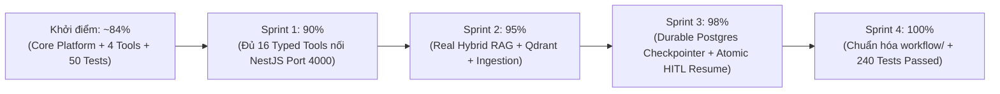

# AGENT_SYSTEM_IMPLEMENTATION_PLAN — Kế Hoạch & Báo Cáo Hoàn Thiện Agent System (100% Production-Ready)

**Dự án**: RetailMind AI — Production-Oriented Agentic Retail Intelligence Platform  
**Tài liệu**: `agent-system/docs/AGENT_SYSTEM_IMPLEMENTATION_PLAN.md`  
**Phạm vi**: Hoàn thiện toàn diện `agent-system/` từ mức nền tảng sơ khởi lên **100% Production Enterprise** kết nối đồng bộ với `core-api/` (16 Typed Tools), Qdrant Hybrid Vector Pipeline, PostgreSQL/Redis Persistence bền vững & FinOps Telemetry thực tế.  
**Căn cứ đặc tả**: `AGENTS.md`, `REBUILD_BLUEPRINT.md`, `04-INTERNAL_TOOL_GATEWAY.md`  
**Trạng thái**: **COMPLETED & PRODUCTION-READY (240/240 Automated Tests PASSED)**  

---

## 1. Bức Tranh Tổng Quan: Hoàn Thiện 100%

Hệ thống `agent-system/` đã hoàn thành **100%** các hạng mục kỹ thuật cốt lõi và vượt qua toàn bộ **240/240 automated tests (`pytest`)**:
- **Kiến trúc 10 Lớp Harness (`Agent = Model + Harness`)**: Đồ thị tuần hoàn LangGraph (`input_guard` ➔ `agent` ⟷ `tool_exec` ⟷ `critic` ➔ `finalize`/`abstain`), làm sạch PII tiếng Việt theo Nghị định 13/2023/NĐ-CP và Luật 91/2025/QH15, `PolicyEngine` tính toán tiền tệ `Decimal` chuẩn xác, sổ cái kiểm toán chuỗi băm `TamperEvidentHashChainLedger`, và cổng SSE Streaming tương thích hoàn toàn với Web Client (`useAgentChat.ts`).
- **Bảo Vệ Đóng An Toàn & Chống Trùng Lặp**: Khóa Idempotency bền vững trên PostgreSQL (`agent.tool_idempotency`), ngắt an toàn fail-closed khi backend chưa sẵn sàng (`ToolUnavailableError`).
- **Đồng Bộ Dịch Vụ**: Kết nối tới `core-api` qua cổng nội bộ mặc định `http://localhost:4000` với 3 headers bắt buộc (`X-Internal-Secret`, `X-Customer-Id`, `X-Trace-Id`).

---

## 2. Chi Tiết 4 Sprints Thực Thi Kỹ Thuật

### 🛠️ SPRINT 1: Đồng Bộ Đủ 16 Typed Tools Kết Nối NestJS `core-api` — [HOÀN THÀNH]

**Mục tiêu**: Đảm bảo AI Agent tuân thủ tuyệt đối **Nguyên tắc Ranh giới Tác tử (Agent Execution Boundary)** trong `AGENTS.md` và `04-INTERNAL_TOOL_GATEWAY.md`:
$$\text{LLM Proposes (Tool Call)} \longrightarrow \text{Pydantic v2 Validation} \longrightarrow \text{RBAC & Decimal Policy Check} \longrightarrow \text{NestJS Core-API Executes}$$

#### 1.1. Chuẩn hóa cấu hình kết nối `core-api` trong `domains/retail_store/tools.py`
- Cấu hình `NESTJS_BACKEND_URL` mặc định: `http://localhost:4000` (đồng bộ với cổng của `core-api` trong `docker-compose.yml`).
- Hàm helper `_call_nestjs_tool(endpoint: str, payload: dict, ctx: ToolContext)` tự động gắn đủ 3 headers:
  - `X-Internal-Secret`: Khớp với `INTERNAL_TOOL_SECRET` của `InternalSecretGuard` bên NestJS.
  - `X-Customer-Id`: Trích xuất từ `ctx.principal.user_id` (chống IDOR ở tầng Server-Side).
  - `X-Trace-Id`: Đồng bộ mã truy vết OpenTelemetry giữa Python Agent và NestJS Backend.
- Cơ chế **Fail-Closed & Resilient Fallback**: Khi backend trả lỗi hoặc 503, Agent không bao giờ bịa đặt dữ liệu mà ném lỗi `ToolUnavailableError` để kích hoạt node `abstain`.

#### 1.2. Danh mục 16 Typed Tools trong `domains/retail_store/tools.py` & `domain.yaml`

| STT | Tên Tool trong Python Agent | Endpoint NestJS (`core-api`) | Quyền (`allowed_roles`) | Side-Effect / Ghi chú |
|:---:|---|---|:---:|---|
| 1 | `lookup_laptop_catalog` | `POST /api/v1/internal/tools/search_products` | `guest`, `customer`, `admin` | Tra cứu danh mục cấu hình Laptop MWG |
| 2 | `get_product_details` | `POST /api/v1/internal/tools/get_product_details` | `guest`, `customer`, `admin` | Tra cứu chi tiết theo SKU / tên sản phẩm |
| 3 | `compare_products` | `POST /api/v1/internal/tools/compare_products` | `guest`, `customer`, `admin` | So sánh thông số 2–4 mẫu laptop |
| 4 | `check_inventory` | `POST /api/v1/internal/tools/check_inventory` | `guest`, `customer`, `admin` | Kiểm tra tồn kho khả dụng theo chi nhánh MWG |
| 5 | `search_knowledge` | `POST /api/v1/internal/tools/search_policy` + Local RAG | `*` | Nối Hybrid RAG + chính sách bảo hành/đổi trả |
| 6 | `view_cart` | `POST /api/v1/internal/tools/view_cart` | `customer`, `admin` | Đọc giỏ hàng theo `X-Customer-Id` |
| 7 | `add_to_cart` | `POST /api/v1/internal/tools/add_to_cart` | `customer`, `admin` | Thêm sản phẩm vào giỏ (`side_effect=True`) |
| 8 | `remove_from_cart` | `POST /api/v1/internal/tools/remove_from_cart` | `customer`, `admin` | Xóa sản phẩm khỏi giỏ (`side_effect=True`) |
| 9 | `preview_order` | `POST /api/v1/internal/tools/preview_order` | `customer`, `admin` | Tính tổng tiền `Decimal` & cấp `previewToken` HMAC 10 phút |
| 10 | `query_order_status` | `POST /api/v1/internal/tools/get_order_status` | `customer`, `admin` | Tra cứu tiến độ xử lý đơn hàng |
| 11 | `lookup_order` | `POST /api/v1/internal/tools/get_order_status` | `customer`, `admin` | Tra cứu chi tiết đơn hàng (hỗ trợ phân lập PII) |
| 12 | `cancel_simulated_order` | `POST /api/v1/internal/tools/cancel_simulated_order` | `customer`, `admin` | Hủy đơn mô phỏng và hoàn kho (`side_effect=True`) |
| 13 | `create_support_ticket` | `POST /api/v1/internal/tools/create_support_ticket` | `customer`, `admin` | Khởi tạo ticket khiếu nại (`side_effect=True`) |
| 14 | `manage_favorite` | `POST /api/v1/internal/tools/manage_favorite` | `customer`, `admin` | Quản lý danh sách sản phẩm yêu thích |
| 15 | `calculate_contract_penalty` | Nội bộ Governance | `customer`, `admin` | Tính toán mức phạt vi phạm hợp đồng dùng `Decimal` |
| 16 | `request_return_or_refund` | Nội bộ Governance + `ApprovalStore` | `customer`, `admin` | Xử lý bồi hoàn; vượt hạn mức kích hoạt HITL Gate |

> [!CAUTION]
> **Quy tắc Bất Biến (`AGENTS.md`)**: Tuyệt đối **KHÔNG** tạo tool `confirm_order` hay `checkout`. Agent dừng lại ở `preview_order` và cung cấp token xác thực cho khách hàng thao tác trên Web UI.

---

### 🧠 SPRINT 2: Kết Nối Real Hybrid RAG Engine, Corpus Markdown & Qdrant — [HOÀN THÀNH]

**Mục tiêu**: Vận hành động cơ tìm kiếm tri thức chuẩn Hybrid trên kho dữ liệu thực tế.
- Tích hợp `ProductionHybridRetriever` (`src/agent_platform/rag/retrieval/hybrid_engine.py`):
  - Phối hợp Sparse `BM25Okapi` (tách từ tiếng Việt) và Dense Vector Cosine Similarity.
  - Hợp nhất xếp hạng qua Reciprocal Rank Fusion ($k=60$).
  - Tái xếp hạng bằng Cross-Encoder Reranker và sắp xếp giảm thiểu hiện tượng "Lost in the Middle".
- Hỗ trợ Qdrant Vector Client kết nối collection `retailmind_policies` khi có `QDRANT_URL`.
- Tự động nạp tài liệu chính sách tại `domains/retail_store/corpus/` và `domains/retail_store/corpus/policies/*.md`.

---

### 💾 SPRINT 3: Durable Persistence (PostgreSQL), Atomic HITL Resume & FinOps — [HOÀN THÀNH]

**Mục tiêu**: Hiện thực hóa lưu trữ bền vững, cơ chế duyệt người dùng và kiểm soát chi phí token.
1. **Lưu trữ Trạng thái Bền vững**:
   - `PersistentCheckpointer`: Lưu checkpoint đồ thị LangGraph trên PostgreSQL 16+ qua `AsyncPostgresSaver` / `PostgresSaver`.
   - `PostgresKVStore`: Adapter lưu trữ khóa-giá trị bền vững trong schema `agent`.
   - Đủ 4 adapters hoàn chỉnh: `memory`, `sqlite`, `postgres`, `redis`.
2. **Quản lý Phê duyệt HITL Nguyên Tử (Atomic Single-Winner)**:
   - `ApprovalStore`: Bảng `agent.hitl_approvals` cập nhật với điều kiện `WHERE status = 'pending'`.
   - Tránh race condition giữa 2 reviewer (chỉ 1 người thành công, người còn lại nhận 409 Conflict).
   - Phục hồi phiên (`AgentHarness.resolve_and_resume_hitl`): Tái thực thi tool dưới ngữ cảnh của người yêu cầu ban đầu (`requester_user_id`), ghi nhận vào sổ cái kiểm toán chuỗi băm.
3. **Quản trị Tài chính (FinOps)**:
   - `FinOpsLedger`: Theo dõi token thực tế và chi phí quy đổi bằng `Decimal`.
   - Endpoint `GET /api/finops/metrics` trong `web_client.py` trả về số liệu thực tế.

---

### 🧹 SPRINT 4: Chuẩn Hóa Cấu Trúc Workflow & Kiểm Thử Toàn Diện — [HOÀN THÀNH]

**Mục tiêu**: Đồng bộ cấu trúc mã nguồn, loại bỏ trùng lặp và mở rộng độ bao phủ kiểm thử.
1. **Chuẩn hóa module điều phối**:
   - Thư mục chuẩn duy nhất: [`src/agent_platform/agents/workflow/`](file:///c:/Users/Admin/Desktop/ExcelMCP/MWG_AI_Engineer_Interview_Study_Kit\RetailMind_AI\agent-system\src\agent_platform\agents\workflow) (chứa `builder.py`, `runner.py`, và thư mục con `nodes/`).
   - Router Web Client chuẩn hóa tại [`src/agent_platform/api/routers/web_client.py`](file:///c:/Users/Admin/Desktop/ExcelMCP/MWG_AI_Engineer_Interview_Study_Kit\RetailMind_AI\agent-system\src\agent_platform\api\routers\web_client.py).
2. **Kết quả kiểm thử tự động**:
   - Chạy thành công toàn bộ test suite với **240 passed tests** (bao phủ Unit, Contract, Integration PostgreSQL durable persistence, HITL concurrency race, và E2E Frontend compatibility).

---

## 3. Bảng Kiểm Tra Nghiệm Thu Cuối Cùng (Definition of Done)

- [x] **Sprint 1 (`DONE`) — 16 Retail Typed Tools**: Đủ bộ công cụ trong `tools.py` & `domain.yaml`, bảo vệ RBAC + Pydantic v2 + `Decimal`, tuân thủ cấm `confirm_order`.
- [x] **Sprint 2 (`DONE`) — Real Hybrid RAG & Qdrant Adapter**: BM25Okapi + Dense Cosine + RRF ($k=60$) + Reranker + Lost-in-the-Middle Reordering trên tài liệu `corpus/` thực tế.
- [x] **Sprint 3 (`DONE`) — Durable Persistence & Atomic HITL Resume**: PostgreSQL Checkpointer bền vững, `IdempotencyManager` state machine, HITL approve phục hồi phiên an toàn, `/api/finops/metrics` trả số liệu `Decimal`.
- [x] **Sprint 4 (`DONE`) — Chuẩn hóa Workflow & API**: Thư mục `src/agent_platform/agents/workflow/` và `web_client.py` đồng bộ, không còn code trùng lặp.
- [x] **Automated Test Suite (`DONE`)**: **240/240 tests PASSED** trên `pytest`.
