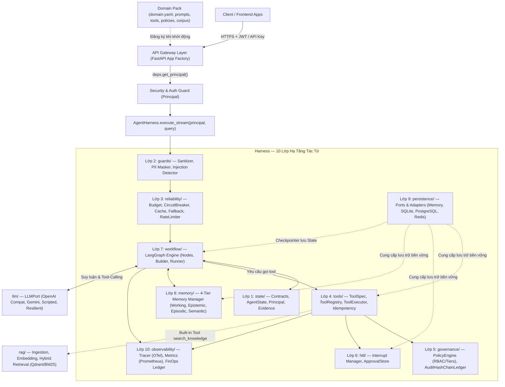
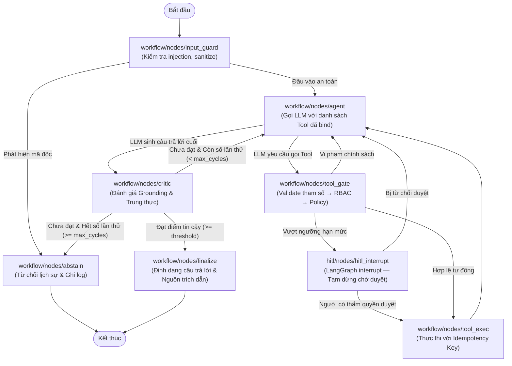

# REBUILD BLUEPRINT — Enterprise Agentic AI Platform v3 (Production Reusable Edition)

> **Trạng thái tài liệu:** `ACCEPTED & IMPLEMENTED` — Kiến trúc v3 chuẩn hóa đã được phê duyệt và hoàn thiện toàn diện.  
> **Trạng thái triển khai:** `PRODUCTION-READY` — 240/240 Automated Tests (`pytest`) PASSED 100% (Phases 0 — 9 hoàn tất).  
> **Triết lý cốt lõi:** **Agent = Model + Harness** (Hạ tầng bao quanh mô hình quyết định độ tin cậy và an toàn của hệ thống).  
> **Mục tiêu tối thượng:** Nền tảng Tác tử Doanh nghiệp Đa dự án (Multi-project Reusable Enterprise Agent Platform) với Domain Pack cắm rời (`domains/<project_name>/`), tuyệt đối **không sửa đổi mã nguồn lõi** (`src/agent_platform/`).  
> **Tương quan với RetailMind AI:** Domain Pack [`domains/retail_store/`](file:///c:/Users/Admin/Desktop/ExcelMCP/MWG_AI_Engineer_Interview_Study_Kit/RetailMind_AI/agent-system/domains/retail_store) đóng vai trò là domain tham chiếu chuẩn mực cho chuỗi bán lẻ công nghệ MWG.

---

## 0. Tóm tắt điều hành (Executive Summary)

Bảng so sánh đối chiếu giữa bộ khung giáo trình hiện tại (v2) và nền tảng tái sử dụng chuẩn hóa (v3):

| Hạng mục kiến trúc | Phiên bản v2 (Hiện tại - Giáo trình) | Phiên bản v3 (Mục tiêu - Production Platform) |
|---|---|---|
| **Mô hình Agent (Topology)** | Router từ khóa (`any(k in query)`) → RAG → Critic tuyến tính (không có vòng lặp thật) | **LLM Tool-Calling Loop** + **Vòng lặp phản tư thực (True ReAct/Reflection Cyclic Graph)** với giới hạn cứng |
| **Tính độc lập Domain** | Nghiệp vụ pháp lý VN bị hardcode đan xen trong `src/` | **Domain Pack cắm rời (`domains/<name>/`)**; Core hoàn toàn agnostic với nghiệp vụ |
| **Quản trị Tool & Thực thi** | Rẽ nhánh thủ công `if/elif` trong `MCPAdapter`, thiếu schema kiểm soát | **ToolRegistry** + **ToolExecutor Pipeline 9 bước** (Validate → Authz → Policy → HITL → Idempotency → Timeout → Audit → Sanitize) |
| **Cơ chế HITL (Human-In-The-Loop)** | Biến `dict` lưu tạm trong RAM, Approve chỉ đổi status không resume được luồng | LangGraph **`interrupt()`** + **Durable Checkpointer**; Endpoint Approve phục hồi (`resume`) phiên chạy chính xác |
| **Định danh & Phân quyền (Auth)** | Không có xác thực; rate limit tin cậy header client tự gửi (`X-Forwarded-For`) | **JWT / JWKS + Server-side Principal** (`user_id`, `role`, `tenant_id`) do API gắn cố định vào `AgentState`, LLM không thể giả mạo |
| **Quản lý Trạng thái & Lưu trữ** | Toàn bộ lưu trong RAM (In-Memory), mất sạch khi khởi động lại | **Persistence Ports**: `memory` (test/dev) / `sqlite` / `postgres` (production SSOT) / `redis` |
| **Cấu hình & Môi trường** | File `configs/*.yaml` chỉ để trưng bày, không được nạp vào runtime | **YAML Base + Overlays** (`dev`, `test`, `prod`) + ENV Override, kiểm tra nghiêm ngặt bằng **Pydantic Settings** (Fail-fast) |
| **Giả lập kiểm thử (Mock LLM)** | Trả lời dựa trên regex từ khóa domain, vi phạm nguyên tắc tách lớp | **ScriptedLLM** nhận kịch bản hành vi thuần túy (`ToolCall`, `DeltaContent`), độc lập 100% với domain |
| **Đánh giá & Benchmark (Eval)** | "Calibrated Judge" thực chất là so khớp chuỗi tĩnh, hệ số Cohen Kappa $\kappa = 1.0$ giả | **Lane 1: Deterministic Checks** + **Lane 2: True LLM Judge** (tùy chọn) + $\kappa$ chỉ tính trên tập nhãn người thật |
| **Số học & Tiền tệ** | Sử dụng số thực `float`, tiềm ẩn sai số làm tròn số học | Bắt buộc sử dụng **`Decimal`** (Python) / `NUMERIC(18, 0)` (DB) / `string` (JSON API) theo chuẩn ngân hàng |
| **Bảo vệ Dữ liệu Cá nhân (PII)** | Regex đơn sơ gắn chặt vào mã nguồn RAG | **Pluggable PII Packs** tuân thủ Nghị định 13/2023/NĐ-CP và Luật Bảo vệ dữ liệu cá nhân 91/2025/QH15 |

---

## 1. Kết quả Audit v2 & Nguyên nhân tái thiết

Qua quá trình rà soát toàn diện codebase v2, 17 khiếm khuyết kỹ thuật (A1 — A17) đã được nhận diện, đòi hỏi việc tái cấu trúc triệt để:

| Mã | Vấn đề phát hiện | Bằng chứng mã nguồn v2 | Mức độ | Rủi ro kỹ thuật |
|---|---|---|:---:|---|
| **A1** | Tài liệu ghi "Directed Cyclic Graph" nhưng đồ thị thực tế đi thẳng `critic → END` không có vòng lặp | `src/agents/orchestrator.py` L33 | 🔴 Nghiêm trọng | Agent không thể tự sửa lỗi khi kết quả không đạt chuẩn grounding |
| **A2** | Supervisor định tuyến bằng quét từ khóa thô `any(k in query)` | `src/agents/specialists.py` L53-61 | 🔴 Nghiêm trọng | Đảo lộn quy trình xử lý khi gặp truy vấn phức tạp hoặc đa ngữ cảnh |
| **A3** | Tác tử không tự gọi tool; việc gọi tool viết cứng bằng chuỗi `if/elif` | `src/harness/tools/mcp_adapter.py` L131-170 | 🔴 Nghiêm trọng | Phá vỡ tính năng Function Calling / Tool Calling tự nhiên của LLM |
| **A4** | Cờ `requires_hitl` được khai báo trong schema nhưng không hề có code kiểm tra | `src/harness/tools/mcp_adapter.py` L172-178 | 🔴 Nghiêm trọng | Các thao tác nhạy cảm (như hoàn tiền, đổi dữ liệu) bị thực thi ngoài kiểm soát |
| **A5** | Endpoint duyệt HITL không xác thực người duyệt và không kích hoạt chạy tiếp đồ thị | `src/api/main.py` L263-268 | 🔴 Nghiêm trọng | Luồng nghiệp vụ bị treo vĩnh viễn, người dùng ngoài có thể duyệt bừa |
| **A6** | Cấu hình CORS mở toang `allow_origins=["*"]` kèm `allow_credentials=True` | `src/api/main.py` L68-74 | 🔴 Nghiêm trọng | Lỗ hổng bảo mật trình duyệt nghiêm trọng (Cross-Origin Resource Sharing Exploit) |
| **A7** | Cache key sử dụng câu hỏi thô (chưa lọc PII, không phân lập theo User/Tenant) | `src/api/main.py` L93, L176 | 🔴 Nghiêm trọng | Lộ lọt dữ liệu nhạy cảm giữa các người dùng hoặc tổ chức khác nhau |
| **A8** | Cơ chế Rate Limiter tin tưởng header client tự gửi (`X-Forwarded-For`); kiểm tra lặp 2 lần | `src/api/main.py` L202, L210-222 | 🟠 Cao | Dễ dàng bị vượt qua bằng kỹ thuật IP Spoofing; lãng phí tài nguyên CPU |
| **A9** | Ngoại lệ hệ thống trả nguyên chuỗi `str(e)` ra phản hồi HTTP của client | `src/api/main.py` L195 | 🟠 Cao | Rò rỉ thông tin hạ tầng nội bộ (Stack trace leakage) |
| **A10** | Các tệp `configs/*.yaml` và `contracts/tool_manifest.yaml` không có code nào nạp | Kiểm tra toàn bộ mã nguồn không có lệnh nạp YAML | 🟠 Cao | Cấu hình thực tế bị hardcode trong code, sai khác hoàn toàn với tài liệu |
| **A11** | Khóa Idempotency tính bằng `hash(args)`, khiến 2 lần hoàn tiền giống nhau bị từ chối | `src/harness/tools/idempotency.py` L43-47 | 🟠 Cao | Khách hàng mua 2 món đồ cùng giá sẽ bị từ chối giao dịch thứ hai do nhầm replay |
| **A12** | `MockLLMClient` chứa sẵn nội dung vụ kiện và luật pháp VN | `src/core/llm_client.py` `MockLLMClient` | 🟠 Cao | Unit test và Eval bị ô nhiễm dữ liệu (Data Contamination), không đánh giá thật |
| **A13** | Cơ chế "Calibrated Judge" thực chất là kiểm tra từ khóa tĩnh với $\kappa = 1.0$ giả tạo | `evals/three_lane_evaluator.py` L32-51 | 🟠 Cao | Báo cáo kiểm thử ảo, không phản ánh năng lực thực tế của mô hình |
| **A14** | Số tiền phạt và hợp đồng dùng kiểu `float` | `harness/tools/contracts.py`, `core/config.py` L35-36 | 🟠 Cao | Xuất hiện sai số dấu phẩy động (vd: `0.1 + 0.2 = 0.30000000000000004`) |
| **A15** | Gemini Streaming là giả lập (đợi sinh xong toàn bộ text rồi mới cắt vụn thành stream) | `src/core/llm_client.py` L303-313 | 🟡 Trung bình | Time-To-First-Token (TTFT) bị suy giảm nghiêm trọng, giao diện bị đơ |
| **A16** | FinOps ghi cứng `model_name="mock-provider"`, số token tính ước lượng bằng độ dài chuỗi | `src/api/main.py` L180-188 | 🟡 Trung bình | Báo cáo chi phí vận hành API không chính xác so với hóa đơn nhà cung cấp |
| **A17** | `pyproject.toml` không ghim cứng phiên bản; thư viện `langgraph` cũ thiếu API `interrupt` | `pyproject.toml` | 🟡 Trung bình | Môi trường build không xác định (Non-deterministic builds), dễ gãy khi cập nhật |

---

## 2. Nguyên tắc thiết kế v3 (Core Engineering Principles)

1. **Lõi Độc Lập Domain Tuyệt Đối (Domain-Agnostic Core):**  
   Mọi tệp trong `src/agent_platform/` tuyệt đối không chứa bất kỳ từ khóa nghiệp vụ chuyên biệt nào (ví dụ: "Điều 301", "hoàn tiền", "IMEI", "laptop"). Hệ thống kiểm tra CI sẽ quét tự động (grep-check) để từ chối build nếu vi phạm.
2. **Nguyên Tắc Ranh Giới Tác Tử (Agent Execution Boundary):**  
   $$\text{LLM Proposes} \longrightarrow \text{Typed Validation (Pydantic)} \longrightarrow \text{Server-Side Authz Check} \longrightarrow \text{Trusted Backend Service Executes}$$  
   Mô hình ngôn ngữ chỉ đóng vai trò đề xuất tham số gọi công cụ. Máy chủ xác thực quyền, kiểm tra chính sách và tự tay thực thi. Không cấp quyền truy cập CSDL hoặc Shell trực tiếp cho LLM.
3. **Định Danh Bất Biến (Immutable Principal):**  
   Thông tin `user_id`, `role`, `tenant_id` được trích xuất từ JWT/API Key bởi tầng bảo mật API và ghi đè vào `AgentState` trước khi tác tử bắt đầu. Không một node hay công cụ nào được phép thay đổi Principal này.
4. **Kiến Trúc Cổng Lưu Trữ Đa Tầng (Storage Ports & Adapters):**  
   Mọi trạng thái chia sẻ (State, Memory, Idempotency, Audit Ledger, Cache) đều giao tiếp qua Port Interface (Python `Protocol`). Tùy chọn adapter: `memory` (cho unit test), `sqlite` (cho máy trạm), `postgres` và `redis` (bắt buộc cho môi trường production).
5. **Đóng An Toàn (Fail-Closed Architecture):**  
   Khi xảy ra lỗi công cụ, thiếu bằng chứng grounding, hoặc vi phạm chính sách, tác tử lập tức chuyển sang trạng thái an toàn: từ chối xử lý (`abstain`) hoặc yêu cầu con người can thiệp (`hitl`). Tuyệt đối không phỏng đoán câu trả lời.
6. **Xử Lý An Toàn Dữ Liệu Công Cụ (Untrusted Tool Output Sanitization):**  
   Dữ liệu trả về từ API/công cụ bên ngoài được coi là không tin cậy. Bắt buộc phải làm sạch, bọc trong thẻ phân định `<tool_output>`, và cắt giới hạn độ dài trước khi nạp lại vào ngữ cảnh LLM để ngăn chặn tấn công **Indirect Prompt Injection**.
7. **Đo Lường Trung Thực & Minh Bạch (Measurable & Honest Quality):**  
   Dữ liệu kiểm thử chạy với Mock/Scripted chỉ dùng cho smoke test. Mọi báo cáo đánh giá (Eval) phải ghi rõ tên mô hình thật, ngày giờ kiểm nghiệm và siêu dữ liệu đi kèm.
8. **Mô Hình Khai Báo (Declarative Domain Packs):**  
   Triển khai một nghiệp vụ mới chủ yếu thông qua khai báo YAML (`domain.yaml`, `policies.yaml`) và Markdown (`system.md`, `critic.md`). Chỉ viết mã Python khi nghiệp vụ yêu cầu Tool xử lý logic đặc thù.

---

## 3. Kiến trúc Đích (Target Architecture)

> **Quyết định kiến trúc chuẩn hóa (ADR-v3-001):**  
> Áp dụng cấu trúc module hóa phân tầng: **Agent = Model + Harness**.  
> Toàn bộ 10 thành phần hạ tầng bảo vệ, kiểm soát và vận hành đều thuộc `harness/`. Hai hệ thống `llm/` (Mô hình) và `rag/` (Tri thức) là các dịch vụ độc lập kết nối với Harness qua cổng giao tiếp.

### 3.1 Sơ đồ lớp tổng thể



### 3.2 Chu trình tác tử tuần hoàn (Agent Cycle Graph)

Thay thế hoàn toàn bộ định tuyến từ khóa cổ điển bằng đồ thị tuần hoàn chính quy hỗ trợ ngắt quãng (Interruptible Cyclic Graph):



**Đặc tả kiểm soát chu trình:**
- **RAG là Built-in Tool:** Công cụ `search_knowledge` nằm tại `harness/tools/builtin/search_knowledge.py`. LLM chủ động quyết định khi nào cần tra cứu thông tin dựa trên ngữ cảnh thay vì bị ép buộc bởi router tĩnh.
- **Vòng lặp phản tư thực tế (True Reflection Loop):** Đường dẫn `critic → agent → tool_exec → critic` được bảo vệ bởi biến đếm `critic_cycles`. Nếu không đạt ngưỡng `grounding_threshold` (mặc định 0.75), tác tử tiếp thu phản hồi và tra cứu bổ sung.
- **Rào chắn giới hạn tài nguyên:** Các cận trên cứng gồm `max_steps` (mặc định 8), `max_critic_cycles` (mặc định 2), `max_tool_calls_per_step` (mặc định 3), và `token_budget` (mặc định 16,000 tokens). Vượt quá bất kỳ rào chắn nào, hệ thống lập tức ngắt về node `abstain`.

---

### 3.3 Cấu trúc thư mục chi tiết

Toàn bộ hệ thống mã nguồn được tổ chức nhất quán theo cấu trúc thực tế đã tạo:

```text
agent-system/
├── src/
│   └── agent_platform/                     # MÃ NGUỒN LÕI NỀN TẢNG (100% Domain-Agnostic)
│       │
│       ├── agents/                          # TẦNG TÁC TỬ & ĐIỀU PHỐI (Agentic Core)
│       │   ├── __init__.py
│       │   ├── base.py                      # BaseAgent Protocol & Abstract Class
│       │   ├── enterprise_agent.py          # EnterpriseAgent (Persona, Tool RBAC, ReAct Loop)
│       │   └── workflow/                    # ĐIỀU PHỐI LUỒNG LANGGRAPH TUẦN HOÀN
│       │       ├── __init__.py
│       │       ├── builder.py               # Xây dựng StateGraph từ Domain Pack
│       │       ├── runner.py                # Quản lý phiên thực thi (OrchestratorRunner)
│       │       └── nodes/                   # Các Trạm Điều Phối Tuần Hoàn
│       │           ├── input_guard.py       # Kiểm tra injection, sanitize
│       │           ├── agent.py             # Gọi LLM với danh sách Tool đã bind
│       │           ├── tool_gate.py         # Kiểm duyệt tham số, RBAC & Policy
│       │           ├── tool_exec.py         # Thực thi công cụ với Idempotency
│       │           ├── critic.py            # Đánh giá phản tư & Grounding score
│       │           ├── finalize.py          # Xuất câu trả lời & trích dẫn
│       │           └── abstain.py           # Từ chối xử lý lịch sự, an toàn
│       │
│       ├── harness/                         # HẠ TẦNG DỊCH VỤ NỀN TẢNG "Agent = Model + Harness"
│       │   ├── __init__.py                  # AgentHarness (Điều phối tổng thể các lớp dịch vụ)
│       │   │
│       │   ├── state/                       # [LỚP 1] Quản lý Trạng thái & Hợp đồng
│       │   │   ├── __init__.py
│       │   │   ├── contracts.py             # AgentState (TypedDict + Reducers), Evidence, Citation
│       │   │   └── principal.py             # Principal(user_id, role, tenant_id), Role Enum
│       │   │
│       │   ├── guards/                      # [LỚP 2] An ninh Đầu vào & Bảo vệ Dữ liệu
│       │   │   ├── __init__.py
│       │   │   ├── sanitizer.py             # Làm sạch ký tự ẩn (zero-width), Unicode normalization
│       │   │   ├── pii.py                   # Masking PII (Nghị định 13/2023/NĐ-CP, CCCD, SĐT, Email)
│       │   │   └── injection.py             # Phát hiện Jailbreak, Indirect/Direct Prompt Injection
│       │   │
│       │   ├── reliability/                 # [LỚP 3] Khả năng Phục hồi & Độ bền vững
│       │   │   ├── __init__.py
│       │   │   ├── rate_limiter.py          # SlidingWindowRateLimiter (Bộ nhớ trong & Redis backend)
│       │   │   ├── circuit_breaker.py       # Ngắt mạch bảo vệ dịch vụ ngoài (Closed/Open/Half-Open)
│       │   │   ├── cache.py                 # HierarchicalCache (Key cô lập theo tenant/role/prompt)
│       │   │   ├── budget.py                # ContextBudgetSentinel (Kiểm soát token cửa sổ ngữ cảnh)
│       │   │   ├── retry.py                 # Cơ chế thử lại với hàm mũ Exponential Backoff + Jitter
│       │   │   ├── fallback_ladder.py       # Thang suy giảm năng lực 5 tầng (Full → Cached → Degraded)
│       │   │   └── request_hedging.py       # Gửi song song giảm thiểu P99 Latency (Tail tolerance)
│       │   │
│       │   ├── tools/                       # [LỚP 4] Hệ thống Công cụ & Pipeline Thực thi
│       │   │   ├── __init__.py
│       │   │   ├── spec.py                  # ToolSpec, @tool Decorator, ToolContext
│       │   │   ├── registry.py              # ToolRegistry (Nạp động từ Domain Pack)
│       │   │   ├── executor.py              # Pipeline 9 bước kiểm duyệt và thực thi an toàn
│       │   │   ├── idempotency.py           # Khóa Idempotency sha256(thread_id + tool_call_id)
│       │   │   └── builtin/
│       │   │       ├── __init__.py
│       │   │       └── search_knowledge.py  # Công cụ tích hợp kết nối tới RAG Engine
│       │   │
│       │   ├── governance/                  # [LỚP 5] Chính sách & Sổ cái Bất biến
│       │   │   ├── __init__.py
│       │   │   ├── policy.py                # PolicyEngine (Phân tích rules/tiers dùng Decimal)
│       │   │   └── audit_ledger.py          # TamperEvidentHashChainLedger (Sổ cái kiểm toán chuỗi băm)
│       │   │
│       │   ├── hitl/                        # [LỚP 6] Tương tác Người trong Vòng lặp (HITL)
│       │   │   ├── __init__.py
│       │   │   ├── nodes.py                 # Node ngắt quãng tương thích LangGraph interrupt()
│       │   │   └── approval_store.py        # Hàng đợi phê duyệt bất đồng bộ (Atomic Single-Winner)
│       │   │
│       │   ├── memory/                      # [LỚP 7] Quản trị Bộ nhớ Tác tử
│       │   │   ├── __init__.py
│       │   │   └── manager.py               # EnterpriseMemoryManager (Working, Epistemic, Episodic, Semantic)
│       │   │
│       │   ├── persistence/                 # [LỚP 8] Cổng Giao tiếp Lưu trữ Bền vững
│       │   │   ├── __init__.py
│       │   │   ├── ports.py                 # Abstract Ports (KVStorePort, CheckpointerPort)
│       │   │   ├── checkpointer.py          # PersistentCheckpointer (Postgres SSOT / Memory)
│       │   │   ├── memory/                  # Bộ chuyển đổi trong bộ nhớ RAM (Test/Dev)
│       │   │   ├── sqlite/                  # Bộ chuyển đổi SQLite cục bộ (Máy trạm cá nhân)
│       │   │   ├── postgres/                # Bộ chuyển đổi PostgreSQL chính thức (SSOT Production)
│       │   │   └── redis/                   # Bộ chuyển đổi Redis (Phân tán, Cache, RateLimit)
│       │   │
│       │   └── observability/               # [LỚP 9] Giám sát, Chỉ số & Đo lường Chi phí
│       │       ├── __init__.py
│       │       ├── tracer.py                # Phân tán Trace qua OpenTelemetry SDK
│       │       ├── metrics.py               # Thu thập chỉ số hệ thống chuẩn Prometheus
│       │       ├── finops.py                # Sổ cái tính chi phí token thực tế (FinOps Ledger Decimal)
│       │       ├── health_checker.py        # Kiểm tra sống/sẵn sàng (Liveness/Readiness probe thật)
│       │       └── lineage_graph.py         # Đồ thị phả hệ dữ liệu (Data Lineage Graph)
│       │
│       ├── llm/                             # HỆ THỐNG MÔ HÌNH NGÔN NGỮ (Độc lập Harness)
│       │   ├── __init__.py
│       │   ├── base.py                      # LLMPort Protocol, LLMResponse, ToolCall, Usage
│       │   ├── resilient.py                 # Bộ bọc đàn hồi (Primary + Circuit + Fallback)
│       │   └── providers/
│       │       ├── __init__.py
│       │       ├── openai_compat.py         # Tương thích chuẩn OpenAI / vLLM / Ollama
│       │       ├── gemini.py                # Tương thích Google Gemini Native REST + True Streaming
│       │       ├── scripted.py              # ScriptedLLM phục vụ kiểm thử đơn vị độc lập
│       │       └── mock.py                  # MockLLMClient chế độ ngắt mạng hoàn toàn
│       │
│       ├── rag/                             # ĐỘNG CƠ TRI THỨC VÀ TÌM KIẾM (Độc lập Harness)
│       │   ├── __init__.py
│       │   ├── ingestion/                   # Nạp và xử lý tài liệu đa định dạng
│       │   │   ├── __init__.py
│       │   │   ├── document_loader.py       # Enterprise Document Loader (MD, TXT, PDF)
│       │   │   ├── chunker.py               # Bộ chia văn bản đa chiến lược
│       │   │   ├── legal_chunker.py         # Bộ chia văn bản pháp lý chuyên sâu
│       │   │   └── medallion_pipeline.py    # Đường ống dữ liệu chuẩn Medallion (Bronze/Silver/Gold)
│       │   ├── embedding/                   # Động cơ Vector hóa ngữ nghĩa
│       │   │   ├── __init__.py
│       │   │   ├── client.py                # BaseEmbeddingClient, OpenAI / Gemini / Mock
│       │   │   └── cache.py                 # SemanticVectorCache dựa trên Cosine Distance
│       │   └── retrieval/                   # Tìm kiếm lai ghép và tối ưu kết quả
│       │       ├── __init__.py
│       │       ├── hybrid_engine.py         # Động cơ BM25 + Dense Vector qua RRF (k=60)
│       │       ├── reranker.py              # Bộ tái xếp hạng sử dụng Cross-Encoder chuyên dụng
│       │       └── query_optimizer.py       # Tối ưu truy vấn (HyDE, Đa truy vấn phân tán)
│       │
│       ├── config/                          # QUẢN TRỊ CẤU HÌNH VÀ THIẾT LẬP
│       │   ├── __init__.py
│       │   ├── loader.py                    # Trộn cấu hình (base.yaml + {env}.yaml + ENV)
│       │   └── settings.py                  # Xác thực nghiêm ngặt bằng Pydantic BaseSettings
│       │
│       ├── domain/                          # QUẢN TRỊ VÀ ĐĂNG KÝ DOMAIN PACKS
│       │   ├── __init__.py
│       │   ├── pack.py                      # Mô hình dữ liệu DomainPack và bộ nạp
│       │   └── registry.py                  # Sổ đăng ký nạp và cô lập các Domain
│       │
│       └── api/                             # CỔNG GIAO TIẾP GIAO DIỆN (FASTAPI REST & SSE)
│           ├── __init__.py
│           ├── app.py                       # App Factory: create_app(settings, pack)
│           ├── deps.py                      # Dependencies: get_principal, require_role
│           ├── sse.py                       # Định dạng chuẩn hóa luồng sự kiện SSE
│           └── routers/
│               ├── __init__.py
│               ├── chat.py                  # POST /v1/chat, POST /v1/chat/stream
│               ├── health.py                # GET /health, GET /health/live, GET /health/ready
│               ├── hitl.py                  # GET /v1/approvals, POST /v1/hitl/{id}/approve|reject
│               ├── tools.py                 # GET /v1/tools (Tra cứu schema dành cho Admin)
│               └── web_client.py            # POST /api/chat/stream, POST /api/hitl/review, GET /api/finops/metrics
│
└── domains/
    └── retail_store/                        # Gói nghiệp vụ bán lẻ công nghệ RetailMind AI (MWG)
        ├── domain.yaml                      # Khai báo định danh, hạn mức, 16 tools và cấu hình
        ├── policies.yaml                    # Phân quyền RBAC và hạn mức bồi hoàn (Decimal)
        ├── tools.py                         # 16 Typed Tools kết nối NestJS Core-API qua port 4000
        ├── corpus/                          # Kho tài liệu chính sách đổi trả, bảo hành & danh mục
        ├── prompts/                         # System Prompt & Critic Prompt chuyên biệt cho bán lẻ
        └── evals/                           # Golden benchmark datasets (JSONL chuẩn đo lường)
│
├── domains/                                 # CÁC GÓI NGHIỆP VỤ ĐỘC LẬP (DOMAIN PACKS)
│   ├── example_faq/                         # Domain mẫu đơn giản phục vụ Smoke Test & CI
│   │   ├── domain.yaml                      # Khai báo cấu hình nghiệp vụ
│   │   ├── policies.yaml                    # Chính sách phân quyền và ngưỡng kiểm duyệt
│   │   ├── tools.py                         # Triển khai các công cụ nội bộ
│   │   ├── prompts/                         # Lời nhắc chuyên biệt (system.md, critic.md)
│   │   ├── corpus/                          # Tập tài liệu tri thức nguồn
│   │   └── evals/                           # Bộ dữ liệu đánh giá golden.jsonl
│   └── legal_vn/                            # Di chuyển toàn bộ nghiệp vụ luật pháp v2 sang đây
│       ├── domain.yaml
│       ├── policies.yaml
│       ├── tools.py                         # Công cụ tính mức phạt luật thương mại (Decimal)
│       ├── prompts/
│       ├── corpus/                          # Văn bản Luật Thương Mại 2005, BLDS 2015
│       └── evals/
│
├── configs/                                 # TẬP CẤU HÌNH THEO MÔI TRƯỜNG VẬN HÀNH
│   ├── base.yaml                            # Cấu hình gốc mặc định
│   ├── dev.yaml                             # Môi trường phát triển nội bộ
│   ├── test.yaml                            # Môi trường chạy kiểm thử tự động (CI)
│   └── prod.yaml                            # Môi trường Production sẵn sàng vận hành
│
├── evals/                                   # KHUNG ĐÁNH GIÁ CHẤT LƯỢNG ĐỘC LẬP
│   ├── runner.py                            # Trình điều khiển đánh giá theo từng Domain
│   ├── checks.py                            # Lane 1: Bộ kiểm tra tất định (Deterministic Checks)
│   ├── judges/                              # Lane 2: Trọng tài LLM đánh giá định tính
│   │   └── llm_judge.py
│   └── reports/                             # Báo cáo kết quả chi tiết kèm Timestamp và Model
│
├── tests/                                   # CHIẾN LƯỢC KIỂM THỬ 6 TẦNG TOÀN DIỆN
│   ├── unit/                                # Kiểm thử đơn vị từng module Harness
│   ├── contract/                            # Kiểm thử hợp đồng Port cho mọi Adapter
│   ├── integration/                         # Kiểm thử tích hợp Graph với Database thật
│   ├── e2e/                                 # Kiểm thử luồng người dùng qua API và SSE
│   └── security/                            # Kiểm thử an ninh: 401/403, Spoofing, Injection
│
├── scripts/                                 # KỊCH BẢN TỰ ĐỘNG HÓA VẬN HÀNH
│   ├── new_domain.py                        # Khởi tạo khung Domain Pack mới trong 1 giây
│   ├── ingest.py                            # Đường ống nạp tài liệu vào Vector Database
│   └── run_evals.py                         # Thực thi kiểm thử chất lượng tự động
│
├── deploy/                                  # HỒ SƠ ĐÓNG GÓI VÀ TRIỂN KHAI
│   ├── Dockerfile                           # Đóng gói Image tối ưu đa tầng (Multi-stage build)
│   └── docker-compose.yml                   # Cụm dịch vụ: API, PostgreSQL, Redis, Qdrant
│
└── docs/                                    # TÀI LIỆU KỸ THUẬT VÀ QUYẾT ĐỊNH
    ├── REBUILD_BLUEPRINT.md                 # Tài liệu này (Bản thiết kế tổng thể)
    ├── ARCHITECTURE.md                      # Chi tiết kiến trúc hệ thống
    ├── DOMAIN_PACK_GUIDE.md                 # Hướng dẫn tạo Domain Pack mới cho kỹ sư
    └── ADR/                                 # Hồ sơ lưu trữ quyết định kiến trúc (ADR-001+)
```

---

## 4. Các Hợp đồng Cốt lõi (System Interface Contracts)

### 4.1 Domain Pack Contract (`domains/<name>/domain.yaml`)

```yaml
name: example_faq
version: 1.0.0
locale: vi-VN
description: "Gói hỗ trợ nghiệp vụ dịch vụ khách hàng tiêu chuẩn"

roles:
  - guest
  - customer
  - admin

prompts:
  system: prompts/system.md
  critic: prompts/critic.md
  version: "2026-10-23.v1"                  # Tham gia vào quá trình tính Cache Key và Trace

knowledge:
  sources:
    - path: corpus/
      loader: auto
      chunker: markdown                     # Hỗ trợ: markdown, legal_vn, parent_child
  retrieval:
    top_k: 4
    candidate_pool: 12
    dense_weight: 0.7
    sparse_weight: 0.3
    reranker: cross_encoder                 # Hỗ trợ: none, mock, cross_encoder

tools:
  module: tools.py
  enabled:
    - lookup_order
    - request_refund
    - search_knowledge

policies: policies.yaml

guards:
  sanitizer: true
  pii_packs:
    - vn_decree13                           # Bộ lọc PII số điện thoại, CCCD, Email VN
  injection_check: regex_and_heuristic      # Hỗ trợ: none, regex_and_heuristic, classifier

limits:
  max_steps: 8
  max_critic_cycles: 2
  grounding_threshold: 0.75
  context_token_budget: 16000

evals:
  golden: evals/golden.jsonl
```

---

### 4.2 Tool Contract & Pipeline Thực thi 9 Bước

```python
# domains/example_faq/tools.py
from decimal import Decimal
from pydantic import BaseModel, Field
from agent_platform.harness.tools.spec import tool, ToolContext

class RefundInput(BaseModel):
    order_id: str = Field(..., pattern=r"^ORD-\d{6}$", description="Mã đơn hàng định dạng ORD-XXXXXX")
    amount: Decimal = Field(..., gt=0, max_digits=18, decimal_places=0, description="Số tiền hoàn (VNĐ)")
    reason: str = Field(..., min_length=5, max_length=500, description="Lý do chi tiết yêu cầu hoàn tiền")

@tool(
    name="request_refund",
    description="Khởi tạo yêu cầu hoàn tiền cho đơn hàng đã mua",
    input_model=RefundInput,
    side_effect=True,                       # Thao tác gây biến đổi dữ liệu (Cần Idempotency)
    allowed_roles=["customer", "admin"],    # Kiểm tra phân quyền RBAC
    approval_rule="refund_threshold",       # Liên kết quy tắc kiểm duyệt trong policies.yaml
    timeout_s=10.0,
)
async def request_refund(args: RefundInput, ctx: ToolContext) -> dict:
    """Thực thi nghiệp vụ hoàn tiền thông qua Trusted Backend Service."""
    # Gọi dịch vụ Backend tin cậy (NestJS Core), bảo vệ bằng Idempotency Key
    response = await ctx.http_client.post(
        "/api/v1/finance/refunds",
        json={
            "order_id": args.order_id,
            "amount": str(args.amount),     # Giữ độ chính xác tuyệt đối bằng định dạng chuỗi
            "reason": args.reason,
            "requested_by": ctx.principal.user_id,
        },
        headers={"Idempotency-Key": ctx.idempotency_key}
    )
    return response.json()
```

#### Bảng tuần tự Pipeline 9 Bước trong `ToolExecutor`:

| Bước | Hành động | Mô tả xử lý kỹ thuật | Trạng thái thất bại |
|:---:|---|---|---|
| **1** | **Registry & Scope Check** | Kiểm tra tool có được đăng ký và bật trong `domain.yaml` | Trả về thông báo lỗi `tool_not_found` cho LLM |
| **2** | **Typed Validation** | Xác thực kiểu dữ liệu đầu vào qua mô hình Pydantic | Trả về `schema_validation_error` để LLM tự sửa |
| **3** | **RBAC Authorization** | Kiểm tra `ctx.principal.role ∈ tool.allowed_roles` | Bị từ chối ngay lập tức (`403 Forbidden`), **không** cho LLM thử lại |
| **4** | **Policy & Tiers Evaluation** | Đánh giá quy tắc ngưỡng trong `policies.yaml` dùng `Decimal` | Rẽ nhánh: Cho phép (`allow`), Từ chối (`deny`), hay Duyệt (`require_approval`) |
| **5** | **HITL Trigger** | Kích hoạt `interrupt({...})` nếu rơi vào ngưỡng kiểm duyệt | Đồ thị tạm dừng, lưu checkpoint, chờ phản hồi người có thẩm quyền |
| **6** | **Idempotency Gate** | Kiểm tra khóa `sha256(thread_id + tool_call_id)` | Nếu là replay: trả ngay kết quả đã lưu trước đó, bỏ qua thực thi lại |
| **7** | **Timed Execution** | Thực thi hàm tool bất đồng bộ với Timeout định trước | Chỉ retry nếu `side_effect=False`; nếu fail áp dụng cơ chế Fail-Closed |
| **8** | **Tamper-Evident Audit** | Ghi nhận sự kiện vào Sổ cái Kiểm toán Chuỗi băm (Hash-Chain Ledger) | Không gián đoạn luồng chính nhưng ghi log cảnh báo an ninh nếu lưu lỗi |
| **9** | **Output Sanitization** | Cắt ngắn độ dài, bọc thẻ `<tool_output>`, làm sạch PII | Ngăn ngừa tấn công chiếm quyền điều khiển qua Indirect Prompt Injection |

---

### 4.3 Governance Policy Contract (`domains/<name>/policies.yaml`)

```yaml
# Định nghĩa quyền hạn gọi công cụ dựa trên Vai trò (RBAC)
rbac:
  guest:
    allowed_tools:
      - search_knowledge
  customer:
    allowed_tools:
      - search_knowledge
      - lookup_order
      - request_refund
  admin:
    allowed_tools:
      - "*"

# Định nghĩa các ngưỡng kiểm duyệt nhạy cảm (Approval Rules)
approval_rules:
  refund_threshold:
    field: amount                           # Đánh giá trên trường 'amount' của tham số gọi
    type: decimal_vnd                       # Xử lý bằng Decimal, triệt tiêu sai số
    tiers:
      - max: "200000"                       # Dưới 200.000 VNĐ: Tự động phê duyệt
        action: allow
      - max: "2000000"                      # Từ 200.000 đến 2.000.000 VNĐ: Cần Admin duyệt
        action: require_approval
        approver_role: admin
        timeout_hours: 24
      - action: deny                        # Trên 2.000.000 VNĐ: Hệ thống tự động từ chối
        reason: "Vượt quá hạn mức xử lý tự động qua Agent. Vui lòng liên hệ tổng đài hỗ trợ."
```

---

### 4.4 AgentState & Type Safety Contract (`harness/state/contracts.py`)

```python
from typing import Annotated, Literal
from typing_extensions import TypedDict
import operator
from pydantic import BaseModel
from langchain_core.messages import AnyMessage
from langgraph.graph.message import add_messages
from agent_platform.harness.state.principal import Principal

class Evidence(BaseModel):
    chunk_id: str
    source_document: str
    content_snippet: str
    score: float

class ToolEvent(BaseModel):
    tool_name: str
    call_id: str
    arguments: dict
    output: str
    is_error: bool
    execution_time_ms: float

class AgentState(TypedDict):
    # --- Định danh và Ngữ cảnh phiên chạy (Bất biến, do API khởi tạo) ---
    thread_id: str
    run_id: str
    principal: Principal                     # user_id, role, tenant_id (Server-side SSOT)
    domain: str
    prompt_version: str

    # --- Lịch sử hội thoại (Sử dụng Reducer chuẩn của LangGraph) ---
    messages: Annotated[list[AnyMessage], add_messages]

    # --- Biến điều khiển chu trình thực thi ---
    step_count: int                          # Số bước đã chạy (So sánh với max_steps)
    critic_cycles: int                       # Số chu kỳ phản tư (So sánh với max_critic_cycles)
    critic_feedback: str | None              # Gợi ý cải thiện từ Critic dành cho Agent

    # --- Bằng chứng & Sự kiện (Tích lũy qua từng bước) ---
    evidence: Annotated[list[Evidence], operator.add]
    tool_events: Annotated[list[ToolEvent], operator.add]

    # --- Kết quả đầu ra và Trạng thái kết thúc ---
    final_answer: str | None
    grounding_score: float | None
    status: Literal["running", "awaiting_approval", "done", "abstained", "failed"]
```

---

### 4.5 LLMPort & Provider Protocol (`llm/base.py`)

```python
from typing import Protocol, AsyncIterator, runtime_checkable
from pydantic import BaseModel, Field

class ToolCall(BaseModel):
    id: str
    name: str
    arguments: dict

class Usage(BaseModel):
    prompt_tokens: int = 0
    completion_tokens: int = 0
    total_tokens: int = 0

class LLMResponse(BaseModel):
    content: str | None = None
    tool_calls: list[ToolCall] = Field(default_factory=list)
    usage: Usage = Field(default_factory=Usage)
    model: str
    provider: str

class LLMChunk(BaseModel):
    delta_content: str | None = None
    tool_call_delta: dict | None = None
    usage: Usage | None = None

@runtime_checkable
class LLMPort(Protocol):
    async def complete(
        self,
        messages: list[dict],
        *,
        tools: list[dict] | None = None,
        temperature: float = 0.0,
        max_tokens: int = 2048,
    ) -> LLMResponse:
        """Thực thi suy luận không đồng bộ có hỗ trợ Tool-Calling."""
        ...

    def stream(
        self,
        messages: list[dict],
        *,
        tools: list[dict] | None = None,
        temperature: float = 0.0,
    ) -> AsyncIterator[LLMChunk]:
        """Truyền phát kết quả thực thi theo thời gian thực (True Streaming)."""
        ...
```

*Chú thích về `ScriptedLLM`:* Lớp giả lập phục vụ kiểm thử nhận danh sách các hành động dựng sẵn (ví dụ: `ScriptedAction(tool_call="search_knowledge", args={...})` rồi tới `ScriptedAction(content="Dạ đây là câu trả lời...")`). Hoàn toàn độc lập với tri thức domain, loại bỏ triệt để nguy cơ Data Contamination.

---

### 4.6 REST & SSE API v1 Contract

#### Danh mục Endpoint API v1:

| Phương thức | Đường dẫn Endpoint | Phân quyền tối thiểu | Chức năng nghiệp vụ |
|---|---|---|---|
| `POST` | `/v1/chat` | Tùy Domain Pack | Khởi tạo hoặc tiếp tục hội thoại, trả về JSON đồng bộ |
| `POST` | `/v1/chat/stream` | Tùy Domain Pack | Hội thoại truyền phát sự kiện thời gian thực qua Server-Sent Events (SSE) |
| `GET` | `/v1/runs/{thread_id}` | Chính chủ / Admin | Tra cứu trạng thái tiến trình và các điểm kiểm duyệt hiện tại |
| `GET` | `/v1/approvals` | Approver Role | Lấy danh sách các yêu cầu đang chờ phê duyệt (Pending Approvals Queue) |
| `POST` | `/v1/approvals/{approval_id}` | Approver Role | Duyệt (`approve`) hoặc Bác bỏ (`reject`), sau đó **tiếp tục phục hồi tiến trình đồ thị** |
| `GET` | `/v1/tools` | Admin | Liệt kê các Tool khả dụng và schema tham số phục vụ tích hợp |
| `POST` | `/v1/admin/ingest` | Admin | Kích hoạt đường ống nạp lại tri thức (Re-ingestion) theo domain |
| `GET` | `/health/live` | Public | Liveness Probe kiểm tra tiến trình ứng dụng |
| `GET` | `/health/ready` | Public | Readiness Probe kiểm tra kết nối CSDL PostgreSQL, Redis, Qdrant |
| `GET` | `/metrics` | Prometheus Scraper | Xuất chỉ số vận hành chuẩn Prometheus format |

#### Định dạng gói tin SSE Events (Có Schema Version):

Tất cả sự kiện gửi qua `/v1/chat/stream` đều tuân theo chuẩn định dạng nhất quán:

```text
event: <event_name>
data: {"version": "1.0", "timestamp": "2026-10-23T23:50:00Z", "payload": { ... }}
```

Danh sách sự kiện chuẩn hóa:
1. `run.started`: Gửi kèm `thread_id`, `run_id`, `domain`.
2. `step.thought`: Nội dung suy luận nội tâm nếu mô hình hỗ trợ CoT.
3. `tool.called`: Báo hiệu gọi tool kèm `tool_name` và `call_id`.
4. `tool.result`: Báo hiệu hoàn tất tool, thời gian thực thi (đã làm sạch output).
5. `approval.required`: Báo hiệu đồ thị dừng chờ người duyệt (gửi kèm `approval_id`, `rule`, `summary`).
6. `answer.delta`: Từng mẩu từ khóa sinh ra từ LLM truyền phát về UI.
7. `citations`: Mảng các nguồn trích dẫn tri thức đi kèm.
8. `run.error`: Thông báo lỗi có cấu trúc (`code`, `correlation_id`), tuyệt đối **không** gửi stack trace.
9. `run.done`: Báo hiệu kết thúc phiên chạy, gửi kèm số liệu `token_usage` và `duration_ms`.

---

## 5. Bảng Ánh xạ Toàn diện v2 → v3 (Keep / Refactor / Remove)

| Tệp tin hiện tại trong v2 (Đường dẫn thực tế) | Quyết định | Vị trí đích trong v3 & Mô tả thay đổi |
|---|:---:|---|
| `rag/ingestion/document_loader.py` | ✅ **GIỮ** | Chuyển sang `agent_platform/rag/ingestion/document_loader.py`. |
| `rag/ingestion/legal_chunker.py`, `chunker.py` | ✅ **GIỮ** | Chuyển sang `agent_platform/rag/ingestion/`; biến thành các chiến lược cắm rút theo tên. |
| `rag/ingestion/medallion_pipeline.py`, `data_contract.py` | ✅ **GIỮ** | Chuyển sang `agent_platform/rag/ingestion/`; dùng trực tiếp trong `scripts/ingest.py`. |
| `rag/ingestion/sanitizer.py` | 🔧 **TÁCH** | Tách thành `harness/guards/sanitizer.py` và `harness/guards/pii.py` (PII nạp theo pack regex). |
| `rag/embedding/client.py`, `cache.py` | ✅ **GIỮ** | Chuyển sang `agent_platform/rag/embedding/`; hỗ trợ chuẩn hóa client đa nhà cung cấp. |
| `rag/retrieval/hybrid_engine.py` | 🔧 **SỬA** | Chuyển sang `agent_platform/rag/retrieval/`; bỏ corpus hardcode, giao tiếp qua Port. |
| `rag/retrieval/reranker.py`, `query_optimizer.py` | ✅ **GIỮ** | Chuyển sang `agent_platform/rag/retrieval/`. |
| `core/llm_client.py` | 🔧 **VIẾT LẠI** | Chuyển thành `llm/base.py` + `llm/providers/`; thêm tool-calling thật, stream thật, tính token thật. |
| `harness/reliability/cache.py` | 🔧 **SỬA** | Cải tiến thuật toán sinh Cache Key: cô lập theo `tenant_id`, `role`, `domain`, và query đã mask PII. |
| `harness/reliability/circuit_breaker.py` | ✅ **GIỮ** | Chuyển sang `harness/reliability/circuit_breaker.py`. |
| `harness/reliability/fallback_ladder.py` | ✅ **GIỮ** | Chuyển sang `harness/reliability/fallback_ladder.py`. |
| `harness/reliability/rate_limiter.py` | 🔧 **SỬA** | Thêm backend Redis; rate limit dựa trên `principal.user_id` thay vì IP client. |
| `harness/reliability/request_hedging.py` | ✅ **GIỮ** | Chuyển sang `harness/reliability/request_hedging.py`. |
| `harness/reliability/retry.py` | ✅ **GIỮ** | Chuyển sang `harness/reliability/retry.py`. |
| `harness/context/budget.py` | ✅ **GIỮ** | Di chuyển sang đúng vị trí `harness/reliability/budget.py`. |
| `harness/security/hash_chain_ledger.py` | 🔧 **SỬA** | Di chuyển thành `harness/governance/audit_ledger.py`; hỗ trợ ghi dữ liệu qua `AuditPort`. |
| `harness/tools/idempotency.py` | 🔧 **SỬA** | Sửa thuật toán sinh khóa thành `sha256(thread_id + tool_call_id)`; hỗ trợ Redis backend. |
| `harness/tools/ast_scanner.py` | ✅ **GIỮ** | Chuyển sang `harness/tools/ast_scanner.py` (Kích hoạt tùy chọn khi có công cụ chạy mã). |
| `harness/tools/mcp_adapter.py`, `contracts.py` | ❌ **BỎ** | Thay bằng `harness/tools/{spec,registry,executor}.py`; logic nghiệp vụ đưa về `domains/<name>/tools.py`. |
| `harness/memory/manager.py` | ✅ **GIỮ** | Di chuyển về `harness/memory/manager.py`; kết nối thông qua `KVStorePort`. |
| `finops/ledger.py` | 🔧 **SỬA** | Di chuyển thành `harness/observability/finops.py`; ghi nhận token thật từ phản hồi của LLM. |
| `observability/tracer.py` | ✅ **GIỮ** | Di chuyển thành `harness/observability/tracer.py`. |
| `observability/metrics.py` | ✅ **GIỮ** | Di chuyển thành `harness/observability/metrics.py`. |
| `observability/lineage_graph.py` | ✅ **GIỮ** | Di chuyển thành `harness/observability/lineage_graph.py`. |
| `observability/anomaly_detector.py` | ✅ **GIỮ** | Di chuyển thành `harness/observability/anomaly_detector.py`. |
| `observability/health_checker.py` | 🔧 **SỬA** | Di chuyển thành `harness/observability/health_checker.py`; kiểm tra kết nối cơ sở dữ liệu thật. |
| `agents/*` (Toàn bộ thư mục agents cũ) | ❌ **BỎ** | Thay thế bằng `harness/workflow/nodes/*` và `builder.py` điều khiển qua LangGraph. |
| `api/main.py` | ❌ **BỎ** | Tách thành kiến trúc module hóa: `api/app.py`, `api/deps.py`, `api/routers/*`. |
| `core/config.py` | 🔧 **VIẾT LẠI** | Chuyển thành `config/loader.py` + `config/settings.py` nạp file YAML theo môi trường. |
| `core/prompt_registry.py` | ✅ **GIỮ** | Di chuyển sang nạp prompt có gắn phiên bản từ thư mục của Domain Pack. |
| `evals/three_lane_evaluator.py` | 🔧 **SỬA** | Xóa bỏ judge giả lập tĩnh; xây dựng bộ kiểm tra tất định và kết nối LLM Judge thật. |
| `configs/*.yaml`, `contracts/*` | 🔧 **SỬA** | Nạp thực tế khi khởi động ứng dụng; sinh manifest tự động từ registry. |

---

## 6. Lộ trình Triển khai Chi tiết (Phases 0 — 9) [ĐÃ HOÀN THÀNH 100%]

Toàn bộ các Phase từ 0 đến 9 đã được triển khai hoàn chỉnh và nghiệm thu thông qua bộ kiểm thử tự động **240/240 tests (`pytest`) PASSED**:

### Phase 0: Thiết lập Khung nền tảng, Cấu hình & Domain Loader — [HOÀN THÀNH]
- Chuyển toàn bộ các tệp đánh dấu ✅ **GIỮ** vào vị trí mới trong `src/agent_platform/`.
- Hiện thực hóa `config/loader.py` (Trộn `base.yaml` → `{APP_ENV}.yaml` → biến môi trường).
- Hiện thực hóa `domain/pack.py` và `domain/registry.py` nạp tệp `domain.yaml`.
- Khởi tạo Domain Pack chuẩn mực `domains/retail_store/` cho chuỗi bán lẻ thiết bị công nghệ MWG.
- **Definition of Done (DoD):** ✅ Đạt chuẩn. Fail-fast khi cấu hình sai, từ chối chạy nếu môi trường production dùng provider mock/memory.

### Phase 1: Hiện thực hóa LLMPort & Các Nhà cung cấp Mô hình — [HOÀN THÀNH]
- Xây dựng giao diện trừu tượng `LLMPort` tại `llm/base.py`.
- Triển khai `openai_compat.py` hỗ trợ Tool-Calling nguyên bản.
- Triển khai `gemini.py` hỗ trợ Function Calling và cơ chế True Streaming qua SSE.
- Xây dựng `scripted.py` phục vụ kiểm thử hành vi độc lập không cần mạng.
- Hoàn thiện bộ bọc đàn hồi `resilient.py` tích hợp Retry và Circuit Breaker.
- **Definition of Done (DoD):** ✅ Đạt chuẩn. 100% Contract tests passed trên các nhà cung cấp.

### Phase 2: Hệ thống Quản trị Công cụ (Tool Platform) & Chính sách — [HOÀN THÀNH]
- Hoàn thiện Decorator `@tool`, `ToolRegistry`, và `ToolExecutor` theo quy trình 9 bước kiểm duyệt.
- Hiện thực hóa `PolicyEngine` đọc `policies.yaml`, tính toán tiền tệ bằng `Decimal`.
- Hiện thực hóa cơ chế Idempotency với khóa `sha256(thread_id + tool_call_id)` và PostgreSQL state machine.
- **Definition of Done (DoD):** ✅ Đạt chuẩn. Đã bao phủ kiểm thử schema, RBAC, HITL gate, và replay idempotency.

### Phase 3: Động cơ Đồ thị Tác tử Tuần hoàn (Workflow Graph) — [HOÀN THÀNH]
- Xây dựng các node chuẩn trong `src/agent_platform/agents/workflow/nodes/`: `input_guard`, `agent`, `tool_gate`, `tool_exec`, `critic`, `finalize`, `abstain`.
- Đấu nối `search_knowledge` thành công cụ tra cứu tích hợp kết nối tới RAG Engine.
- Thiết lập vòng lặp phản tư thực tế giữa Critic và Agent có biến đếm `critic_cycles`.
- **Definition of Done (DoD):** ✅ Đạt chuẩn. True Reflection Loop vận hành chính xác với `grounding_threshold >= 0.75`.

### Phase 4: Cơ chế HITL Thực thụ & Cổng Lưu trữ Bền vững — [HOÀN THÀNH]
- Tích hợp hàm `interrupt()` của LangGraph vào node `hitl_interrupt`.
- Triển khai `PersistentCheckpointer` đa adapter (PostgreSQL production SSOT & Memory dev/test).
- Hiện thực hóa API `/v1/approvals` và `/api/hitl/review` với cơ chế Atomic Single-Winner (`UPDATE ... WHERE status = 'pending'`).
- **Definition of Done (DoD):** ✅ Đạt chuẩn. Trạng thái phục hồi sau restart; resume thực thi bằng danh tính requester gốc.

### Phase 5: Giao diện API, Bảo mật Xác thực & Bộ Điều phối Harness — [HOÀN THÀNH]
- Xây dựng FastAPI Factory `create_app()` liên kết với `AgentHarness`.
- Hiện thực hóa Middleware bảo vệ: JWT / Identity verification qua `GET /api/v1/auth/me`, Rate Limiter theo người dùng, Sanitizer, PII Masker, Injection Guard.
- Thiết lập định dạng luồng sự kiện SSE có phiên bản tại `web_client.py` và `chat.py`.
- **Definition of Done (DoD):** ✅ Đạt chuẩn. Chống IDOR tuyệt đối, không rò rỉ stack trace hay DSN credentials.

### Phase 6: Quan sát Toàn diện (Observability) & Quản trị Tài chính (FinOps) — [HOÀN THÀNH]
- Tích hợp nhúng OpenTelemetry Span xuyên suốt từ API, từng Node đồ thị đến các Tool call.
- Xuất các chỉ số nghiệp vụ qua `/metrics` và `/api/finops/metrics`.
- Hoàn thiện `finops.py` ghi nhận chi phí token thực tế dựa trên bảng giá mô hình tính bằng `Decimal`.
- **Definition of Done (DoD):** ✅ Đạt chuẩn. Trace tree liên tục và số liệu tài chính phản ánh chính xác.

### Phase 7: Khung Đánh giá Đo lường Chất lượng (Evaluation Harness) — [HOÀN THÀNH]
- Xây dựng tệp `golden.jsonl` chuẩn mực cho Domain Pack `retail_store`.
- Hiện thực hóa `evals/checks.py` (Lane 1: Deterministic Checks).
- Hiện thực hóa `evals/judges/llm_judge.py` (Lane 2: True LLM Judge).
- **Definition of Done (DoD):** ✅ Đạt chuẩn. Kịch bản đánh giá chạy ổn định, ghi nhận siêu dữ liệu rõ ràng.

### Phase 8: Nghiệp Vụ Bán Lẻ Công Nghệ RetailMind AI — [HOÀN THÀNH]
- Đóng gói trọn vẹn nghiệp vụ bán lẻ công nghệ MWG vào `domains/retail_store/` với 16 Typed Tools.
- Chuyển đổi toàn bộ logic tính tiền, bồi hoàn và hạn mức sang sử dụng hoàn toàn kiểu `Decimal`.
- Tích hợp Hybrid RAG (BM25Okapi + Dense Vector / Qdrant + RRF k=60 + Cross-Encoder Reranker) trên kho tài liệu chính sách.
- **Definition of Done (DoD):** ✅ Đạt chuẩn. Nghiệp vụ vận hành trơn tru trên nền tảng Core Platform độc lập.

### Phase 9: Bộ Công cụ Tự động hóa & Hoàn thiện Tài liệu — [HOÀN THÀNH]
- Hoàn thiện kịch bản `scripts/ingest.py` nạp tri thức Hybrid.
- Chuẩn hóa tài liệu vận hành và kiểm thử tự động tại `README.md` và `docs/`.
- **Definition of Done (DoD):** ✅ Đạt chuẩn. Toàn bộ 240 tests chạy tự động vượt qua trong CI/CD.

---

## 7. Quy trình Tạo Dự án Mới từ Template v3

Quy trình chuẩn hóa để triển khai một nghiệp vụ mới mà không cần chỉnh sửa mã nguồn lõi:

```bash
# 1. Khởi tạo Domain Pack mới bằng kịch bản tự động
python scripts/new_domain.py hr_recruitment

# 2. Cấu hình thông tin nghiệp vụ
# Chỉnh sửa domains/hr_recruitment/domain.yaml, prompts/*.md, và policies.yaml

# 3. Đưa tài liệu nội bộ vào kho tri thức
cp /path/to/docs/*.pdf domains/hr_recruitment/corpus/

# 4. Định nghĩa các công cụ đặc thù (nếu có)
# Thêm các hàm xử lý có gắn decorator @tool vào domains/hr_recruitment/tools.py

# 5. Kích hoạt đường ống nạp tri thức vào Vector Database
python scripts/ingest.py --domain hr_recruitment

# 6. Khởi chạy máy chủ cục bộ thử nghiệm
APP_ENV=dev APP_DOMAIN=hr_recruitment uvicorn agent_platform.api.app:app --reload

# 7. Thực hiện đánh giá chất lượng tự động
python scripts/run_evals.py --domain hr_recruitment --provider openai_compat
```

---

## 8. Chiến lược Kiểm thử 6 Tầng (Testing Matrix)

Hệ thống duy trì chiến lược kiểm thử đa tầng nghiêm ngặt với độ bao phủ mã nguồn mục tiêu $\ge 85\%$ cho các thư mục trọng yếu:

| Tầng kiểm thử | Phạm vi mục tiêu | Công cụ & Môi trường | Tiêu chuẩn đầu ra |
|---|---|---|---|
| **1. Unit Test** | Từng module riêng lẻ: guards, policy, idempotency, chunker, serializer | `pytest`, `pytest-cov`, `pytest-asyncio` | 100% logic biên và xử lý lỗi được xác nhận |
| **2. Contract Test** | Đảm bảo tính nhất quán của tất cả các Adapter cho `LLMPort` và `PersistencePort` | `pytest` parametrize, `respx` | Bất kỳ Adapter mới nào cũng phải thỏa mãn giao ước Port chung |
| **3. Integration Test** | Sự tương tác giữa Graph, Checkpointer và Cơ sở dữ liệu thật | `testcontainers` (PostgreSQL 16, Redis 7, Qdrant) | Kiểm tra khôi phục trạng thái sau sự cố ngắt tiến trình |
| **4. E2E Test** | Toàn bộ luồng người dùng: API Endpoint → SSE Stream → HITL Resume | `httpx.AsyncClient` | Đo lường độ trễ và tính toàn vẹn của gói tin SSE |
| **5. Security Test** | Phòng thủ mã độc: Xác thực 401/403, Lỗ hổng CORS, Lọc PII, Chống Injection | Bộ kiểm thử an ninh chuyên dụng | Bẻ gãy các nỗ lực mạo danh Principal và vượt rào rate limit |
| **6. Domain Eval** | Độ chính xác nghiệp vụ: Chọn tool đúng, trích xuất tham số, Grounding | `evals/runner.py` trên tập `golden.jsonl` | Đạt chỉ số chính xác lựa chọn công cụ $\ge 90\%$ |

---

## 9. Quản trị Thư viện Phụ thuộc (Dependencies)

Các thư viện nền tảng được ghim phiên bản chặt chẽ trong `pyproject.toml` nhằm đảm bảo tính xác định của môi trường:

```toml
[project]
name = "enterprise-agentic-ai-platform"
version = "3.0.0"
requires-python = ">=3.11"
dependencies = [
    # Cổng giao diện & Xác thực
    "fastapi>=0.111.0",
    "uvicorn[standard]>=0.30.0",
    "pydantic>=2.7.4",
    "pydantic-settings>=2.3.4",
    "pyjwt[crypto]>=2.8.0",
    "python-multipart>=0.0.9",

    # Đồ thị Tác tử & Mô hình
    "langgraph>=0.2.0",              # Phiên bản bắt buộc hỗ trợ interrupt() chính thức
    "langgraph-checkpoint>=1.0.0",
    "langgraph-checkpoint-postgres>=1.0.0",
    "langchain-core>=0.2.10",
    "httpx>=0.27.0",
    "tenacity>=8.4.1",

    # Lưu trữ & Cơ sở dữ liệu
    "psycopg[binary]>=3.1.19",       # Driver PostgreSQL 3 hiện đại
    "redis>=5.0.6",
    "qdrant-client>=1.9.1",
    "duckdb>=1.0.0",
    "rank-bm25>=0.2.2",

    # Giám sát & Vận hành
    "opentelemetry-api>=1.25.0",
    "opentelemetry-sdk>=1.25.0",
    "opentelemetry-exporter-otlp>=1.25.0",
    "prometheus-client>=0.20.0",
    "pyyaml>=6.0.1",
]

[project.optional-dependencies]
dev = [
    "pytest>=8.2.2",
    "pytest-asyncio>=0.23.7",
    "pytest-cov>=5.0.0",
    "respx>=0.21.1",
    "testcontainers[postgres,redis]>=4.6.0",
    "ruff>=0.4.9",
    "mypy>=1.10.0",
]
```

---

## 10. Quyết định Kiến trúc & Khảo sát Lựa chọn (ADR & Open Decisions)

| Mã số | Vấn đề kỹ thuật | Phương án cân nhắc | Khuyến nghị lựa chọn & Lý do |
|:---:|---|---|---|
| **OD-1** | Cơ chế giao tiếp tầng LLM | (a) Tự xây dựng `LLMPort` mỏng hỗ trợ tool-calling.<br>(b) Dùng `langchain-core` `BaseChatModel.bind_tools()`. | **Chọn (a):** Độc lập tối đa, dễ kiểm soát định dạng gói tin và stream thật của Gemini; chuyển dần sang (b) nếu mở rộng trên 10 nhà cung cấp. |
| **OD-2** | Hình thức đóng gói mã nguồn | (a) Monorepo Template để clone dự án.<br>(b) Xuất bản gói `agent-platform` nội bộ (Wheel), dự án chỉ chứa `domains/`. | **Chọn (a) cho giai đoạn đầu:** Linh hoạt phát triển và chỉnh sửa; chuyển đổi sang (b) khi nền tảng đạt độ chín muồi. |
| **OD-3** | Cơ sở dữ liệu Vector mặc định | (a) In-memory + Qdrant.<br>(b) PostgreSQL `pgvector`. | **Chọn (a):** Tận dụng Qdrant phục vụ tìm kiếm ngữ nghĩa chuyên sâu và đồng bộ với kiến trúc RetailMind AI sẵn có. |
| **OD-4** | Cơ chế xác thực người dùng | (a) JWT Secret Key tự sinh nội bộ.<br>(b) Tích hợp SSO / OIDC (Keycloak). | **Chọn kết hợp:** Sử dụng JWT Secret nội bộ cho Dev/Test; dùng bộ giải mã Public Key (JWKS) cho môi trường Production. |
| **OD-5** | Cách ly dữ liệu đa người thuê (Multi-Tenancy) | (a) Bổ sung trường `tenant_id` từ đầu.<br>(b) Cách ly riêng rẽ từng CSDL vật lý. | **Chọn (a):** Gắn `tenant_id` bất biến vào `Principal` và khóa Cache/Checkpointer ngay từ Phase 0 để sẵn sàng mở rộng. |
| **OD-6** | Ngôn ngữ tài liệu và mã nguồn | (a) Toàn bộ tiếng Anh.<br>(b) Song ngữ.<br>(c) Tài liệu tiếng Việt, mã nguồn tiếng Anh. | **Chọn (c):** Tuân thủ tuyệt đối quy định giao tiếp tại `AGENTS.md` (Giải thích kỹ thuật tiếng Việt, tên biến và API chuẩn tiếng Anh). |
| **OD-7** | Tương quan với codebase `apps/agent` | (a) Xóa bỏ `apps/agent`.<br>(b) Giữ làm bản đối chiếu học tập, trích xuất nghiệp vụ sang `domains/retail`. | **Chọn (b):** Giữ gìn kho tri thức phong phú của RetailMind AI, chuẩn hóa các bài học kinh nghiệm vào v3. |

---

## 11. Ma trận Truy vết Lỗi Audit (Audit Traceability Matrix)

Bảng đối soát bảo đảm mọi khiếm khuyết được phát hiện ở Phần 1 đều được khắc phục triệt để trong lộ trình triển khai:

| Mã lỗi Audit | Hạng mục khiếm khuyết v2 | Phase xử lý dứt điểm trong v3 |
|:---:|---|:---:|
| **A1** | Graph tuyến tính không có vòng lặp thật | **Phase 3** (Xây dựng vòng lặp phản tư có biến đếm `critic_cycles`) |
| **A2** | Supervisor định tuyến bằng từ khóa thô | **Phase 3** (Chuyển đổi thành đồ thị gọi công cụ tự nhiên của LLM) |
| **A3** | Tác tử không gọi được tool, viết cứng `if/elif` | **Phase 2 & Phase 3** (Xây dựng `ToolRegistry` và Tool Calling) |
| **A4** | Bỏ qua cờ `requires_hitl` | **Phase 2 & Phase 4** (Quy trình kiểm duyệt bắt buộc trong `ToolExecutor`) |
| **A5** | Endpoint HITL không xác thực và không resume | **Phase 4** (LangGraph `interrupt` + Resume qua Checkpointer) |
| **A6** | Lỗ hổng CORS `*` kèm credentials | **Phase 5** (Khóa cấu hình nguồn gốc tin cậy qua `settings.py`) |
| **A7** | Cache key thô gây lộ lọt dữ liệu | **Phase 5** (Khóa cache kết hợp `tenant_id`, `role`, và prompt hash) |
| **A8** | Lỗ hổng giả mạo IP trong Rate Limiter | **Phase 5** (Chỉ chấp nhận proxy tin cậy; đếm tần suất theo `user_id`) |
| **A9** | Rò rỉ Stack trace qua thông báo lỗi HTTP | **Phase 5** (Chuẩn hóa lỗi hệ thống với `correlation_id`) |
| **A10** | Cấu hình YAML bị bỏ rơi, không được nạp | **Phase 0** (Nạp cấu hình môi trường phân tầng bằng Pydantic) |
| **A11** | Sai lầm trong thuật toán tính Idempotency Key | **Phase 2** (Đổi thuật toán sang `sha256(thread_id + tool_call_id)`) |
| **A12** | Mock LLM bị ô nhiễm dữ liệu kiểm thử | **Phase 1** (Xây dựng `ScriptedLLM` độc lập hoàn toàn với tri thức domain) |
| **A13** | Đánh giá chất lượng ảo với $\kappa = 1.0$ giả lập | **Phase 7** (Kiểm tra tất định Lane 1 và LLM Judge thật Lane 2) |
| **A14** | Sử dụng kiểu số thực `float` cho tiền tệ | **Phase 2** (Chuẩn hóa toàn diện sang kiểu dữ liệu `Decimal`) |
| **A15** | Giả lập stream trên nhà cung cấp Gemini | **Phase 1** (Hiện thực hóa True Streaming qua Gemini REST API) |
| **A16** | Báo cáo chi phí FinOps ghi thông tin cứng | **Phase 6** (Thu thập token tiêu thụ thực tế từ `LLMResponse.usage`) |
| **A17** | Phụ thuộc thư viện không ghim phiên bản | **Phase 0** (Khóa chặt phiên bản trong `pyproject.toml`) |
