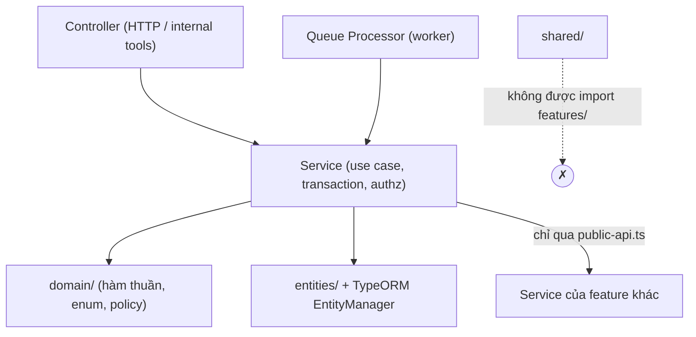
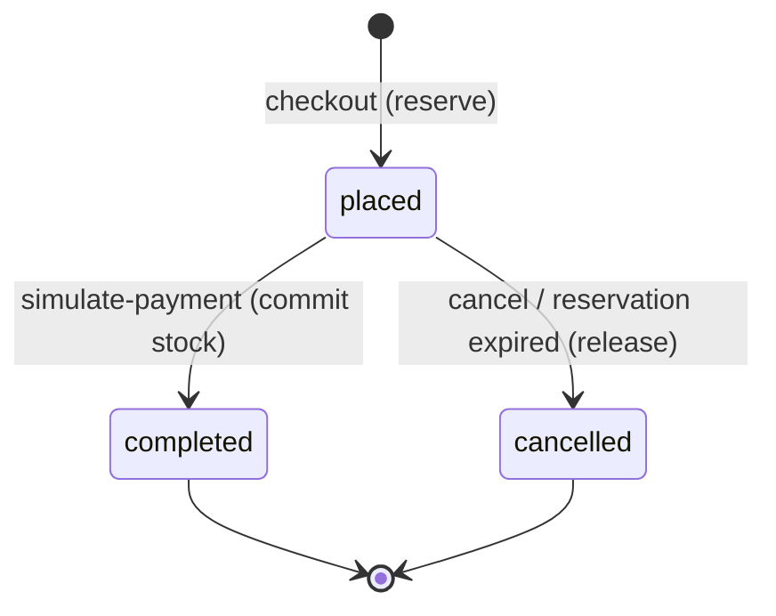
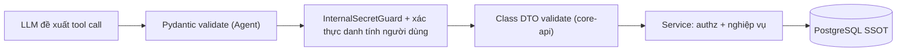

# CODING STANDARDS — RetailMind AI `core-api`

> **Phiên bản:** 2.0.0 · **Cập nhật:** 2026-10-29
> **Phạm vi:** Riêng service `core-api/` (NestJS + TypeORM + PostgreSQL), là **Commerce Core & Single Source of Truth** của RetailMind AI.
> **Văn bản cấp trên:** [`../AGENTS.md`](../AGENTS.md) (Hiến pháp Kỹ thuật). Khi hai tài liệu xung đột, **AGENTS.md thắng**. Tài liệu này chỉ cụ thể hóa AGENTS.md cho mã NestJS.
> **Đối tượng:** Kỹ sư và AI coding agent làm việc trong `core-api`.

---

## 0. Cách đọc tài liệu

| Từ khóa | Ý nghĩa |
|---|---|
| **MUST / MUST NOT** | Bắt buộc. Vi phạm là lỗi **BLOCKER** hoặc **MAJOR** khi review (§20). |
| **SHOULD / SHOULD NOT** | Mặc định nên làm. Làm khác thì phải ghi lý do trong PR. |
| **MAY** | Tùy chọn. |
| 🎯 **Mục tiêu** | Chuẩn đích. Code hiện tại **chưa** đạt; mọi code **mới hoặc được sửa** phải theo chuẩn này. |

**Thứ tự ưu tiên khi xung đột:** Đúng nghiệp vụ & toàn vẹn dữ liệu → Bảo mật → Hợp đồng API → Kiến trúc → Naming/format.

**Ngôn ngữ:**
- Tên code, file, route, cột DB, log field, error `code`, commit: **tiếng Anh**.
- Thông điệp trả cho người dùng cuối (`message` trong exception): **tiếng Việt có dấu**.
- Comment/docstring: tiếng Việt hoặc tiếng Anh, nhưng phải giải thích **vì sao**, không diễn giải lại code.

---

## 1. Stack & quyết định kiến trúc đã chốt

| Chủ đề | Quyết định | Ghi chú |
|---|---|---|
| Runtime | Node.js 20 LTS | Pin bằng `engines` + `package-lock.json`. Chỉ dùng **npm**. |
| Framework | NestJS 10 (`@nestjs/*` ^10) | Không trộn major version. |
| ORM | TypeORM 0.3 + `pg` | `synchronize: false`. Mọi thay đổi schema đi qua migration. |
| Database | PostgreSQL 16 — **SSOT** cho giá, tồn kho, đơn, phiên bản tài liệu | |
| Cache/Queue | Redis (`ioredis`) + BullMQ | Worker chạy tách tiến trình (`src/worker.ts`). |
| Object storage | MinIO | Tài liệu chính sách, ảnh sản phẩm. |
| Vector | **Không** truy cập Qdrant từ `core-api` | Qdrant thuộc Agent/ingestion; chỉ là chỉ mục phụ. |
| Tiền tệ | `NUMERIC(18,0)` ↔ `decimal.js` (`decimalTransformer`) | Cấm `float`/`number` cho tiền (§9). |
| Mật khẩu | Argon2id (`argon2`) | |
| AuthN | JWT HS256 access 15 phút + refresh token xoay vòng (hash SHA-256 trong `auth_refresh_sessions`) | |
| AuthZ | Global `JwtAuthGuard` + `RolesGuard`, **deny-by-default**; kiểm tra sở hữu ở service | |
| Transport | REST JSON, prefix `/api/v1` (`app.setGlobalPrefix`) | |
| Response | `ApiEnvelopeDto` `{ success, data, error, meta }` (§6.3) | Riêng `/internal/tools/*` dùng hợp đồng Agent (§11.3). |
| Validation | Class DTO + `class-validator` + global `ValidationPipe` | |
| Test | Jest (`*.spec.ts` trong `src/`), integration trong `test/` | |

Muốn đổi bất kỳ quyết định nào ở bảng trên thì **MUST** có ADR trong `../docs/` và được người dùng phê duyệt (theo Gate Protocol của AGENTS.md).

---

## 2. Phạm vi nghiệp vụ (Scope Lock)

- **MUST** chỉ phục vụ 3 persona `GUEST`, `CUSTOMER`, `ADMIN` và 12 use case `UC01`–`UC12`.
- **MUST NOT** thêm ERP, nhân sự, purchasing, chấm công, cổng thanh toán thật, vận chuyển thật, hoặc tính năng pháp lý/tài chính ngoài phạm vi (ví dụ: tool tính phạt hợp đồng).
- **MUST** đánh dấu trạng thái trung thực trong tài liệu/PR: `DONE` (có code thật + test chạy trên hạ tầng thật), `IN_PROGRESS`, `NOT_RUN`, `BLOCKED`. Test chỉ chạy trên mock thì **không** đủ để ghi `DONE` cho tính năng concurrency/transaction.

---

## 3. Cấu trúc thư mục & ranh giới module

### 3.1. Cấu trúc chuẩn

```text
core-api/
├── src/
│   ├── main.ts                    # HTTP bootstrap
│   ├── worker.ts                  # BullMQ headless worker (không mở port)
│   ├── app.module.ts / worker.module.ts
│   ├── config/                    # Validate env, production guard, architecture tests
│   ├── database/
│   │   ├── data-source.ts         # Dùng cho TypeORM CLI
│   │   ├── migrations/            # <timestamp>-<PascalName>.ts
│   │   └── seeds/
│   ├── shared/                    # Chỉ hạ tầng cross-cutting, KHÔNG chứa nghiệp vụ
│   │   ├── decorators/ guards/ filters/ interceptors/ middleware/
│   │   ├── dto/                   # ApiEnvelopeDto, PaginationQueryDto...
│   │   ├── redis/ queue/ storage/
│   │   └── utils/                 # Hàm thuần không thuộc domain nào
│   └── features/
│       └── <feature>/             # auth, catalog, inventory, cart, orders, support,
│           │                      # customers, knowledge, ingestion, audit, internal-agent
│           ├── public-api.ts      # Cổng xuất DUY NHẤT cho feature khác
│           ├── <feature>.module.ts
│           ├── <feature>.controller.ts
│           ├── <feature>.service.ts        # hoặc services/<name>.service.ts khi > 1 service
│           ├── dto/               # Request DTO (class) + Response DTO
│           ├── entities/          # TypeORM entities
│           ├── domain/            # (khi cần) enum trạng thái, policy thuần, lỗi domain
│           └── *.spec.ts          # Unit test đặt cạnh source
├── test/                          # Integration/E2E (*.integration.ts, *.e2e-spec.ts)
└── scripts/                       # Script vận hành/e2e thủ công
```

### 3.2. Quy tắc phụ thuộc



- **MUST** import feature khác **chỉ** qua `../<feature>/public-api`. Quy tắc này được `src/config/architecture-boundaries.spec.ts` kiểm tra; **MUST NOT** sửa test để lách.
- **MUST NOT** dùng `forwardRef()` (đã có test chặn). Nếu bị vòng phụ thuộc thì tách trách nhiệm hoặc đảo chiều phụ thuộc.
- **MUST** giữ `public-api.ts` tối thiểu: chỉ export Module, Service public và type cần thiết. **SHOULD NOT** export entity nếu feature khác không thực sự cần tham chiếu kiểu.
- **MUST NOT** để `shared/` import từ `features/`. 🎯 *Nợ hiện tại:* `shared/guards/jwt-auth.guard.ts` đang import `features/auth/auth.service`. Hướng sửa: chuyển guard vào `features/auth/` và export qua `public-api`, hoặc inject qua một token interface.
- **MUST NOT** truy vấn trực tiếp bảng do feature khác sở hữu. Bảng thuộc feature nào thì gọi service của feature đó. Ví dụ: `orders` đọc giá/tồn kho qua `InventoryService`/`CatalogService`.

**Bảng sở hữu dữ liệu:**

| Feature | Bảng sở hữu |
|---|---|
| `auth` | `roles`, `users`, `auth_refresh_sessions` |
| `catalog` | `brands`, `categories`, `products`, `variants`, `product_specs` |
| `inventory` | `stores`, `inventory` |
| `cart` | `carts`, `cart_items` |
| `orders` | `orders`, `order_items`, `idempotency_keys` |
| `support` | `support_tickets` |
| `customers` | `favorites` |
| `knowledge` / `ingestion` | `policies`, `document_versions`, `ingestion_jobs` |
| `internal-agent` | `conversations`, `messages` |
| `audit` | `audit_events` (append-only) |

### 3.3. Trách nhiệm từng thành phần NestJS

| Thành phần | Được làm | Không được làm |
|---|---|---|
| Controller | Route, DTO, `@CurrentUser()`, `ParseUUIDPipe`, HTTP status, gọi **một** service method | SQL, rẽ nhánh nghiệp vụ, tự bọc envelope, tự đặt principal mặc định |
| Guard | Xác thực/phân quyền theo route | Ghi DB, chứa danh sách nghiệp vụ (ví dụ allowlist tool → dùng decorator metadata) |
| Service | Use case, transaction, khóa, kiểm tra sở hữu, gọi audit | Nhận `Request`/`Response` của Express |
| `domain/` | Tính tiền, chuyển trạng thái, policy giảm giá — hàm thuần | Import `@nestjs/*`, TypeORM, I/O |
| Filter | Map exception → envelope lỗi | Nuốt lỗi, trả 200 cho lỗi |
| Interceptor | Bọc envelope, trace, timing | Nghiệp vụ |

---

## 4. Quy tắc đặt tên

| Thành phần | Quy ước | Ví dụ đúng |
|---|---|---|
| File/thư mục | `kebab-case` + hậu tố Nest | `orders.service.ts`, `checkout.dto.ts`, `preview-token.helper.ts` |
| Class | `PascalCase` | `OrdersService`, `CheckoutDto`, `OrderResponseDto` |
| Request DTO | `<Action><Noun>Dto` | `CheckoutDto`, `AddCartItemDto`, `ListOrdersQueryDto` |
| Response DTO | `<Noun>ResponseDto` | `OrderResponseDto`, `CartResponseDto` |
| Interface/type | `PascalCase`, **không** tiền tố `I` | `ReserveItemInput`, `AuthenticatedUser` |
| Biến/hàm | `camelCase`; hàm bắt đầu bằng động từ | `reserveMultipleWithLock()`, `calculatePreview()` |
| Boolean | `is/has/can/should` | `isActive`, `isAdmin` |
| Hằng số | `UPPER_SNAKE_CASE` | `MAX_PAGE_SIZE`, `PREVIEW_TOKEN_TTL_SECONDS` |
| Enum/union trạng thái | Giá trị wire **lowercase** khớp CHECK constraint DB | `'placed' \| 'cancelled' \| 'completed'` |
| Role | `UPPER_SNAKE_CASE` | `'CUSTOMER'`, `'ADMIN'` |
| Error code | `UPPER_SNAKE_CASE`, có tiền tố domain | `INVENTORY_INSUFFICIENT`, `ORDER_NOT_CANCELLABLE` |
| Bảng/cột DB | `snake_case`, bảng số nhiều | `order_items.unit_price_vnd` |
| Thuộc tính entity | 🎯 `camelCase` + `@Column({ name: 'snake_case' })` | `onHandQty` ↔ `on_hand_qty` |
| JSON field API | `camelCase` | `totalVnd`, `orderNo` |
| JSON field tool Agent | `snake_case` (hợp đồng Python/Pydantic) | `available_qty`, `order_id` |
| Route | danh từ số nhiều, `kebab-case` | `/orders`, `/orders/:orderId/cancel` |
| Env var | `UPPER_SNAKE_CASE` | `JWT_SECRET`, `INTERNAL_TOOL_SECRET` |

**Quy tắc bổ sung:**
- **MUST** ghi đơn vị vào tên khi dễ nhầm: `priceVnd`, `ttlSeconds`, `timeoutMs`, `fileSizeBytes`.
- **MUST** phân biệt rõ các loại ID: `orderId` (UUID) ≠ `orderNo` (mã hiển thị `MWG-YYYYMMDD-XXXXXXXX`), `variantId` (UUID) ≠ `sku`. **MUST NOT** truyền SKU vào tham số tên `variantId`.
- **SHOULD** tách hai method khi đầu vào có thể là UUID hoặc mã nghiệp vụ (`getOrderById` / `getOrderByNo`), hoặc dùng một resolver duy nhất có kiểm tra định dạng UUID trước. Viết `id::text = $1 OR code = $1` sẽ làm mất index trên PK.
- **MUST NOT** dùng tên chung chung `data`, `result`, `obj`, `temp` khi có thể gọi đúng tên nghiệp vụ.
- 🎯 Entity mới **MUST** dùng thuộc tính camelCase. Entity cũ dùng snake_case (`Order`, `Inventory`, `Variant`) chỉ được đổi khi có PR refactor riêng, **không** trộn vào PR tính năng.

---

## 5. TypeScript

| Option | Hiện tại | 🎯 Mục tiêu |
|---|---|---|
| `strictNullChecks` | `false` | `true` |
| `noImplicitAny` | `false` | `true` |
| `noFallthroughCasesInSwitch` | `false` | `true` |
| `forceConsistentCasingInFileNames` | `false` | `true` (bắt buộc trên Windows/Linux lẫn lộn) |
| `useUnknownInCatchVariables` | — | `true` |

Lộ trình: bật từng flag trong PR riêng, sửa lỗi theo từng feature; **MUST NOT** thêm `// @ts-ignore` để lấy lại build xanh.

Quy tắc áp dụng ngay cho code mới/sửa:
- **MUST NOT** dùng `any` tường minh (kể cả `@Body() body: any`, `catch (err: any)`). Dùng `unknown` rồi thu hẹp kiểu.
- **MUST** khai báo return type cho method public của service và handler của controller.
- **MUST** `await` hoặc `return` mọi Promise. Không để promise trôi nổi.
- **MUST** dùng `private readonly` cho dependency inject qua constructor.
- **SHOULD** dùng discriminated union + `assertNever` khi `switch` qua trạng thái đơn hàng.
- **MUST NOT** dùng non-null assertion `!` để che việc thiếu validation (ngoại lệ: thuộc tính DTO được `class-validator` đảm bảo).

---

## 6. REST API

### 6.1. Route & method

- Base URL: `/api/v1/...` (cấu hình duy nhất ở `main.ts`; controller **MUST NOT** tự lặp lại `api/v1`).
- **MUST** dùng danh từ số nhiều. Hành động nghiệp vụ dùng sub-resource động từ đã thống nhất:

```http
POST /api/v1/orders/preview            # tính giá + phát preview token
POST /api/v1/orders/checkout           # Idempotency-Key bắt buộc
GET  /api/v1/orders?page=1&limit=20&status=placed
GET  /api/v1/orders/:orderId
POST /api/v1/orders/:orderId/cancel
POST /api/v1/orders/:orderId/simulate-payment   # Idempotency-Key bắt buộc
```

- **MUST NOT** thay đổi state trong `GET`.
- **MUST** dùng `@HttpCode(HttpStatus.CREATED)` khi tạo resource đồng bộ (checkout, ticket, register).
- **MUST** dùng `ParseUUIDPipe` cho path param là UUID. Nếu route chấp nhận cả `orderNo` thì validate bằng regex định dạng trước khi vào service.

### 6.2. Status code

| Status | Dùng khi | Exception Nest |
|---|---|---|
| 400 | DTO/param sai | `BadRequestException` (do `ValidationPipe`) |
| 401 | Thiếu/sai token | `UnauthorizedException` |
| 403 | Đủ xác thực nhưng không đủ quyền | `ForbiddenException` |
| 404 | Không tồn tại **hoặc** không thuộc quyền sở hữu (chống dò ID) | `NotFoundException` |
| 409 | Hết tồn kho, trạng thái không cho phép, idempotency đang xử lý/sai payload | `ConflictException` |
| 422 | **Không dùng**; lỗi ngữ nghĩa dùng 400/409 | — |
| 429 | Vượt rate limit | `ThrottlerException` |
| 503 | Phụ thuộc (DB/Redis/MinIO) không sẵn sàng | `ServiceUnavailableException` |
| 500 | Lỗi không lường trước — chỉ do filter sinh ra | — |

- **MUST NOT** để một input sai gây ra 500. Gặp case như vậy thì xử lý như bug.
- **MUST NOT** trả 200 kèm `success:false`.

### 6.3. Hợp đồng response — `ApiEnvelopeDto`

Mọi API public (không phải `/internal/tools`) **MUST** trả envelope do `TransformResponseInterceptor` và `AllExceptionsFilter` sinh ra:

```json
// Thành công
{ "success": true, "data": { "orderId": "…", "orderNo": "MWG-20261029-A1B2C3D4", "totalVnd": "19789000" },
  "error": null, "meta": { "traceId": "…", "timestamp": "2026-10-29T10:00:00.000Z" } }

// Lỗi
{ "success": false, "data": null,
  "error": { "code": "INVENTORY_INSUFFICIENT", "message": "Số lượng tồn kho khả dụng không đủ.", "details": null },
  "meta": { "traceId": "…", "timestamp": "…" } }
```

- **MUST** để controller trả **dữ liệu thô** (DTO). **MUST NOT** tự bọc `{ status: 'success', data }`, vì interceptor sẽ bọc thêm một lớp nữa thành `data.data`. 🎯 *Nợ hiện tại:* các controller orders/cart/inventory/catalog đang tự bọc.
- **MUST** dùng `message` cho người dùng (tiếng Việt). Client **MUST** rẽ nhánh xử lý theo `error.code`, không theo text của message.
- **MUST** đặt `error.code` ổn định cho các lỗi nghiệp vụ, bằng cách throw kèm object: `throw new ConflictException({ error: 'INVENTORY_INSUFFICIENT', message: '…' })`.

### 6.4. Phân trang, lọc, sắp xếp

- **MUST** dùng `ListXxxQueryDto` với `@Type(() => Number) @IsInt() @Min(1)` cho `page`, và `@Max(100)` cho `limit` (mặc định 20).
- **MUST** sắp xếp ổn định (`ORDER BY created_at DESC, id DESC`).
- **MUST** dùng allowlist cho `status`/`sort`. **MUST NOT** nối chuỗi user input vào SQL, kể cả `LIMIT`/`OFFSET`. Mọi giá trị đều phải bind param.
- **MUST** trả list dưới dạng `data: { items, page, limit, total }`.
- **MUST NOT** có endpoint list không giới hạn số bản ghi (ví dụ `getProducts` hiện chưa phân trang).

### 6.5. OpenAPI

- 🎯 **SHOULD** gắn `@ApiTags`, `@ApiOperation`, `@ApiOkResponse({ type })`, `@ApiBearerAuth()` cho endpoint mới (`@nestjs/swagger` đã có trong dependencies).
- **MUST NOT** expose Swagger UI khi `NODE_ENV=production`.

---

## 7. DTO & Validation

Global `ValidationPipe` 🎯 cấu hình mục tiêu:

```ts
app.useGlobalPipes(
  new ValidationPipe({
    transform: true,
    whitelist: true,
    forbidNonWhitelisted: true,
    transformOptions: { enableImplicitConversion: false },
  }),
);
```

- **MUST** dùng **class** DTO cho mọi `@Body()`, `@Query()`. TypeScript `interface` không có metadata lúc runtime nên `ValidationPipe` sẽ bỏ qua hoàn toàn. 🎯 *Nợ hiện tại:* `CheckoutInputDTO`, `OrderItemInput`, auth `@Body('email')`, internal tools `body: any`.
- **MUST NOT** dùng `@Body('field')` lẻ từng trường cho endpoint có nhiều trường, vì cách này bỏ qua validation.
- **MUST** validate: định dạng UUID, độ dài chuỗi, khoảng giá trị số, kích thước mảng (`@ArrayMinSize(1) @ArrayMaxSize(50)`), object lồng nhau (`@ValidateNested({ each: true }) @Type(() => X)`).
- **MUST NOT** nhận từ client các trường mà server phải tự quyết định: `customerId`, `userId`, `role`, `priceVnd`, `totalVnd`, `status`. Danh tính lấy từ `@CurrentUser()`; giá lấy từ DB.
- **MUST** dùng Response DTO hoặc hàm map tường minh. **MUST NOT** trả entity (đặc biệt `User` có `passwordHash`).

```ts
// features/orders/dto/checkout.dto.ts
export class CheckoutItemDto {
  @IsString() @IsNotEmpty() @MaxLength(100)
  sku!: string;

  @IsInt() @Min(1) @Max(20)
  quantity!: number;
}

export class CheckoutDto {
  @IsUUID('4')
  storeId!: string;

  @IsArray() @ArrayMinSize(1) @ArrayMaxSize(50)
  @ValidateNested({ each: true }) @Type(() => CheckoutItemDto)
  items!: CheckoutItemDto[];

  @IsOptional() @IsString() @MaxLength(32)
  discountCode?: string;

  @IsString() @IsNotEmpty()
  previewToken!: string; // bắt buộc — đảm bảo khách đã thấy đúng giá
}
```

---

## 8. Bảo mật & phân quyền

### 8.1. Fail-closed — quy tắc số 1

- **MUST NOT** gán giá trị mặc định cho danh tính hoặc quyền. Cấm các mẫu sau:

```ts
// ❌ BLOCKER
principal = { id: 'system', role: 'ADMIN' }
const customerId = dto.customerId || '00000000-0000-0000-0000-000000000002';
const customerId = header || body.customer_id || 'usr-customer-01';
const storeId = dto.storeId || '10000000-0000-0000-0000-000000000001';
```

- **MUST** để mọi service method thao tác trên dữ liệu thuộc sở hữu nhận `principal: AuthenticatedUser` là tham số **bắt buộc** (không optional, không default).
- Tác vụ hệ thống (worker, seed) **MUST** dùng một principal tường minh `SYSTEM_PRINCIPAL` khai báo tại một chỗ duy nhất và được audit, không được ngụy trang thành ADMIN.

### 8.2. Xác thực

- Route mặc định là private (global `JwtAuthGuard`). Route công khai **MUST** có `@Public()` và được liệt kê trong PR.
- **MUST** verify JWT với `algorithms: ['HS256']`, kiểm tra `tokenType === 'access'`, `sub`, `exp`, và tải lại user để chặn tài khoản đã bị vô hiệu hóa (đã có, giữ nguyên).
- 🎯 **SHOULD** thêm claim `iss`/`aud` khi có nhiều service phát token.
- **MUST** rate-limit `/auth/login`, `/auth/register`, `/auth/refresh` (`@nestjs/throttler`, storage Redis khi chạy nhiều replica).
- Nếu dùng cookie auth thì **MUST** cài `cookie-parser`, đặt `httpOnly`, `secure` khi production, `sameSite`, và có biện pháp chống CSRF. Nếu không dùng thì gỡ nhánh đọc cookie trong guard để tránh code chết gây hiểu lầm.

### 8.3. Phân quyền & chống IDOR

- `@Roles()` chỉ là kiểm tra cấp chức năng. **MUST** kiểm tra sở hữu ở service, **ưu tiên ngay trong câu query**:

```ts
// ✅ Lọc theo sở hữu trong query — không tồn tại hoặc không phải của bạn đều trả 404
const order = await manager.findOne(Order, {
  where: isAdmin(principal) ? { id: orderId } : { id: orderId, customerId: principal.id },
});
if (!order) throw new NotFoundException('Không tìm thấy đơn hàng.');
```

- **MUST** có test chứng minh **customer A không đọc/sửa/hủy/thanh toán được tài nguyên của customer B** cho mọi endpoint nhận ID.
- Thông báo lỗi 403 **MUST NOT** liệt kê role yêu cầu hoặc chi tiết nội bộ.

### 8.4. Hạ tầng

- **MUST** cấu hình CORS bằng allowlist từ env `CORS_ORIGINS`. **MUST NOT** dùng `origin: true` kèm `credentials: true`.
- **MUST** dùng `helmet` (security headers) và giới hạn body size cho JSON và upload (`image-upload.policy.ts` là mẫu tham khảo).
- **MUST** so sánh secret bằng `crypto.timingSafeEqual`.
- **MUST NOT** hardcode secret fallback (`process.env.X || 'some_default_secret'`). Thiếu biến môi trường thì phải fail khi khởi động.
- **MUST** bổ sung mọi secret mới vào `assertProductionConfiguration` (`JWT_SECRET`, `DB_PASSWORD`, `MINIO_SECRET_KEY`, `INTERNAL_TOOL_SECRET`, `PREVIEW_TOKEN_SECRET`…).
- **MUST** dùng tham số bind (`$1`, `:name`) cho mọi raw SQL. Pattern `ILIKE` **MUST** escape `%` và `_` có trong input.

### 8.5. Dữ liệu cá nhân (PII)

- **MUST NOT** log `password`, token, cookie, header `authorization`, số CCCD, số điện thoại, email đầy đủ.
- Dữ liệu chuyển cho LLM/Agent **MUST** được che theo AGENTS.md §5.3: `[REDACTED_CCCD]`, `[REDACTED_PHONE]`, `[REDACTED_EMAIL]`. Tool response chỉ trả các trường Agent thật sự cần.

---

## 9. Tiền tệ (VND)

- **MUST** lưu tiền dưới dạng `NUMERIC(18,0)` với tên cột `*_vnd`, và map sang `Decimal` qua `decimalTransformer`.
- **MUST** tính toán bằng `decimal.js`. **MUST NOT** dùng `number`, `parseFloat`, `toNumber()` trong phép tính tiền.
- **MUST** serialize tiền ra JSON dưới dạng **string** số nguyên (`"19789000"`). Khi cần format hiển thị thì dùng `Intl.NumberFormat('vi-VN').format(BigInt(x.toFixed(0)))`. **MUST NOT** gọi `toNumber()` rồi format.
- **MUST** gom quy tắc làm tròn về một chỗ trong `orders/domain/pricing.ts` 🎯: giảm giá trước, VAT 10% sau trên số tiền đã giảm, làm tròn xuống (`floor`) tới đơn vị đồng. Có unit test cho các biên (subtotal = 0, giảm giá lớn hơn subtotal).
- **MUST NOT** hardcode mã giảm giá trong service. 🎯 Chuyển sang bảng hoặc config, được ADMIN quản lý và có audit.
- **MUST** lưu snapshot `unit_price_vnd`, `line_total_vnd`, `title_snapshot` vào `order_items` tại thời điểm chốt đơn. **MUST NOT** tính lại tổng tiền đơn cũ theo giá hiện tại.

---

## 10. Database, transaction & concurrency

### 10.1. Migration

- **MUST** thay đổi schema **chỉ** qua migration trong `src/database/migrations/` (`npm run migration:generate` / `migration:run`). `synchronize` luôn là `false`.
- **MUST NOT** sửa migration đã được chạy ở môi trường dùng chung. Muốn thay đổi thì tạo migration mới.
- **MUST** dùng ràng buộc DB để giữ bất biến (CHECK, UNIQUE, FK), không chỉ kiểm tra ở service. Ví dụ đang có: `chk_inventory_reserved_lte_on_hand`, `uq_cart_items_cart_variant`.
- **MUST** dùng `TIMESTAMPTZ` cho thời gian và UUID (`gen_random_uuid()`) cho khóa chính.
- 🎯 Cột tham chiếu người dùng/đơn (`support_tickets.customer_id`, `conversations.customer_id`) **SHOULD** là `UUID` có FK.
- **MUST** tạo index theo câu query thực tế (`WHERE`/`ORDER BY`), kèm `EXPLAIN` trong PR nếu query nằm trên đường nóng.

### 10.2. Transaction

Mẫu chuẩn (theo AGENTS.md §5.1):

```ts
const runner = this.dataSource.createQueryRunner();
await runner.connect();
await runner.startTransaction();
try {
  // ... chỉ dùng runner.manager bên trong transaction
  await runner.commitTransaction();
} catch (error) {
  await runner.rollbackTransaction();
  throw error;
} finally {
  await runner.release();
}
```

- **MAY** dùng `dataSource.transaction(isolation, async (manager) => …)` khi không cần điều khiển chi tiết.
- **MUST** dùng **cùng một** `EntityManager` cho mọi thao tác trong transaction. Service con nhận `manager`/`queryRunner` làm tham số (như `InventoryService.reserveMultipleWithLock(runner, …)`).
- **MUST NOT** gọi HTTP, Redis, MinIO hoặc enqueue BullMQ **bên trong** transaction DB. Các việc này làm sau khi commit, hoặc dùng outbox nếu cần đảm bảo chắc chắn.
- **MUST** xác định rõ hành vi khi bước sau commit thất bại (ví dụ: `clearCart` thất bại thì đơn vẫn hợp lệ) và **MUST NOT** nuốt lỗi im lặng. Tối thiểu phải log `warn` kèm `traceId`.

### 10.3. Tồn kho — chống bán vượt (bất biến cốt lõi)

| Sự kiện | `on_hand_qty` | `reserved_qty` |
|---|---|---|
| Checkout (giữ chỗ) | — | `+q` |
| Thanh toán thành công | `−q` | `−q` |
| Hủy đơn / hết hạn giữ chỗ | — | `−q` |

- **MUST** đọc và cập nhật tồn kho bằng `setLock('pessimistic_write')` trong transaction, và kiểm tra `on_hand_qty - reserved_qty >= q` **sau khi** đã khóa.
- **MUST** khóa nhiều dòng theo **thứ tự xác định** (sort theo `variant_id`) để tránh deadlock, đồng thời gộp các SKU trùng trước khi khóa.
- **MUST** áp dụng **cả ba** chuyển trạng thái ở bảng trên. 🎯 *Nợ hiện tại:* `simulatePayment` chưa trừ tồn kho và chưa có job giải phóng giữ chỗ hết hạn.
- **MUST** khóa dòng `orders` (`pessimistic_write`) trước khi đổi trạng thái đơn, và chỉ cho phép chuyển trạng thái hợp lệ:



### 10.4. Idempotency (AGENTS.md §5.2)

- **MUST** yêu cầu header `Idempotency-Key` dạng UUIDv4 cho `checkout` và `simulate-payment`. **MUST NOT** chấp nhận key gửi trong body.
- **MUST** gắn phạm vi cho key: `${principal.id}:${operation}:${key}`.
- **MUST** dùng mô hình **claim-first** 🎯:
  1. `INSERT … status='processing', request_hash=… ON CONFLICT (key) DO NOTHING RETURNING id` *trước* khi làm nghiệp vụ.
  2. Nếu conflict mà key đang `processing` → `409 IDEMPOTENCY_IN_PROGRESS`.
  3. Nếu conflict mà key đã `completed`: hash khác → `409 IDEMPOTENCY_PAYLOAD_MISMATCH`; hash trùng → trả lại `response_payload` đã lưu.
  4. Nghiệp vụ thất bại → xóa hoặc đánh dấu `failed` để client retry được.
- **MUST** đặt `expires_at` (ví dụ 24h) và có job dọn key hết hạn.

### 10.5. Hiệu năng truy vấn

- **MUST NOT** tạo N+1 query trong vòng lặp. Dùng `WHERE id = ANY($1)` / `In([...])` hoặc `JOIN`.
- **MUST NOT** dùng `SELECT *` trong raw SQL. Chỉ chọn các cột cần thiết.
- **SHOULD** ưu tiên QueryBuilder/Repository. Raw SQL chỉ dùng khi QueryBuilder không diễn đạt được, và phải có comment giải thích lý do.

---

## 11. Ranh giới Agent — `/internal/tools/*`

Agent Python (LangGraph) là **client không tin cậy về mặt nội dung**: LLM có thể bị prompt-inject. Luồng bắt buộc:



### 11.1. Xác thực & danh tính

- **MUST** xác thực service-to-service bằng `X-Internal-Secret` (so sánh timing-safe) **và** kèm danh tính người dùng cuối do server ký.
- **MUST NOT** tin `X-Customer-Id`, `customer_id` trong body, hoặc bất kỳ ID nào do LLM sinh ra để làm danh tính. 🎯 Agent chuyển tiếp access token của người dùng (hoặc một delegation token ngắn hạn do `core-api` phát), và `core-api` tự verify để lấy `principal`.
- Tool cho khách vãng lai (`GUEST`: tìm kiếm, chi tiết, so sánh, chính sách) **MAY** chạy không cần danh tính người dùng. Tool chạm dữ liệu cá nhân (giỏ, đơn, ticket, yêu thích) **MUST** có `principal`.
- 🎯 Allowlist tool **SHOULD** khai báo bằng decorator metadata (`@AgentTool({ name, requiresUser })`) thay vì hardcode `Set` trong guard.

### 11.2. Tính trung thực của dữ liệu

- **MUST NOT** có fallback mock hay dữ liệu giả trong tool response (đơn `DELIVERED` hardcode, `inventory_restored: true` khi không ghi DB, giỏ hàng trong `Map`…). Lỗi thì trả lỗi có cấu trúc để Agent nói "không xác nhận được", **không** để LLM bịa.
- **MUST** để tool có side effect (hủy đơn, thêm giỏ, tạo ticket) gọi **cùng service** với API public. **MUST NOT** viết logic riêng cho Agent.
- **MUST** ghi audit cho mọi tool có side effect, với `actor = principal`, `via = 'agent'`, kèm `traceId`.
- Tool tạm khóa **MUST** bị gỡ khỏi route/allowlist hoặc tắt bằng feature flag tường minh. **MUST NOT** để code nằm sau một lệnh `throw` (code chết).

### 11.3. Hợp đồng response của tool

```json
{ "status": "success", "tool": "check_inventory", "data": { "sku": "…", "available_qty": 3 } }
{ "status": "error", "code": "INVENTORY_NOT_FOUND", "message": "…", "details": null, "trace_id": "…" }
```

- Field trong `data` dùng `snake_case` để khớp Pydantic schema bên Agent. Mỗi thay đổi schema **MUST** được cập nhật đồng thời ở cả hai phía, kèm contract test.
- Tên tool có hai alias (`inventory-check` / `check_inventory`) chỉ để tương thích ngược. Tool mới **SHOULD** chỉ dùng một tên `snake_case`.

---

## 12. Xử lý lỗi

- **MUST** dùng exception của Nest (`NotFoundException`, `ConflictException`…) trong service, kèm `message` tiếng Việt và `error` code (§6.3).
- **MUST NOT** `catch {}` rỗng hoặc `catch { return fallback }` làm mất nguyên nhân lỗi. Chỉ catch khi có xử lý cụ thể, nếu không thì throw lại.
- **MUST NOT** throw lại `error.message` của driver/DB cho client.
- `AllExceptionsFilter` map lỗi Postgres `23505` → 409 và `23503` → 400. 🎯 Bổ sung `22P02` (sai định dạng UUID) → 400 và `40001`/`40P01` (serialization failure/deadlock) → 409 có thể retry.
- **MUST** log lỗi không lường trước kèm `traceId` và stack trace (chỉ trong log, không trả ra response).

---

## 13. Cấu hình & môi trường

- **MUST** có `.env.example` (không chứa secret thật), liệt kê mọi biến: `PORT`, `ENABLE_POSTGRES`, `DB_*`, `REDIS_*`, `MINIO_*`, `JWT_SECRET`, `PREVIEW_TOKEN_SECRET`, `INTERNAL_TOOL_SECRET`, `AUTH_REFRESH_ENABLED`, `CORS_ORIGINS`.
- 🎯 **MUST** validate env lúc khởi động bằng `ConfigModule.forRoot({ validationSchema | validate })`. `assertProductionConfiguration` là lớp chặn tối thiểu, không thay thế bước validate này.
- **SHOULD** đọc config qua `ConfigService`, không gọi `process.env.X` rải rác trong service.
- **MUST NOT** commit `.env`.
- 🎯 Chế độ `ENABLE_POSTGRES=false` chỉ dùng để khởi động nhanh khi dev. **MUST NOT** để service vẫn trả dữ liệu giả khi không có DB: phải trả 503. Không thêm mới mẫu `@Optional() DataSource` + nhánh fallback in-memory; test dùng `Test.createTestingModule().overrideProvider()`.

---

## 14. Logging, audit & observability

- **MUST** dùng `Logger` của Nest với object có cấu trúc: `logger.log({ event: 'order.placed', orderId, traceId })`. **MUST NOT** dùng `console.log` trong `src/` (ngoại lệ: lỗi fatal khi bootstrap).
- **MUST** gắn `traceId` (do `CorrelationIdMiddleware` cấp) vào log, response `meta` và job payload.
- **MUST** ghi `audit_events` (append-only, không update/delete) cho các thao tác: đặt đơn, hủy đơn, thanh toán, giữ chỗ/điều chỉnh tồn kho, đổi giá, đổi role, upload tài liệu chính sách, và mọi side effect do Agent kích hoạt. Ghi **trong cùng transaction** với nghiệp vụ.
- **MUST NOT** trả audit log giả (seed in-memory) khi bảng rỗng.
- 🎯 **SHOULD** có endpoint `/health` (liveness) và readiness tách riêng (kiểm tra DB/Redis), không lộ thông tin cấu hình.

---

## 15. Queue & worker (BullMQ)

- **MUST** đặt producer ở feature sở hữu nghiệp vụ (`ingestion.producer.ts`) và processor chạy trong `worker.ts`, không chạy trong tiến trình HTTP.
- **MUST** giữ job payload nhỏ, chỉ chứa ID (ví dụ `documentVersionId`), không chứa PII hoặc nội dung file.
- **MUST** cấu hình `attempts`, backoff mũ, `removeOnComplete`/`removeOnFail` có giới hạn. Processor **MUST** idempotent (chạy lại vẫn ra cùng kết quả).
- **MUST** cập nhật trạng thái job vào DB (`ingestion_jobs.status`, `error_message`). Không nuốt lỗi.

---

## 16. Testing

| Tầng | Vị trí | Bắt buộc cho |
|---|---|---|
| Unit | `src/**/*.spec.ts` | Hàm tính giá, policy, guard, mapping |
| Boundary/architecture | `src/config/*.spec.ts` | Import qua `public-api`, cấm `forwardRef` |
| Integration (Postgres thật) | `test/*.integration.ts` | Transaction, khóa, idempotency, migration |
| HTTP E2E | `test/*.e2e-spec.ts`, `scripts/*-http-e2e.cjs` | Luồng checkout, support, auth |
| Security | cùng E2E | IDOR (A ↔ B), thiếu token, sai role, mass assignment |

- **MUST** viết test theo cấu trúc Given–When–Then.
- **MUST** kiểm thử concurrency trên **PostgreSQL thật** (Docker/Testcontainers): N request song song tranh mua tồn kho = 1 → đúng 1 thành công, `reserved_qty` không vượt `on_hand_qty`. Test chỉ dùng mock `setLock` **không** đủ làm bằng chứng.
- **MUST** có test idempotency: cùng key gửi song song → một đơn; cùng key khác payload → 409.
- **MUST** có test đủ bốn trường hợp happy, boundary, invalid input, forbidden cho mỗi endpoint mới.
- **MUST NOT** dùng DB/secret production trong test.
- **MUST NOT** báo test đã pass khi chưa chạy. PR phải dán output `npm test` (và integration nếu có).

---

## 17. Tooling, format & scripts

🎯 Hiện repo **chưa có** ESLint/Prettier config. Cần bổ sung:

```json
// .prettierrc
{ "singleQuote": true, "semi": true, "trailingComma": "all", "printWidth": 120, "tabWidth": 2, "endOfLine": "lf" }
```

- ESLint flat config (`eslint.config.mjs`) + `typescript-eslint` `recommendedTypeChecked`. Các rule tối thiểu: `no-explicit-any`, `no-floating-promises`, `no-unused-vars`, `no-console` (cho `src/`).
- `.editorconfig` + `endOfLine: lf`, vì repo đang lẫn CRLF/LF.

Scripts mục tiêu trong `package.json`:

```json
{
  "lint": "eslint \"{src,test}/**/*.ts\" --max-warnings 0",
  "format:check": "prettier --check \"{src,test}/**/*.ts\"",
  "typecheck": "tsc --noEmit -p tsconfig.json",
  "test": "jest",
  "test:integration": "jest --config ./test/jest-integration.json --runInBand"
}
```

- **MUST** chạy `typecheck` + `test` trước khi mở PR. Khi đã có lint thì chạy cả `lint` + `format:check`.
- **MUST NOT** commit `dist/`, `jest/` (cache), `coverage/`, `node_modules/`.

---

## 18. Git & Pull Request

- Commit theo Conventional Commits, scope là tên feature: `feat(orders): claim-first idempotency`, `fix(internal-agent): remove mock order fallback`.
- Branch: `feat/<feature>-<mô-tả>`, `fix/<feature>-<mô-tả>`.
- **Mỗi PR một mục tiêu.** Không refactor hàng loạt kèm tính năng (AGENTS.md: "không sinh mã ồ ạt").
- Mô tả PR **MUST** có: mục tiêu, use case liên quan (`UCxx`), thay đổi schema/migration, endpoint public mới, bằng chứng test, trạng thái trung thực (`DONE`/`IN_PROGRESS`/…).

---

## 19. Anti-pattern — từ chối trong review

```ts
// ❌ Principal/ID mặc định (fail-open)
async getOrder(id: string, principal = { id: 'system', role: 'ADMIN' }) { … }

// ❌ Tin danh tính từ Agent/LLM
const customerId = req.headers['x-customer-id'] || body.customer_id || 'usr-customer-01';

// ❌ Dữ liệu giả khi lỗi — làm LLM "bịa có căn cứ"
try { return await this.ordersService.getOrder(id, principal); }
catch { return { order_status: 'DELIVERED', items: [/* hardcode */] }; }

// ❌ DTO là interface + body any → không validate
@Post('checkout') checkout(@Body() dto: CheckoutInputDTO /* interface */) { … }

// ❌ Tiền bằng number
const total = Number(price) * qty * 1.1;

// ❌ Đọc tồn kho rồi cập nhật mà không khóa
const inv = await repo.findOne({ where: { variantId } });
inv.reservedQty += qty; await repo.save(inv);

// ❌ Controller tự bọc envelope (interceptor bọc thêm lần nữa)
return { status: 'success', data: order };

// ❌ Nối input vào SQL
`… LIMIT ${limit} OFFSET ${offset}`  // kể cả khi "đã ép kiểu"

// ❌ Secret fallback hardcode
const SECRET = process.env.PREVIEW_TOKEN_SECRET || 'retailmind_preview_token_secret_production_2026';

// ❌ Dữ liệu catalog hardcode thay vì JOIN DB (vi phạm SSOT)
brand: this.defaultLaptops.find((d) => d.sku === v.sku)?.brand
```

---

## 20. Mức độ khi review

| Mức | Ví dụ | Merge? |
|---|---|---|
| **BLOCKER** | IDOR, principal/ID mặc định, tin danh tính từ Agent, tiền dùng `number`, cập nhật tồn kho không khóa, dữ liệu giả trả cho Agent/người dùng, SQL injection, lộ secret/PII, migration mất dữ liệu | ❌ |
| **MAJOR** | DTO không validate, N+1 trên đường nóng, nuốt lỗi, thiếu test IDOR/concurrency, import xuyên feature, thiếu audit cho thao tác nhạy cảm, vượt scope UC | ❌ (trừ ngoại lệ được duyệt) |
| **MINOR** | Đặt tên chưa chuẩn, envelope bọc hai lần, thiếu OpenAPI decorator | ✅ kèm follow-up |
| **SUGGESTION** | Tách hàm, tối ưu nhỏ | ✅ |

---

## 21. Definition of Done (checklist PR)

**Nghiệp vụ & dữ liệu**
- [ ] Thuộc một `UCxx`, không vượt Scope Lock.
- [ ] Giá/tồn kho đọc từ PostgreSQL; không hardcode, không fallback mock.
- [ ] Tiền dùng `Decimal` / `NUMERIC(18,0)` / string JSON.
- [ ] Thao tác tồn kho/đơn hàng có transaction + `pessimistic_write` + thứ tự khóa xác định.
- [ ] Endpoint tạo giao dịch có idempotency claim-first.
- [ ] Có migration (nếu đổi schema) kèm constraint/index phù hợp.

**Bảo mật**
- [ ] Không có principal/ID/store mặc định; `principal` là tham số bắt buộc.
- [ ] Kiểm tra sở hữu ở service/query; có test A ↔ B.
- [ ] Class DTO validate đầy đủ; không nhận `customerId`/giá từ client.
- [ ] Không log hoặc trả PII/secret; dữ liệu gửi LLM đã được che.
- [ ] Thao tác nhạy cảm đã ghi `audit_events`.

**Chất lượng**
- [ ] Import feature khác chỉ qua `public-api.ts`; không `forwardRef`.
- [ ] Controller mỏng, trả DTO thô (không tự bọc envelope).
- [ ] `npm run typecheck` + `npm test` pass (dán output); integration test cho phần concurrency.
- [ ] Trạng thái ghi trung thực (`DONE` / `IN_PROGRESS` / `NOT_RUN` / `BLOCKED`).

---

## 22. Quick reference cho AI coding agent

Trước khi viết code trong `core-api`:
1. Đọc `../AGENTS.md` và mục liên quan của tài liệu này.
2. Xác định feature sở hữu dữ liệu (§3.2) → chỉ sửa trong feature đó, gọi feature khác qua `public-api.ts`.
3. Xác định actor + kiểm tra sở hữu → `principal` bắt buộc, fail-closed.
4. Xác định tính nhất quán: transaction? khóa? idempotency? audit?
5. Viết class DTO → service → controller mỏng → test (unit + integration nếu chạm DB/khóa).
6. Chạy `npm run typecheck` và `npm test`, báo cáo kết quả **thật**.

**Không bao giờ tự ý:** thêm giá trị mặc định cho danh tính/quyền; thêm fallback mock; dùng `any`/`@ts-ignore` để qua build; sửa architecture test để lách; tự chuyển Phase khi chưa được phê duyệt; ghi `DONE` khi chưa chạy test thật.

---

## Phụ lục A — Nợ kỹ thuật đã biết (tính đến 2026-10-29)

Danh sách đối chiếu với chuẩn ở trên, để các PR sửa dần. Chi tiết xem báo cáo code review.

| # | Vi phạm | Mục | Vị trí chính | Mức |
|---|---|---|---|---|
| 1 | Principal mặc định `ADMIN`, `customerId`/`storeId` mặc định | §8.1 | `orders.service.ts`, `cart.service.ts` | BLOCKER |
| 2 | Agent tin `X-Customer-Id`; fallback `usr-customer-01` | §11.1 | `internal-agent.controller.ts` | BLOCKER |
| 3 | Fallback mock/dữ liệu giả trong tool, audit, catalog | §11.2, §14 | `internal-agent.service.ts`, `audit.service.ts`, `catalog.service.ts` | BLOCKER |
| 4 | Thanh toán không trừ tồn kho; không có job hết hạn giữ chỗ | §10.3 | `orders.service.ts#simulatePayment` | BLOCKER |
| 5 | Idempotency check-then-act, chưa dùng `processing` | §10.4 | `orders.service.ts#checkout` | MAJOR |
| 6 | CORS `origin: true` + credentials | §8.4 | `main.ts` | BLOCKER |
| 7 | DTO interface / `@Body('x')` / `body: any` | §7 | orders, auth, inventory, knowledge, internal-agent | MAJOR |
| 8 | Chưa có rate limit cho auth | §8.2 | `auth.controller.ts` | MAJOR |
| 9 | Secret fallback hardcode cho preview token | §8.4 | `preview-token.helper.ts` | BLOCKER |
| 10 | `logEvent` chưa được gọi ở đâu | §14 | toàn bộ | MAJOR |
| 11 | Envelope bọc hai lần | §6.3 | các controller | MINOR |
| 12 | N+1, `SELECT *`, `id::text OR code` | §10.5, §4 | `orders.service.ts`, `inventory.service.ts` | MAJOR |
| 13 | `shared/` import `features/auth` | §3.2 | `jwt-auth.guard.ts` | MINOR |
| 14 | TS non-strict; thiếu ESLint/Prettier | §5, §17 | `tsconfig.json` | MAJOR |
| 15 | Test concurrency chỉ chạy trên mock | §16 | `orders-concurrency.spec.ts` | MAJOR |
| 16 | Tool ngoài scope (`calculate_penalty`) | §2 | `internal-agent.*` | MAJOR |

---

**Owner:** Backend lead của RetailMind AI. **Thay đổi tài liệu:** qua PR; thay đổi ảnh hưởng §1 (stack), §8 (bảo mật), §10 (giao dịch) hoặc §11 (ranh giới Agent) cần ADR + phê duyệt của người dùng.
