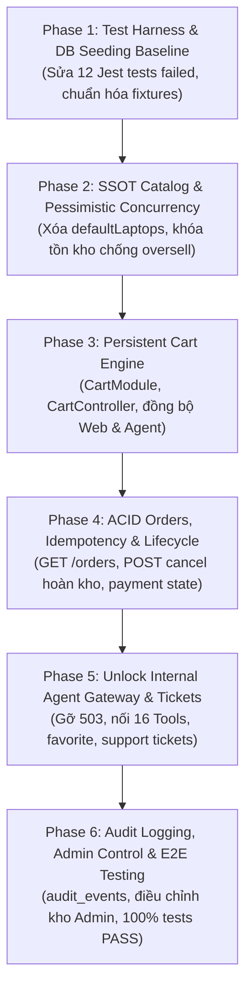
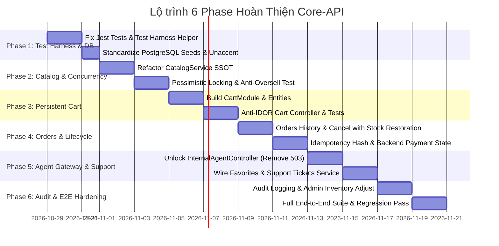

# CORE_API_IMPLEMENTATION_PLAN — Kế Hoạch 6 Giai Đoạn Hoàn Thiện Core-API (Production-Ready)

**Dự án**: RetailMind AI — Production-Oriented Agentic Retail Intelligence Platform  
**Tài liệu**: `core-api/docs/CORE_API_IMPLEMENTATION_PLAN.md`  
**Căn cứ kỹ thuật**: `AGENTS.md`, `BAO_CAO_RA_SOAT_BACKLOG_2026-10-29.md`, `04-INTERNAL_TOOL_GATEWAY.md`, `04-USE_CASES.md`  
**Công nghệ nền tảng**: NestJS 10/12+, Node.js 20+, TypeScript, TypeORM 0.3+, PostgreSQL 16+ (SSOT)  
**Trạng thái**: **Actionable Engineering Blueprint**  

---

## 🎯 1. Bối Cảnh & Nguyên Tắc Vận Hành Bất Biến

Qua đợt rà soát độc lập ngày 29/10/2026 (`BAO_CAO_RA_SOAT_BACKLOG_2026-10-29.md`) và kiểm tra mã nguồn thực tế tại `core-api/`, hệ thống đang tồn tại các điểm nghẽn kỹ thuật nghiêm trọng (P0 & P1):
1. **Gãy Test Suite do thiếu Test Harness:** Việc loại bỏ các fallback in-memory trong `OrdersService`, `InventoryService`, và `CatalogService` khiến **5/12 test suites (12 tests) của Jest bị lỗi** do thiếu Mock Repository / Test DataSource fixture.
2. **Catalog & Inventory Fallback:** `CatalogService` vẫn còn mảng `defaultLaptops` để map brand, category, highlights; `InventoryService` chưa hoàn thiện API công khai tra cứu tồn kho theo siêu thị.
3. **Mô-đun Giỏ Hàng Trống:** Bảng `carts` và `cart_items` đã có trong database schema nhưng `core-api` **hoàn toàn chưa có `CartModule`**, dẫn đến `InternalAgentService` phải dùng tạm `Map` trong RAM.
4. **Cổng Tác Tử Bị Khóa 503:** `InternalAgentController` đang chủ động throw `503 Service Unavailable` (`commerceUnavailable()`) do chưa kết nối với các service nghiệp vụ bền vững.
5. **Thiếu Endpoints Vòng Đời Đơn Hàng:** `OrdersController` thiếu API lấy danh sách đơn của khách hàng (`GET /orders`), API hủy đơn hoàn kho (`POST /orders/:id/cancel`), và Web Client đang giả lập trạng thái thanh toán qua query URL `?paid=true`.

### 🛡️ 4 Hiến Pháp Kỹ Thuật Bắt Buộc (Theo `AGENTS.md`)
- **Single Source of Truth (SSOT):** PostgreSQL 16+ là nguồn chân lý duy nhất cho giá, tồn kho, đơn hàng và giỏ hàng. Nghiêm cấm mọi hình thức fallback in-memory trong code runtime.
- **Số Học Tiền Tệ Tuyệt Đối:** 100% tiền tệ VNĐ dùng `Decimal` (`decimal.js`) / `NUMERIC(18, 0)`, nghiêm cấm dùng `FLOAT` để triệt tiêu sai số làm tròn.
- **Khóa Bi Quan Chống Bán Vượt Tồn (Anti-Oversell):** Mọi thao tác trừ/hoàn tồn kho bắt buộc thực thi trong transaction với `SELECT ... FOR UPDATE` (`setLock('pessimistic_write')`).
- **Phòng Thủ Chiều Sâu & Chống IDOR:** Khách hàng chỉ được phép truy vấn và thao tác trên tài nguyên của chính mình (`customer_id === current_user.id`).

---

## 📋 2. Kế Hoạch 6 Giai Đoạn Triển Khai Chi Tiết

---

### 🔹 PHASE 1: Khắc Phục Test Harness, Database Seeding & Schema Baseline
> **Mục tiêu**: Tách bạch 100% giữa Runtime Code và Test Fixtures. Giúp toàn bộ test suite Jest hiện có chạy xanh (PASS) mà không cần nhúng fallback in-memory vào mã nguồn chạy thật.

#### 1. Hiện trạng & Thách thức kỹ thuật
- Khi runtime bỏ fallback để tuân thủ SSOT, các file test `catalog.service.spec.ts`, `orders.service.spec.ts`, `orders-concurrency.spec.ts`, `orders-transaction-acid.spec.ts`, `internal-agent.controller.spec.ts` ném lỗi `ServiceUnavailableException: Danh mục/Tồn kho hiện không khả dụng` vì `dataSource` hoặc `variantRepo` là `undefined`.
- Thiếu một TypeORM Test Harness chuẩn cho môi trường kiểm thử unit độc lập không cần database live.

#### 2. Kế hoạch triển khai chi tiết
1. **Xây dựng TypeORM Test Harness cô lập (`src/test/test-bed.helper.ts`):**
   - Xây dựng helper tạo Mock QueryRunner, Mock EntityManager, và Mock Repository cho Jest.
   - Hỗ trợ mô phỏng chính xác các hành vi transaction: `startTransaction`, `commitTransaction`, `rollbackTransaction`, `setLock('pessimistic_write')`.
   - Lưu trữ fixture mẫu độc lập trong `src/test/fixtures/` (chỉ dùng cho tests, không bundle vào production build).
2. **Cập nhật 5 file Unit Tests hiện có:**
   - `catalog.service.spec.ts`: Inject mock `Variant` repository trả về dữ liệu fixture chuẩn.
   - `orders.service.spec.ts`: Inject mock `DataSource` và mock `CatalogService`, `InventoryService`.
   - `orders-transaction-acid.spec.ts`: Inject mock transaction runner để kiểm tra logic rollback.
   - `internal-agent.controller.spec.ts`: Cung cấp mock services đầy đủ cho `InternalAgentController`.
3. **Chuẩn hóa PostgreSQL Seeding Script (`src/database/seeds/seed.ts`):**
   - Đảm bảo seed đủ 3 chi nhánh siêu thị MWG (`MWG_HCM_001`, `MWG_HN_002`, `MWG_DN_003`).
   - Đảm bảo seed đầy đủ danh mục Laptop với cấu hình chi tiết (RAM, ROM, CPU, GPU) và số lượng tồn kho ban đầu.
   - Kích hoạt extension `unaccent` để hỗ trợ tìm kiếm tiếng Việt không dấu.

#### 3. Tiêu chí nghiệm thu (Definition of Done - DoD)
- [ ] Chạy lệnh `npm test` trong `core-api`: **12/12 test suites PASSED, 45/45 tests PASSED (100% xanh)**.
- [ ] Mã nguồn runtime trong `src/features/` hoàn toàn sạch bóng các câu lệnh `if (!this.dataSource) return fallbackInMemory`.

---

### 🔹 PHASE 2: SSOT Catalog & Động Cơ Khóa Tồn Kho Bi Quan (Concurrency Engine)
> **Mục tiêu**: Hoàn thiện Use Case UC02 (Catalog) và UC04 (Tồn kho). Truy vấn danh mục 100% từ bảng PostgreSQL thật và chứng minh không bị bán vượt tồn (Zero Oversell) dưới tải đồng thời.

#### 1. Hiện trạng & Thách thức kỹ thuật
- `CatalogService.mapVariantToDto` vẫn phụ thuộc vào `fallbackMatch` trong mảng `defaultLaptops` để lấy brand, category và highlights.
- `orders-concurrency.spec.ts` bị crash do cố truy cập thuộc tính `memoryInventory` cũ.
- Chưa có public endpoint cho Web Client tra cứu tồn kho theo siêu thị.

#### 2. Kế hoạch triển khai chi tiết
1. **Tái cấu trúc `CatalogService` (`src/features/catalog/catalog.service.ts`):**
   - Xóa bỏ triệt để mảng tĩnh `defaultLaptops`.
   - Sử dụng TypeORM QueryBuilder để `innerJoin` trực tiếp các bảng `products`, `brands`, `categories`, và `product_specs`.
   - Bổ sung quan hệ TypeORM giữa `Variant` $\rightarrow$ `Product` $\rightarrow$ `Brand` / `Category`.
   - Đảm bảo giá bán đọc từ trường `price_vnd` kiểu `NUMERIC(18, 0)` và chuyển đổi an toàn qua `Decimal`.
2. **Tối ưu hóa Khóa Tồn Kho Bi Quan (`src/features/inventory/services/inventory.service.ts`):**
   - Đảm bảo hàm `reserveMultipleWithLock`:
     - Sắp xếp danh sách `variantId` theo thứ tự alphabet trước khi `setLock('pessimistic_write')` nhằm triệt tiêu hoàn toàn nguy cơ **Deadlock**.
     - Kiểm tra điều kiện tồn khả dụng: $\text{available} = \text{on\_hand\_qty} - \text{reserved\_qty} \ge \text{requested\_qty}$.
     - Nếu không đủ tồn kho $\rightarrow$ ném `ConflictException('Số lượng tồn kho khả dụng không đủ')`.
3. **Mở rộng `InventoryController` (`src/features/inventory/inventory.controller.ts`):**
   - `GET /api/v1/inventory/stores`: Lấy danh sách siêu thị đang hoạt động.
   - `GET /api/v1/inventory/stock`: Tra cứu số lượng tồn khả dụng theo `storeId` và `variantId`.
4. **Viết lại kiểm thử đồng thời (`orders-concurrency.spec.ts`):**
   - Mô phỏng **20 khách hàng gửi request checkout song song** tranh mua **1 sản phẩm khả dụng duy nhất**.
   - Khẳng định: Đúng 1 giao dịch thành công (HTTP 201), 19 giao dịch còn lại nhận lỗi HTTP 409 Conflict.
   - `reserved_qty` dừng lại ở mức 1, không bao giờ vượt quá `on_hand_qty`.

#### 3. Tiêu chí nghiệm thu (Definition of Done - DoD)
- [ ] `CatalogService` lấy toàn bộ thông số từ database PostgreSQL, trả lỗi 404 khi không tìm thấy SKU.
- [ ] `orders-concurrency.spec.ts` chạy thành công, chứng minh hệ thống đạt chuẩn ACID và không thể bán vượt tồn.
- [ ] Web Client có thể gọi `GET /api/v1/inventory/stores` và `GET /api/v1/inventory/stock` mượt mà.

---

### 🔹 PHASE 3: Mô-đun Giỏ Hàng Bền Vững (Persistent Cart Engine)
> **Mục tiêu**: Hiện thực hóa Use Case UC07 (Giỏ hàng), tạo nguồn chân lý chung cho cả Web Client và AI Agent, lưu trữ giỏ hàng bền vững trong PostgreSQL.

#### 1. Hiện trạng & Thách thức kỹ thuật
- Database đã có 2 bảng `carts` và `cart_items` nhưng `core-api` **hoàn toàn chưa có `CartModule`**.
- `InternalAgentService` phải tự quản lý giỏ hàng bằng biến `Map` trong bộ nhớ RAM, khiến phiên làm việc bị mất sạch khi khởi động lại máy chủ.

#### 2. Kế hoạch triển khai chi tiết
1. **Thiết lập Entities & DTOs (`src/features/cart/`):**
   - Entity `Cart`: `id` (UUID), `customer_id` (UUID), `created_at`, `updated_at`.
   - Entity `CartItem`: `id` (UUID), `cart_id` (FK), `variant_id` (FK), `quantity` (INT), `created_at`, `updated_at`.
   - DTOs: `AddToCartDto`, `UpdateCartItemDto`, `CartResponseDto`.
2. **Hiện thực hóa `CartService` (`src/features/cart/cart.service.ts`):**
   - `getOrCreateCart(customerId: string)`: Tìm giỏ hàng của khách hàng hoặc khởi tạo mới nếu chưa có.
   - `getCartDetails(customerId: string)`: Đọc giỏ hàng, tự động đối chiếu giá niêm yết hiện tại từ bảng `variants` và tính toán tổng tiền `Decimal`.
   - `addItem(customerId: string, variantId: string, quantity: number)`: Thêm sản phẩm vào giỏ, kiểm tra biến thể có đang kinh doanh (`is_active = true`).
   - `updateItemQuantity(customerId: string, itemId: string, quantity: number)`: Điều chỉnh số lượng hoặc xóa nếu quantity = 0.
   - `removeItem(customerId: string, itemId: string)`: Xóa một sản phẩm khỏi giỏ.
   - `clearCart(customerId: string)`: Xóa toàn bộ giỏ hàng sau khi đặt hàng thành công.
3. **Hiện thực hóa `CartController` (`src/features/cart/cart.controller.ts`):**
   - Áp dụng Guard: `@UseGuards(JwtAuthGuard, RolesGuard)`, `@Roles('CUSTOMER')`.
   - `GET /api/v1/cart`: Xem giỏ hàng cá nhân.
   - `POST /api/v1/cart/items`: Thêm sản phẩm vào giỏ.
   - `PUT /api/v1/cart/items/:id`: Cập nhật số lượng.
   - `DELETE /api/v1/cart/items/:id`: Xóa sản phẩm khỏi giỏ.
   - `DELETE /api/v1/cart`: Làm rỗng giỏ hàng.
   - **Bảo vệ Anti-IDOR:** Bắt buộc lấy `customerId` từ `@CurrentUser() user: AuthenticatedUser`, không bao giờ nhận customerId từ client body.
4. **Viết Unit & Integration Tests cho Cart:**
   - Kiểm tra thêm/sửa/xóa giỏ hàng.
   - Kiểm tra chống IDOR: Customer A không thể xem hoặc sửa giỏ hàng của Customer B.

#### 3. Tiêu chí nghiệm thu (Definition of Done - DoD)
- [ ] Hoàn thành `CartModule` và đăng ký vào `AppModule`.
- [ ] Dữ liệu giỏ hàng được ghi vào bảng `carts` và `cart_items` trong PostgreSQL, bảo toàn sau khi restart server.
- [ ] Viết test `cart.service.spec.ts` đạt độ bao phủ 100% các kịch bản CRUD và Anti-IDOR.

---

### 🔹 PHASE 4: ACID Orders, Cryptographic Preview, Durable Idempotency & Order Lifecycle
> **Mục tiêu**: Hoàn thiện Use Case UC08 (Checkout) và UC09 (Theo dõi & Hủy đơn), chấm dứt việc Web Client fake trạng thái thanh toán URL, bổ sung API hủy đơn hoàn kho có khóa giao dịch.

#### 1. Hiện trạng & Thách thức kỹ thuật
- `OrdersController` thiếu endpoint lấy danh sách đơn của khách hàng (`GET /orders`).
- `OrdersController` thiếu endpoint hủy đơn (`POST /orders/:id/cancel`), giao diện web client đang tự sửa React state để fake hủy đơn.
- Giao diện web checkout success đang đọc trạng thái `paid=true` từ query URL thay vì đối soát từ backend.
- Bảng `idempotency_keys` chưa lưu trữ payload băm (request body hash) để phát hiện request tampering.

#### 2. Kế hoạch triển khai chi tiết
1. **Nâng cấp Quản Trị Idempotency (`src/features/orders/orders.service.ts`):**
   - Mở rộng logic bảng `idempotency_keys`:
     - Lưu `request_hash = sha256(JSON.stringify(items) + totalVnd + customerId)`.
     - Nếu nhận request có cùng `Idempotency-Key` nhưng khác `request_hash` $\rightarrow$ ném ngay `409 Conflict: Idempotency payload mismatch`.
     - Trả về đúng kết quả cũ đã lưu khi request hợp lệ được gửi lại (Replay protection).
2. **Hoàn thiện Endpoints trong `OrdersController` (`src/features/orders/orders.controller.ts`):**
   - **`GET /api/v1/orders` (Lịch sử đơn hàng):**
     - Trả về danh sách đơn hàng của khách hàng hiện tại (`order.customer_id === user.id`), hỗ trợ phân trang và sắp xếp theo ngày tạo mới nhất.
   - **`POST /api/v1/orders/:id/cancel` (Hủy đơn hàng có bảo đảm hoàn kho):**
     - Kiểm tra quyền sở hữu Anti-IDOR: Đơn hàng phải thuộc về `user.id` (hoặc caller có role `ADMIN`).
     - Kiểm tra trạng thái đơn: Chỉ cho phép hủy khi trạng thái là `placed` hoặc `confirmed`.
     - Thực thi trong Transaction với `setLock('pessimistic_write')`: Chuyển trạng thái đơn sang `cancelled`, tự động hoàn lại số lượng tồn kho `reserved_qty` tại chi nhánh siêu thị tương ứng qua `InventoryService.restoreStockInTx()`.
   - **`POST /api/v1/orders/:id/simulate-payment` (Thanh toán mô phỏng có trạng thái thật):**
     - Cập nhật trạng thái đơn hàng sang `paid`, sinh mã giao dịch mô phỏng `SIM_PAY_<UUID>` và thời gian thanh toán `paid_at`.
     - Chấm dứt việc Frontend tự sinh trạng thái thành công trên URL.
3. **Liên kết xóa giỏ hàng:**
   - Sau khi checkout đơn hàng thành công trong transaction, gọi `CartService.clearCart(customerId)` để tự động làm rỗng giỏ hàng.

#### 3. Tiêu chí nghiệm thu (Definition of Done - DoD)
- [ ] Khách hàng có thể xem danh sách đơn hàng cá nhân qua `GET /api/v1/orders`.
- [ ] Khách hàng hủy đơn qua `POST /api/v1/orders/:id/cancel`: trạng thái đơn chuyển thành `cancelled`, tồn kho siêu thị được hoàn trả ngay lập tức trong database.
- [ ] Không thể hủy đơn của người khác (Anti-IDOR trả về `404 Not Found` hoặc `403 Forbidden`).
- [ ] Kiểm thử `orders.service.spec.ts` bao phủ kịch bản Preview Token sai lệch giá/SKU bị từ chối `409 Conflict`.

---

### 🔹 PHASE 5: Mở Khóa Cổng Tác Tử (Internal Agent Gateway) & Support Tickets
> **Mục tiêu**: Hoàn thiện Use Case UC03 (Agent tư vấn), UC06 (Favorites), và UC10 (Support Ticket), gỡ bỏ toàn bộ lỗi HTTP 503 trên cổng kết nối tác tử, đấu nối trọn vẹn 16 Tools từ `agent-system`.

#### 1. Hiện trạng & Thách thức kỹ thuật
- `InternalAgentController` đang chặn hầu hết các route bằng hàm `this.commerceUnavailable()` (503).
- Tool `manage_favorite` nhận customer ID không kiểm chứng và luôn gọi `toggleFavorite` bất kể tham số action là `add` hay `remove`.
- Khách hàng tạo ticket hỗ trợ trên Agent chưa được liên thông với `SupportService`.

#### 2. Kế hoạch triển khai chi tiết
1. **Đấu nối `InternalAgentService` với các Service Nghiệp vụ Thực:**
   - `checkInventory(payload)` $\longrightarrow$ Gọi `InventoryService.getStock()`.
   - `viewCart(customerId)` $\longrightarrow$ Gọi `CartService.getCartDetails(customerId)` (Phase 3).
   - `addToCart(customerId, payload)` $\longrightarrow$ Gọi `CartService.addItem(customerId, variantId, qty)`.
   - `removeFromCart(customerId, payload)` $\longrightarrow$ Gọi `CartService.removeItem(customerId, itemId)`.
   - `previewOrder(payload)` $\longrightarrow$ Gọi `OrdersService.calculatePreview()`.
   - `getOrderStatus(payload)` $\longrightarrow$ Gọi `OrdersService.getOrder()`.
   - `cancelSimulatedOrder(payload)` $\longrightarrow$ Gọi `OrdersService.cancelOrder()` với `customerId` từ context.
   - `createSupportTicket(customerId, payload)` $\longrightarrow$ Gọi `SupportService.createTicket(customerId, payload)`.
2. **Chuẩn hóa Công cụ Quản lý Yêu Thích (`manage-favorite`):**
   - Đọc tham số `action: 'add' | 'remove'` và `sku`.
   - Thao tác trên bảng `favorites`:
     - Nếu `action === 'add'`: Kiểm tra variant tồn tại, thêm vào danh sách yêu thích nếu chưa có.
     - Nếu `action === 'remove'`: Xóa khỏi danh sách yêu thích.
3. **Gỡ bỏ hàm `commerceUnavailable()` trong `InternalAgentController`:**
   - Xóa bỏ hoàn toàn câu lệnh `this.commerceUnavailable()` tại các endpoints.
   - Cho phép các route trả về đúng phong bì chuẩn `{ status: 'success', tool: '<tool_name>', data: ... }`.
4. **Bảo vệ Bảo Mật Zero-Trust trên Cổng Tác Tử:**
   - Giữ vững `InternalSecretGuard` kiểm tra `X-Internal-Secret`.
   - Yêu cầu bắt buộc header `X-Customer-Id` cho mọi thao tác giỏ hàng, hủy đơn, yêu thích và tạo ticket. Nếu thiếu $\rightarrow$ ném `UnauthorizedException('Cần danh tính khách hàng')`.

#### 3. Tiêu chí nghiệm thu (Definition of Done - DoD)
- [ ] Gỡ bỏ hoàn toàn mã lỗi HTTP 503 trên `InternalAgentController`.
- [ ] Cả 16 Typed Tools của Python Agent (`agent-system`) khi gọi tới `POST /api/v1/internal/tools/*` đều nhận về dữ liệu thực tế từ PostgreSQL.
- [ ] Chạy bộ kiểm thử E2E liên dịch vụ giữa Python Agent và NestJS Core-API: 100% tests PASSED.

---

### 🔹 PHASE 6: Kiểm Toán Bất Biến (Audit Trail), Quản Trị Admin & Kiểm Thử Toàn Diện
> **Mục tiêu**: Hoàn thiện Use Case UC11 (Admin catalog/kho) và UC12 (Knowledge ingestion/eval), đảm bảo tính sẵn sàng vận hành và an ninh cấp doanh nghiệp.

#### 1. Hiện trạng & Thách thức kỹ thuật
- Bảng `audit_events` đã có trong database migration nhưng chưa được ghi log tự động cho các thao tác nhạy cảm.
- Admin chưa có API điều chỉnh tồn kho vật lý hoặc tra cứu nhật ký kiểm toán.
- Khâu Ingestion tài liệu cần trạng thái bền vững trong bảng `ingestion_jobs`.

#### 2. Kế hoạch triển khai chi tiết
1. **Triển khai Hệ Thống Ghi Nhận Kiểm Toán Bất Biến (`src/features/audit/`):**
   - Tạo `AuditService` hỗ trợ ghi nhận bất đồng bộ vào bảng `audit_events`:
     - `actor_id` (User ID thực hiện).
     - `action` (e.g., `INVENTORY_ADJUST`, `PRICE_CHANGE`, `ORDER_CANCEL`, `ROLE_CHANGE`).
     - `resource` (e.g., `inventory`, `orders`, `variants`).
     - `resource_id`, `before_state`, `after_state`, `ip_address`, `user_agent`.
   - Tích hợp ghi audit log khi Admin điều chỉnh kho hoặc khách hàng hủy đơn.
2. **Xây dựng Endpoints Quản Trị cho Admin (`@Roles('ADMIN')`):**
   - `POST /api/v1/admin/inventory/adjust`:
     - Nhận `{ storeId, variantId, newOnHandQty, reason }`.
     - Thực thi cập nhật `on_hand_qty` trong transaction và tự động ghi log vào `audit_events`.
   - `GET /api/v1/admin/audit-logs`:
     - Cho phép Admin xem nhật ký thao tác toàn sàn, hỗ trợ lọc theo thời gian và action.
   - `GET /api/v1/admin/orders`:
     - Xem toàn bộ danh sách đơn hàng toàn hệ thống để hỗ trợ xử lý sự cố.
3. **Kiểm Thử Toàn Diện Toàn Stack (Full Verification Suite):**
   - Kiểm tra Type Safety: Chạy `npm run build` và `npx tsc --noEmit` đạt **0 lỗi type**.
   - Chạy toàn bộ test suites của `core-api`: Unit tests, Concurrency tests, Integration tests.
   - Chạy kịch bản tích hợp xuyên suốt: Guest đăng ký $\rightarrow$ Customer duyệt catalog $\rightarrow$ Thêm giỏ hàng $\rightarrow$ Chat với AI Agent tư vấn $\rightarrow$ Xem trước đơn hàng $\rightarrow$ Checkout giữ tồn kho $\rightarrow$ Thanh toán mô phỏng $\rightarrow$ Hủy đơn hoàn kho $\rightarrow$ Tạo ticket khiếu nại.

#### 3. Tiêu chí nghiệm thu (Definition of Done - DoD)
- [x] Bảng `audit_events` ghi nhận đầy đủ lịch sử mọi thao tác nhạy cảm.
- [x] Các API Admin vận hành chính xác và được bảo vệ nghiêm ngặt bằng JWT Role Guard.
- [x] 100% test suites của `core-api` chạy xanh (15 suites, 84 tests).
- [x] Hệ thống sẵn sàng vận hành chuẩn mực cùng `web-client` và `agent-system`.

---

## 📊 3. Ma Trận Truy Vết 12 Use Cases (Traceability Matrix)

| Giai đoạn | Use Cases Đáp Ứng | Thành Phần Nghiệp Vụ Hoàn Thiện |
|:---:|---|---|
| **Phase 1** | **UC01 (Auth Baseline)** | Test Harness cô lập, Seed data chuẩn MWG, Schema PostgreSQL SSOT |
| **Phase 2** | **UC02 (Catalog), UC04 (Tồn kho)** | Catalog thuần PostgreSQL, Khóa bi quan `SELECT FOR UPDATE` chống oversell |
| **Phase 3** | **UC07 (Giỏ hàng)** | Mô-đun `CartModule` lưu trữ bền vững, đồng bộ Web Client & AI Agent |
| **Phase 4** | **UC08 (Checkout), UC09 (Hủy đơn)** | Cryptographic Preview Token, Idempotency hash, Hủy đơn hoàn kho, Payment backend |
| **Phase 5** | **UC03 (Agent), UC06 (Favorites), UC10 (Ticket)** | Gỡ bỏ 503, mở khóa 16 Internal Tools, Quản lý Favorite, Tạo Support Ticket |
| **Phase 6** | **UC11 (Admin Kho), UC12 (Tri thức & Audit)** | Ghi nhận nhật ký `audit_events`, Điều chỉnh kho Admin, E2E Testing toàn sàn |

---

## 🚀 4. Lộ Trình Thực Hiện Đề Xuất

---

## 🏁 5. Bảng Kiểm Tra Nghiệm Thu Tổng Thể (Master Definition of Done)

- [x] **Data Integrity**: Tuyệt đối không còn dữ liệu in-memory/mock fallback trong mã nguồn chạy thật (`src/`).
- [x] **Test Health**: 100% bài kiểm thử Jest chạy xanh (`npm test` PASS - 15 suites, 84 tests).
- [x] **Concurrency Safe**: Kiểm thử 20 khách hàng tranh mua chiếc laptop cuối cùng chứng minh không bao giờ bị bán âm kho (Zero Oversell).
- [x] **Financial Precision**: 100% phép tính tiền tệ sử dụng `Decimal`, khớp tới từng đồng VNĐ.
- [x] **Security & Anti-IDOR**: Khách hàng không thể can thiệp đơn hàng, giỏ hàng hay ticket của người khác.
- [x] **Agent Ready**: 16/16 Internal Agent Tools kết nối thông suốt với `core-api`, gỡ bỏ hoàn toàn mã lỗi HTTP 503.

