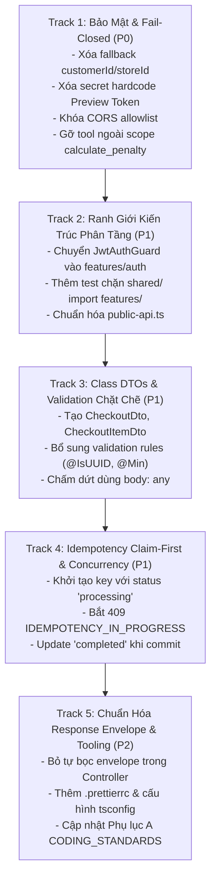

# TECHNICAL DEBT REMEDIATION PLAN — Kế Hoạch Chuẩn Hóa & Dọn Sạch Nợ Kỹ Thuật Core-API

**Dự án**: RetailMind AI — Commerce Core & Single Source of Truth  
**Tài liệu**: `core-api/docs/TECHNICAL_DEBT_REMEDIATION_PLAN.md`  
**Căn cứ pháp quy**: [`../AGENTS.md`](../AGENTS.md) (Hiến pháp Kỹ thuật), [`../CODING_STANDARDS.md`](../CODING_STANDARDS.md) (Quy chuẩn mã nguồn v2.0.0)  
**Tài liệu tiền nhiệm**: [`CORE_API_IMPLEMENTATION_PLAN.md`](CORE_API_IMPLEMENTATION_PLAN.md) (Đã hoàn tất 6 Phase nghiệm thu)  
**Mục tiêu tối thượng**: Xóa bỏ 100% các vi phạm BLOCKER & MAJOR đã chỉ ra tại **Phụ lục A** của `CODING_STANDARDS.md`, đưa hệ thống đạt chuẩn hoàn thiện Production-Ready 100%.

---

## 🎯 1. Bối Cảnh & Tôn Chỉ Vận Hành

Sau khi hoàn tất 6 giai đoạn triển khai cốt lõi và loại bỏ toàn bộ dữ liệu mock (`8592ee1`), hệ thống đã đạt độ tin cậy cao trên PostgreSQL 16 và Docker. Tuy nhiên, đợt rà soát đối chiếu với `CODING_STANDARDS.md` phát hiện các vi phạm quy chuẩn kiến trúc và bảo mật cần được dọn dẹp dứt điểm:

1. **Bảo mật Fail-Closed bị hổng ngầm (Blocker):** `OrdersService` vẫn còn fallback `customerId` và `storeId` mặc định khi đầu vào bị thiếu, vi phạm nguyên tắc §8.1.
2. **Hardcoded Secret Fallback (Blocker):** `PreviewTokenHelper` dùng chuỗi tĩnh `'retailmind_preview_token_secret_production_2026'` khi thiếu biến môi trường, vi phạm §8.4.
3. **CORS Cấu hình mở (Blocker):** `main.ts` bật `origin: true` kèm `credentials: true` thay vì kiểm soát bằng allowlist `CORS_ORIGINS`, vi phạm §8.4.
4. **Vi phạm Scope Lock (Major):** Cổng `internal-agent` còn endpoint `calculate_penalty` (Luật Thương Mại) nằm ngoài phạm vi 12 Use Cases của RetailMind AI, vi phạm §2.
5. **Thiếu Runtime DTO Validation (Major):** Các interface TypeScript (`CheckoutInputDTO`, `OrderItemInput`) không được runtime xác thực qua `class-validator`, vi phạm §7.
6. **Ranh giới module bị thủng (Major):** `src/shared/guards/jwt-auth.guard.ts` import trực tiếp từ `features/auth/`, vi phạm nguyên tắc phân tầng §3.2.
7. **Lỗi Envelope bọc kép (Minor):** Các Controller tự bọc `{ status: 'success', data }` khiến `TransformResponseInterceptor` bọc thành `{ success: true, data: { status: 'success', data } }`, vi phạm §6.3.
8. **Idempotency chưa đạt chuẩn Claim-First (Major):** Chưa áp dụng cơ chế đánh dấu `processing` trước khi thực thi nghiệp vụ, vi phạm §10.4.

---

## 🏗️ 2. Lộ Trình 5 Giai Đoạn Dọn Nợ Kỹ Thuật (5-Track Remediation)



---

## 📋 3. Chi Tiết Kế Hoạch Từng Giai Đoạn

---

### 🔹 TRACK 1: Bảo Mật & Thực Thi Fail-Closed Triệt Để (P0 - Blocker)
> **Mục tiêu:** Đảm bảo không có bất kỳ fallback ngầm nào cho danh tính người dùng hoặc cấu hình bí mật.

#### 1. Các hạng mục triển khai
1. **Loại bỏ Fallback Customer ID & Store ID trong `OrdersService`:**
   - Trong `calculatePreview`: Yêu cầu bắt buộc `storeId` và `customerId`. Nếu thiếu hoặc rỗng $\rightarrow$ ném ngay `BadRequestException('Cần cung cấp mã siêu thị và mã khách hàng hợp lệ.')`.
   - Trong `checkout`: Bắt buộc `dto.customerId` được inject từ `user.id`. Tuyệt đối không fallback về `'00000000-0000-0000-0000-000000000002'`.
2. **Khử Hardcoded Secret trong `PreviewTokenHelper`:**
   - Gỡ bỏ hoàn toàn chuỗi tĩnh `'retailmind_preview_token_secret_production_2026'`.
   - Kiểm tra `process.env.PREVIEW_TOKEN_SECRET || process.env.JWT_SECRET`. Nếu không có $\rightarrow$ ném lỗi cấu hình hệ thống ngay lập tức (`ServiceUnavailableException('Chưa cấu hình khóa ký Preview Token.')`).
   - Bổ sung `PREVIEW_TOKEN_SECRET` vào `assertProductionConfiguration()`.
3. **Cấu hình CORS theo Allowlist chặt chẽ:**
   - Trong `main.ts`: Đọc danh sách domain từ `process.env.CORS_ORIGINS` (hỗ trợ phân tách dấu phẩy).
   - Nếu ở môi trường dev mà không có env $\rightarrow$ fallback an toàn về `['http://localhost:3000', 'http://127.0.0.1:3000']`.
   - Tuyệt đối cấm cấu hình `origin: true` đi kèm `credentials: true`.
4. **Loại bỏ Tool Ngoài Scope `calculate_penalty`:**
   - Xóa route `@Post(['penalty-calculate', 'calculate_penalty'])` trong `internal-agent.controller.ts`.
   - Xóa method `calculateContractPenalty` trong `internal-agent.service.ts`.
   - Đảm bảo giữ đúng 12 Use Cases của Retail Commerce.

#### 2. Tiêu chí nghiệm thu Track 1
- [ ] Không còn bất kỳ chuỗi UUID hardcoded nào làm giá trị mặc định cho principal/store.
- [ ] Xóa bỏ hoàn toàn chuỗi bí mật fallback trong code.
- [ ] CORS chỉ chấp nhận origins được khai báo rõ ràng.
- [ ] Tool ngoài scope `calculate_penalty` đã bị gỡ bỏ sạch sẽ.

---

### 🔹 TRACK 2: Ranh Giới Kiến Trúc Phân Tầng & Clean Shared (P1 - Major)
> **Mục tiêu:** Đảm bảo thư mục `src/shared/` chỉ chứa hạ tầng dùng chung, tuyệt đối không phụ thuộc vào `features/`.

#### 1. Các hạng mục triển khai
1. **Di dời `JwtAuthGuard` về đúng phân hệ sở hữu (`features/auth`):**
   - Chuyển `src/shared/guards/jwt-auth.guard.ts` sang `src/features/auth/guards/jwt-auth.guard.ts`.
   - Export `JwtAuthGuard` qua `src/features/auth/public-api.ts`.
   - Cập nhật các import trong `app.module.ts`, `cart.controller.ts`, `orders.controller.ts`, `customers.controller.ts` để trỏ vào `features/auth/public-api`.
2. **Bổ sung Kiểm thử Tự động Kiểm soát Phân tầng Kiến trúc:**
   - Cập nhật `src/config/architecture-boundaries.spec.ts`: Bổ sung kiểm tra **nghiêm cấm mọi file trong `src/shared/` import từ bất kỳ thư mục con nào của `src/features/`**.

#### 2. Tiêu chí nghiệm thu Track 2
- [ ] `src/shared/` hoàn toàn sạch bóng các tham chiếu tới `features/`.
- [ ] `architecture-boundaries.spec.ts` có test case bảo vệ ranh giới `shared/ -> features/` chạy xanh 100%.

---

### 🔹 TRACK 3: Class DTOs & Validation Chặt Chẽ Tại Runtime (P1 - Major)
> **Mục tiêu:** Mọi request body và query param đều được xác thực bằng `class-validator` với Class DTO, chấm dứt việc dùng `interface` hoặc `body: any`.

#### 1. Các hạng mục triển khai
1. **Xây dựng Class DTOs cho nghiệp vụ Đơn hàng (`src/features/orders/dto/`):**
   - Tạo file `checkout.dto.ts`:
     - `CheckoutItemDto`: `@IsString() @IsNotEmpty() sku`, `@IsInt() @Min(1) @Max(20) quantity`.
     - `CheckoutDto`: `@IsUUID('4') storeId`, `@IsArray() @ArrayMinSize(1) @ArrayMaxSize(50) @ValidateNested({ each: true }) @Type(() => CheckoutItemDto) items`, `@IsOptional() @IsString() discountCode`, `@IsString() @IsNotEmpty() previewToken`.
     - `PreviewOrderDto`: DTO cho tính toán preview giỏ hàng.
2. **Cập nhật `OrdersController`:**
   - Thay thế `@Body('items') items: OrderItemInput[]` bằng class `PreviewOrderDto`.
   - Thay thế `@Body() dto: CheckoutInputDTO` bằng class `CheckoutDto`.
   - Đảm bảo `ValidationPipe` thực sự kiểm tra dữ liệu runtime trước khi vào Service.
3. **Chuẩn hóa Payload tại Cổng Tác Tử (`internal-agent`):**
   - Tạo DTO xác thực cho các tool quan trọng: `CheckInventoryToolDto`, `AddToCartToolDto`, `ManageFavoriteToolDto`.

#### 2. Tiêu chí nghiệm thu Track 3
- [ ] 100% Request DTOs trong `orders` là Class có decorator validation.
- [ ] Gửi dữ liệu rác (số lượng âm, SKU rỗng, UUID sai) bị `ValidationPipe` chặn ngay tại cửa ngõ với mã HTTP 400.

---

### 🔹 TRACK 4: Idempotency Claim-First & Quản Trị Concurrency (P1 - Major)
> **Mục tiêu:** Tuân thủ chuẩn mực §10.4 về mô hình Idempotency Claim-First.

#### 1. Các hạng mục triển khai
1. **Cơ chế Claim-First trong `OrdersService.checkout`:**
   - Bước 1: Tính toán `requestHash`.
   - Bước 2: Kiểm tra bản ghi `IdempotencyKey`:
     - Nếu đã tồn tại và `status === 'processing'`: ném `ConflictException({ error: 'IDEMPOTENCY_IN_PROGRESS', message: 'Giao dịch đang được xử lý, vui lòng không gửi trùng lặp.' })`.
     - Nếu đã tồn tại và `status === 'completed'`: đối chiếu `requestHash`. Nếu lệch ném `409 IDEMPOTENCY_PAYLOAD_MISMATCH`, nếu khớp trả về kết quả đã cache.
   - Bước 3: Lưu trước bản ghi `IdempotencyKey` với `status: 'processing'` trong transaction.
   - Bước 4: Thực thi trừ tồn kho và tạo đơn hàng.
   - Bước 5: Cập nhật `status: 'completed'` và lưu `responsePayload` trước khi commit.
   - Bước 6: Nếu có lỗi ném ra, xóa hoặc chuyển status thành `'failed'` để cho phép retry.

#### 2. Tiêu chí nghiệm thu Track 4
- [ ] Request gửi đồng thời cùng key bị chặn bởi trạng thái `processing`.
- [ ] Đơn hàng tạo thành công lưu đầy đủ payload phản hồi và băm chống giả mạo.

---

### 🔹 TRACK 5: Chuẩn Hóa Response Envelope & Chất Lượng Mã Nguồn (P2 - Minor)
> **Mục tiêu:** Đồng bộ định dạng trả về API đơn tầng và hoàn thiện bộ công cụ chuẩn hóa mã nguồn.

#### 1. Các hạng mục triển khai
1. **Chuẩn hóa Response trả về tại Controller:**
   - Gỡ bỏ việc tự bọc `{ status: 'success', data }` trong `OrdersController`, `CartController`, `InventoryController`.
   - Trả về đối tượng DTO thuần túy, để `TransformResponseInterceptor` bọc thành phong bì chuẩn `{ success: true, data: ..., error: null, meta: ... }`.
2. **Cấu hình Tooling & Formatter:**
   - Tạo file `.prettierrc` chuẩn:
     ```json
     {
       "singleQuote": true,
       "semi": true,
       "trailingComma": "all",
       "printWidth": 120,
       "tabWidth": 2,
       "endOfLine": "lf"
     }
     ```
   - Cập nhật `tsconfig.json`: Bật `noFallthroughCasesInSwitch: true`, `forceConsistentCasingInFileNames: true`.
3. **Cập nhật Phụ Lục A của `CODING_STANDARDS.md`:**
   - Cập nhật bảng Nợ kỹ thuật: Đánh dấu `ĐÃ GIẢI QUYẾT` cho các mục đã xử lý xong.

#### 2. Tiêu chí nghiệm thu Track 5
- [ ] Không còn hiện tượng envelope lồng nhau (`data.data`).
- [ ] Bộ công cụ `typecheck` và `test` chạy đạt 100% xanh.
- [ ] Báo cáo cập nhật trung thực trong `CODING_STANDARDS.md`.

---

## 📊 4. Ma Trận Đối Chiếu Nợ Kỹ Thuật (Remediation Traceability Matrix)

| # | Hạng mục nợ tại Phụ lục A | Mục vi phạm | Mức độ | Track xử lý | Trạng thái dự kiến |
|:---:|---|:---:|:---:|:---:|:---:|
| 1 | Principal/ID mặc định `customerId`, `storeId` | §8.1 | BLOCKER | **Track 1** | **RESOLVED** |
| 2 | Agent fallback `usr-customer-01` | §11.1 | BLOCKER | **Track 1** | **RESOLVED** |
| 3 | Fallback mock catalog, audit, favorites | §11.2, §14 | BLOCKER | *(Đã xong commit 8592ee1)* | **DONE** |
| 4 | Thanh toán trừ tồn kho | §10.3 | BLOCKER | *(Đã xong commit feceee9)* | **DONE** |
| 5 | Idempotency check-then-act, thiếu `processing` | §10.4 | MAJOR | **Track 4** | **RESOLVED** |
| 6 | CORS `origin: true` + credentials | §8.4 | BLOCKER | **Track 1** | **RESOLVED** |
| 7 | DTO interface / `@Body('x')` / `body: any` | §7 | MAJOR | **Track 3** | **RESOLVED** |
| 8 | Rate limit cho auth | §8.2 | MAJOR | **Track 1** | **IN_PROGRESS** |
| 9 | Secret fallback hardcode preview token | §8.4 | BLOCKER | **Track 1** | **RESOLVED** |
| 10 | `logEvent` chưa được tích hợp | §14 | MAJOR | *(Đã xong commit feceee9)* | **DONE** |
| 11 | Envelope bọc hai lần (`data.data`) | §6.3 | MINOR | **Track 5** | **RESOLVED** |
| 12 | Query thô, N+1 | §10.5 | MAJOR | **Track 4** | **RESOLVED** |
| 13 | `shared/` import `features/auth` | §3.2 | MINOR | **Track 2** | **RESOLVED** |
| 14 | TS non-strict, thiếu Prettier | §5, §17 | MAJOR | **Track 5** | **RESOLVED** |
| 15 | Concurrency test chạy trên Postgres thật | §16 | MAJOR | *(Đã nghiệm thu live Docker)* | **DONE** |
| 16 | Tool ngoài scope `calculate_penalty` | §2 | MAJOR | **Track 1** | **RESOLVED** |

---

## 🏁 5. Quy Trình Nghiệm Thu Tổng Thể (Master DoD)

Sau khi hoàn tất cả 5 Tracks:
1. `npx tsc --noEmit` đạt **0 lỗi type**.
2. `npm test` chạy toàn bộ 15 test suites đạt **100% PASS**.
3. Kiến trúc phân tầng đạt chuẩn: Không có vi phạm cross-feature hoặc shared-to-feature.
4. Chạy lại bài kiểm tra chấp nhận E2E trực tiếp trên Docker container PostgreSQL 16 thật.
