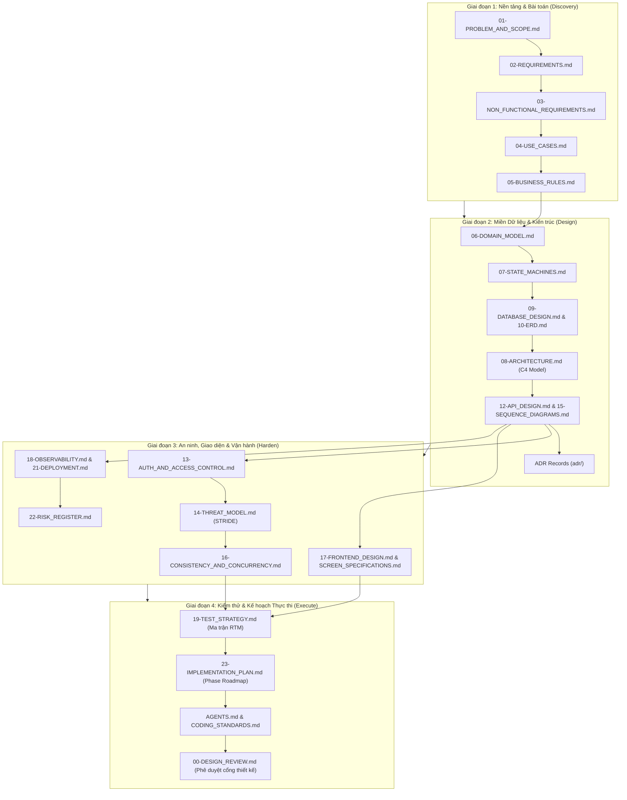

# 📘 Hướng Dẫn Vận Hành & Áp Dụng Bộ Tài Liệu Kỹ Thuật (Engineering Docs Playbook)

> **Cẩm nang toàn diện dành cho Tech Lead, Software Architect và AI Pair Programmer**  
> Hướng dẫn từng bước cách tùy biến, viết tài liệu theo chuỗi truy vết (Traceability) và prompt các mô hình AI để hoàn thiện toàn bộ tài liệu dự án mà không bị ảo giác (zero hallucination).

---

## 🧭 1. Chu Trình Hoàn Thiện Tài Liệu 4 Giai Đoạn (Documentation Lifecycle)

Đừng cố viết toàn bộ 40 tài liệu cùng một lúc. Hãy tuân thủ quy trình 4 giai đoạn logic từ trừu tượng đến cụ thể:



---

## 🎯 2. Quy Tắc Đặt Mã Định Danh & Truy Vết Bắt Buộc (Traceability Standards)

Để dự án duy trì tính minh bạch tuyệt đối, bạn phải gán mã định danh duy nhất cho từng thực thể tài liệu và duy trì sự liên kết:

| Ký hiệu | Ý nghĩa | Định dạng chuẩn | Ví dụ thực tế |
| :---: | :--- | :--- | :--- |
| **`FR`** | Functional Requirement (Yêu cầu chức năng) | `FR-<MODULE>-<3_DIGITS>` | `FR-ORDER-001`, `FR-AUTH-002` |
| **`NFR`** | Non-Functional Requirement (Yêu cầu phi chức năng) | `NFR-<TYPE>-<3_DIGITS>` | `NFR-PERF-001`, `NFR-SEC-003` |
| **`UC`** | Use Case (Ca sử dụng) | `UC-<ACTOR/FEATURE>-<NUM>` | `UC-CUSTOMER-CHECKOUT`, `UC-ADMIN-REFUND` |
| **`BR`** | Business Rule (Quy tắc nghiệp vụ) | `BR-<3_DIGITS>` | `BR-001`, `BR-015` |
| **`API`** | RESTful Endpoint | `API-<VERB>-<RESOURCE>` | `POST /api/v1/orders`, `PATCH /api/v1/users/{id}` |
| **`ADR`** | Architecture Decision Record | `ADR-<3_DIGITS>-<TITLE>` | `ADR-001-POSTGRESQL`, `ADR-002-EVENT_DRIVEN` |
| **`ATK`** | Attack Scenario (Kịch bản tấn công) | `ATK-<2_DIGITS>` | `ATK-01` (IDOR), `ATK-05` (Double Submit) |
| **`SCR`** | Screen Specification (Màn hình giao diện) | `SCR-<2_DIGITS>` | `SCR-01` (Login), `SCR-08` (Checkout) |
| **`RSK`** | System Risk (Rủi ro hệ thống) | `RSK-<2_DIGITS>` | `RSK-01` (Payment Gateway Downtime) |
| **`TC`** | Critical Test Case (Kịch bản kiểm thử) | `TC-<CATEGORY>-<2_DIGITS>` | `TC-SEC-01`, `TC-CONC-01` |
| **`PHASE`** | Implementation Phase (Giai đoạn thi công) | `Phase <NUM> — <TITLE>` | `Phase 1 — Foundation`, `Phase 4 — Payment` |

---

## 🤖 3. Bộ Prompt Mẫu Điều Khiển AI (AI Prompting Playbook)

Khi làm việc với các trợ lý AI (Gemini, Claude, GPT), đừng đưa ra yêu cầu chung chung như *"Hãy viết docs cho dự án ecommerce"*. Hãy sử dụng các Prompt Template đã đóng khung ngữ cảnh dưới đây:

### 3.1. Prompt Tạo Bối Cảnh, Bài Toán & Yêu Cầu (`01-PROBLEM` & `02-REQUIREMENTS`)
```text
BẠN ĐÓNG VAI TRÒ: Senior Business Analyst & Requirements Engineer.
NHIỆM VỤ: Hãy dựa vào mô tả dự án [{{PROJECT_NAME}}]: [Mô tả ngắn gọn dự án của bạn]
YÊU CẦU ĐẦU RA:
1. Viết tài liệu `01-PROBLEM_AND_SCOPE.md` theo cấu trúc: Bối cảnh AS-IS vs TO-BE vs GAP, Problem Statement (4 vấn đề chính), Business Goals, Phân tích 3-4 Actors chính, Ranh giới Trong phạm vi (In-Scope) và Ngoài phạm vi (Out-of-Scope).
2. Viết tài liệu `02-REQUIREMENTS.md` chia theo 5-6 Module nghiệp vụ độc lập. Mỗi yêu cầu phải có mã `FR-<MODULE>-<NUMBER>` rõ ràng, mô tả tiêu chí chấp nhận cụ thể, không dùng từ ngữ mập mờ.
QUY TẮC: Định dạng chuẩn Markdown, tiếng Việt kỹ thuật chuẩn mực, có bảng tóm tắt.
```

### 3.2. Prompt Thiết Kế Quy Tắc Nghiệp Vụ 5 Tầng (`05-BUSINESS_RULES`)
```text
BẠN ĐÓNG VAI TRÒ: Principal Software Architect.
NHIỆM VỤ: Dựa vào các yêu cầu FR-* của dự án [{{PROJECT_NAME}}], hãy trích xuất 15-20 Quy tắc Nghiệp vụ Bất biến (Business Rules) vào file `05-BUSINESS_RULES.md`.
YÊU CẦU BẮT BUỘC:
Mỗi quy tắc phải có: Mã `BR-***`, Tên quy tắc, Mô tả chi tiết, Tầng thực thi chính (Enforcement Layer trong 5 tầng: Database Constraint / Concurrency Lock / Action & Policy / Form Validation / Frontend UX), Mã lỗi HTTP khi vi phạm.
Kèm sơ đồ Mermaid thể hiện luồng phòng thủ chiều sâu và phân tích sâu 2 quy tắc sinh tử nhất (ví dụ: Chống trừ tiền 2 lần, Chống vượt quyền IDOR).
```

### 3.3. Prompt Thiết Kế CSDL, ERD & Máy Trạng Thái FSM (`02-domain-database`)
```text
BẠN ĐÓNG VAI TRÒ: Senior Database Architect (PostgreSQL 16).
NHIỆM VỤ: Thiết kế CSDL hoàn chỉnh cho dự án [{{PROJECT_NAME}}]:
1. File `07-STATE_MACHINES.md`: Xác định 2-3 thực thể có vòng đời phức tạp. Vẽ sơ đồ Mermaid stateDiagram-v2, lập bảng chuyển đổi trạng thái (Current State, Next State, Actor, Condition, Side Effect), danh sách các bước chuyển BỊ CẤM TUYỆT ĐỐI.
2. File `09-DATABASE_DESIGN.md`: Lập bảng tổng hợp 10-15 bảng CSDL (Tên bảng, Mục đích, PK, FK, Unique, Index, Cột cốt lõi). Phân tích chi tiết hành vi ON DELETE (RESTRICT vs CASCADE) để bảo toàn dữ liệu lịch sử. Viết các câu lệnh SQL ràng buộc Unique/Check phức tạp.
3. File `10-ERD.md`: Vẽ sơ đồ Mermaid erDiagram chi tiết với quan hệ 1-1, 1-N, N-N chuẩn xác.
```

### 3.4. Prompt Thiết Kế Kiến Trúc C4 & Hợp Đồng API (`03-architecture-api`)
```text
BẠN ĐÓNG VAI TRÒ: Senior System Architect & API Designer.
NHIỆM VỤ:
1. File `08-ARCHITECTURE.md`: Vẽ sơ đồ C4 Model Mermaid gồm Level 1: System Context và Level 2: Container Diagram. Giải thích chi tiết trách nhiệm của từng khối (Backend, Frontend, Cache, Queue Worker, Database, Third-party APIs).
2. File `12-API_DESIGN.md`: Thiết kế bộ API RESTful `/api/v1` chuẩn mực. Với mỗi endpoint, nêu rõ: HTTP Method, URL, Mô tả, Authorization (Role/Policy), Request Headers/Body (JSON schema), Response Headers/Body (200/201/422/403/404), Cơ chế phân trang & Rate Limiting.
3. File `15-SEQUENCE_DIAGRAMS.md`: Vẽ ít nhất 3 sơ đồ tuần tự Mermaid biểu diễn các luồng nghiệp vụ phức tạp nhất (ví dụ: Luồng Xác thực, Luồng Đặt hàng / Thanh toán, Luồng Xử lý Hàng đợi bất đồng bộ).
```

### 3.5. Prompt Thiết Kế An Ninh STRIDE & Concurrency (`04-security-concurrency`)
```text
BẠN ĐÓNG VAI TRÒ: Application Security Engineer & Concurrency Specialist.
NHIỆM VỤ:
1. File `14-THREAT_MODEL.md`: Đánh giá rủi ro an ninh theo mô hình STRIDE kết hợp OWASP API Security Top 10 (2023). Xây dựng bảng Ma trận Kịch bản Tấn công (ATK-01 -> ATK-08) gồm: Tài sản, Mối đe dọa, Kịch bản tấn công thực tế, Mức độ tác động, Xác suất, Cơ chế phòng ngừa kỹ thuật, và Phương pháp kiểm chứng tự động (Assertion).
2. File `16-CONSISTENCY_AND_CONCURRENCY.md`: Phân tích các rủi ro Race Conditions (Double submit, Concurrent balance update, State race). Đưa ra giải pháp Database Transaction kết hợp Khóa dòng Bi quan (`SELECT ... FOR UPDATE`), Unique Constraints và Header Idempotency-Key. Viết kèm mẫu code backend triển khai chuẩn.
```

### 3.6. Prompt Lập Kế Hoạch Kiểm Thử & Lộ Trình 10-15 Phase (`07-testing-execution`)
```text
BẠN ĐÓNG VAI TRÒ: QA Lead & Principal Technical Project Manager.
NHIỆM VỤ:
1. File `19-TEST_STRATEGY.md`: Thiết lập kim tự tháp kiểm thử (E2E 10%, Concurrency/Security 20%, Feature/Integration 50%, Unit 20%). Lập danh mục các Test Case sống còn (`TC-*`) và Bảng Ma trận Truy xuất Nguồn gốc (Traceability Matrix) đối chiếu: `FR-*` -> `UC-*` -> `API-*` -> `BR-*` -> `Security Control` -> `Test Case`.
2. File `23-IMPLEMENTATION_PLAN.md`: Chia dự án thành 10-14 Phase thi công tuần tự từ Foundation đến Go-Live. Mỗi Phase bắt buộc nêu rõ: Mục tiêu, Phụ thuộc, Tệp tin ảnh hưởng, Thay đổi CSDL, Endpoints, Kiểm soát An ninh, Danh sách Test Cases, và Definition of Done (DoD) định lượng.
```

---

## 🏛️ 4. Quy Trình Pair Programming Cùng AI (AI Pair Programming Constitution)

Khi chuyển sang giai đoạn gõ code, file `AGENTS.md` tại thư mục gốc đóng vai trò là bản **Hiến pháp Kỹ thuật**. Bạn hoặc AI bắt buộc phải thực thi 2 thủ tục sư phạm:

### 4.1. Thủ tục Pre-Implementation Check (Trước khi gõ code)
Trước khi tạo bất kỳ controller hay migration nào, AI phải tự trả lời và thống nhất với bạn 14 câu hỏi:
1. Use Case nào (`UC-*`)?
2. Actor nào thực hiện?
3. Endpoint URL & HTTP Method?
4. Request Body Schema?
5. Response Schema & API Resource?
6. Cơ chế Authentication?
7. Cơ chế Authorization & Chống IDOR (Policy)?
8. Validation Rules (Form Request / Schema)?
9. Bảng & Khóa ngoại liên quan?
10. Ranh giới Database Transaction?
11. Side Effects (Events, Jobs, Emails)?
12. Test Cases cần viết?
13. Rủi ro An ninh cần triệt tiêu?
14. Hiệu năng truy vấn & Rủi ro N+1?

### 4.2. Thủ tục Post-Implementation Debrief (Sau khi code xong)
Sau khi hoàn thành tính năng, AI phải giải thích cho bạn:
- Luồng dữ liệu (Request Lifecycle).
- Các câu lệnh SQL chính sinh ra.
- Cơ chế Authorization & Chống IDOR đã triển khai.
- Kết quả chạy test tự động (100% Pass).
- Ứng xử của hệ thống khi có 1.000 user đồng thời.
- Gợi ý kiến thức nâng cao nên đọc thêm.

---

## ✅ 5. Tiêu Chuẩn Phê Duyệt Cổng Thiết Kế (Definition of Ready - DoR)

Trước khi bắt đầu gõ dòng code đầu tiên, hãy mở file [00-DESIGN_REVIEW.md](docs/03-architecture-api/00-DESIGN_REVIEW.md) và tích đủ 100% các tiêu chí:
- [ ] 100% `FR-*` được ánh xạ sang `UC-*` và `API-*`.
- [ ] Mọi bảng trong CSDL đều có khóa ngoại với `ON DELETE` được phân tích rõ.
- [ ] Mọi trạng thái thực thể đều được kiểm soát bởi FSM và có danh sách chuyển đổi bị cấm.
- [ ] Ma trận rủi ro `ATK-*` có cơ chế phòng vệ cụ thể cho từng kịch bản.
- [ ] Không có endpoint nào để lộ dữ liệu nhạy cảm ra ngoài client.
- [ ] Kế hoạch thi công chia nhỏ thành từng Phase độc lập với DoD có thể đo lường.
