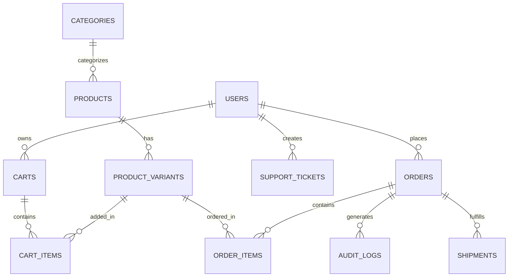

# Báo Cáo Tổng Quan Dự Án — RetailMind AI

**Ngày lập:** 2026-10-20  
**Phiên bản:** 1.0 (Production 2026 Baseline)  
**Tác giả:** Đội ngũ Kỹ sư Hệ thống RetailMind AI  
**Trạng thái:** Architecture Baseline v1.0 / Approved

---

## 1. Tổng Quan Hệ Thống

Dự án **RetailMind AI** là nền tảng thương mại điện tử thông minh kết hợp hệ thống tác tử AI (Agentic Retail Intelligence Platform) cấp doanh nghiệp, được thiết kế để giải quyết bài toán cốt lõi: **Xóa bỏ tình trạng quá tải thông tin và tư vấn sai lệch trong bán lẻ thiết bị công nghệ bằng cách kết hợp AI Agent tư vấn thông minh với cơ chế kiểm soát dữ liệu giao dịch chặt chẽ, chống oversell và loại bỏ hoàn toàn rủi ro ảo giác (hallucination).**

Hệ thống được tổ chức theo kiến trúc phân tách ranh giới rõ ràng:

| Khối hệ thống | Vai trò & Trách nhiệm | Công nghệ chủ đạo |
|---|---|---|
| **Backend Core SSOT Engine** | **System of Record & Commerce Engine:** Nguồn chân lý duy nhất lưu trữ và xử lý toàn bộ dữ liệu, tồn kho, đơn hàng, phân quyền và khóa bi quan | Node.js 20+, NestJS 12+ (TypeScript), TypeORM, PostgreSQL 16+, Redis 7, BullMQ, MinIO |
| **AI Agent Runtime** | **System of Intelligence:** Tác tử suy luận ReAct, Hybrid RAG, PII Filter, Tool Registry có kiểm soát | Python 3.11+, FastAPI (Async), LangGraph StateGraph, Pydantic v2, Qdrant Vector DB |
| **Frontend Web Client** | **System of Engagement:** Giao diện người dùng hiện đại, tối ưu SEO, BFF Reverse Proxy, tương tác hội thoại AI Agent thời gian thực (SSE) | Next.js 16+ (App Router, React 19, TypeScript), TailwindCSS |
| **Container & Infra** | Môi trường triển khai chuẩn hóa đa dịch vụ | Docker Compose (8 services), Multi-stage Dockerfiles, Arize Phoenix |

```text
RetailMind_AI/
├── core-api/                 ← NestJS 12+ Core API, TypeORM & SSOT Commerce Engine
├── agent-system/             ← Python 3.11+ FastAPI & LangGraph Agent Engine
├── web-client/               ← Next.js 16+ App Router, React 19 Web Client
├── contracts/                ← Khế ước giao tiếp & Typed Tool interfaces
├── data/                     ← Dữ liệu sản phẩm mẫu & Catalog seed data
├── deploy/                   ← Multi-stage Dockerfiles cho Backend, Agent, Frontend
├── docker-compose.yml        ← Điều phối 8 containers (Postgres, Redis, MinIO, Qdrant, Phoenix, Backend, Agent, Frontend)
├── enterprise-docs/          ← Hệ thống tài liệu kiến trúc doanh nghiệp chuẩn hóa (11 nhóm)
├── scripts/                  ← Tiện ích Ingestion MinIO S3 & Rebranding dữ liệu
└── AGENTS.md                 ← Hiến pháp kỹ thuật vận hành dự án
```

### Nguyên tắc cốt lõi
> **PostgreSQL** là nguồn chân lý duy nhất (Single Source of Truth) cho dữ liệu giao dịch, giá niêm yết, tồn kho khả dụng và phiên bản tài liệu.  
> **Qdrant** chỉ đóng vai trò chỉ mục tìm kiếm ngữ nghĩa thứ cấp (Secondary Retrieval Index), không bao giờ được phép quyết định giá hoặc số lượng tồn kho.  
> **Ranh giới tác tử (Agent Execution Boundary):** $\text{LLM Proposes} \longrightarrow \text{Typed Validation (Pydantic)} \longrightarrow \text{Authz Check} \longrightarrow \text{Backend Service Executes}$. LLM tuyệt đối không truy cập trực tiếp CSDL.

---

## 2. Mục Tiêu Chức Năng & Vòng Đời Nghiệp Vụ Cốt Lõi

Hệ thống quản lý toàn diện vòng đời mua sắm và tư vấn thông minh:

```mermaid
flowchart LR
    %% ==========================================
    %% RETAIL FLOW PALETTE
    %% ==========================================
    classDef stepAuth fill:#271E0B,stroke:#F59E0B,stroke-width:2px,color:#FEF3C7,rx:8,ry:8
    classDef stepAI fill:#1E1B4B,stroke:#8B5CF6,stroke-width:2px,color:#EDE9FE,rx:8,ry:8
    classDef stepCart fill:#064E3B,stroke:#10B981,stroke-width:2px,color:#D1FAE5,rx:8,ry:8
    classDef stepLock fill:#3B0764,stroke:#EC4899,stroke-width:2.5px,color:#FCE7F3,rx:8,ry:8
    classDef stepPay fill:#064E3B,stroke:#10B981,stroke-width:2px,color:#D1FAE5,rx:8,ry:8
    classDef stepCare fill:#0F172A,stroke:#38BDF8,stroke-width:2px,color:#E0F2FE,rx:8,ry:8
    classDef stepAdmin fill:#1E293B,stroke:#94A3B8,stroke-width:1.5px,color:#F8FAFC,rx:8,ry:8

    A["1. Xác Thực & Phiên<br/>(JWT • Argon2id)"]:::stepAuth
    B["2. Tư Vấn AI Agent<br/>(LangGraph • RAG Qdrant)"]:::stepAI
    C["3. Giỏ Hàng Mua Sắm<br/>(Cart Validation)"]:::stepCart
    D["4. Preview & Giữ Kho<br/>(SELECT FOR UPDATE 10m)"]:::stepLock
    E["5. Chốt Đơn Giả Lập<br/>(Idempotent Checkout)"]:::stepPay
    F["6. Chăm Sóc Hậu Mãi<br/>(Ticket Hỗ Trợ Khách)"]:::stepCare
    G["7. Kiểm Toán & Quản Trị<br/>(Sổ Cái Append-Only)"]:::stepAdmin

    A ==> B ==> C ==> D ==> E ==> F ==> G
```



---

## 3. Vai Trò Người Dùng (RBAC Scope Lock)

Dự án áp dụng kỷ luật khóa phạm vi nghiêm ngặt (Scope Lock Discipline) với đúng 3 tác nhân (Personas):

| Vai trò (Role) | Ký hiệu | Mô tả & Quyền hạn chính |
|---|:---:|---|
| **Khách vãng lai** | `Guest` | Duyệt danh mục sản phẩm, tìm kiếm cơ bản, tương tác tư vấn AI ẩn danh (giới hạn context bộ nhớ phiên), không thể tạo đơn hàng hoặc lưu giỏ hàng lâu dài. |
| **Khách hàng** | `Customer` | Đăng ký/đăng nhập, quản lý giỏ hàng, nhận tư vấn AI cá nhân hóa với lịch sử, đặt hàng (checkout), thanh toán mô phỏng, tra cứu đơn hàng cá nhân và gửi yêu cầu hỗ trợ. |
| **Quản trị viên** | `Admin` | Quản trị danh mục sản phẩm, cập nhật giá và tồn kho khả dụng, kích hoạt đồng bộ hóa Vector DB (Qdrant Sync), quản lý đơn hàng toàn sàn, xử lý khiếu nại và xem báo cáo tổng hợp. |

---

## 4. Mô Hình Miền (Domain Model at a Glance)

Hệ thống quản lý lược đồ CSDL quan hệ chuẩn hóa tuân thủ ACID trên PostgreSQL:



---

## 5. Máy Trạng Thái Cốt Lõi (Core State Machines)

```text
Product Status:        draft → active → inactive → archived
Inventory Hold:        available → reserved (hold 15m) → committed (ordered) / released (timeout)
Order Lifecycle:       pending_payment → paid → processing → shipped → completed / cancelled / refunded
Support Ticket:        open → pending_agent → investigating → resolved → closed
Agent Chat Session:    idle → listening → thinking (RAG retrieval) → responding (SSE stream) → terminated
```

---

## 6. Stack Kỹ Thuật Chuẩn Hóa (ADR-007 Polyglot Edition)

| Tầng công nghệ | Công nghệ lựa chọn | Lý do kiến trúc & Ưu điểm |
|---|---|---|
| **Commerce Backend Core (SSOT)** | Node.js 20+, NestJS 12+ (TypeScript) | Kiến trúc Modular Monolith, Dependency Injection mạnh mẽ, TypeORM quản lý Transaction ACID và Khóa bi quan |
| **Database (SSOT)** | PostgreSQL 16+ | Nguồn chân lý duy nhất cho giá bán, tồn kho, đơn hàng; 100% tiền tệ dùng `NUMERIC(18, 0)` VNĐ |
| **Vector Search (Secondary)** | Qdrant (HNSW Cosine) | Chỉ mục tìm kiếm ngữ nghĩa sản phẩm và tri thức chính sách tốc độ cao, hỗ trợ payload filtering |
| **AI Agent Runtime** | Python 3.11+, FastAPI (Async) | LangGraph StateGraph điều phối luồng suy luận, ngắt luồng (interrupt), Pydantic v2 Typed Tools |
| **Data Validation & Tools** | Pydantic v2 | Kiểm tra kiểu dữ liệu tĩnh/động tốc độ cao (Rust core), ngăn chặn hoàn toàn Prompt Injection vào 13 Typed Tools |
| **Async Queue & Cache** | Redis 7 & BullMQ | Quản lý Token blacklist, session state, rate limiting, prompt cache và BullMQ xử lý tài liệu nền |
| **Object Storage** | MinIO (S3-Compatible) | Lưu trữ văn bản chính sách PDF, hình ảnh sản phẩm và tài liệu đính kèm chuẩn Enterprise |
| **Frontend Client** | Next.js 16+ (App Router, React 19, TS) | Feature-Based Architecture, BFF Reverse Proxy (`/api/proxy/[...path]`), HttpOnly Cookie, SSE streaming |
| **Observability & FinOps** | Arize Phoenix (6006) & OTel | Giám sát LLM Traces, UMAP embedding drift, Model Cascading tiết kiệm 88% token chi phí $0 |
| **Containerization** | Docker Compose | Triển khai chuẩn hóa đồng nhất 8 services: Postgres, Redis, MinIO, Qdrant, Phoenix, Backend, Agent, Frontend |

---

## 7. Kiến Trúc API & Luồng Xử Lý Request

- **Prefix:** `/api/v1`
- **Phong cách:** RESTful kết hợp Server-Sent Events (SSE) cho streaming AI response qua BFF Proxy.
- **Hành trình xử lý một Request thương mại thông thường:**

```text
HTTP Request → Next.js BFF Reverse Proxy (/api/proxy/[...path]) → HttpOnly Cookie to Bearer
→ NestJS Core Backend → Middleware (RateLimit, Logging) → JwtAuthGuard & RolesGuard
→ Service Layer (DB Transaction + TypeORM setLock('pessimistic_write') khi thao tác tồn kho)
→ TypeORM Entity Manager → PostgreSQL 16 (SSOT)
→ Standardized Envelope JSON Response (200 / 201 / 400 / 401 / 403 / 404 / 409 / 500)
```

- **Hành trình xử lý Agent Prompt:**

```text
User Prompt (Client) → Next.js BFF SSE Proxy (duplex: 'half') → Python Agent Runtime
→ PII Sanitizer (Nghị định 13/2023 & Luật 91/2025) → Prompt Guard / Jailbreak Detector
→ LangGraph Agent Node → LLM Tool Call Proposal (Structured JSON)
→ 13 Typed Tools Validator (Pydantic v2) → Internal Tool Gateway (NestJS Core / Qdrant)
→ AST Safe Calculator (zero eval) → Output Guard (Citation Whitelist) → SSE Stream Response
```

---

## 8. An Ninh Ứng Dụng & Kiểm Soát Concurrency

| Cơ chế bảo vệ | Kỹ thuật triển khai chi tiết |
|---|---|
| **Chống IDOR** | Resource-level Policy kiểm tra quyền sở hữu bản ghi (`order.user_id == current_user.id`) trước khi truy xuất hoặc cập nhật. |
| **Zero-Leakage Policy** | Phân tách Dedicated Pydantic Response DTOs; loại bỏ hoàn toàn mật khẩu băm, secret keys và PII không cần thiết. |
| **Làm sạch PII tiếng Việt** | Tự động làm sạch CCCD (12 số), SĐT Việt Nam (03x, 05x, 07x, 08x, 09x), Email theo Nghị định 13/2023/NĐ-CP và Luật 91/2025/QH15 trước khi gửi sang LLM. |
| **Chống Bán Vượt Tồn (Anti-Oversell)** | Khóa dòng bi quan `SELECT quantity, reserved_quantity FROM product_variants WHERE id = :id FOR UPDATE` trong Transaction; từ chối nếu số lượng không đủ. |
| **Chống Trùng Lặp Giao Dịch** | Yêu cầu Header `Idempotency-Key: UUIDv4` cho mọi request tạo đơn và thanh toán; lưu trữ trạng thái tại Redis/DB với TTL 24 giờ. |
| **Số học Tiền tệ Tuyệt đối** | Toàn bộ các cột giá trị tiền tệ VNĐ sử dụng kiểu `NUMERIC(18, 0)` hoặc `Decimal`, **nghiêm cấm dùng `FLOAT`** để triệt tiêu sai số làm tròn. |

---

## 9. Bảng Theo Dõi Trạng Thái Triển Khai (Implementation Dashboard)

| Hạng mục kỹ thuật | Trạng thái | Ghi chú & Liên kết tài liệu |
|---|:---:|---|
| **01. Yêu cầu & Bài toán Nghiệp vụ (Nhóm 01)** | `DONE` | [01-requirements/README.md](docs/01-requirements/README.md) — 12 Use Cases, 25 Business Rules |
| **02. Miền Dữ liệu & Thiết Kế CSDL (Nhóm 02)** | `DONE` | [02-domain-database/README.md](docs/02-domain-database/README.md) — 22 Bảng, PostgreSQL 16+, Numeric VNĐ |
| **03. Kiến trúc Hệ Thống & API (Nhóm 03)** | `DONE` | [03-architecture-api/README.md](docs/03-architecture-api/README.md) — C4 Model, 13 Typed Tools, 9 ADRs |
| **04. An Ninh Ứng Dụng & Concurrency (Nhóm 04)** | `DONE` | [04-security-concurrency/README.md](docs/04-security-concurrency/README.md) — RBAC, IDOR, Pessimistic Locking |
| **05. Dịch Vụ Máy Chủ NestJS Core (Nhóm 05)** | `DONE` | [05-backend/README.md](docs/05-backend/README.md) — NestJS 12+, TypeORM SSOT, MinIO, BullMQ |
| **06. Giao Diện Người Dùng Next.js (Nhóm 06)** | `DONE` | [06-frontend/README.md](docs/06-frontend/README.md) — Next.js 16+, FSD, BFF Reverse Proxy, 9 Screens |
| **07. Vận Hành, SRE & Triển Khai (Nhóm 07)** | `DONE` | [07-operations-devops/README.md](docs/07-operations-devops/README.md) — Phoenix 6006, Docker 8 Services |
| **08. Kiểm Thử & Kế Hoạch Thực Thi (Nhóm 08)** | `DONE` | [08-testing-execution/README.md](docs/08-testing-execution/README.md) — 17 ATs, SLA Framework, 10 Phases |
| **09. Quy Chuẩn Kỹ Thuật & Đào Tạo (Nhóm 09)** | `DONE` | [09-guidelines/README.md](docs/09-guidelines/README.md) — AST Safe Calc, Anti-Patterns, Pitch Deck |
| **10. Nghiên Cứu & Bằng Chứng Nguồn (Nhóm 10)** | `DONE` | [10-research-benchmarks/README.md](docs/10-research-benchmarks/README.md) — 16 Repos Benchmark, Deterministic Eval |
| **11. Quản Trị & Tiến Độ Thi Công (Nhóm 11)** | `DONE` | [11-governance-progress/README.md](docs/11-governance-progress/README.md) — SHA-256 Baseline, 10-Col RTM |
| **Hạ tầng Ứng dụng & Mã Nguồn (Tri-Tier)** | `DONE` | `core-api` (23/23 Jest Passed), `agent-system` (50/50 Pytest Passed), `web-client` (Next.js Build Pass) |
