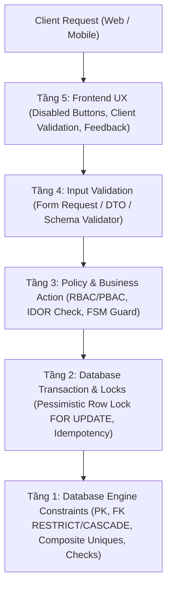

# 🏛️ Enterprise Software Documentation Blueprint & Engineering Framework

> **Bộ Khung Tài Liệu Kỹ Thuật Chuẩn Hóa Chuẩn Enterprise Cho Mọi Dự Án Phần Mềm**  
> Thiết kế theo chuẩn Senior Software Architect, Single Source of Truth (SSOT), Defense-in-Depth, Traceability Matrix và AI-Native Engineering.

---

## 🌟 1. Giới Thiệu & Triết Lý Cốt Lõi

Khi bắt đầu một dự án phần mềm mới (Web, Mobile, SaaS, Fintech, E-Commerce, ERP, IoT hay AI System), việc thiếu hụt một hệ thống tài liệu chuẩn mực thường dẫn đến:
- **Mã nguồn lộn xộn (Spaghetti Code)**: Code viết trước, suy nghĩ sau; các thành viên trong đội ngũ hiểu sai yêu cầu.
- **Lỗ hổng an ninh & IDOR**: Không có mô hình đe dọa (Threat Model) và phân quyền phân tầng.
- **Tranh chấp dữ liệu (Race Conditions)**: Bỏ qua kiểm soát đồng thời (Concurrency Control), nộp trùng lặp, trừ tiền đúp.
- **Mất kiểm soát khi bàn giao cho AI**: AI tạo ra code rời rạc, sinh mã vô tội vạ, phá vỡ cấu trúc và rò rỉ dữ liệu nhạy cảm.

**Enterprise Software Documentation Blueprint** được chắt lọc từ các thực tiễn kỹ thuật đỉnh cao (Enterprise Architecture, C4 Model, STRIDE Threat Modeling, FSM, Conventional Commits, RTM Traceability), tổ chức thành **11 thư mục chức năng phân định theo vai trò kỹ sư**, tạo thành một kim chỉ nam duy nhất (**Single Source of Truth**) giúp dẫn dắt cả lập trình viên con người lẫn trợ lý AI (AI Agents).

---

## 🗂️ 2. Bản Đồ 11 Thư Mục Kỹ Thuật Chuẩn Hóa

```text
enterprise-docs/
├── AGENTS.md                                    # Hiến pháp kỹ thuật vận hành & AI Pair Programming
├── PROJECT_OVERVIEW.md                          # Báo cáo tổng quan dự án 360 độ (Executive Summary)
├── HOW_TO_USE_GUIDE.md                          # Cẩm nang vận hành & Playbook tương tác AI
│
└── docs/
    ├── README.md                                # Bản đồ tra cứu trung tâm & điều hướng nhanh
    │
    ├── 01-requirements/                         # [VAI TRÒ: YÊU CẦU & BÀI TOÁN NGHIỆP VỤ]
    │   ├── README.md                            # Mục lục & nguyên tắc yêu cầu
    │   ├── 01-PROBLEM_AND_SCOPE.md              # Bối cảnh AS-IS, TO-BE, Bài toán, Mục tiêu & Phạm vi
    │   ├── 02-REQUIREMENTS.md                   # Yêu cầu chức năng phân tầng (FR-<MODULE>-<NUM>)
    │   ├── 03-NON_FUNCTIONAL_REQUIREMENTS.md    # Yêu cầu phi chức năng (NFR-PERF, NFR-SEC, NFR-SCALE)
    │   ├── 04-USE_CASES.md                      # Sơ đồ Actor-Use Case & Đặc tả chi tiết 12 Use Cases (UC01–UC12)
    │   └── 05-BUSINESS_RULES.md                 # Danh mục quy tắc nghiệp vụ 5 tầng (BR-001–BR-025)
    │
    ├── 02-domain-database/                      # [VAI TRÒ: MÔ HÌNH MIỀN & THIẾT KẾ DỮ LIỆU]
    │   ├── README.md                            # Mục lục & nguyên tắc mô hình dữ liệu
    │   ├── 06-DOMAIN_MODEL.md                   # Mô hình thực thể nghiệp vụ, ranh giới Aggregate & Quan hệ
    │   ├── 07-STATE_MACHINES.md                 # Máy trạng thái hữu hạn (FSM), Guards & Forbidden Transitions
    │   ├── 09-DATABASE_DESIGN.md                # Thiết kế CSDL chi tiết 22 bảng, DDL PostgreSQL 16+, Numeric VNĐ
    │   ├── 10-ERD.md                            # Sơ đồ thực thể liên kết Mermaid ERD chuẩn xác & Phân định PG/Qdrant
    │   └── 11-DATA_CLASSIFICATION.md            # Phân loại độ nhạy cảm dữ liệu (PII, Secret) & Chính sách lưu trữ
    │
    ├── 03-architecture-api/                     # [VAI TRÒ: KIẾN TRÚC HỆ THỐNG & API CONTRACTS]
    │   ├── README.md                            # Mục lục & nguyên tắc kiến trúc
    │   ├── 00-DESIGN_REVIEW.md                  # Cổng kiểm định chất lượng thiết kế (Design Gate Verdict)
    │   ├── 08-ARCHITECTURE.md                   # Kiến trúc C4 Model (Level 1 Context & Level 2 Container)
    │   ├── 12-API_DESIGN.md                     # Hợp đồng RESTful API: Envelope, Endpoints, 13 Typed Tools
    │   ├── 15-SEQUENCE_DIAGRAMS.md              # Sơ đồ tuần tự (Sequence Diagrams) cho 4 luồng cốt lõi
    │   └── adr/                                 # 9 Bản ghi quyết định kiến trúc then chốt (ADR-001..009)
    │
    ├── 04-security-concurrency/                 # [VAI TRÒ: AN NINH ỨNG DỤNG & TRANH CHẤP ĐỒNG THỜI]
    │   ├── README.md                            # Mục lục & nguyên tắc phòng thủ
    │   ├── 13-AUTH_AND_ACCESS_CONTROL.md        # Xác thực JWT/Cookie, RBAC/PBAC Matrix & Chống IDOR
    │   ├── 14-THREAT_MODEL.md                   # Mô hình đe dọa STRIDE + OWASP Top 10 & Ma trận ATK-*
    │   └── 16-CONSISTENCY_AND_CONCURRENCY.md    # Race Conditions, Khóa bi quan FOR UPDATE & Idempotency
    │
    ├── 05-backend/                              # [VAI TRÒ: DỊCH VỤ MÁY CHỦ NESTJS & SSOT]
    │   ├── README.md                            # Bản đồ tra cứu & tổng quan NestJS Core Backend
    │   ├── 01-BACKEND_ARCHITECTURE.md           # Kiến trúc NestJS, Modular Monolith, DI, Request Lifecycle
    │   ├── 02-FEATURE_SPECIFICATIONS.md         # Đặc tả chi tiết các Features nghiệp vụ (thay cho modules)
    │   ├── 03-TRANSACTION_AND_CONCURRENCY.md    # Khóa bi quan TypeORM FOR UPDATE, Deadlock, Idempotency
    │   ├── 04-INTERNAL_TOOL_GATEWAY.md          # Giao thức kết nối 13 Typed Tools với Python AI Agent
    │   ├── 05-ASYNC_PROCESSING_MINIO_REDIS_BULLMQ.md # Pipeline ngầm: MinIO (S3), Redis Cache, BullMQ Worker
    │   └── 06-ENTERPRISE_BEST_PRACTICES_FOODEE.md # 10 Tinh hoa kỹ thuật Enterprise từ foodee-be/core-api
    │
    ├── 06-frontend/                             # [VAI TRÒ: GIAO DIỆN & TRẢI NGHIỆM NGƯỜI DÙNG]
    │   ├── README.md                            # Bản đồ tra cứu phân hệ giao diện người dùng
    │   ├── 17-FRONTEND_DESIGN.md                # Kiến trúc Next.js 16+ App Router, FSD, BFF Proxy, Server Actions
    │   ├── SCREEN_SPECIFICATIONS.md             # Đặc tả 9 màn hình chuẩn hóa (SCR-01 đến SCR-09)
    │   ├── BRAND_AND_DESIGN_TOKENS.md           # Cyber-Retail Intelligence tokens, Typography, Dark Mode
    │   └── wireframe/                           # Thư mục chứa sơ đồ phác thảo giao diện
    │
    ├── 07-operations-devops/                    # [VAI TRÒ: VẬN HÀNH, SRE & TRIỂN KHAI]
    │   ├── README.md                            # Mục lục & nguyên tắc DevOps
    │   ├── 18-OBSERVABILITY.md                  # Structured JSON Logging, OpenTelemetry, Arize Phoenix (6006)
    │   ├── 20-PERFORMANCE_PLAN.md               # Kế hoạch chịu tải Flash-Sale, Redis cache, Model Cascading
    │   ├── 21-DEPLOYMENT.md                     # Ma trận môi trường, Docker Compose 7 services, CI/CD Actions
    │   └── 22-RISK_REGISTER.md                  # Sổ đăng ký rủi ro (Risk Register RSK-*) & Kế hoạch ứng phó
    │
    ├── 08-testing-execution/                    # [VAI TRÒ: ĐẢM BẢO CHẤT LƯỢNG & KẾ HOẠCH THI CÔNG]
    │   ├── README.md                            # Mục lục & nguyên tắc kiểm thử
    │   ├── 19-TEST_STRATEGY.md                  # Kim tự tháp kiểm thử, 17 Acceptance Tests, SLA & CI/CD Gating
    │   └── 23-IMPLEMENTATION_PLAN.md            # Lộ trình 10 phân kỳ (P0–P9) thi công chi tiết kèm Definition of Done
    │
    ├── 09-guidelines/                           # [VAI TRÒ: QUY CHUẨN LẬP TRÌNH & ĐÀO TẠO KỸ SƯ]
    │   ├── README.md                            # Mục lục & nguyên tắc quản trị kỹ thuật
    │   ├── CODING_STANDARDS.md                  # Clean Code, AST Safe Calculator, 10 Anti-Patterns Checklist
    │   ├── COMMIT_STANDARDS.md                  # Quy chuẩn Git Commit chuẩn Production (Conventional Commits 1.0.0)
    │   ├── LEARNING_GUIDE.md                    # Cẩm nang phỏng vấn & đào tạo Senior AI Systems Engineer
    │   └── AI_PAIR_PROGRAMMING_GUIDE.md         # Quy tắc & Prompt mẫu làm việc cùng AI Agents
    │
    ├── 10-research-benchmarks/                  # [VAI TRÒ: KHẢO SÁT KỸ THUẬT & MA TRẬN BẰNG CHỨNG THỰC NGHIỆM]
    │   ├── README.md                            # Bản đồ tra cứu phân khu nghiên cứu & bằng chứng
    │   ├── 01-EVIDENCE_MATRIX.md                # Master Evidence Matrix 16 repo mã nguồn mở
    │   ├── 02-COMMERCE_FLOW.md                  # Phân tích luồng nghiệp vụ E-commerce shopping bot
    │   ├── 03-INVENTORY_FLOW.md                 # Phân tích luồng trừ tồn kho & khóa bi quan FOR UPDATE
    │   ├── 04-RAG_FLOW.md                       # Phân tích luồng RAG Ingestion & Chunking băm SHA-256
    │   ├── 05-AGENT_TOOL_FLOW.md                # Phân tích điều phối Tool, cấm Text-to-SQL, MAX_STEPS = 5
    │   ├── 06-SECURITY_RELIABILITY.md           # Khảo sát bảo mật OWASP LLM, PII tiếng Việt (Nghị định 13)
    │   ├── 07-EVALUATION_BENCHMARK.md           # Bộ đánh giá chất lượng tất định (Deterministic Eval)
    │   ├── 08-INTEGRATION_DECISIONS.md          # Quyết định tích hợp giải pháp bên thứ 3
    │   └── 09-REJECTED_PATTERNS.md              # 10 mẫu phản thiết kế bị bác bỏ triệt để (Anti-Patterns)
    │
    └── 11-governance-progress/                  # [VAI TRÒ: QUẢN TRỊ THI CÔNG & TRẠNG THÁI DỰ ÁN]
        ├── README.md                            # Bản đồ tra cứu phân khu quản trị & báo cáo
        ├── 01-DESIGN_BASELINE_SHA256.md         # Bảng băm SHA-256 đóng băng thiết kế baseline v1
        ├── 02-PROJECT_STATUS.md                 # Báo cáo tiến độ thời gian thực (Executive Status)
        ├── 03-MICRO_DECISIONS.md                # Sổ cái các quyết định vi mô (Micro-Decisions Log)
        ├── 04-TRACEABILITY_MATRIX.md            # Ma trận truy vết toàn diện 10 chiều
        └── 05-NEXT_ACTIONS.md                   # Kế hoạch hành động chi tiết các phân kỳ tiếp theo
```

---

## 🔗 3. Chuỗi Truy Xuất Nguồn Gốc Toàn Diện (Traceability Chain)

Mọi chi tiết trong tài liệu liên kết chặt chẽ với nhau thông qua chuỗi truy vết chuẩn mực:

$$\mathbf{FR\text{-}*} \longrightarrow \mathbf{UC\text{-}*} \longrightarrow \mathbf{BR\text{-}*} \longrightarrow \mathbf{DB\text{-}*} \longrightarrow \mathbf{API\text{-}*} \longrightarrow \mathbf{ATK\text{-}*} \longrightarrow \mathbf{SCR\text{-}*} \longrightarrow \mathbf{TC\text{-}*} \longrightarrow \mathbf{DoD}$$

1. **`FR-*` (Functional Requirement)**: Yêu cầu nghiệp vụ bắt đầu từ người dùng.
2. **`UC-*` (Use Case)**: Kịch bản tương tác cụ thể của Actor.
3. **`BR-*` (Business Rule)**: Ràng buộc nghiệp vụ bất biến qua 5 tầng phòng thủ.
4. **`DB-*` (Database Table & Constraint)**: Khóa chính, khóa ngoại, Unique, Check Constraint.
5. **`API-*` (API Endpoint)**: Hợp đồng request/response, validation rules, HTTP status.
6. **`ATK-*` (Attack Scenario & Threat)**: Kịch bản tấn công và cơ chế ngăn chặn IDOR/Mass Assignment.
7. **`SCR-*` (Screen Specification)**: Trải nghiệm UI, trạng thái loading/error, optimistic updates.
8. **`TC-*` (Automated Test Case)**: Bộ kiểm thử tự động (Feature/Unit/Security test).
9. **`DoD` (Definition of Done)**: Tiêu chuẩn nghiệm thu cuối cùng trước khi merge code.

---

## 🛡️ 4. Triết Lý Phòng Thủ Chiều Sâu 5 Tầng (Defense-in-Depth)

Hệ thống tài liệu áp dụng triết lý phân tầng bảo mật và toàn vẹn dữ liệu:



---

## 🚀 5. Cách Sử Dụng Bộ Tài Liệu Cho Dự Án Mới

### Cách 1: Sử dụng Công cụ Tự động Scaffolding (Khuyến nghị)
Bộ blueprint tích hợp sẵn script tự động khởi tạo. Bạn chỉ cần chạy một lệnh để sinh toàn bộ cây tài liệu đã điền tên dự án và công nghệ:

```bash
# Sử dụng Node.js:
node scaffold.js --name "ShopZen" --domain "E-Commerce SaaS" --stack "Laravel-Nextjs" --out "../ShopZen"

# Hoặc sử dụng PowerShell:
.\scaffold.ps1 -ProjectName "ShopZen" -Domain "E-Commerce SaaS" -TechStack "Laravel-Nextjs" -OutputPath "../ShopZen"
```

### Cách 2: Sao chép Thủ công (Manual Copy)
1. Sao chép toàn bộ thư mục `docs/`, file `AGENTS.template.md`, và `PROJECT_OVERVIEW.template.md` sang dự án mới.
2. Đổi tên:
   - `AGENTS.template.md` $\rightarrow$ `AGENTS.md` (đặt tại root dự án mới)
   - `PROJECT_OVERVIEW.template.md` $\rightarrow$ `docs/PROJECT_OVERVIEW.md`
   - Bỏ hậu tố `.template.md` trên tất cả các file trong `docs/`.
3. Tìm và thay thế các biến giữ chỗ toàn cục:
   - `{{PROJECT_NAME}}`: Tên dự án (Ví dụ: *FinPay*, *ShopZen*, *MediCare*)
   - `{{DOMAIN_NAME}}`: Miền nghiệp vụ (Ví dụ: *Cổng thanh toán điện tử*, *Thương mại điện tử*, *Y tế số*)
   - `{{BACKEND_STACK}}`: Công nghệ backend (Ví dụ: *Laravel 13*, *FastAPI*, *Spring Boot*, *NestJS*, *Go*)
   - `{{FRONTEND_STACK}}`: Công nghệ frontend (Ví dụ: *Next.js 15*, *React Native*, *Flutter*, *Vue 3*)
   - `{{DATABASE_STACK}}`: Cơ sở dữ liệu (Ví dụ: *PostgreSQL 16*, *MySQL 8.4*)
4. Mở file [HOW_TO_USE_GUIDE.md](HOW_TO_USE_GUIDE.md) để xem chi tiết lộ trình viết từng file và prompt mẫu tương tác cùng AI!
