# 04 — Use Case Design & Detailed Specifications

**Dự án**: RetailMind AI — Production-Oriented Agentic Retail Intelligence Platform  
**Tài liệu**: `docs/01-requirements/04-USE_CASES.md`  
**Căn cứ đặc tả**: `prompt_sections/01_PRODUCT_AND_REFERENCES.md` (Mục 2) & `06_USE_CASE_SPECIFICATION.md`  
**Trạng thái**: Approved for Architecture Baseline  

---

## 1. Sơ Đồ Ca Sử Dụng Tổng Quan (System Use Case Diagrams)

### 1.1. Sơ Đồ Phân Bổ 12 Use Cases Theo 3 Nhóm Tác Nhân

```mermaid
flowchart TB
    %% ==========================================
    %% COLOR PALETTE & STYLES
    %% ==========================================
    classDef actorAdmin fill:#1E1B4B,stroke:#A855F7,stroke-width:2px,color:#F3E8FF,rx:12,ry:12
    classDef actorCustomer fill:#0F172A,stroke:#38BDF8,stroke-width:2px,color:#E0F2FE,rx:12,ry:12
    classDef actorGuest fill:#1E293B,stroke:#94A3B8,stroke-width:2px,color:#F8FAFC,rx:12,ry:12
    
    classDef ucPublic fill:#0F172A,stroke:#38BDF8,stroke-width:1.5px,color:#F8FAFC,rx:8,ry:8
    classDef ucCommerce fill:#064E3B,stroke:#10B981,stroke-width:1.5px,color:#D1FAE5,rx:8,ry:8
    classDef ucAdmin fill:#3B0764,stroke:#EC4899,stroke-width:1.5px,color:#FCE7F3,rx:8,ry:8
    classDef ucAuth fill:#271E0B,stroke:#F59E0B,stroke-width:1.5px,color:#FEF3C7,rx:8,ry:8

    %% ==========================================
    %% ACTORS
    %% ==========================================
    subgraph Actors ["👥 TÁC NHÂN HỆ THỐNG"]
        direction LR
        Guest["🌐 Khách Vãng Lai (Guest)"]:::actorGuest
        Customer["👤 Khách Hàng (Customer)"]:::actorCustomer
        Admin["👑 Quản Trị Viên (Admin)"]:::actorAdmin
    end

    %% ==========================================
    %% USE CASE CLUSTERS
    %% ==========================================
    subgraph Catalog_RAG ["🛍️ PHÂN HỆ TƯ VẤN & KHÁM PHÁ CATALOG"]
        direction TB
        UC02["UC02: Duyệt & Lọc Danh Mục Laptop"]:::ucPublic
        UC03["UC03: Tư Vấn & So Sánh qua AI Agent"]:::ucPublic
        UC04["UC04: Tra Cứu Tồn Kho Chi Nhánh"]:::ucPublic
        UC05["UC05: Hỏi Đáp Chính Sách Bảo Hành RAG"]:::ucPublic
    end

    subgraph Commerce_Flow ["💳 PHÂN HỆ GIỎ HÀNG & GIAO DỊCH CHỐT ĐƠN"]
        direction TB
        UC06["UC06: Quản Lý Đoạn Chat & Danh Mục Thích"]:::ucCommerce
        UC07["UC07: Quản Lý Giỏ Hàng Mua Sắm"]:::ucCommerce
        UC08["UC08: Preview Token & Chốt Đơn Giả Lập"]:::ucCommerce
        UC09["UC09: Tra Cứu & Hủy Đơn Hàng Giả Lập"]:::ucCommerce
        UC10["UC10: Gửi Khiếu Nại & Phiếu Hỗ Trợ Ticket"]:::ucCommerce
    end

    subgraph Administration ["🏛️ PHÂN HỆ XÁC THỰC & QUẢN TRỊ VẬN HÀNH"]
        direction TB
        UC01["UC01: Xác Thực & Quản Trị Phiên JWT"]:::ucAuth
        UC11["UC11: Quản Trị Catalog & Tồn Kho Chi Nhánh"]:::ucAdmin
        UC12["UC12: Quản Trị Tri Thức RAG, Ticket & Đánh Giá"]:::ucAdmin
    end

    %% ==========================================
    %% ASSOCIATIONS
    %% ==========================================
    Guest ==> UC02 & UC04 & UC05
    Customer ==> UC01 & UC03 & UC06 & UC07 & UC08 & UC09 & UC10
    Admin ==> UC01 & UC11 & UC12
```

---

## 2. Đặc Tả Chi Tiết 12 Ca Sử Dụng Chuẩn Mực

---

### UC01: Xác Thực & Quản Trị Phiên Truy Cập (Account Access & Session Management)
* **Tác nhân chính**: `Customer`, `Admin`
* **Tiền điều kiện**: Người dùng có kết nối mạng tới hệ thống, chưa đăng nhập hoặc token đã hết hạn.
* **Luồng sự kiện chính (Main Flow)**:
  1. Người dùng gửi thông tin đăng nhập (`email`, `password`) qua giao diện đăng nhập.
  2. Backend kiểm tra tài khoản trong bảng `users`, xác minh mật khẩu băm bằng Argon2id/Bcrypt.
  3. Kiểm tra trạng thái tài khoản: Nếu `is_active = true`, tạo bản ghi phiên đăng nhập.
  4. Cấp phát cặp JWT token (`access_token` có TTL 15 phút, `refresh_token` có TTL 7 ngày).
  5. Trả về thông tin định danh và vai trò người dùng cho Web Client.
* **Luồng rẽ nhánh / Ngoại lệ (Exception Flows)**:
  - *Sai email hoặc mật khẩu*: Trả về mã lỗi `401 Unauthorized` (`INVALID_CREDENTIALS`).
  - *Tài khoản bị khóa*: Trả về mã lỗi `403 Forbidden` (`ACCOUNT_INACTIVE`).
  - *Quá 5 lần thử sai / phút*: Kích hoạt Rate Limit, trả về mã lỗi `429 Too Many Requests`.
* **Hậu điều kiện**: Phiên đăng nhập được xác lập, người dùng có quyền truy cập các endpoint bảo mật.

---

### UC02: Duyệt, Lọc & Tìm Kiếm Danh Mục Sản Phẩm (Catalog Browsing & Multi-Facet Filtering)
* **Tác nhân chính**: `Guest`, `Customer`
* **Tiền điều kiện**: Cơ sở dữ liệu catalog đã được khởi tạo và kích hoạt.
* **Luồng sự kiện chính (Main Flow)**:
  1. Người dùng truy cập trang danh mục sản phẩm trên Web Client.
  2. Chọn các tiêu chí lọc: Khoảng giá VNĐ, Dung lượng RAM, Hãng sản xuất (Apple, Asus, Dell...), CPU.
  3. Web Client gửi request `GET /catalog/products` kèm tham số truy vấn hợp lệ.
  4. Backend thực thi truy vấn SQL tham số hóa tối ưu B-Tree Index trên bảng `products` và `variants`.
  5. Trả về danh sách thẻ sản phẩm phân trang (`items`, `total`, `page`, `page_size`) kèm nhãn `DEMO / SYNTHETIC`.
* **Hậu điều kiện**: Danh sách sản phẩm thỏa mãn tiêu chí lọc được hiển thị cho người dùng.

---

### UC03: Tư Vấn & So Sánh Sản Phẩm Qua AI Agent (Agentic Shopping Advisor & Comparison)
* **Tác nhân chính**: `Customer` (đã đăng nhập)
* **Tiền điều kiện**: Phiên đăng nhập hợp lệ, mở một luồng chat mới hoặc tiếp tục luồng chat cũ (`thread_id`).
* **Luồng sự kiện chính (Main Flow)**:
  1. Khách hàng gửi yêu cầu tư vấn bằng ngôn ngữ tự nhiên (ví dụ: *"Tìm laptop tầm 20 triệu, RAM 16GB để học AI"*).
  2. Tầng bảo vệ (Inbound Guard) làm sạch ký tự vô hình và che giấu PII tiếng Việt.
  3. LangGraph Agent phân tích ngữ cảnh, trích xuất tham số có cấu trúc: `budget_vnd=22000000`, `min_ram_gb=16`.
  4. Agent tự động gọi Tool `search_products(budget_vnd, min_ram_gb)`.
  5. Tool thực thi truy vấn SQL tham số hóa trong PostgreSQL, trả về 2-3 biến thể phù hợp nhất.
  6. Agent phân tích ưu/nhược điểm từng máy và gửi phản hồi dạng Streaming SSE về Web Client.
  7. Web Client hiển thị câu trả lời kèm các Thẻ sản phẩm tương tác (có nút So sánh hoặc Thêm giỏ hàng).
* **Luồng rẽ nhánh / Ngoại lệ (Exception Flows)**:
  - *Không có máy nào thỏa mãn tiêu chí*: Agent đề xuất nới lỏng ngân sách hoặc giảm tiêu chí RAM, tuyệt đối không bịa đặt cấu hình máy không có trong CSDL.
  - *Số bước suy luận vượt quá 5 bước*: Kích hoạt ngắt khẩn cấp (`MAX_STEPS = 5`), tổng hợp câu trả lời cứu hộ.
* **Hậu điều kiện**: Lịch sử hội thoại được cập nhật vào SQLite/PostgreSQL Checkpoint.

---

### UC04: Tra Cứu Giá & Tồn Kho Theo Cửa Hàng (Store Inventory Inspection)
* **Tác nhân chính**: `Guest`, `Customer`
* **Tiền điều kiện**: Biến thể sản phẩm (`variant_id`) tồn tại trong hệ thống.
* **Luồng sự kiện chính (Main Flow)**:
  1. Người dùng chọn biến thể máy tính và chọn khu vực/cửa hàng demo cụ thể.
  2. Web Client gửi request `GET /stores/{store_id}/inventory/{variant_id}`.
  3. Backend truy vấn bảng `inventories` đọc `on_hand_qty` và `reserved_qty`.
  4. Tính toán số lượng khả dụng: `available_qty = on_hand_qty - reserved_qty`.
  5. Trả về trạng thái: `IN_STOCK` (Còn hàng - kèm số lượng), `LOW_STOCK` (Sắp hết hàng $\le 2$ máy), hoặc `OUT_OF_STOCK` (Hết hàng).
* **Hậu điều kiện**: Người dùng nắm được số lượng máy thực tế tại cửa hàng định đến xem.

---

### UC05: Hỏi Đáp Chính Sách Bảo Hành/Đổi Trả Có Dẫn Nguồn (Warranty Policy RAG Q&A)
* **Tác nhân chính**: `Guest` *(public)*, `Customer`
* **Tiền điều kiện**: Đã có phiên bản tài liệu chính sách ở trạng thái `published` trong hệ thống.
* **Luồng sự kiện chính (Main Flow)**:
  1. Người dùng đặt câu hỏi về chính sách bảo hành, hoàn tiền hoặc đổi trả lỗi phần cứng.
  2. Backend sinh vector nhúng cho câu hỏi và truy vấn Qdrant với bộ lọc `visibility = 'public'`.
  3. Qdrant trả về Top 3 Chunks văn bản kèm `chunk_id` và `document_version_id`.
  4. Backend xác minh chéo: Kiểm tra trong bảng `document_versions` của PostgreSQL xem phiên bản này có đang ở trạng thái `published` hay không.
  5. Nếu hợp lệ, đưa nội dung chunk vào System Prompt cách ly để LLM tổng hợp câu trả lời.
  6. LLM trả về câu trả lời kèm mã trích dẫn xác thực (ví dụ: `[Nguồn: Chính Sách Bảo Hành 2026, Điều 2.1]`).
* **Luồng rẽ nhánh / Ngoại lệ (Exception Flows)**:
  - *Câu hỏi nằm ngoài chính sách hoặc độ tương đồng Cosine $< 0.70$*: Kích hoạt cơ chế từ chối trả lời (*honest abstention*): *"Xin lỗi, tôi không tìm thấy thông tin chính sách liên quan trong tài liệu quy định hiện hành."*
* **Hậu điều kiện**: Khách hàng nhận được câu trả lời chính xác có cơ sở pháp lý, 0% ảo giác.

---

### UC06: Quản Lý Lịch Sử Hội Thoại & Danh Mục Yêu Thích (Conversation History & Wishlist)
* **Tác nhân chính**: `Customer`
* **Tiền điều kiện**: Đã đăng nhập tài khoản.
* **Luồng sự kiện chính (Main Flow)**:
  1. Khách hàng xem danh sách các phiên chat tư vấn đã diễn ra trong quá khứ (`GET /conversations`).
  2. Bấm vào một phiên chat để tải lại toàn bộ tin nhắn và trạng thái gợi ý cũ.
  3. Trong khi xem máy tính, khách hàng có thể nhấn nút "Thêm vào yêu thích" để lưu vào bảng `favorites`.
* **Ràng buộc an ninh (IDOR Defense)**: Hệ thống chỉ trả về danh sách hội thoại và danh mục yêu thích thuộc sở hữu của chính người dùng (`user_id = current_user.id`).

---

### UC07: Quản Lý Giỏ Hàng Mua Sắm (Shopping Cart Lifecycle Management)
* **Tác nhân chính**: `Customer`
* **Tiền điều kiện**: Khách hàng đã đăng nhập tài khoản.
* **Luồng sự kiện chính (Main Flow)**:
  1. Khách hàng bấm nút "Thêm vào giỏ" trên thẻ sản phẩm hoặc từ gợi ý của AI.
  2. Backend kiểm tra biến thể có đang hoạt động và số lượng tồn kho khả dụng $> 0$.
  3. Thêm hoặc cập nhật số lượng trong bảng `cart_items` của giỏ hàng active.
  4. Backend tự động tính toán lại tổng tiền tạm tính dựa trên giá niêm yết hiện hành của bảng `variants`.
  5. Trả về thông tin giỏ hàng cập nhật cho Web Client.

---

### UC08: Preview & Xác Nhận Đơn Hàng Giả Lập (Order Preview & Idempotent Confirmation - MVP Gate)
* **Tác nhân chính**: `Customer`
* **Tiền điều kiện**: Giỏ hàng có ít nhất 01 sản phẩm hợp lệ; người dùng đã đăng nhập.
* **Luồng sự kiện chính (Main Flow)**:
  1. Khách hàng chuyển sang màn hình Thanh Toán và nhấn "Xem trước đơn hàng" (Preview).
  2. Backend kiểm tra tồn kho, khóa giá bán snapshot và cấp phát `Signed Preview Token` (TTL = 10 phút) có gắn nhãn `DEMO / SIMULATED ORDER`.
  3. Giao diện hiển thị chi tiết hóa đơn tạm tính, cảnh báo đây là đơn hàng mô phỏng.
  4. Khách hàng chủ động nhấn nút **Xác Nhận Đặt Hàng (Confirm Order)**.
  5. Web Client gửi request `POST /orders/confirm` kèm `Preview Token` và `Idempotency-Key` (UUIDv4).
  6. Backend mở Database Transaction ACID:
     - Khóa bảng `idempotency_keys` kiểm tra trùng lặp.
     - Thực thi `SELECT ... FOR UPDATE` trên bảng `inventories`.
     - Tăng số lượng giữ kho: `reserved_qty = reserved_qty + quantity`.
     - Tạo bản ghi trong `orders` (`status = 'PENDING'`) và lưu snapshot giá vào `order_items`.
     - Chuyển trạng thái giỏ hàng sang `converted`.
     - Ghi nhận `idempotency_keys` và commit transaction.
  7. Trả về mã đơn hàng `order_id` cho khách hàng với trạng thái `PENDING / SIMULATED`.
* **Luồng rẽ nhánh / Ngoại lệ (Exception Flows)**:
  - *Hết hàng trong kho khi chốt đơn*: Rollback transaction, trả về `409 Conflict` (`OUT_OF_STOCK`).
  - *Gửi lại cùng một Idempotency-Key*: Trả về nguyên văn kết quả đơn hàng cũ với mã `200 OK`, không trừ kho lần 2.

---

### UC09: Tra Cứu & Yêu Cầu Hủy Đơn Hàng Giả Lập (Order Tracking & Cancellation)
* **Tác nhân chính**: `Customer`
* **Tiền điều kiện**: Khách hàng sở hữu đơn hàng hợp lệ trong hệ thống.
* **Luồng sự kiện chính (Main Flow)**:
  1. Khách hàng vào trang Lịch sử đơn hàng, xem tiến độ trạng thái (`PENDING` $\rightarrow$ `CONFIRMED` $\rightarrow$ `COMPLETED`).
  2. Nếu đơn hàng đang ở trạng thái `PENDING`, khách hàng có thể bấm nút "Hủy đơn hàng".
  3. Backend mở Database Transaction:
     - Chuyển trạng thái đơn hàng sang `CANCELLED`.
     - Hoàn trả số lượng tồn kho nguyên tử: `reserved_qty = reserved_qty - quantity`.
     - Commit transaction.
  4. Thông báo hủy đơn thành công và cập nhật lại số lượng tồn kho khả dụng tại cửa hàng.

---

### UC10: Gửi Phản Hồi & Ticket Hỗ Trợ Kỹ Thuật (Customer Feedback & Support Ticket)
* **Tác nhân chính**: `Customer`
* **Tiền điều kiện**: Khách hàng đã đăng nhập, có đơn hàng phát sinh sự cố.
* **Luồng sự kiện chính (Main Flow)**:
  1. Khách hàng mở form hỗ trợ, chọn mã đơn hàng liên quan và nhập nội dung khiếu nại/sự cố.
  2. Backend tạo bản ghi trong bảng `support_tickets` với trạng thái `open` và độ ưu tiên mặc định `normal`.
  3. Khách hàng theo dõi phản hồi và tiến độ xử lý từ nhân viên quản trị.

---

### UC11: Quản Trị Danh Mục, Biến Thể & Tồn Kho (Admin Catalog & Stock Administration)
* **Tác nhân chính**: `Admin`
* **Tiền điều kiện**: Đăng nhập bằng tài khoản có vai trò `admin`.
* **Luồng sự kiện chính (Main Flow)**:
  1. Admin truy cập Bảng điều khiển quản trị (Admin Dashboard).
  2. Thực hiện thêm mới nhãn hàng, danh mục laptop, thông số kỹ thuật và cấu hình biến thể giá bán.
  3. Thực hiện điều chỉnh số lượng tồn kho `on_hand_qty` tại các chi nhánh cửa hàng.
  4. Mọi thao tác ghi dữ liệu đều được lưu vết chi tiết vào bảng `audit_events`.

---

### UC12: Quản Trị Tri Thức, Ticket & Đánh Giá AI (Knowledge Ingestion, Ticket & AI Evaluation)
* **Tác nhân chính**: `Admin`
* **Tiền điều kiện**: Đăng nhập bằng tài khoản có vai trò `admin`.
* **Luồng sự kiện chính (Main Flow)**:
  1. Admin tải lên file văn bản chính sách bảo hành mới (`TXT / MD`).
  2. Hệ thống kiểm tra tính hợp lệ, lưu trữ bất biến và chạy tiến trình phân mảnh/embedding vào Qdrant.
  3. Admin duyệt xuất bản phiên bản mới (`status = 'published'`), hệ thống tự động đánh dấu phiên bản cũ là `superseded`.
  4. Admin tiếp nhận và xử lý các ticket khiếu nại của khách hàng.
  5. Admin xem báo cáo đo lường độ trễ, số lượng token tiêu thụ và kết quả chấm điểm đánh giá tự động (Eval Scorecard).
