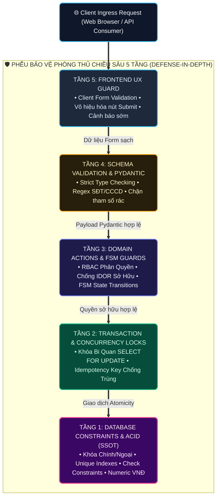

# 05 — Business Rules (BR) Specification

**Dự án**: RetailMind AI — Production-Oriented Agentic Retail Intelligence Platform  
**Tài liệu**: `docs/01-requirements/05-BUSINESS_RULES.md`  
**Căn cứ đặc tả**: `prompt_sections/01_PRODUCT_AND_REFERENCES.md` & `06_USE_CASE_SPECIFICATION.md`  
**Trạng thái**: Approved for Architecture Baseline  

---

## 1. Triết Lý Thực Thi Quy Tắc Nghiệp Vụ (Enforcement Philosophy)

1. **Nguyên tắc "Zero-Trust Client"**: Phía giao diện Frontend (React) chỉ đóng vai trò hỗ trợ trải nghiệm người dùng (UX) — ví dụ: vô hiệu hóa nút bấm khi hết hàng, hiển thị spinner xoay khi đang xử lý. **Không một quy tắc nghiệp vụ hay an ninh nào được phép chỉ dựa vào Client**.
2. **Kiến trúc Phòng thủ Đa tầng (Defense-in-Depth 5 Layers)**:
   - **Tầng 1 (Database Engine)**: Ràng buộc toàn vẹn quan hệ (PK/FK `RESTRICT`, Composite Uniques, Check Constraints, NOT NULL) làm chốt chặn cuối cùng.
   - **Tầng 2 (Transaction & Concurrency)**: Sử dụng Database Transactions và Pessimistic Locking (`SELECT ... FOR UPDATE`) để bảo vệ dữ liệu trước các cuộc đua trạng thái (Race Conditions).
   - **Tầng 3 (Backend Domain Actions & Policies)**: Đóng gói logic chuyển đổi trạng thái FSM, kiểm tra quyền sở hữu (IDOR Protection) và kiểm tra nghiệp vụ.
   - **Tầng 4 (Validation Layer & Pydantic)**: Sử dụng Pydantic Schema Validator để kiểm tra kiểu dữ liệu, định dạng, regex và giới hạn đầu vào.
   - **Tầng 5 (Frontend UX)**: Cảnh báo sớm, hiển thị lỗi thân thiện và vô hiệu hóa nút bấm hợp lý.



---

## 2. Bảng Danh Mục 20 Quy Tắc Nghiệp Vụ Bất Biến (Business Rules Catalog)

| Mã Rule | Tên Quy tắc Nghiệp vụ | Mô tả Nội dung Chi tiết | Tầng Thực thi Chính | Mã lỗi khi Vi phạm |
|:---:|---|---|---|:---:|
| **`BR-001`** | **Tài khoản Kích hoạt Hợp lệ** | Người dùng chỉ được phép thực hiện các thao tác bảo mật nếu tài khoản đang ở trạng thái kích hoạt (`is_active = true`). | NestJS JwtAuthGuard & RolesGuard | `403 Forbidden` |
| **`BR-002`** | **Tính Bất biến của Đơn hàng đã Chốt** | Tuyệt đối không cho phép sửa đổi số lượng hoặc đơn giá của đơn hàng sau khi đã chuyển sang trạng thái `CONFIRMED` hoặc `COMPLETED`. | State Guard + DB Trigger | `409 Conflict` |
| **`BR-003`** | **Chống Truy cập Trái phép (Chống IDOR)** | Khách hàng chỉ được quyền đọc, sửa giỏ hàng, xem đơn hàng, chat và ticket thuộc sở hữu của chính mình (`resource.user_id === auth_user.id`). | Service Ownership Check | `403 Forbidden` |
| **`BR-004`** | **Bảo mật Dữ liệu Nhạy cảm (Zero-Leakage)**| Tuyệt đối không bao gồm `password_hash`, secret keys, hoặc PII thô trong JSON response trả về cho client hoặc ghi vào file log mở. | Pydantic Response DTO | N/A (Kiến trúc ngăn rò rỉ) |
| **`BR-005`** | **Số học Tiền tệ VNĐ Chuẩn xác** | Mọi giá trị tiền tệ bắt buộc phải là số nguyên dương $\ge 0$ và lưu trữ bằng kiểu `NUMERIC(18,0)` hoặc `Decimal`, nghiêm cấm dùng `FLOAT`. | DB Check Constraint + Pydantic | `422 Unprocessable` |
| **`BR-006`** | **Tự động Tính Tổng Tiền Máy Chủ** | Tổng tiền đơn hàng (`total_amount_vnd`) phải do Backend tính toán bằng $\sum (\text{unit\_price} \times \text{quantity})$. Không cho phép client tự gửi tổng tiền lên để ghi đè. | Backend Service trong Transaction | Tự động tính toán |
| **`BR-007`** | **Chống Gửi Đúp (Idempotency Key Engine)** | Mỗi request chốt đơn bắt buộc phải có `Idempotency-Key` (UUIDv4); nếu gửi lại cùng key trong 24h, hệ thống trả về kết quả cũ mà không trừ kho lần 2. | DB Lock + `idempotency_keys` | `200 OK` (Cache) / `409` |
| **`BR-008`** | **Duy Nhất 01 Giỏ hàng Hoạt động** | Mỗi khách hàng chỉ được sở hữu duy nhất 01 giỏ hàng ở trạng thái `active` tại một thời điểm (`carts.status = 'active'`). | Partial Unique Index CSDL | `409 Conflict` |
| **`BR-009`** | **Chống Trùng lặp Biến thể trong Giỏ** | Một biến thể sản phẩm chỉ xuất hiện tối đa 01 lần trong cùng một giỏ hàng. Khi thêm tiếp, hệ thống tăng trường `quantity`. | Composite Unique (`cart_id, variant_id`) | DB Unique Constraint |
| **`BR-010`** | **Số lượng Tồn kho Khả dụng Không Âm** | Số lượng khả dụng $\text{available\_qty} = \text{on\_hand\_qty} - \text{reserved\_qty}$ phải $\ge \text{order\_qty}$. Không cho phép bán vượt số lượng tồn thực tế. | DB Check Constraint + Lock | `409 Conflict` (`OUT_OF_STOCK`) |
| **`BR-011`** | **Khóa Hàng Bi Quan Cấp Cơ Sở Dữ Liệu** | Mọi thao tác kiểm tra tồn kho để giữ hàng chốt đơn bắt buộc phải dùng câu lệnh `SELECT ... FOR UPDATE` bên trong Transaction ACID. | DB Transaction Isolation | Ngăn chặn Race Condition |
| **`BR-012`** | **Đóng Băng Giá Bán Snapshot trên Đơn** | Giá biến thể trong `order_items` (`unit_price_vnd`) phải được sao chép cố định tại thời điểm chốt đơn, không bị thay đổi khi giá catalog cập nhật. | DB Immutable Insert | Bảo tồn lịch sử kế toán |
| **`BR-013`** | **Giải Phóng Tồn Kho Nguyên Tử khi Hủy Đơn** | Khi đơn hàng chuyển sang `CANCELLED`, hệ thống mở Transaction giảm `reserved_qty = reserved_qty - quantity` để hoàn trả tồn kho ngay lập tức. | DB Transaction Service | Tự động hoàn kho |
| **`BR-014`** | **Xác Nhận 2 Pha Tường Minh (Human Sign-off)**| AI Agent chỉ có thẩm quyền sinh `Preview Token` xem trước; người dùng bắt buộc phải tự tay nhấn nút **Confirm** trên Web để đơn hàng được khởi tạo. | Application Service Rule | Chặn Agent tự ý mua hàng |
| **`BR-015`** | **Thời hạn Hiệu lực của Preview Token** | Bản Preview chỉ có hiệu lực trong vòng 10 phút (`server_now <= expires_at`); sau 10 phút, token tự hủy và phải tạo bản preview mới. | Token Cryptographic Verification | `409 Conflict` (`PREVIEW_EXPIRED`) |
| **`BR-016`** | **Bảo vệ Phân quyền Trò chuyện AI** | Tính năng AI Chatbot chỉ mở cho `Customer` đã đăng nhập; `Guest` chỉ được phép dùng thanh tìm kiếm sản phẩm và tra cứu FAQ công khai. | Route Auth Guard | `401 Unauthorized` |
| **`BR-017`** | **Giới hạn Số bước Suy luận của Agent** | Vòng lặp LangGraph StateGraph bị giới hạn tối đa 5 bước (`MAX_STEPS = 5`). Nếu quá 5 bước mà chưa hoàn tất, hệ thống tự động ngắt và trả về phản hồi cứu hộ. | LangGraph Step Counter Guard | Chống lặp vô tận |
| **`BR-018`** | **Duy Nhất 01 Phiên bản Chính sách Xuất bản**| Mỗi chính sách (`policy_id`) chỉ có duy nhất 01 phiên bản ở trạng thái `published` tại một thời điểm để ngăn chặn AI trích dẫn lẫn lộn tài liệu cũ. | Partial Unique Index CSDL | DB Unique Constraint |
| **`BR-019`** | **Xác minh Trích dẫn 2 Chiều (Two-Way Citations)**| Mọi `chunk_id` trả về từ Qdrant bắt buộc phải kiểm tra đối chiếu ngược lại với PostgreSQL xem phiên bản tài liệu có đang ở trạng thái `published` hay không. | Knowledge Retrieval Service | Chống trích dẫn stale vector |
| **`BR-020`** | **Làm Sạch PII Trước Khi Đẩy Ra Ngoài** | Toàn bộ số CCCD, SĐT, Email trong prompt người dùng bắt buộc phải được thay thế bằng mã giữ chỗ ngẫu nhiên có TTL theo phiên trước khi gửi sang Cloud LLM. | PII Egress Middleware | `Fail-Closed` nếu rò rỉ |

---

## 3. Phân Tích Thực Thi Kỹ Thuật Chuyên Sâu (Deep Dive)

### Triển khai `BR-011` (Pessimistic Locking & Atomic Reservation)
Khi khách hàng gửi yêu cầu chốt đơn (`POST /orders/confirm`), đoạn mã xử lý tại tầng Service tuân thủ nghiêm ngặt quy trình:

```python
async with db_session.begin():
    # 1. Khóa dòng kiểm tra trùng lặp
    idempotency_record = await check_and_lock_idempotency_key(db_session, key=request.idempotency_key)
    if idempotency_record.is_completed:
        return idempotency_record.cached_response

    for item in request.items:
        # 2. Khóa dòng dữ liệu tồn kho bằng khóa bi quan
        stmt = (
            select(Inventory)
            .where(Inventory.variant_id == item.variant_id, Inventory.store_id == request.store_id)
            .with_for_update()
        )
        inventory = await db_session.scalar(stmt)
        
        # 3. Kiểm tra tính khả dụng (BR-010)
        available_qty = inventory.on_hand_qty - inventory.reserved_qty
        if available_qty < item.quantity:
            raise OutOfStockException(f"Sản phẩm {item.variant_id} không đủ số lượng tồn kho.")
            
        # 4. Giữ kho nguyên tử
        inventory.reserved_qty += item.quantity

    # 5. Tạo đơn hàng và lưu snapshot giá (BR-006, BR-012)
    order = create_order_with_snapshots(db_session, request)
    # Commit tự động khi thoát khối context
```
Quy trình trên đảm bảo tính toàn vẹn tuyệt đối: Nếu có 2 giao dịch cùng tranh chấp một máy tính tồn kho = 1, giao dịch thứ hai bắt buộc phải chờ giao dịch thứ nhất hoàn tất và sẽ nhận thông báo `OutOfStockException` an toàn.
