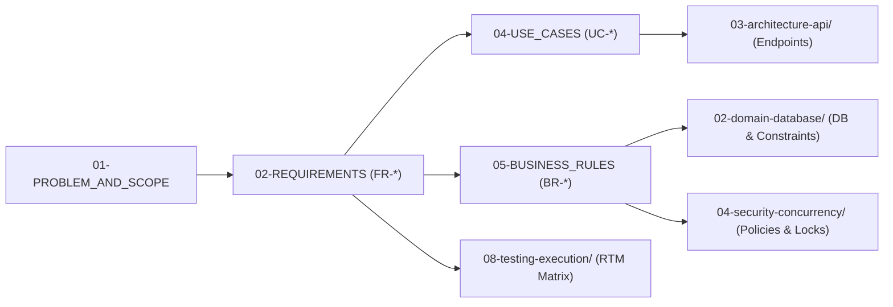

# 📋 Nhóm 01 — Yêu Cầu & Bài Toán Nghiệp Vụ (Requirements Engineering)

> **Vai trò kỹ thuật:** Business Analyst / Requirements Engineer / Product Owner  
> **Mục tiêu:** Định nghĩa rõ ràng bài toán kinh doanh, bối cảnh thực tại (AS-IS), mục tiêu hướng tới (TO-BE), ranh giới hệ thống, danh mục yêu cầu chức năng (FR), phi chức năng (NFR), ca sử dụng (UC) và các quy tắc nghiệp vụ bất biến (BR).

---

## 🗂️ Danh Mục Tài Liệu Thuộc Nhóm 01

| Thứ tự | Tên tài liệu | Mục đích nghiệp vụ cốt lõi |
| :---: | :--- | :--- |
| **01** | [`01-PROBLEM_AND_SCOPE.md`](01-PROBLEM_AND_SCOPE.md) | Phân tích bài toán, phân tích khoảng cách GAP (AS-IS vs TO-BE), mục tiêu kinh doanh, phân tích Actor và ranh giới In-Scope / Out-of-Scope. |
| **02** | [`02-REQUIREMENTS.md`](02-REQUIREMENTS.md) | Bảng đặc tả chi tiết toàn bộ các Yêu cầu Chức năng (`FR-<MODULE>-<NUM>`), phân chia theo từng module nghiệp vụ độc lập. |
| **03** | [`03-NON_FUNCTIONAL_REQUIREMENTS.md`](03-NON_FUNCTIONAL_REQUIREMENTS.md) | Các yêu cầu Phi chức năng định lượng: Hiệu năng (Latency/Throughput), Bảo mật (OWASP), Độ tin cậy (SLA 99.9%), Khả năng mở rộng (Scale). |
| **04** | [`04-USE_CASES.md`](04-USE_CASES.md) | Sơ đồ Use Case tổng quan theo từng Actor và đặc tả chi tiết các Use Case cốt lõi (Preconditions, Main Flow, Alternate Flows, Postconditions). |
| **05** | [`05-BUSINESS_RULES.md`](05-BUSINESS_RULES.md) | Danh mục 15-20 Quy tắc Nghiệp vụ Bất biến (`BR-*`), bảng ma trận 5 tầng thực thi (Defense-in-Depth) và các mã lỗi HTTP tương ứng khi vi phạm. |

---

## 🔗 Liên Kết Truy Xuất (Traceability Flow)

Tất cả các tài liệu trong nhóm 01 là điểm khởi đầu cho toàn bộ hệ thống kỹ thuật:

