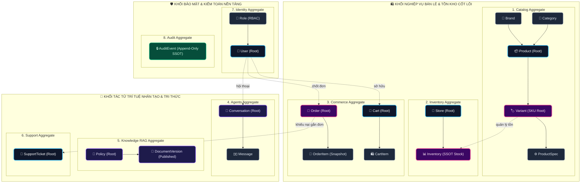

# 06 — Domain Model & Ubiquitous Language Specification

**Dự án**: RetailMind AI — Production-Oriented Agentic Retail Intelligence Platform  
**Tài liệu**: `enterprise-docs/docs/02-domain-database/06-DOMAIN_MODEL.md`  
**Căn cứ đặc tả**: `docs/database/01_conceptual_model.md` & `docs/requirements/business-rules.md`  
**Trạng thái**: Approved for Architecture Baseline (Production 2026 Edition)  

---

## 1. Ngôn Ngữ Chung Miền Nghiệp Vụ (Ubiquitous Language)

Tất cả thành viên đội ngũ kỹ sư, quản lý sản phẩm và các trợ lý AI bắt buộc phải sử dụng thống nhất bộ thuật ngữ miền nghiệp vụ dưới đây trong mã nguồn, thiết kế CSDL và giao tiếp:

| Thuật ngữ Tiếng Việt | Thuật ngữ Tiếng Anh | Định nghĩa & Ranh giới trách nhiệm |
|:--- |:--- |:--- |
| **Người dùng** | `User` | Thực thể định danh truy cập hệ thống, gắn với một vai trò duy nhất (`role`: `CUSTOMER` hoặc `ADMIN`) và trạng thái kích hoạt. |
| **Vai trò** | `Role` | Quyền hạn truy cập hệ thống (Guest: không tài khoản, Customer: mua sắm và chat, Admin: quản trị hệ thống). |
| **Thương hiệu** | `Brand` | Hãng sản xuất laptop hoặc thiết bị điện tử (Apple, Dell, Asus, Lenovo, HP...). |
| **Danh mục** | `Category` | Cây phân loại sản phẩm có hỗ trợ phân cấp cha-con (`parent_id`). |
| **Sản phẩm gốc** | `Product` | Thực thể sản phẩm trừu tượng chứa tên dòng máy chung (ví dụ: "MacBook Air M2"). |
| **Biến thể cấu hình** | `Variant` (SKU) | Thực thể bán lẻ cụ thể có cấu hình phần cứng, SKU duy nhất và giá niêm yết theo VNĐ. |
| **Thông số kỹ thuật** | `ProductSpec` | Cặp thuộc tính thông số kỹ thuật dạng Key-Value gắn với từng biến thể (RAM, CPU, GPU, Ổ cứng...). |
| **Cửa hàng / Chi nhánh** | `Store` | Địa điểm cửa hàng bán lẻ vật lý có kho chứa hàng demo. |
| **Tồn kho chi nhánh** | `Inventory` | Bản ghi định lượng số lượng tồn vật lý (`on_hand_qty`) và số lượng đang giữ chỗ (`reserved_qty`). |
| **Tồn kho khả dụng** | `Available Quantity` | Số lượng máy sẵn sàng bán: $\text{available\_qty} = \text{on\_hand\_qty} - \text{reserved\_qty}$. |
| **Giỏ hàng** | `Cart` | Tập hợp các sản phẩm khách hàng đang quan tâm, **tuyệt đối không giữ chỗ tồn kho**. |
| **Bản xem trước đơn hàng** | `Order Preview` | Thao tác kiểm tra lại giá và tồn kho khả dụng trước khi chốt, cấp `preview_token` có hiệu lực 10 phút. |
| **Đơn hàng giả lập** | `Simulated Order` | Bản ghi chốt giao dịch mua sắm giả lập, chụp lại snapshot giá và thông số máy bất biến tại thời điểm chốt. |
| **Khóa Idempotency** | `IdempotencyKey` | Mã khóa duy nhất do client gửi lên để ngăn chặn việc trừ kho hoặc chốt đơn trùng lặp khi mạng chập chờn. |
| **Hội thoại tư vấn** | `Conversation` | Luồng phiên tương tác tư vấn giữa khách hàng và trợ lý LangGraph Agent. |
| **Tin nhắn** | `Message` | Bản ghi thông điệp trao đổi mang vai trò `user`, `assistant` hoặc `tool` kèm các trích dẫn. |
| **Chính sách bán lẻ** | `Policy` | Tài liệu văn bản về chính sách bảo hành, đổi trả hoặc hậu mãi. |
| **Phiên bản tài liệu** | `DocumentVersion` | Bản ghi lịch sử phát hành văn bản chính sách, có trạng thái (`draft`, `published`, `superseded`). |
| **Công việc nạp vector** | `IngestionJob` | Tác vụ băm nhỏ văn bản (chunking) và đồng bộ embedding vector vào Qdrant. |
| **Phiếu hỗ trợ khiếu nại** | `SupportTicket` | Phiếu yêu cầu trợ giúp kỹ thuật hoặc phản hồi của khách hàng gắn với đơn hàng cụ thể. |
| **Sổ cái kiểm toán** | `AuditEvent` | Nhật ký bất biến (Append-Only) lưu vết mọi hành vi thay đổi dữ liệu nhạy cảm. |

---

## 2. Ranh Giới 8 Cụm Tổng Hợp (8 Bounded Contexts & Aggregates)

Hệ thống được thiết kế theo nguyên lý Domain-Driven Design (DDD), phân định ranh giới sở hữu nghiêm ngặt giữa 8 Cụm Tổng Hợp:

---

## 3. Trách Nhiệm Chi Tiết Của Từng Aggregate Root

### 1. `User` (Identity Aggregate Root)
* Quản lý vòng đời tài khoản, mật khẩu băm Argon2id và kiểm soát trạng thái đăng nhập.
* Kiểm tra toàn vẹn ràng buộc: 1 người dùng chỉ có 1 vai trò duy nhất (`CUSTOMER` hoặc `ADMIN`), email không trùng lặp.

### 2. `Product` & `Variant` (Catalog Aggregate Root)
* `Variant` là rễ quản lý cấu hình bán lẻ và giá niêm yết (Price SSOT).
* Giá niêm yết `price_vnd` bắt buộc $\ge 0$ và sử dụng kiểu số học `NUMERIC(18, 0)`.

### 3. `Store` & `Inventory` (Inventory Aggregate Root)
* Quản lý định lượng tồn kho độc lập theo từng chi nhánh vật lý.
* Bất biến toán học: Luôn đảm bảo $0 \le \text{reserved\_qty} \le \text{on\_hand\_qty}$. Không cho phép tồn khả dụng âm.

### 4. `Cart` & `Order` (Commerce Aggregate Root)
* `Cart`: Mỗi khách hàng chỉ có duy nhất 1 giỏ hàng hoạt động (`status = 'active'`). Thêm vào giỏ không bao giờ tác động đến `reserved_qty` của kho.
* `Order`: Quản lý giao dịch mua sắm giả lập. Khi chốt đơn, giữ khóa bi quan `SELECT ... FOR UPDATE` trên các dòng tồn kho để trừ tồn khả dụng nguyên tử. Lưu trữ snapshot giá và cấu hình bất biến vào `OrderItem`.

### 5. `Policy` & `DocumentVersion` (Knowledge Aggregate Root)
* Quản lý tài liệu pháp lý và chính sách bảo hành.
* Mỗi chính sách chỉ có tối đa 1 phiên bản xuất bản hoạt động (`UNIQUE(policy_id) WHERE status = 'published'`). Qdrant chỉ đóng vai trò chỉ mục tìm kiếm thứ cấp.

### 6. `Conversation` (Agents Aggregate Root)
* Lưu trữ phiên làm việc của tác tử LangGraph. Khách hàng chỉ được quyền đọc và tương tác trên thread thuộc quyền sở hữu của mình (chống rò rỉ IDOR).

### 7. `SupportTicket` (Support Aggregate Root)
* Tiếp nhận khiếu nại và phản hồi của khách hàng gắn với đơn hàng của chính họ.

### 8. `AuditEvent` (Audit Aggregate Root)
* Bảng nhật ký Append-Only, ghi nhận mọi hành vi nhạy cảm (thay đổi tồn kho, chốt đơn, hủy đơn, sửa chính sách). Tuyệt đối không cho phép lệnh `UPDATE` hoặc `DELETE`.
