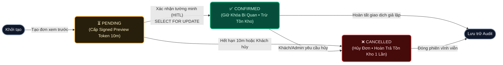
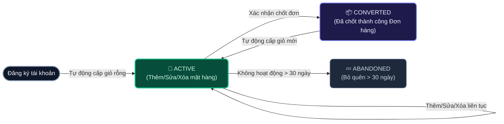
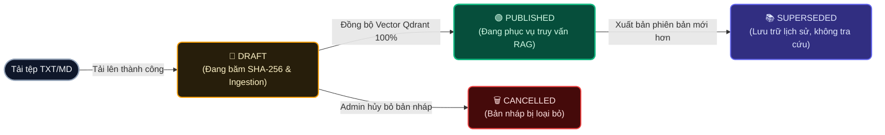

# 07 — State Machine Design & Entity Lifecycles

**Dự án**: RetailMind AI — Production-Oriented Agentic Retail Intelligence Platform  
**Tài liệu**: `enterprise-docs/docs/02-domain-database/07-STATE_MACHINES.md`  
**Căn cứ đặc tả**: `docs/database/01_conceptual_model.md`, `docs/database/06_constraints_indexes.md` & `ADR-005`  
**Trạng thái**: Approved for Architecture Baseline (Production 2026 Edition)  

---

## 1. Giới Thiệu Về Máy Trạng Thái Hữu Hạn (Finite State Machines - FSM)

Trong hệ thống bán lẻ công nghệ **RetailMind AI**, việc kiểm soát chặt chẽ trạng thái và các bước chuyển đổi trạng thái (State Transitions) của thực thể là yếu tố sống còn để bảo đảm tính toàn vẹn dữ liệu, chống mua vượt tồn kho (oversell) và đảm bảo tính nhất quán của giao dịch.

Hệ thống định nghĩa **4 FSM trọng yếu**:
1. **`Order Lifecycle`**: Vòng đời đơn hàng thương mại giả lập và quy trình khóa kho.
2. **`Cart Lifecycle`**: Vòng đời giỏ hàng và chuyển đổi sang đơn hàng.
3. **`DocumentVersion Lifecycle`**: Vòng đời tài liệu chính sách bảo hành RAG.
4. **`SupportTicket Lifecycle`**: Vòng đời xử lý khiếu nại và phản hồi khách hàng.

---

## 2. Máy Trạng Thái Đơn Hàng Thương Mại (Order State Machine)

### 2.1. Sơ Đồ Trạng Thái Đơn Hàng (Visual State Diagram)

### 2.2. Bảng Chuyển Đổi Trạng Thái Hợp Lệ

| Trạng thái hiện tại | Trạng thái tiếp theo | Tác nhân (Actor) | Điều kiện kiểm tra (Guard Condition) | Tác dụng phụ (Side Effect) |
|:--- |:--- |:--- |:--- |:--- |
| `[*] (None)` | `pending` | Customer | Giỏ hàng có sản phẩm, kho đủ tồn khả dụng | Tạo bản ghi `Order` tạm thời, cấp Signed Preview Token (TTL 10m). |
| `pending` | `confirmed` | Customer | Token còn hạn ($\le 10$m), Khóa bi quan `SELECT ... FOR UPDATE` thành công | Trừ tồn kho nguyên tử (`reserved_qty += qty`), chuyển giỏ hàng sang `converted`, ghi `audit_events`. |
| `pending` | `cancelled` | Customer, System | Token quá 10 phút hoặc người dùng hủy thao tác | Đánh dấu hủy bản preview, không thay đổi số lượng kho. |
| `confirmed` | `cancelled` | Customer, Admin | Đơn hàng đang ở `confirmed`, gọi hủy đơn hợp lệ | Hoàn trả tồn kho nguyên tử (`reserved_qty -= qty`) đúng 1 lần duy nhất, ghi `audit_events`. |

### 2.3. Các Bước Chuyển Bị Cấm Tuyệt Đối (Forbidden Transitions)
* ❌ **Cấm tự ý chuyển từ `pending` sang `confirmed` bởi AI Agent**: Khách hàng bắt buộc phải bấm nút xác nhận tường minh trên giao diện (Human In The Loop).
* ❌ **Cấm chuyển từ `cancelled` sang `confirmed`**: Một đơn hàng đã bị hủy không bao giờ được phép khôi phục lại để tránh sai lệch tồn kho.
* ❌ **Cấm hoàn trả tồn kho lần thứ 2 khi hủy đơn**: Thao tác hủy đơn phải kiểm tra trạng thái hiện tại phải đúng là `confirmed`; nếu đã là `cancelled` thì trả về lỗi `409 Conflict`.

---

## 3. Máy Trạng Thái Giỏ Hàng (Cart State Machine)

### 3.1. Sơ Đồ Trạng Thái Giỏ Hàng

### 3.2. Bảng Chuyển Đổi Trạng Thái Hợp Lệ

| Trạng thái hiện tại | Trạng thái tiếp theo | Tác nhân | Điều kiện kiểm tra | Tác dụng phụ |
|:--- |:--- |:--- |:--- |:--- |
| `[*] (None)` | `active` | Customer, System | Người dùng đăng ký tài khoản thành công | Tạo bản ghi giỏ hàng duy nhất có trạng thái `active`. |
| `active` | `converted` | System (Checkout) | Đơn hàng được xác nhận chốt thành công | Khóa giỏ hàng cũ, tạo ngay 1 giỏ hàng `active` mới cho khách. |
| `active` | `abandoned` | Background Job | Thời gian cập nhật cuối cùng $> 30$ ngày | Đánh dấu bỏ quên để phân tích hành vi khách hàng. |

---

## 4. Máy Trạng Thái Phiên Bản Tài Liệu Tri Thức (DocumentVersion State Machine)

### 4.1. Sơ Đồ Trạng Thái Tài Liệu RAG

### 4.2. Bảng Chuyển Đổi Trạng Thái Hợp Lệ

| Trạng thái hiện tại | Trạng thái tiếp theo | Tác nhân | Điều kiện kiểm tra | Tác dụng phụ |
|:--- |:--- |:--- |:--- |:--- |
| `[*] (None)` | `draft` | Admin | Tệp tải lên định dạng TXT/MD hợp lệ | Tạo bản ghi `DocumentVersion`, khởi tạo `IngestionJob`. |
| `draft` | `published` | Admin | Ingestion Qdrant thành công 100% | Cập nhật `published_at`, tự động chuyển version `published` cũ sang `superseded`. |
| `published` | `superseded` | System | Có phiên bản mới hơn cùng `policy_id` xuất bản | Thu hồi chỉ mục tìm kiếm cũ, bảo toàn lịch sử tra cứu cũ. |

### 4.3. Bất Biến RAG Không Thể Phá Vỡ
* ❌ **Cấm Agent trích dẫn nội dung ở trạng thái `draft` hoặc `superseded`**: Khi truy vấn RAG, Backend bắt buộc thực hiện kiểm tra 2 chiều (Two-Way Verification) tại PostgreSQL xác nhận `document_versions.status == 'published'`.

---

## 5. Máy Trạng Thái Phiếu Hỗ Trợ Khiếu Nại (SupportTicket State Machine)

### 5.1. Sơ Đồ Trạng Thái Khiếu Nại

```mermaid
flowchart LR
    %% STYLES
    classDef startEnd fill:#0F172A,stroke:#94A3B8,stroke-width:2px,color:#F8FAFC,rx:20,ry:20
    classDef openState fill:#271E0B,stroke:#F59E0B,stroke-width:2px,color:#FEF3C7,rx:8,ry:8
    classDef reviewState fill:#1E1B4B,stroke:#8B5CF6,stroke-width:2px,color:#EDE9FE,rx:8,ry:8
    classDef resState fill:#064E3B,stroke:#10B981,stroke-width:2.5px,color:#D1FAE5,rx:8,ry:8
    classDef closeState fill:#1E293B,stroke:#64748B,stroke-width:2px,color:#CBD5E1,rx:8,ry:8

    Start([Khách tạo Ticket]):::startEnd
    Open["📩 OPEN<br/>(Chờ phân công xử lý)"]:::openState
    InReview["🔍 IN_REVIEW<br/>(Admin đang tiếp nhận)"]:::reviewState
    Resolved["✨ RESOLVED<br/>(Đã gửi kết luận xử lý)"]:::resState
    Closed["🔒 CLOSED<br/>(Hoàn tất đóng ticket)"]:::closeState

    Start -->|Gắn với order_id hợp lệ| Open
    Open -->|Admin tiếp nhận| InReview
    InReview -->|Gửi phản hồi cho khách| Resolved
    Resolved -->|Khách đồng ý hoặc sau 7 ngày| Closed
    Open -->|Khách tự hủy yêu cầu| Closed
```

### 5.2. Bảng Chuyển Đổi Trạng Thái Hợp Lệ

| Trạng thái hiện tại | Trạng thái tiếp theo | Tác nhân | Điều kiện kiểm tra | Tác dụng phụ |
|:--- |:--- |:--- |:--- |:--- |
| `[*] (None)` | `open` | Customer | Đơn hàng thuộc sở hữu của Customer | Tạo ticket với `status = 'open'`. |
| `open` | `in_review` | Admin | Admin nhận phụ trách | Cập nhật trạng thái và thời điểm tiếp nhận. |
| `in_review` | `resolved` | Admin | Đã gửi phản hồi xử lý cho khách hàng | Gửi thông báo đến khách hàng. |
| `resolved` | `closed` | Customer, System | Khách hài lòng hoặc 7 ngày không phản hồi | Đóng ticket vĩnh viễn, lưu trữ phục vụ thống kê CSAT. |
