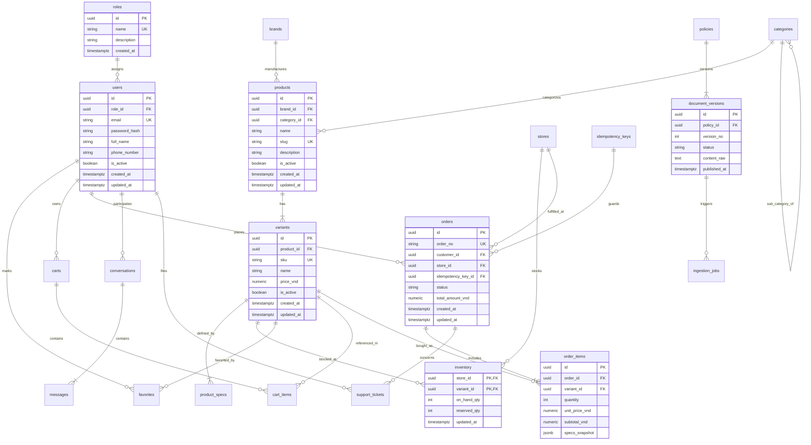
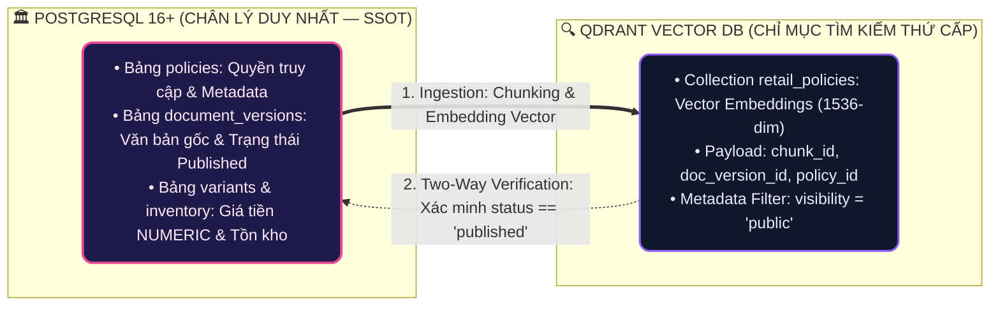

# 10 — Entity Relationship Diagram (ERD) Specification

**Dự án**: RetailMind AI — Production-Oriented Agentic Retail Intelligence Platform  
**Tài liệu**: `enterprise-docs/docs/02-domain-database/10-ERD.md`  
**Căn cứ đặc tả**: `docs/database/04_erd.md` & `docs/database/02_logical_schema.md`  
**Trạng thái**: Approved for Architecture Baseline (Production 2026 Edition)  

---

## 1. Sơ Đồ Thực Thể Liên Kết Tổng Thể (System-Wide Mermaid ERD)

Toàn cảnh quan hệ liên kết giữa 22 thực thể cốt lõi trong cơ sở dữ liệu PostgreSQL 16+:

---

## 2. Ranh Giới Phân Tách Dữ Liệu: PostgreSQL vs Qdrant

Hệ thống phân định nghiêm ngặt vai trò giữa cơ sở dữ liệu quan hệ và cơ sở dữ liệu vector:

> [!CAUTION]
> **Quy Tắc RAG Bất Biến**: Qdrant không bao giờ được phép quyết định giá, khuyến mãi hay tồn kho. Mọi thông tin tư vấn chính sách của AI Agent phải trích dẫn kèm `document_version_id` đã được xác minh trạng thái `published` tại PostgreSQL.
