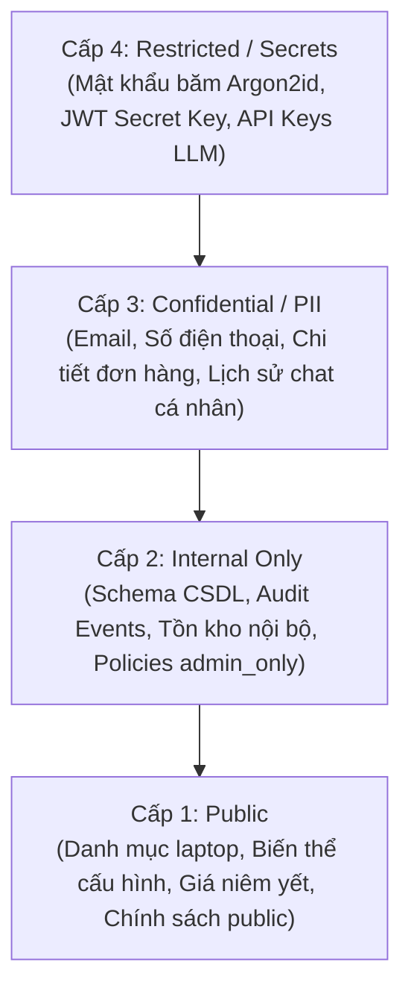

# 11 — Data Classification, Privacy & Retention Policy

**Dự án**: RetailMind AI — Production-Oriented Agentic Retail Intelligence Platform  
**Tài liệu**: `enterprise-docs/docs/02-domain-database/11-DATA_CLASSIFICATION.md`  
**Căn cứ đặc tả**: `docs/database/02_logical_schema.md`, `docs/architecture/03_security_threat_model.md` & Nghị định 13/2023/NĐ-CP  
**Trạng thái**: Approved for Architecture Baseline (Production 2026 Edition)  

---

## 1. Phân Loại Độ Nhạy Cảm Dữ Liệu 4 Cấp Độ (Data Sensitivity Levels)

Toàn bộ dữ liệu lưu trữ trong PostgreSQL 16+, Qdrant Vector DB và luân chuyển qua giao thức API/SSE được phân định thành 4 cấp độ nghiêm ngặt:



---

## 2. Bảng Ma Trận Phân Loại Dữ Liệu Theo Trường (Data Fields Matrix)

| Cấp độ | Thực Thể & Trường Dữ Liệu | Rủi Ro Nếu Bị Lộ | Kiểm Soát Lưu Trữ & Truy Cập | Quy Định Trong Log & API Response |
|:--- |:--- |:--- |:--- |:--- |
| **Cấp 4: Restricted** | `users.password_hash`, `JWT_SECRET_KEY`, `OPENAI_API_KEY`, `QDRANT_API_KEY` | Chiếm quyền điều khiển hệ thống, tấn công giả mạo | Băm 1 chiều Argon2id (Salt ngẫu nhiên); Lưu trữ trong biến môi trường bí mật; Không lưu code | **CẤM TUYỆT ĐỐI** xuất hiện trong log, telemetry và API response. Dùng Pydantic `exclude=True`. |
| **Cấp 3: Confidential (PII)** | `users.email`, `users.phone_number`, `orders.order_no`, `messages.content` | Vi phạm Nghị định 13/2023/NĐ-CP & Luật 91/2025/QH15, rò rỉ đời tư | Mã hóa đường truyền TLS 1.3; Kiểm soát chống IDOR (`WHERE customer_id = current_user.id`) | Che giấu mặt nạ trong log (`ng***@domain.com`, `098***123`). Lọc PII trước khi gửi sang LLM. |
| **Cấp 2: Internal** | `audit_events.*`, `inventory.on_hand_qty`, `policies` (loại `admin_only`) | Lộ bí mật kinh doanh, phân tích gian lận kho | Yêu cầu xác thực Bearer JWT vai trò `ADMIN` | Chỉ trả về cho Admin qua các endpoint `/api/v1/admin/*`. |
| **Cấp 1: Public** | `brands.*`, `categories.*`, `products.*`, `variants.price_vnd`, `policies` (`public`) | Rủi ro thấp, dữ liệu thương mại công khai | Cache CDN, cho phép đọc công khai (Guest & Customer) | Cho phép hiển thị tự do, không yêu cầu xác thực. |

---

## 3. Bộ Lọc Làm Sạch Dữ Liệu Cá Nhân (PII Sanitization Guard)

Trước khi bất kỳ chuỗi hội thoại nào từ người dùng được gửi sang LLM Provider ngoại vi, hệ thống bắt buộc đẩy qua tầng middleware lọc PII tiếng Việt:

```python
# Quy tắc Regex nhận diện và thay thế PII tiếng Việt
REDACTION_PATTERNS = {
    "VIETNAMESE_ID": r"\b\d{12}\b",                      # CCCD 12 số
    "VIETNAMESE_PHONE": r"\b(0[3|5|7|8|9])\d{8}\b",       # SĐT Việt Nam (03, 05, 07, 08, 09)
    "EMAIL_ADDRESS": r"\b[A-Za-z0-9._%+-]+@[A-Za-z0-9.-]+\.[A-Z|a-z]{2,}\b"
}
```

* Chuỗi nhận diện CCCD được thay thế bằng: `[REDACTED_CCCD]`
* Chuỗi nhận diện SĐT được thay thế bằng: `[REDACTED_PHONE]`
* Chuỗi nhận diện Email được thay thế bằng: `[REDACTED_EMAIL]`

---

## 4. Chính Sách Lưu Trữ & Xóa Bỏ Dữ Liệu (Retention & Purging Policy)

| Phân Loại Dữ Liệu | Thời Gian Lưu Hoạt Động (Active DB) | Cơ Chế Cold Storage | Cơ Chế Xóa Vĩnh Viễn / Ẩn Danh Hóa |
|:--- |:---: |:--- |:--- |
| **Tài khoản người dùng (`users`)** | Suốt thời gian hoạt động | Khóa tài khoản (`is_active = false`) | Ẩn danh hóa thông tin cá nhân sau 3 năm không đăng nhập. |
| **Đơn hàng thương mại (`orders`)** | 12 tháng gần nhất | Sao lưu nén Parquet phục vụ báo cáo tài chính | Lưu trữ kiểm toán pháp lý tối thiểu 5 năm trước khi hủy. |
| **Phiên hội thoại AI (`conversations`)** | 6 tháng gần nhất | Lưu trữ SQLite/PostgreSQL checkpoint | Tự động dọn dẹp các phiên không phát sinh tin nhắn mới sau 180 ngày. |
| **Mã khóa Idempotency (`idempotency_keys`)** | 24 giờ kể từ thời điểm tạo | Không lưu trữ | Tự động xóa bằng Cron Job dọn dẹp chạy hàng đêm (`expires_at < NOW()`). |
| **Nhật ký kiểm toán (`audit_events`)** | 24 tháng | Lưu trữ Append-Only trong CSDL | Di chuyển sang kho nén WORM (Write Once Read Many), không bao giờ xóa. |
