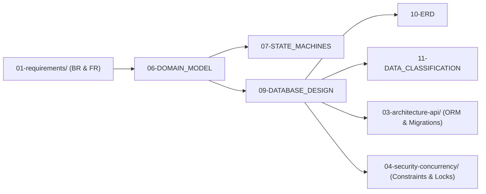

# 🗄️ Nhóm 02 — Mô Hình Miền & Thiết Kế Cơ Sở Dữ Liệu (Domain & Database Design)

> **Vai trò kỹ thuật:** Database Architect / Data Engineer / Domain Modeler  
> **Mục tiêu:** Định hình mô hình thực thể miền nghiệp vụ (Domain Model), thiết kế máy trạng thái hữu hạn (FSM) kiểm soát chặt chẽ vòng đời thực thể, thiết kế lược đồ CSDL quan hệ chuẩn hóa ACID, sơ đồ Mermaid ERD và chính sách phân loại bảo mật dữ liệu.

---

## 🗂️ Danh Mục Tài Liệu Thuộc Nhóm 02

| Thứ tự | Tên tài liệu | Mục đích kỹ thuật cốt lõi |
| :---: | :--- | :--- |
| **06** | [`06-DOMAIN_MODEL.md`](06-DOMAIN_MODEL.md) | Bản đồ mô hình miền nghiệp vụ: Thực thể (Entities), Giá trị đối tượng (Value Objects), Ranh giới Tổng hợp (Aggregate Roots) và Trách nhiệm. |
| **07** | [`07-STATE_MACHINES.md`](07-STATE_MACHINES.md) | Thiết kế Máy trạng thái Hữu hạn (FSM) cho các thực thể quan trọng, sơ đồ chuyển đổi Mermaid, điều kiện Guards và các bước chuyển BỊ CẤM TUYỆT ĐỐI. |
| **09** | [`09-DATABASE_DESIGN.md`](09-DATABASE_DESIGN.md) | Bảng tổng hợp chi tiết toàn bộ các bảng CSDL: Khóa chính, Khóa ngoại (hành vi `ON DELETE RESTRICT` vs `CASCADE`), Composite Unique, Check Constraints và Composite Indexes. |
| **10** | [`10-ERD.md`](10-ERD.md) | Sơ đồ Thực thể Liên kết (Mermaid ERD) chi tiết với bản số quan hệ (Cardinality 1-1, 1-N, N-N). |
| **11** | [`11-DATA_CLASSIFICATION.md`](11-DATA_CLASSIFICATION.md) | Phân loại độ nhạy cảm dữ liệu (Public, Internal, Confidential, Restricted/PII), chính sách lưu trữ (Data Retention) và quy tắc thanh lọc nhật ký (Sanitization). |

---

## 🔗 Liên Kết Truy Xuất (Traceability Flow)

