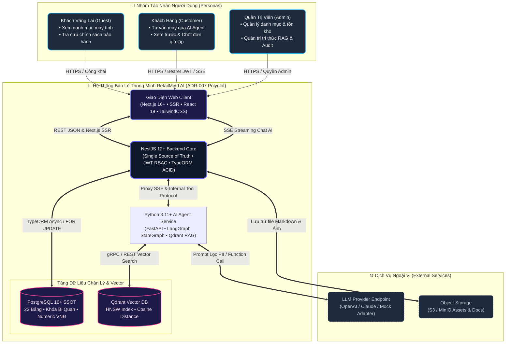
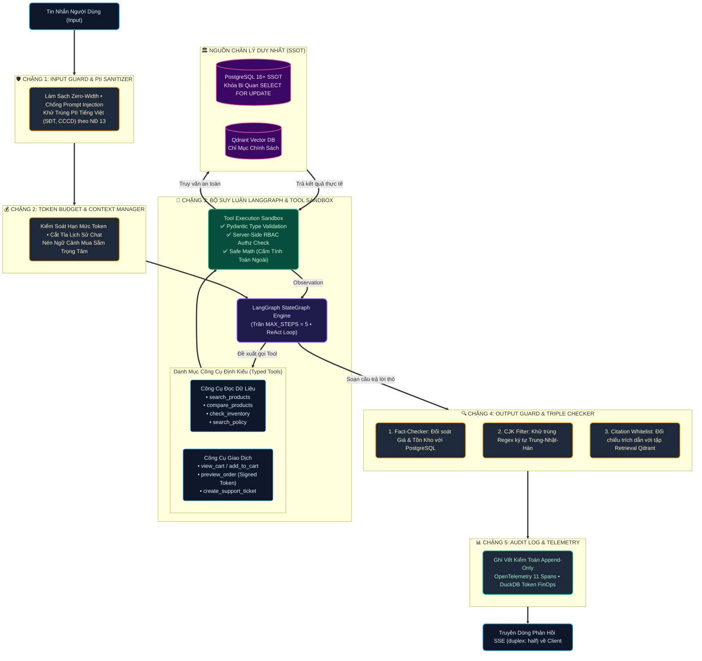

# 08 — System Architecture Specification (C4 & AI Harness Model)

**Dự án**: RetailMind AI — Production-Oriented Agentic Retail Intelligence Platform  
**Tài liệu**: `enterprise-docs/docs/03-architecture-api/08-ARCHITECTURE.md`  
**Căn cứ đặc tả**: `docs/architecture/01_system_architecture.md` & `ADR-006`  
**Trạng thái**: Approved for Architecture Baseline (Production 2026 Edition)  

---

## 1. C4 Mức 1: Sơ Đồ Ngữ Cảnh Hệ Thống (System Context)

Sơ đồ ngữ cảnh thể hiện toàn diện các tác nhân tương tác và các hệ thống ngoại vi kết nối với **RetailMind AI**:



---

## 2. C4 Mức 2: Sơ Đồ Thùng Chứa & Dịch Vụ (Container Architecture — ADR-007)

Mô hình phân rã dịch vụ Polyglot chuyên biệt hóa theo thế mạnh ngôn ngữ:

```mermaid
flowchart LR
    %% ==========================================
    %% STYLES & THEME
    %% ==========================================
    classDef clientStyle fill:#0F172A,stroke:#38BDF8,stroke-width:2px,color:#F8FAFC,rx:8,ry:8
    classDef gatewayStyle fill:#1E293B,stroke:#F59E0B,stroke-width:2px,color:#FEF3C7,rx:8,ry:8
    classDef nestStyle fill:#0F172A,stroke:#EA284E,stroke-width:2.5px,color:#FFE4E6,rx:8,ry:8
    classDef agentStyle fill:#1E1B4B,stroke:#38BDF8,stroke-width:2px,color:#F3E8FF,rx:8,ry:8
    classDef dbStyle fill:#1F1329,stroke:#EC4899,stroke-width:2px,color:#FCE7F3,rx:8,ry:8

    %% ==========================================
    %% CONTAINERS
    %% ==========================================
    Client["Next.js 16+ Frontend & BFF<br/>(Port 3000 • App Router • FSD)<br/>• BFF Proxy: /api/proxy/[...path]<br/>• Cookie HttpOnly • SSE duplex: half"]:::clientStyle
    Nginx["Reverse Proxy & Gateway<br/>(Nginx • SSL • Rate Limit)"]:::gatewayStyle

    subgraph NestBackend ["NestJS 12+ Core API (Port 3001)"]
        direction TB
        AuthMod["AuthModule (JWT • Argon2id • RBAC)"]:::nestStyle
        CatalogMod["CatalogModule (Laptop Specs • Filters)"]:::nestStyle
        InventoryMod["InventoryModule (Khóa Bi Quan FOR UPDATE)"]:::nestStyle
        CommerceMod["CommerceModule (Cart • Preview Token)"]:::nestStyle
        KnowledgeMod["KnowledgeModule (Policy Documents • Versions)"]:::nestStyle
        InternalToolGateway["InternalToolGateway (X-Internal-Secret)"]:::nestStyle
    end

    subgraph AsyncWorker ["Async Ingestion Pipeline (BullMQ + MinIO)"]
        direction TB
        MinIO["MinIO Object Storage<br/>(Raw Policies • SHA-256 Checksum)"]:::gatewayStyle
        BullWorker["BullMQ Ingestion Worker<br/>• 11-Tier Administrative Splitter<br/>• Idempotent Delete & Re-index"]:::agentStyle
    end

    subgraph PythonAgentService ["Python 3.11+ AI Agent Engine (Port 8000)"]
        direction TB
        AgentFastAPI["FastAPI SSE Proxy"]:::agentStyle
        InboundPII["PII Redaction Guard (Regex NĐ 13)"]:::agentStyle
        LangGraphCore["LangGraph StateGraph (Trần 5 Bước)"]:::agentStyle
        OutputGuard["Output Guard & Fact-Checker<br/>• Giá SSOT • CJK Filter • Citation Whitelist"]:::agentStyle
    end

    subgraph DBs ["Tầng Lưu Trữ & Chỉ Mục"]
        PG[("PostgreSQL 16+ SSOT<br/>ACID • Khóa Bi Quan")]:::dbStyle
        QD[("Qdrant Vector DB<br/>Chỉ Mục Chính Sách RAG")]:::dbStyle
    end

    %% ==========================================
    %% CONNECTIONS
    %% ==========================================
    Client ==>|HTTPS /api/proxy/v1/... (HttpOnly Token)| Nginx
    Nginx ==>|Chuyển tiếp REST| NestBackend
    Nginx ==>|Proxy SSE Stream (duplex: half)| PythonAgentService

    KnowledgeMod -->|Tải lên văn bản gốc| MinIO
    KnowledgeMod -->|Đẩy tác vụ nạp| BullWorker
    BullWorker -->|Xóa vector cũ & Upsert vector mới| QD
    BullWorker -->|Cập nhật trạng thái published| PG

    PythonAgentService ==>|1. Gọi 13 Typed Tools qua REST/JSON| InternalToolGateway
    InternalToolGateway --> CatalogMod
    InternalToolGateway --> InventoryMod
    InternalToolGateway --> CommerceMod

    CatalogMod ==> PG
    InventoryMod ==>|Pessimistic Lock| PG
    CommerceMod ==>|Snapshot đơn hàng| PG

    LangGraphCore ==>|2. Tra cứu chính sách| QD
    LangGraphCore --> OutputGuard
    OutputGuard --> AgentFastAPI
```

---

## 3. C4 Mức 3: Luồng Điều Phối Tác Tử AI & Bộ Giáp AI Harness Pipeline

Quy trình bảo vệ 5 chặng khép kín, triệt tiêu ảo giác giá, rò rỉ dữ liệu cá nhân, ký tự ngoại lai và trích dẫn giả mạo:



---

## 4. Năm Ranh Giới An Toàn Zero-Trust & Bộ Giáp AI Harness (Execution Boundaries)

1. **Ranh giới Client/Ingress Boundary (BFF Proxy & HttpOnly Isolation)**:
   - Client giao tiếp qua Next.js BFF Reverse Proxy (`/api/proxy/[...path]`).
   - Token JWT được bảo vệ trong HttpOnly Cookie phía server, JavaScript tại trình duyệt không thể đọc được.
   - Kiểm tra tài khoản kích hoạt `is_active` tại mỗi request.
2. **Ranh giới Agent Safety & Sandbox Boundary**:
   $$\text{LLM Proposes (JSON tool_calls)} \longrightarrow \text{Typed Validation (Pydantic)} \longrightarrow \text{Authz Check} \longrightarrow \text{Trusted Internal Service}$$
   LLM tuyệt đối không phải là Database Client. Nghiêm cấm cấp quyền kết nối CSDL trực tiếp, không cấp quyền Shell / Docker cho Agent.
3. **Ranh giới Output Guard & Fact-Checking Boundary (`check_facts`)**:
   Mọi câu trả lời của LLM chứa thông tin về giá (VNĐ) và số lượng tồn kho bắt buộc phải được đối chiếu chéo (cross-checked) với payload do PostgreSQL trả về từ Tool Call trước đó. Nếu LLM nói sai giá niêm yết, Harness tự động chặn lại và hiệu chỉnh về giá chuẩn từ DB SSOT.
4. **Ranh giới Ngôn Ngữ & Trích Dẫn Thực Chứng (Linguistic & Citation Guard)**:
   - Lọc sạch toàn bộ ký tự ngoại lai CJK bằng Regex trước khi xuất bản phản hồi.
   - Kiểm tra Whitelist trích dẫn: Mọi citation phải thuộc về các `chunk_id` thực sự được trả về từ tầng retrieval của Qdrant, ngăn LLM bịa nguồn trích dẫn.
5. **Ranh giới Retrieval Boundary (Two-Way Verification & Idempotency)**:
   - Qdrant trả về chunk văn bản $\to$ Backend kiểm tra trạng thái tại bảng `document_versions` của PostgreSQL xác nhận `status == 'published'` trước khi đưa vào context prompt cho LLM.
   - Quy trình nạp vector bảo đảm tính Idempotent: Xóa các vector cũ theo `policy_id` trước khi ghi nhận các vector phiên bản mới.

---

## 5. Tinh Hoa Kỹ Thuật Đúc Kết Từ Thực Chiến Doanh Nghiệp (Enterprise Standards)

Dự án áp dụng các mô hình kỹ thuật tiên tiến được kiểm chứng cho hệ thống thương mại bán lẻ quy mô lớn:
1. **Kiến Trúc Tri Thức RAG & Xử Lý Bất Đồng Bộ Chuẩn Việt Nam:**
   - Bộ cắt phân đoạn 11 cấp theo cấu trúc thể thức văn bản hành chính Việt Nam (Nghị định 30/2020/NĐ-CP), bảo toàn trọn vẹn ngữ nghĩa các điều khoản bảo hành laptop.
   - Ingestion Pipeline bất đồng bộ với MinIO S3 và BullMQ Worker kết hợp cơ chế xóa vector idempotent trước khi upsert vào Qdrant.
   - Bộ lọc kiểm duyệt đa tầng: Loại bỏ ảo giác chữ Hán/ký tự lạ bằng Regex CJK và kiểm định Citation Whitelist hậu xử lý.
2. **Kiến Trúc Frontend Next.js Chuẩn Doanh Nghiệp:**
   - Next.js 16+ App Router chuẩn **Feature-Based Architecture**.
   - Mô hình BFF Reverse Proxy Server-side che giấu Bearer Token trong HttpOnly Cookie, truyền luồng SSE với `duplex: 'half'`.
   - Phân tách tuyệt đối Data Queries (`.get.ts`) có revalidation tags và Server Actions (`.action.ts`) ghi nhận audit.
   - Dynamic UI Access Control Matrix (Role-Based Guards) cho 3 vai trò: `Guest`, `Customer`, `Admin`.
3. **Bậc Thang Dự Phòng 5 Tầng Chống Sập Hệ Thống (5-Tier Fallback Ladder & Zero-500 Resilience):**
   - **Tier 1 (Primary Model):** vLLM / OpenAI GPT-4o-mini xử lý luồng suy luận chính.
   - **Tier 2 (Semantic Vector Cache):** Trả về kết quả từ Redis cache băm ngữ nghĩa trong $< 5\text{ms}$ với chi phí token $0đ$.
   - **Tier 3 (Compact / Multi-Provider Fallback):** Chuyển hướng sang Google Gemini 2.5 Flash hoặc Groq Llama 3 khi upstream timeout hoặc rate limit (HTTP 429).
   - **Tier 4 (Extractive Heuristic Synthesizer):** Trích xuất trực tiếp đoạn văn bản bảo hành từ PostgreSQL SSOT và trả về kết quả không qua LLM nếu toàn bộ API ngoại vi gián đoạn.
   - **Tier 5 (Graceful Degradation Notice):** Thông báo lịch sự cho người dùng, ghi nhận trace vào sổ cái kiểm toán, triệt tiêu 100% mã lỗi HTTP 500 Unhandled Exception.
4. **Bộ Tính Toán Số Học AST An Toàn Cấp Bán Lẻ (AST Safe Calculator Engine):**
   - Triệt tiêu hoàn toàn lệnh `eval()` và `exec()`, loại trừ nguy cơ Remote Code Execution (RCE).
   - Thực thi biểu thức qua cây cú pháp trừu tượng `ast.parse(mode="eval")` với tập toán tử an toàn được kiểm soát nghiêm ngặt.
   - Tính toán khuyến mãi, chiết khấu combo và lãi suất trả góp 0% chuẩn xác tuyệt đối bằng kiểu dữ liệu `Decimal` (VNĐ).

