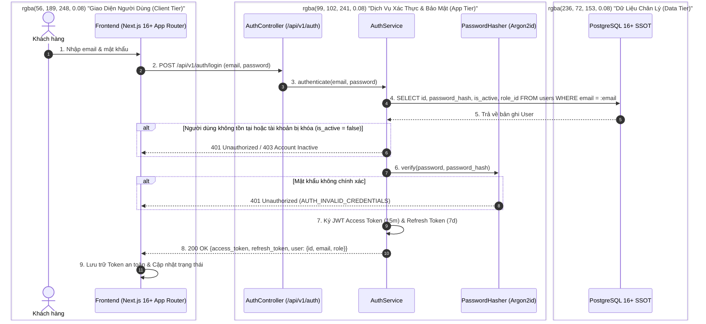
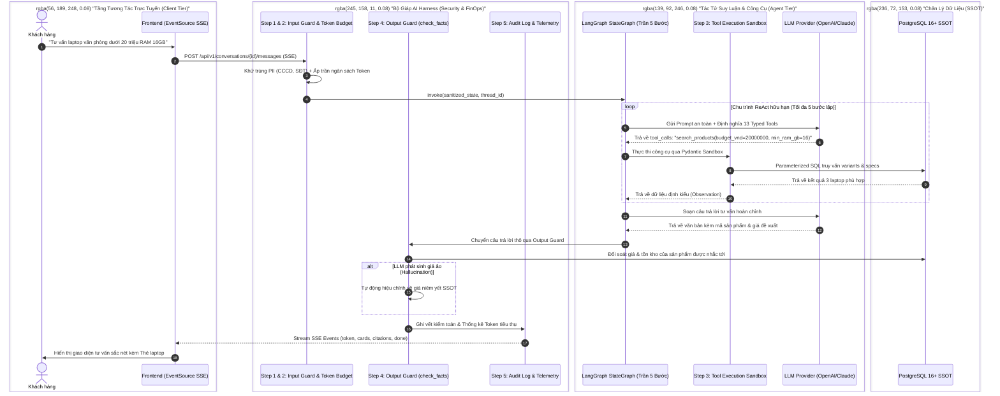
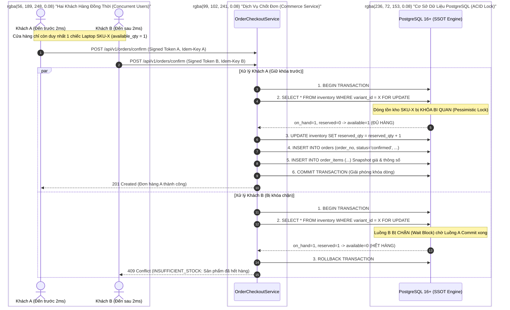
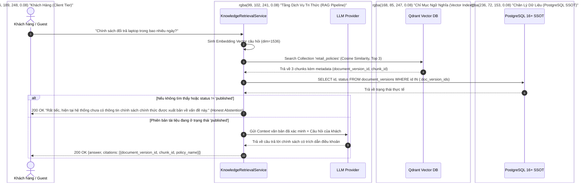
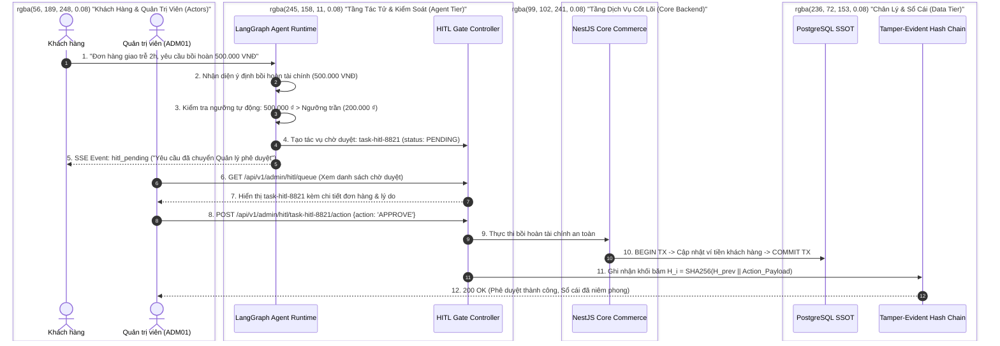

# 15 — Sequence Diagrams for Critical Business Flows

**Dự án**: RetailMind AI — Production-Oriented Agentic Retail Intelligence Platform  
**Tài liệu**: `enterprise-docs/docs/03-architecture-api/15-SEQUENCE_DIAGRAMS.md`  
**Căn cứ đặc tả**: `docs/research/commerce-flow.md`, `agent-tool-flow.md`, `rag-flow.md` & `ADR-005`  
**Trạng thái**: Approved for Architecture Baseline (Production 2026 Edition)  

---

## 1. Luồng Xác Thực & Cấp Phát Token (UC01: Auth & Token Lifecycle)

---

## 2. Luồng Hội Thoại AI Agent & Bộ Giáp AI Harness (UC03: Agentic Advisor & Harness Flow)

---

## 3. Luồng Chốt Đơn Giao Dịch & Khóa Bi Quan Chống Đua (UC08: Checkout & Race Condition)

Luồng xử lý khi 2 khách hàng cùng gửi yêu cầu chốt mua một chiếc laptop duy nhất còn lại trong kho:

---

## 4. Luồng RAG Chính Sách Bảo Hành Xác Minh Hai Chiều (UC05: Two-Way Verified RAG)

---

## 5. Luồng Cổng Phê Duyệt Tác Vụ Con Người (HITL Approval Gate & Hash Chain Ledger)

