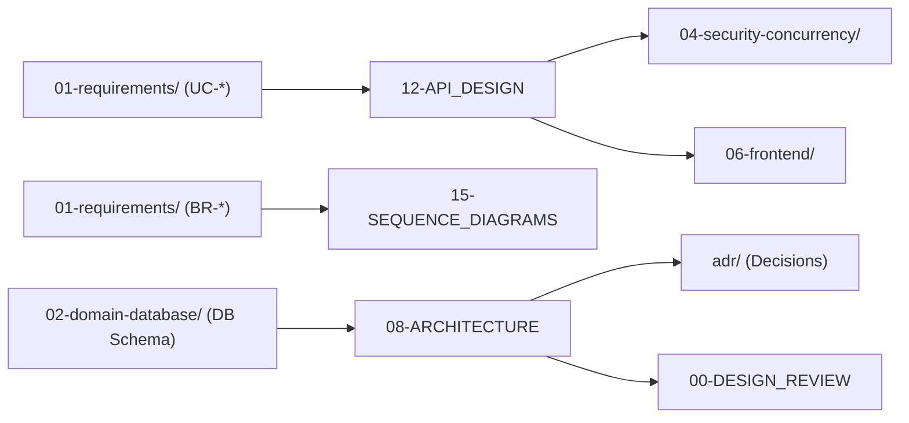

# 🏛️ Nhóm 03 — Kiến Trúc Hệ Thống & Hợp Đồng API (Architecture & API Design)

> **Vai trò kỹ thuật:** System Architect / API Designer / Principal Software Engineer  
> **Mục tiêu:** Định hình kiến trúc tổng thể theo mô hình C4 Model chuẩn quốc tế, thiết lập hợp đồng giao tiếp RESTful API `/api/v1` trực quan, bảo mật, idempotent, vẽ sơ đồ tuần tự các luồng nghiệp vụ phức tạp và lưu vết các Quyết định Kiến trúc (ADR).

---

## 🗂️ Danh Mục Tài Liệu Thuộc Nhóm 03

| Thứ tự | Tên tài liệu | Mục đích kỹ thuật cốt lõi |
| :---: | :--- | :--- |
| **00** | [`00-DESIGN_REVIEW.md`](00-DESIGN_REVIEW.md) | Báo cáo kiểm định cổng thiết kế kiến trúc (Design Gate Review). Đánh giá tính sẵn sàng trước khi cho phép scaffold mã nguồn (Verdict: READY / BLOCKED). |
| **08** | [`08-ARCHITECTURE.md`](08-ARCHITECTURE.md) | Kiến trúc hệ thống theo chuẩn C4 Model: Level 1 (System Context) và Level 2 (Container Diagram) sử dụng Mermaid C4 syntax. |
| **12** | [`12-API_DESIGN.md`](12-API_DESIGN.md) | Đặc tả hợp đồng RESTful API chi tiết: Phương thức HTTP, Endpoints, Headers, Request Body Schema, Response Schemas (200/201/422/403/409), Mã lỗi chuẩn hóa. |
| **15** | [`15-SEQUENCE_DIAGRAMS.md`](15-SEQUENCE_DIAGRAMS.md) | Sơ đồ tuần tự (Mermaid Sequence) chi tiết cho các luồng xử lý phức tạp: Đăng nhập/Cấp Token, Thực thi giao dịch có khóa dòng, Xử lý hàng đợi bất đồng bộ. |
| **ADR**| [`adr/`](adr/README.md) | Thư mục lưu trữ các Bản ghi Quyết định Kiến trúc (Architecture Decision Records): ADR-001, ADR-002... |

---

## 🔗 Liên Kết Truy Xuất (Traceability Flow)

