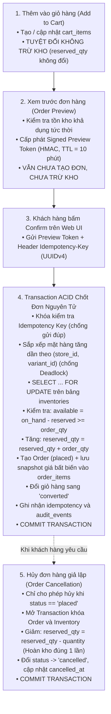

# ADR-005: Quy Trình Vòng Đời Đơn Hàng, Khóa Tồn Kho Bi Quan & Đảm Bảo Tính Bất Biến

**Mã quyết định:** `ADR-005`  
**Dự án:** RetailMind AI — Production-Oriented Agentic Retail Intelligence Platform  
**Trạng thái:** `APPROVED FOR BASELINE`  
**Ngày quyết định:** 2026-10-20  
**Tác giả:** Technical Architecture Team & Antigravity Pair Programmer  
**Căn cứ:** `prompt_sections/04_PHASE_PLAN.md` (Gate P0-G06), `docs/requirements/business-rules.md` & `AGENTS.md`  

---

## 1. Ngữ Cảnh & Vấn Đề Kỹ Thuật (Context & Problem Statement)

Trong hệ thống thương mại bán lẻ, việc xử lý đồng thời (Concurrency) khi chốt đơn đặt hàng (`UC08`) và hủy đơn (`UC09`) là khu vực có nguy cơ phát sinh lỗi cao nhất:
* Tranh chấp tồn kho khi nhiều người cùng mua sản phẩm có số lượng tồn ít (Race Conditions / Overselling).
* Trùng lặp đơn hàng do mạng chập chờn người dùng bấm liên tiếp nút Đặt hàng (Double-Spend / Replay Attacks).
* Giữ chỗ ảo làm mất cơ hội bán hàng nếu giữ kho quá sớm (ví dụ: giữ kho ngay khi thêm vào giỏ).
* Bị thay đổi giá trong quá khứ khi giá bán của catalog cập nhật.

---

## 2. Quyết Định Kiến Trúc (Decision)

Hệ thống thiết lập một quy trình 5 bước nghiêm ngặt về vòng đời đơn hàng và tồn kho:

### Các Nguyên Tắc Cốt Lõi Bất Biến:
1. **Thêm vào giỏ không giữ kho (`BR-011`):** Giỏ hàng chỉ là danh sách ý định mua sắm, không làm thay đổi `reserved_qty`.
2. **Order Preview có hạn 10 phút (`BR-012`):** Tránh việc khách hàng giữ đơn giá cũ khi catalog đã điều chỉnh giá hoặc hết hàng.
3. **Chống Deadlock bằng sắp xếp:** Mọi truy vấn khóa dòng bi quan `SELECT ... FOR UPDATE` đều phải sắp xếp các cặp `(store_id, variant_id)` theo thứ tự tăng dần trước khi thực thi.
4. **Snapshot giá bất biến (`BR-016`):** Đơn giá được sao chép cố định vào `order_items.unit_price_vnd` tại thời điểm chốt đơn; mọi thay đổi giá trong tương lai trên bảng `variants` không làm thay đổi lịch sử hóa đơn.
5. **Chống gửi đúp bằng Idempotency (`BR-018`):** Mỗi request chốt đơn bắt buộc có `Idempotency-Key`. Nếu gửi lại cùng key trong 24h, hệ thống trả về nguyên vẹn kết quả đơn hàng cũ với mã `200 OK`, tuyệt đối không trừ kho lần 2.
6. **Hủy đơn hoàn kho 1 lần duy nhất (`BR-017`):** Chỉ đơn hàng ở trạng thái `placed` mới được phép hủy; thao tác hoàn kho `reserved_qty = reserved_qty - quantity` chỉ chạy duy nhất một lần.

---

## 3. Hệ Quả & Đánh Đổi (Consequences)

### Tích cực (Positive):
* Triệt tiêu hoàn toàn rủi ro bán vượt tồn kho (Overselling) và khóa chết (Deadlock) ở tầng CSDL.
* Bảo toàn lịch sử kế toán tuyệt đối, đảm bảo tính toàn vẹn tài chính.

### Tiêu cực & Biện pháp khắc phục (Risks & Mitigations):
* *Rủi ro:* Khóa bi quan `SELECT ... FOR UPDATE` có thể gây xếp hàng chờ nếu nhiều người cùng mua 1 sản phẩm.
* *Biện pháp:* Cấu hình `SET lock_timeout = '3s'` để giải phóng worker ngay nếu bị nghẽn; logic nghiệp vụ bên trong transaction được tối ưu hóa cực ngắn (< 15ms) để giải phóng khóa lập tức.
