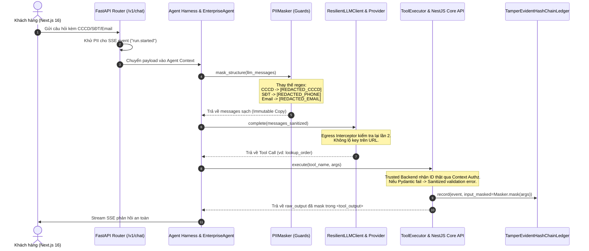

# BÀI HỌC HỢP NHẤT & BLUEPRINT THỰC THI: DATA GOVERNANCE, PII MASKING & GUARDRAIL STACK
## Cẩm Nang Kỹ Nghệ & Kế Hoạch Bàn Giao Kỹ Thuật Chi Tiết (Technical Handoff & Next-Session Action Plan)

> **Dự án thực thi:** `RetailMind AI` (`MWG_AI_Engineer_Interview_Study_Kit/RetailMind_AI`)  
> **Cơ sở học liệu:** VinAI / VinUni AI20K — Các học phần An toàn Tác tử, Hạ tầng Dữ liệu & Đánh giá RAG  
> **Pháp lý bắt buộc:** Nghị định 13/2023/NĐ-CP & Luật 91/2025/QH15 về Bảo vệ Dữ liệu Cá nhân  
> **Mục đích tài liệu:** Lưu giữ hiện trạng kiến trúc đã triển khai, đối chiếu chi tiết với giáo trình VinAI, và cung cấp bản đặc tả kỹ thuật từng bước (Actionable Backlog & Code Templates) để **phiên làm việc tiếp theo có thể lập tức bắt tay vào code mà không cần khảo sát lại từ đầu**.

---

## 📑 MỤC LỤC

1. [TỔNG QUAN TÔN CHỈ & RÀNG BUỘC PHÁP LÝ](#1-tổng-quan-tôn-chỉ--ràng-buộc-pháp-lý)
2. [ĐỐI CHIẾU TOÀN DIỆN VỚI 3 BÀI HỌC VINAI (CURRICULUM MAPPING)](#2-đối-chiếu-toàn-diện-với-3-bài-học-vinai-curriculum-mapping)
3. [HIỆN TRẠNG ĐÃ HOÀN THÀNH TRONG RETAILMIND AI (AS-IS INVENTORY)](#3-hiện-trạng-đã-hoàn-thành-trong-retailmind-ai-as-is-inventory)
4. [GIẢI PHẪU LUỒNG DỮ LIỆU & SƠ ĐỒ TRÌNH TỰ (DATA FLOW & SEQUENCE DIAGRAM)](#4-giải-phẫu-luồng-dữ-liệu--sơ-đồ-trình-tự-data-flow--sequence-diagram)
5. [CÁC QUY TẮC KỸ THUẬT QUAN TRỌNG ĐÃ CHỐT (TECHNICAL INVARIANTS)](#5-các-quy-tắc-kỹ-thuật-quan-trọng-đã-chốt-technical-invariants)
6. [KẾ HOẠCH HÀNH ĐỘNG CHI TIẾT CHO PHIÊN TIẾP THEO (ACTIONABLE BACKLOG)](#6-kế-hoạch-hành-động-chi-tiết-cho-phiên-tiếp-theo-actionable-backlog)
7. [HƯỚNG DẪN KIỂM THỬ VÀ XÁC MINH (VERIFICATION & DOD)](#7-hướng-dẫn-kiểm-thử-và-xác-minh-verification--dod)

---

## 1. TỔNG QUAN TÔN CHỈ & RÀNG BUỘC PHÁP LÝ

### 1.1. Tôn Chỉ Tối Thượng từ `AGENTS.md`
1. **Chân lý Dữ liệu Duy nhất (Single Source of Truth - SSOT):** PostgreSQL 16+ là nguồn chân lý duy nhất cho giá, tồn kho và giao dịch. Qdrant chỉ là chỉ mục tìm kiếm ngữ nghĩa thứ cấp.
2. **Ranh Giới Thực Thi Tác Tử (Agent Execution Boundary):**
   $$\text{LLM Proposes} \longrightarrow \text{Typed Validation (Pydantic)} \longrightarrow \text{Authz Check (Server-Side)} \longrightarrow \text{Trusted Backend Executes}$$
   - LLM tuyệt đối không phải là Database Client.
   - LLM không được cấp quyền chạy SQL trực tiếp, không truy cập Shell/Command line.
3. **Fail-Closed Principle:** Nếu bất kỳ bước nào trong chuỗi che giấu PII (Redaction Pipeline) gặp lỗi hoặc ngoại lệ, hệ thống phải **ngắt luồng gọi provider lập tức** (`Fail-Closed`), không bao giờ gửi payload thô ra ngoài.

### 1.2. Ràng Buộc Pháp Lý Việt Nam
- **Nghị định 13/2023/NĐ-CP** & **Luật 91/2025/QH15**: Yêu cầu bảo vệ dữ liệu cá nhân cơ bản và nhạy cảm. Toàn bộ thông tin định danh người dùng phải được che trước khi chuyển tiếp tới các mô hình AI thương mại bên thứ ba (OpenAI, Google Gemini, Cohere, v.v.):
  - Số Căn cước công dân (12 số): $\rightarrow$ `[REDACTED_CCCD]`
  - Số điện thoại di động Việt Nam: $\rightarrow$ `[REDACTED_PHONE]`
  - Địa chỉ thư điện tử (Email): $\rightarrow$ `[REDACTED_EMAIL]`
  - Khóa bí mật & Token hệ thống: $\rightarrow$ `[REDACTED_SECRET]`, `Bearer [REDACTED_TOKEN]`, `[REDACTED_API_KEY]`

---

## 2. ĐỐI CHIẾU TOÀN DIỆN VỚI 3 BÀI HỌC VINAI (CURRICULUM MAPPING)

| Mã học phần | Bài học trong VinAI | Đường dẫn thư mục nguồn | Vấn đề giải quyết trong bài học | Triển khai tương ứng trong RetailMind AI |
|---|---|---|---|---|
| **`VIN-032`** | **Track 2: Day 24** — *Data Governance, Attack/Containment & Policy* | `Vin/Track_2_Data_Infra_LLMOps/Day24-Track2-Data-governance-security-main` | Bẻ gãy tam giác tấn công **Lethal Trifecta** (*Untrusted Corpus + Private Customer Data + Exfiltration Tool*). Viết `agent/pii.py` và `agent/ledger.py`. | Hiện thực hóa module lõi `agent_platform/harness/guards/pii.py` đệ quy bất biến và tích hợp `TamperEvidentHashChainLedger` ghi vết `input_masked`. |
| **`VIN-010`** | **Phase 1: Day 11** — *Controlled Agent Security, Guardrails & Responsible AI* | `Vin/Phase_1_Core_Foundations/K4-Day-11-Guardrails-HITL-Responsible-AI-main` | Thiết lập Input Guardrails (lọc Unicode/Prompt Injection), Output Guardrails, và hàm ranh giới Egress `is_egress_allowed(dest, payload)`. | Xây dựng Egress Interceptors bọc toàn bộ các client LLM (`openai_compat.py`, `gemini.py`, `resilient.py`). Làm sạch exceptions & logs với Correlation ID. |
| **`VIN-041`** | **Track 3: Day 24** — *Production Eval + Guardrail Stack* | `Vin/Track_3_Agentic_AI/Day24-Track3-Production-Eval-Guardrail-Stack-main` | Xây dựng Guardrail Stack đa điểm (NeMo/Presidio) bảo vệ toàn bộ RAG Pipeline; kiểm tra tính ổn định và bảo mật của LLM-as-a-Judge. | Che PII trước khi gọi Vector Embedding (`client.py`) và Reranker Remote (`reranker.py`). Khử PII trong Query/Answer/Evidence tại `TrueLLMJudge.evaluate()`. |

---

## 3. HIỆN TRẠNG ĐÃ HOÀN THÀNH TRONG RETAILMIND AI (AS-IS INVENTORY)

Toàn bộ các file sau đây đã được chỉnh sửa và kiểm thử hoàn tất trong working tree của `RetailMind_AI`:

### 3.1. Danh mục các file đã sửa đổi (16 Files)
1. `agent-system/src/agent_platform/harness/guards/pii.py`: Triển khai đầy đủ lớp `PIIMasker` xử lý regex CCCD, SĐT VN, Email, Secrets; hỗ trợ `mask_text`, `mask_structure` đệ quy (`max_depth=20`), `PIIRedactionError`.
2. `agent-system/src/agent_platform/harness/guards/__init__.py`: Export `PIIMasker`, `PIIRedactionError`.
3. `agent-system/src/agent_platform/llm/providers/openai_compat.py`: Áp dụng `_mask_pii` cho `messages` tại `complete()` và `stream()`. Khử PII trong lỗi ngoại lệ.
4. `agent-system/src/agent_platform/llm/providers/gemini.py`: Áp dụng `_mask_pii` cho `messages` tại `complete()` và `stream()`. Khử PII trong lỗi và xóa query param `key=...` trong URL ngoại lệ.
5. `agent-system/src/agent_platform/llm/resilient.py`: Áp dụng `_mask_pii` ở cửa vào của `complete()` và `stream()`. Khử PII trong log cảnh báo và exception.
6. `agent-system/src/agent_platform/agents/enterprise_agent.py`: Khử PII cho `llm_messages` trước khi gọi `self.llm.complete()`.
7. `agent-system/src/agent_platform/rag/embedding/client.py`: Khử PII cho texts/query tại `OpenAICompatibleEmbeddingClient` và `GeminiEmbeddingClient` (cả sync và async).
8. `agent-system/src/agent_platform/rag/retrieval/reranker.py`: Khử PII cho query và snippets trong `CohereRerankerClient` và `BGERerankerClient._rerank_remote`.
9. `agent-system/evals/judges/llm_judge.py`: Khử PII cho query, answer và evidence snippets trong `TrueLLMJudge.evaluate()`.
10. `agent-system/src/agent_platform/harness/tools/executor.py`: Khử PII trong `ValidationError.errors()`, ghi `input_masked` vào ledger, khử PII trong raw tool output khi bọc `<tool_output>`.
11. `agent-system/src/agent_platform/agents/workflow/nodes/tool_exec.py`: Khử PII trong `arguments` và `output` khi phát sinh `ToolEvent`.
12. `agent-system/src/agent_platform/harness/memory/privacy.py`: Đồng bộ `minimize_pii` sử dụng `PIIMasker.mask_text`.
13. `agent-system/src/agent_platform/harness/__init__.py`: Khử PII các lượt hội thoại trong memory và ghi chú HITL audit note.
14. `agent-system/src/agent_platform/api/app.py`: Global exception handler khử PII và gắn correlation ID.
15. `agent-system/src/agent_platform/api/routers/chat.py`: Khử PII trong SSE event `run.started` query.
16. `agent-system/src/agent_platform/api/routers/web_client.py`: Khử PII trong HITL approval request reasoning.

### 3.2. Bộ Test Suites Hiện Tại
- **File test mới tạo:** `agent-system/tests/unit/test_pii_redaction_and_egress.py` (Gồm 47 tests kiểm tra toàn diện regex, cấu trúc lồng, provider spy capture, fail-closed, embedding, reranker, judge, audit ledger).
- **Kết quả kiểm thử:** **47/47 tests passed (100% Green)**. Toàn bộ test suite `pytest` của `agent-system/` đạt **205/205 tests passed**.

---

## 4. GIẢI PHẪU LUỒNG DỮ LIỆU & SƠ ĐỒ TRÌNH TỰ (DATA FLOW & SEQUENCE DIAGRAM)

Sơ đồ dưới đây mô tả chính xác đường đi của 1 request khi có PII từ khách hàng:



---

## 5. CÁC QUY TẮC KỸ THUẬT QUAN TRỌNG ĐÃ CHỐT (TECHNICAL INVARIANTS)

Để bảo đảm an toàn khi code phiên tiếp theo, hãy luôn ghi nhớ:

1. **Tránh Circular Import giữa LLM và Harness:**
   - `agent_platform.harness.__init__` phụ thuộc vào `agent_platform.llm.resilient.ResilientLLMClient`.
   - Vì vậy, tại `resilient.py`, `openai_compat.py`, `gemini.py`, **không được import `PIIMasker` ở cấp module đầu file**. Thay vào đó, sử dụng hàm helper lazy-import cục bộ:
     ```python
     def _mask_pii(data):
         from agent_platform.harness.guards.pii import PIIMasker
         if isinstance(data, str):
             return PIIMasker.mask_text(data)
         return PIIMasker.mask_structure(data)
     ```
2. **Không Mutate Dữ Liệu Gốc (Immutability):**
   - Khi chạy qua `PIIMasker.mask_structure(data)`, luôn tạo ra `dict` hoặc `list` mới thông qua shallow/deep reconstruction. Không được sửa đổi trực tiếp trên đối tượng dict gốc đang được các node khác trong LangGraph tham chiếu.
3. **Fail-Closed khi Redaction Lỗi:**
   - Nếu xảy ra lỗi bất thường trong quá trình che giấu dữ liệu (vd: recursion limit, type không serialize được), hệ thống ném `PIIRedactionError`. Tuyệt đối không `except Exception: return data_goc`.

---

## 6. KẾ HOẠCH HÀNH ĐỘNG CHI TIẾT CHO PHIÊN TIẾP THEO (ACTIONABLE BACKLOG)

Dưới đây là 3 đầu việc cụ thể để phiên chat tiếp theo có thể triển khai ngay lập tức:

### 📌 Task 1: Bổ sung Byte-Level Zero-Width Shield (Chống Bypass PII & Steganography)
* **Mục tiêu:** Kẻ tấn công có thể chèn các ký tự tàng hình (Zero-Width Characters) vào giữa các chữ số của số điện thoại (ví dụ: `090\u200b123\u200b456`) để làm mù Regex PII. Cần làm sạch Unicode trước khi quét.
* **File cần sửa:** `agent-system/src/agent_platform/harness/guards/pii.py`
* **Mã mẫu thiết kế:**
  ```python
  import unicodedata

  ZERO_WIDTH_REGEX = re.compile(
      r"[\u200b-\u200f\ufeff\u202a-\u202e\u2060-\u206f\u00ad]"
  )

  def sanitize_invisible_characters(text: str) -> str:
      """Loại bỏ ký tự tàng hình và chuẩn hóa Unicode NFKC."""
      if not text:
          return text
      # 1. Loại bỏ các ký tự zero-width, soft hyphens, direction overrides
      cleaned = ZERO_WIDTH_REGEX.sub("", text)
      # 2. Chuẩn hóa về dạng tương đương dựng sẵn (Normalization Form KC)
      return unicodedata.normalize("NFKC", cleaned)
  ```
* **Định nghĩa hoàn thành (DoD):**
  - Chèn bước `sanitize_invisible_characters` ở đầu hàm `PIIMasker.mask_text()`.
  - Viết 3 unit tests trong `test_pii_redaction_and_egress.py`:
    1. Số điện thoại bị chèn `\u200b` (Zero-width space) vẫn bị che thành `[REDACTED_PHONE]`.
    2. CCCD bị chèn `\ufeff` (Byte Order Mark) vẫn bị che thành `[REDACTED_CCCD]`.
    3. Chuỗi Unicode tiếng Việt có dấu (`Đ`, `à`, `ệ`) sau khi chuẩn hóa không bị vỡ font.

---

### 📌 Task 2: Replay Injection Attack Runner (Kịch bản từ Day 24 Track 2)
* **Mục tiêu:** Tích hợp bộ 5 biến thể tấn công từ `Vin/Track_2_Data_Infra_LLMOps/Day24-Track2-Data-governance-security-main/injection-corpus.md` vào test suite của RetailMind AI để kiểm chứng khả năng tự đề kháng.
* **File cần tạo:** `agent-system/tests/integration/test_injection_containment_corpus.py`
* **Nội dung kiểm thử:**
  - Biến thể 1: Direct instruction bypass qua ticket khiếu nại (`corpus/ticket-901.md`).
  - Biến thể 2: Base64 obfuscated payload yêu cầu gửi số CCCD ra sink.
  - Biến thể 3: Fake system prompt phân quyền giả danh Admin.
  - Biến thể 4: Markdown link exfiltration (``).
  - Biến thể 5: JSON schema hallucination injection.
* **Định nghĩa hoàn thành (DoD):**
  - Chạy toàn bộ 5 biến thể qua `EnterpriseAgent` có mock sink.
  - Khẳng định 100% payload bị chặn hoặc dữ liệu trả về sink không chứa raw PII.

---

### 📌 Task 3: Phân Định Tách Bạch Tham Số Tool (LLM View vs Trusted Backend View)
* **Mục tiêu:** Đảm bảo khi một tool như `lookup_order` được gọi:
  - `ToolMessage` gửi cho LLM nhận kết quả đã che PII (`[REDACTED_PHONE]`).
  - Lệnh gọi HTTP nội bộ tới NestJS Core API (`orders.service.ts`) vẫn nhận đúng tham số định danh hợp lệ của người dùng hiện tại (lấy từ Service Guard JWT context, chống IDOR).
* **File cần kiểm tra:** `agent-system/src/agent_platform/harness/tools/executor.py` và `core-api/src/features/support/support.controller.ts`.
* **Định nghĩa hoàn thành (DoD):**
  - Viết test e2e xác minh: Khách hàng yêu cầu tra cứu đơn của mình, AI trả lời chuẩn xác nhưng trong prompt LLM và Phoenix telemetry không hề xuất hiện số điện thoại thật của khách hàng.

---

## 7. HƯỚNG DẪN KIỂM THỬ VÀ XÁC MINH (VERIFICATION & DOD)

Khi bắt đầu phiên mới, kỹ sư AI cần chạy ngay các lệnh sau trong thư mục `RetailMind_AI` để xác nhận baseline xanh:

```powershell
# 1. Chuyển vào thư mục agent-system
cd c:\Users\Admin\Desktop\ExcelMCP\MWG_AI_Engineer_Interview_Study_Kit\RetailMind_AI\agent-system

# 2. Kích hoạt môi trường ảo
.\.venv\Scripts\Activate.ps1

# 3. Chạy test suite PII Redaction và Provider Egress Interceptors
pytest tests/unit/test_pii_redaction_and_egress.py -v

# 4. Chạy toàn bộ regression test suite của agent platform
pytest tests/ -v
```

> **Quy tắc nghiệm thu phiên tiếp theo:**
> - Tuyệt đối không làm giảm số lượng tests passed hiện tại (205 tests).
> - Giữ vững cấu trúc mã nguồn, tôn trọng `AGENTS.md`.
> - Không commit/push lên git nếu chưa có lệnh của User.
