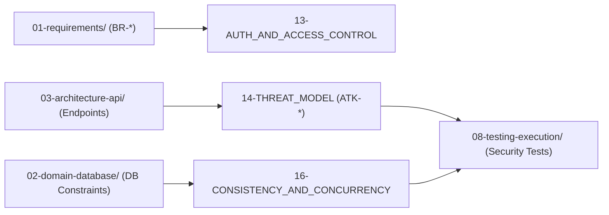

# 🛡️ Nhóm 04 — An Ninh Bảo Mật & Tranh Chấp Đồng Thời (Security & Concurrency)

> **Vai trò kỹ thuật:** Application Security Engineer / Concurrency & Systems Specialist  
> **Mục tiêu:** Thiết lập hệ thống phòng thủ chiều sâu (Defense-in-Depth), mô hình hóa các mối đe dọa an ninh theo chuẩn STRIDE & OWASP API Top 10, ngăn chặn triệt để lỗ hổng phân quyền IDOR và thiết kế kiến trúc kiểm soát tranh chấp đồng thời (Concurrency Control) triệt tiêu lỗi nộp trùng, trừ tiền đúp.

---

## 🗂️ Danh Mục Tài Liệu Thuộc Nhóm 04

| Thứ tự | Tên tài liệu | Mục đích kỹ thuật cốt lõi |
| :---: | :--- | :--- |
| **13** | [`13-AUTH_AND_ACCESS_CONTROL.md`](13-AUTH_AND_ACCESS_CONTROL.md) | Cơ chế xác thực Stateless Token / Cookie, vòng đời Token, Ma trận phân quyền RBAC và cơ chế Policy PBAC chống lỗ hổng IDOR. |
| **14** | [`14-THREAT_MODEL.md`](14-THREAT_MODEL.md) | Đánh giá rủi ro an ninh theo mô hình STRIDE + OWASP API Security Top 10 (2023), Bảng Ma trận Kịch bản Tấn công (`ATK-01` $\rightarrow$ `ATK-08`), cơ chế khắc phục và phương pháp kiểm chứng tự động. |
| **16** | [`16-CONSISTENCY_AND_CONCURRENCY.md`](16-CONSISTENCY_AND_CONCURRENCY.md) | Triết lý quản lý đồng thời, Ma trận phân tích Race Conditions, Kỹ thuật Khóa Dòng Bi Quan (`SELECT ... FOR UPDATE`), Giao dịch ACID và Header `Idempotency-Key`. |

---

## 🔗 Liên Kết Truy Xuất (Traceability Flow)

