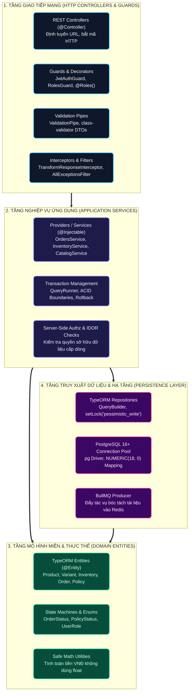

# 01 — NestJS Backend Architecture & Engineering Design

**Dự án**: RetailMind AI — Production-Oriented Agentic Retail Intelligence Platform  
**Tài liệu**: `enterprise-docs/docs/05-backend/01-BACKEND_ARCHITECTURE.md`  
**Công nghệ**: NestJS 12+, Node.js 20+ LTS, TypeScript 5+, TypeORM 0.3+, PostgreSQL 16+  
**Căn cứ đặc tả**: `AGENTS.md`, `ADR-005`, `ADR-007` & `ADR-009`  
**Trạng thái**: Approved for Architecture Baseline (Production 2026 Edition)  

---

## 1. Nguyên Tắc Phân Tầng Trong NestJS (Clean Modular Architecture)

Mã nguồn **NestJS Backend Core** áp dụng mô hình phân tầng chặt chẽ dựa trên hệ thống **Dependency Injection (DI)** chuẩn mực:



---

## 2. Cấu Trúc Mã Nguồn Feature-Driven & Shared Kernel (`core-api/src`)

Mã nguồn NestJS được tổ chức theo kiến trúc phân tách rạch ròi giữa **Hạ tầng dùng chung (`shared/`)** và **Các phân hệ tính năng nghiệp vụ (`features/`)** thay cho cách chia `modules/` truyền thống:

```text
core-api/src/
├── main.ts                    # Khởi động ứng dụng, thiết lập Global Pipes, CORS, Interceptors
├── app.module.ts              # Root Module kết nối Database và đăng ký các Features nghiệp vụ
│
├── shared/                    # [DÙNG CHUNG] Shared Kernel & Common Infrastructure
│   ├── database/              # Quản lý TypeORM DataSource, Migrations 22 bảng, Seeds
│   ├── decorators/            # @Roles(), @CurrentUser(), @Public(), @Idempotent()
│   ├── dto/                   # ApiEnvelopeDto<T>, PaginationQueryDto, ErrorResponseDto
│   ├── filters/               # HttpExceptionFilter, TypeOrmExceptionFilter
│   ├── guards/                # JwtAuthGuard, RolesGuard, InternalSecretGuard
│   ├── interceptors/          # TransformResponseInterceptor, LoggingInterceptor
│   ├── middleware/            # CorrelationIdMiddleware (x-trace-id header)
│   └── utils/                 # SafeMath (tiền tệ VNĐ), CryptoHelper
│
└── features/                  # [PHÂN HỆ NGHIỆP VỤ] Feature-Driven Slices (Thay cho modules)
    ├── auth/                  # Đăng nhập, cấp JWT, Token Rotation, Argon2id
    │   ├── auth.controller.ts, auth.service.ts, auth.module.ts, jwt.strategy.ts
    ├── catalog/               # Quản lý Laptop, biến thể CPU/RAM/GPU, lọc đa tiêu chí
    │   ├── catalog.controller.ts, catalog.service.ts, entities/, dto/
    ├── inventory/             # Quản lý kho chi nhánh, khóa bi quan setLock('pessimistic_write')
    │   ├── inventory.controller.ts, inventory.service.ts, entities/
    ├── orders/ (commerce)     # Giỏ hàng, Signed Preview Token, chốt đơn giả lập
    │   ├── orders.controller.ts, orders.service.ts, entities/, dto/
    ├── internal-agent/        # 13 REST Endpoints phục vụ riêng cho Python AI Agent
    │   ├── internal-agent.controller.ts, internal-agent.service.ts
    └── customers/             # Hồ sơ khách hàng, phân quyền dữ liệu cá nhân (IDOR check)
```

### Ưu Điểm Của Mô Hình `shared/` & `features/`:
1. **Phân tách trách nhiệm triệt để:** `shared/` chứa mã nguồn thuần kỹ thuật, không gắn với bất kỳ quy tắc kinh doanh cụ thể nào.
2. **Khả năng mở rộng theo chiều ngang (High Scalability):** Mỗi feature trong `features/` là một đơn vị độc lập hoàn chỉnh, có thể dễ dàng tách ra thành microservice riêng khi lưu lượng tăng trưởng mà không làm xáo trộn các thành phần dùng chung trong `shared/`.
3. **Đồng nhất với Frontend:** Frontend sử dụng Feature-Sliced Design (`features/`), Backend cũng sử dụng `features/`, giúp lập trình viên full-stack dễ dàng định vị tính năng tương ứng giữa hai tầng.

---

## 3. Vòng Đời Xử Lý Yêu Cầu (NestJS Request Lifecycle)

Khi một request HTTP gửi tới NestJS Backend, request tuần tự đi qua các chặng phòng thủ:

```text
Incoming Request (HTTP /api/v1/...)
  │
  ▼
[1. Middleware]            --> Gán hoặc trích xuất x-trace-id, ghi vết truy vết OpenTelemetry
  │
  ▼
[2. Guards]                --> JwtAuthGuard xác thực token, RolesGuard kiểm tra quyền Role
  │
  ▼
[3. Interceptors (Pre)]    --> Đo đạc thời gian xử lý, ghi nhận bắt đầu request
  │
  ▼
[4. Validation Pipes]      --> class-validator kiểm tra chặt chẽ Schema DTO đầu vào
  │
  ▼
[5. Controller Route]      --> Bắt request và ủy quyền cho Application Service
  │
  ▼
[6. Service Layer]         --> Thực thi nghiệp vụ trong TypeORM Transaction & Khóa bi quan
  │
  ▼
[7. Interceptors (Post)]   --> Đóng gói kết quả vào phong bì đồng nhất ApiEnvelopeDto<T>
  │
  ▼
[8. Exception Filters]     --> Bắt lỗi (nếu có), chuyển đổi thành ErrorResponseDto chuẩn hóa
  │
  ▼
Outgoing Response (JSON HTTP 200/201/4xx/5xx)
```

---

## 4. Quản Lý Kết Nối Cơ Sở Dữ Liệu TypeORM Với PostgreSQL 16+

* **Cấu hình Connection Pool**:
  - `max`: 20 connections per instance.
  - `idleTimeoutMillis`: 30000ms.
  - `connectionTimeoutMillis`: 5000ms.
* **Quy chuẩn Mapping kiểu dữ liệu**:
  - Khóa chính ID: Kiểu `uuid` (`@PrimaryGeneratedColumn('uuid')`).
  - Tiền tệ VNĐ: Kiểu `NUMERIC(18, 0)` trong Postgres được TypeORM map thành kiểu `string` trong TypeScript nhằm triệt tiêu hoàn toàn sai số dấu phẩy động của JavaScript `number`.
  - Dấu vết thời gian: `@CreateDateColumn({ type: 'timestamptz' })` và `@UpdateDateColumn({ type: 'timestamptz' })`.

---

## 5. Ranh Giới An Toàn Cho Tác Tử AI (Internal Tool Execution Gateway)

Theo quy định nghiêm ngặt của `AGENTS.md`, AI Agent chạy trên tiến trình Python riêng biệt và **hoàn toàn không được cấp quyền kết nối trực tiếp vào PostgreSQL**.

Để thực thi 13 công cụ tra cứu và quản lý đơn hàng:
* Python Agent gọi tới NestJS qua endpoint nội bộ: `POST /internal/tools/:toolName`
* Request bắt buộc chứa:
  1. Header `X-Internal-Secret`: Khóa bí mật giao tiếp giữa các container nội bộ.
  2. Header `X-Customer-Id`: Định danh khách hàng đã được xác thực an toàn từ phiên làm việc.
* NestJS `InternalSecretGuard` kiểm tra tính hợp lệ trước khi cho phép gọi vào Service nội bộ.
