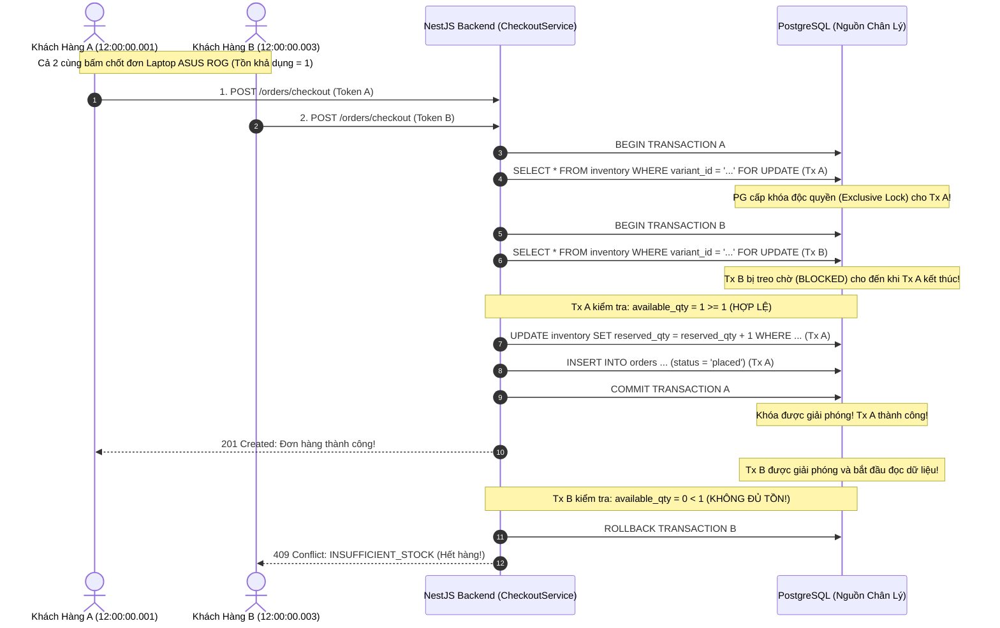

# 03 — Transaction Management & High-Concurrency Locking Specification

**Dự án**: RetailMind AI — Production-Oriented Agentic Retail Intelligence Platform  
**Tài liệu**: `enterprise-docs/docs/05-backend/03-TRANSACTION_AND_CONCURRENCY.md`  
**Căn cứ đặc tả**: `AGENTS.md`, `ADR-005` & `docs/security/16_consistency_and_concurrency.md`  
**Trạng thái**: Approved for Architecture Baseline (Production 2026 Edition)  

---

## 1. Đặt Vấn Đề: Tranh Chấp Đồng Thời Trong Thương Mại Bán Lẻ

Trong các đợt mở bán hoặc chương trình khuyến mãi chớp nhoáng (Flash-Sale), hàng trăm khách hàng có thể cùng lúc nhấn nút mua một mẫu laptop chỉ còn duy nhất 1 chiếc trong kho (`quantity = 1`).
Nếu chỉ sử dụng truy vấn kiểm tra thông thường (`SELECT quantity ...` rồi `UPDATE quantity = quantity - 1`), hệ thống sẽ gặp lỗi **Race Condition / Overselling**, dẫn đến bán âm kho và vi phạm cam kết với khách hàng.

RetailMind AI áp dụng chiến lược **Kiểm Soát Giao Dịch ACID & Khóa Bi Quan Cực Nghiêm Ngặt** để triệt tiêu hoàn toàn rủi ro này.

---

## 2. Cơ Chế Khóa Bi Quan Dòng (Pessimistic Row-Locking)

Hệ thống bắt buộc sử dụng cơ chế khóa dòng độc quyền `SELECT ... FOR UPDATE` trong Transaction CSDL:



### Triển Khai Trong NestJS (TypeORM):
```typescript
// core-api/src/features/orders/orders.service.ts & inventory.service.ts
const queryRunner = this.dataSource.createQueryRunner();
await queryRunner.connect();
await queryRunner.startTransaction();

try {
  // 1. Khóa bi quan dòng với setLock('pessimistic_write')
  const inventoryItem = await queryRunner.manager
    .createQueryBuilder(Inventory, 'inv')
    .setLock('pessimistic_write')
    .where('inv.variant_id = :variantId AND inv.store_id = :storeId', { variantId, storeId })
    .getOne();

  if (!inventoryItem || (inventoryItem.on_hand_qty - inventoryItem.reserved_qty) < requestedQty) {
    throw new ConflictException('Số lượng tồn kho khả dụng không đủ.');
  }

  // 2. Giữ chỗ tồn kho và chốt đơn hàng
  inventoryItem.reserved_qty += requestedQty;
  await queryRunner.manager.save(inventoryItem);
  
  await queryRunner.commitTransaction();
} catch (err) {
  await queryRunner.rollbackTransaction();
  throw err;
} finally {
  await queryRunner.release();
}
```

---

## 3. Chiến Lược Sắp Xếp Khóa Chống Bế Tắc (Deadlock Prevention)

Khi một đơn hàng có nhiều mặt hàng (ví dụ: mua cùng lúc Laptop A và Laptop B):
* Nếu Khách hàng 1 khóa A rồi chờ khóa B;
* Khách hàng 2 khóa B rồi chờ khóa A;
$\longrightarrow$ **Phát sinh Deadlock (Bế tắc lẫn nhau) làm sập Transaction.**

### Quy Tắc Phòng Ngừa Bắt Buộc:
Mọi thao tác khóa dòng nhiều sản phẩm trong cùng một đơn hàng bắt buộc phải **Sắp xếp danh sách `variant_id` theo thứ tự từ điển tăng dần (Ascending Order)** trước khi thực thi lệnh khóa:

```typescript
// Sắp xếp ID trước khi truy vấn khóa
const sortedItems = items.sort((a, b) => a.variantId.localeCompare(b.variantId));

for (const item of sortedItems) {
  await queryRunner.manager
    .createQueryBuilder(Inventory, 'inv')
    .setLock('pessimistic_write')
    .where('inv.variant_id = :vId AND inv.store_id = :sId', { vId: item.variantId, sId: storeId })
    .getOne();
}
```
Nguyên tắc này đảm bảo mọi giao dịch đều khóa tài nguyên theo cùng một chiều duy nhất, triệt tiêu 100% rủi ro Deadlock.

---

## 4. Bảo Vệ Trùng Lặp Yêu Cầu Bằng Idempotency-Key

Khi người dùng nhấn nút "Chốt đơn" nhiều lần hoặc mạng bị rớt khiến trình duyệt tự động gửi lại request:
1. Client gửi kèm header `Idempotency-Key: [UUIDv4]`.
2. Backend kiểm tra trong bảng `idempotency_keys`:
   - Nếu key đã tồn tại và trạng thái là `COMPLETED`: Trả về ngay lập tức kết quả đã lưu trước đó mà **không thực hiện trừ kho lần thứ hai**.
   - Nếu key đang ở trạng thái `PROCESSING`: Trả về mã lỗi `409 Conflict` (yêu cầu đang được xử lý).
   - Nếu key chưa tồn tại: Tạo bản ghi `PROCESSING` và tiến hành chốt đơn bình thường.

---

## 5. Quy Chuẩn Số Học Tiền Tệ VNĐ: Cấm Tuyệt Đối Kiểu Float

Trong thương mại bán lẻ tại Việt Nam, tiền tệ VNĐ không có phần thập phân và giá trị có thể lên đến hàng trăm triệu hoặc hàng tỷ đồng:
* **Tại PostgreSQL**: Cột `price_vnd`, `total_amount_vnd` bắt buộc khai báo `NUMERIC(18, 0)`.
* **Tại TypeScript / NestJS**: Bắt buộc lưu trữ dưới dạng `string` hoặc sử dụng thư viện `decimal.js` / `bignumber.js`. **Nghiêm cấm dùng primitive `number` của JavaScript** để tránh sai số dấu phẩy động.
* **Tại Python / FastAPI**: Bắt buộc sử dụng `decimal.Decimal`.
