# 06 — TIÊU CHUẨN KỸ THUẬT & KIẾN TRÚC ENTERPRISE NÂNG CAO (KHO BÁU BÀI HỌC TỪ FOODEE CORE-API)

**Dự án:** RetailMind AI — Production-Oriented Agentic Retail Intelligence Platform  
**Phiên bản:** Production 2026 Edition  
**Tài liệu kế thừa:** Đúc kết thực chiến từ kiến trúc Feature-Sliced Modular của `foodee-be/core-api` (Hệ thống đặt món & giao hàng thực tế quy mô lớn)  
**Phạm vi áp dụng:** Toàn bộ Backend Core (NestJS 12+), Headless Worker, Hàng đợi BullMQ, Lưu trữ MinIO và Kết nối Agentic AI.

---

## 1. TỔNG QUAN & BỐI CẢNH HỌC TẬP THỰC NGHIỆM

Trong quá trình xây dựng hệ thống **RetailMind AI**, việc thiết kế một nền tảng Backend không chỉ dừng lại ở việc đáp ứng các tính năng cơ bản, mà phải đạt tiêu chuẩn **Enterprise-Grade** có khả năng chịu tải cao, cách ly lỗi hoàn hảo, và ngăn chặn triệt để các lỗ hổng bảo mật rò rỉ dữ liệu (BOLA/IDOR).

Dự án `foodee-be/core-api` là một hệ thống e-commerce/delivery thực chiến có độ phức tạp cao, xử lý hàng triệu giao dịch, điều phối shipper theo thời gian thực và tích hợp đa cổng thanh toán (MoMo, VNPay). Phân tích mã nguồn và hiến pháp kỹ thuật (`AGENTS.md`) của Foodee Core-API đã khai phá **10 mẫu hình kiến trúc tối ưu (Architectural Gems)** mà RetailMind AI kế thừa và chuẩn hóa trực tiếp vào hệ thống:

```mermaid
graph TD
    subgraph Foodee Gems ["10 TINH HOA KIẾN TRÚC TỪ FOODEE CORE-API"]
        G1["1. Public-API Barrier & ESLint Boundary"]
        G2["2. Relational Integrity & Public Query Services"]
        G3["3. Headless Worker (Nest ApplicationContext)"]
        G4["4. Transactional Outbox Pattern"]
        G5["5. BOLA/IDOR Defense & Anti-Enumeration (404)"]
        G6["6. Magic Bytes Upload Policy (Buffer Level)"]
        G7["7. Self-Healing Reconciliation Cron"]
        G8["8. Immutable Domain State Machine"]
        G9["9. Actor Slices on Unified Domain Model"]
        G10["10. Postgres Unaccent Extension (Vietnamese Search)"]
    end

    subgraph RetailMind AI ["ÁP DỤNG TRONG RETAILMIND AI"]
        RM1["src/features/*/public-api.ts"]
        RM2["Khóa ngoại PostgreSQL SSOT & ICatalogReader (Readonly)"]
        RM3["src/worker.ts (BullMQ & Ingestion Runner)"]
        RM4["Outbox Event Ledger & Event Bus"]
        RM5["@CurrentActor() & 404 on IDOR probe"]
        RM6["image-upload.policy.ts (MinIO JPEG/PNG/WebP/PDF)"]
        RM7["Stale Ingestion & Reservation Reconciliation"]
        RM8["Order & Ingestion Status Machine"]
        RM9["Customer vs Admin Order Slices"]
        RM10["Vietnamese Diacritic-Insensitive Search"]
    end

    G1 --> RM1
    G2 --> RM2
    G3 --> RM3
    G4 --> RM4
    G5 --> RM5
    G6 --> RM6
    G7 --> RM7
    G8 --> RM8
    G9 --> RM9
    G10 --> RM10
```



---

## 2. NGUYÊN TẮC 1: RANH GIỚI TÍNH NĂNG TUYỆT ĐỐI (`public-api.ts` & ESLINT BOUNDARIES)

### 2.1. Thách thức trong các dự án NestJS Monolith
Khi dự án phình to, các lập trình viên thường có xu hướng "import tắt": Feature `Orders` import trực tiếp service nội bộ hoặc repository của `Catalog`, tạo ra mạng lưới liên kết chằng chịt (Spaghetti Dependencies) và dẫn đến lỗi vòng lặp `circular dependency`, buộc phải dùng giải pháp tình thế tai hại `forwardRef()`.

### 2.2. Giải pháp từ Foodee Core-API
- Mỗi feature trong `src/features/<feature>/` **BẮT BUỘC** phải có một cổng giao tiếp công khai duy nhất: `public-api.ts`.
- Mọi feature khác khi cần sử dụng tài nguyên của Feature B **chỉ được phép** import từ `src/features/<feature-b>/public-api`.
- **CẤM TUYỆT ĐỐI** Deep Import vào internals:
  ```typescript
  // ❌ VI PHẠM RANH GIỚI (Cấm tuyệt đối - Bị ESLint reject ngay lập tức)
  import { CatalogService } from '../catalog/catalog.service';
  import { ProductEntity } from '../catalog/entities/product.entity';

  //  CHUẨN MỰC ENTERPRISE (Chỉ đi qua public-api)
  import { CatalogFeatureModule, CatalogReaderService, type ProductView } from '../catalog/public-api';
  ```

### 2.3. Tự động hóa kiểm soát bằng Custom ESLint Rules (`architecture-boundaries.cjs`)
Foodee triển khai rule ESLint kiểm tra AST trong quá trình build/lint:
1. `foodee-boundaries/no-forward-ref`: Đánh dấu `error` khi phát hiện hàm `forwardRef()`. Nếu có phụ thuộc vòng, lập trình viên bắt buộc phải tái cấu trúc bằng Event, Outbox hoặc tách Contract Port.
2. `foodee-boundaries/feature-import-boundaries`: Bắt lỗi nếu đường dẫn import trỏ vào file nội bộ của feature khác ngoài `public-api.ts`.
3. `foodee-boundaries/no-duplicate-module-providers`: Đảm bảo một service chỉ được đăng ký làm provider ở đúng một Module sở hữu, tránh duplicate singleton instances trong bộ nhớ.

---

## 3. NGUYÊN TẮC 2: TOÀN VẸN KHÓA NGOẠI POSTGRESQL SSOT & TRUY VẤN QUA PUBLIC QUERY SERVICE (READONLY INTERFACES)

### 3.1. Phân Tích Nhược Điểm Của Việc Lạm Dụng "Snapshot DTOs"
Trong một số kiến trúc microservices phân tán, lập trình viên thường sao chép dữ liệu thành các Snapshot DTOs rời rạc. Tuy nhiên, trong một hệ thống **Modular Monolith với PostgreSQL là Single Source of Truth (SSOT)** như RetailMind AI, việc lạm dụng Snapshot DTOs bộc lộ các nhược điểm nghiêm trọng:
1. **Phá vỡ Toàn vẹn Tham chiếu CSDL (Loss of Referential Integrity):** Thay vì dùng Foreign Key chuẩn `product_id REFERENCES products(id)` có ràng buộc `RESTRICT`/`CASCADE` và tận dụng index CSDL, Snapshot DTO chỉ lưu dữ liệu bản sao lỏng lẻo. CSDL không thể ngăn chặn việc xóa nhầm sản phẩm đang có đơn hàng.
2. **Bùng nổ Boilerplate & Lệch Pha Schema (Schema Drift & Maintenance Nightmare):** Khi thực thể `Product` bổ sung thuộc tính (ví dụ: `warrantyMonths`, `modelYear`, `vatRate`), lập trình viên phải đi sửa hàng loạt file Snapshot DTO rải rác ở khắp các feature khác.
3. **Mất Sức Mạnh Của SQL JOINs $\rightarrow$ Bẫy Hiệu Năng N+1 Queries:** Monolith dùng chung PostgreSQL. Nếu cấm JOIN và ép dùng Snapshot DTO, ứng dụng buộc phải thực hiện In-Memory JOIN ở tầng ứng dụng, làm tăng vọt độ trễ P99.

### 3.2. Chuẩn Mực Kiến Trúc: Khóa Ngoại PostgreSQL Kết Hợp Public Query Service
RetailMind AI thiết lập giải pháp tối ưu kết hợp sức mạnh quan hệ của PostgreSQL với tính đóng gói của NestJS:

1. **Ở Tầng Cơ Sở Dữ Liệu (PostgreSQL SSOT):**
   - Vẫn duy trì liên kết Khóa Ngoại tường minh (`order_items.product_id` trỏ tới `products.id`) để đảm bảo toàn vẹn dữ liệu ACID và cho phép JOIN hiệu năng cao khi kết xuất báo cáo.
2. **Ở Tầng Ứng Dụng (NestJS Application Layer):**
   - Nghiệp vụ ghi/sửa sản phẩm chỉ thuộc thẩm quyền của `CatalogFeatureModule`.
   - Feature `Orders` hoặc `AgentGateway` khi cần tra cứu thông tin sản phẩm sẽ gọi thông qua **Public Query Service** (`CatalogReaderService`) được xuất bản qua `src/features/catalog/public-api.ts`.
   - Dữ liệu trả về được đóng gói kiểu bất biến `Readonly<Product>` hoặc `ProductView`, ngăn chặn việc sửa đổi ngoài ý muốn mà không cần tạo các class DTO trùng lặp.

```typescript
// src/features/catalog/public-api.ts
export { CatalogFeatureModule } from './catalog.module';
export { CatalogReaderService } from './services/catalog-reader.service';
export type { ProductView } from './contracts/product-view.interface';

// src/features/catalog/contracts/product-view.interface.ts
export interface ProductView {
  readonly id: string;
  readonly sku: string;
  readonly name: string;
  readonly basePrice: string; // Chuẩn NUMERIC(18, 0)
  readonly isActive: boolean;
  readonly categoryName?: string;
}

// src/features/orders/services/orders.service.ts
@Injectable()
export class OrdersService {
  constructor(
    private readonly catalogReader: CatalogReaderService, // Inject qua Public API
    @InjectRepository(Order) private readonly orderRepo: Repository<Order>,
  ) {}

  async createOrder(createOrderDto: CreateOrderDto, actorId: string): Promise<Order> {
    // Gọi qua Public Query Service an toàn, không đẻ Snapshot DTO rác
    const product: ProductView = await this.catalogReader.getProductForCheckout(createOrderDto.productId);
    // Tính toán đơn hàng với giá SSOT từ PostgreSQL...
  }
}
```

---

## 4. NGUYÊN TẮC 3: TIẾN TRÌNH HEADLESS WORKER ĐỘC LẬP (`NestFactory.createApplicationContext`)

### 4.1. Vấn đề của kiến trúc Monolith gộp chung tiến trình
Nếu toàn bộ HTTP API Server, BullMQ Job Processors, và Ingestion Vectorization chạy chung trên một process Node.js:
1. Khi có tài liệu PDF/Excel dung lượng 50MB tải lên, quá trình băm chunk và embedding sẽ chiếm dụng CPU/Event Loop, làm tăng độ trễ (latency p99) của các HTTP request đặt hàng.
2. Khi Worker bị rò rỉ bộ nhớ hoặc crash do một task nặng, toàn bộ Web Server phục vụ khách hàng sẽ chết theo.

### 4.2. Giải pháp Headless Worker từ Foodee Core-API
Tách thành 2 entrypoints độc lập trong cùng một codebase:
1. `src/main.ts`: Khởi tạo HTTP Web Server qua `NestFactory.create(AppModule)` lắng nghe trên Port 3000.
2. `src/worker.ts`: Khởi tạo Headless Context qua `NestFactory.createApplicationContext(WorkerModule)`.

```typescript
// src/worker.ts — Headless Background Worker
import { Logger } from '@nestjs/common';
import { NestFactory } from '@nestjs/core';
import { assertProductionConfiguration } from './config/production-config.guard';
import { WorkerModule } from './worker.module';

async function bootstrapWorker(): Promise<void> {
  // 1. Kiểm tra nghiêm ngặt biến môi trường production
  assertProductionConfiguration();

  // 2. Tạo context không bind HTTP port
  const app = await NestFactory.createApplicationContext(WorkerModule, {
    logger: process.env.NODE_ENV === 'production'
      ? ['error', 'warn', 'log']
      : ['log', 'debug', 'error', 'verbose', 'warn'],
  });

  // 3. Kích hoạt hook dọn dẹp khi nhận SIGTERM / SIGINT
  app.enableShutdownHooks();

  const logger = new Logger('RetailMindWorker');
  logger.log({
    event: 'worker_bootstrap_success',
    environment: process.env.NODE_ENV || 'development',
    pid: process.pid,
    purpose: 'BullMQ Background Ingestion & Document Processing',
  });
}

bootstrapWorker().catch((error: unknown) => {
  console.error('Fatal error starting RetailMind Worker:', error);
  process.exit(1);
});
```

### 4.3. Cấu hình Docker & Giới Hạn Bộ Nhớ V8
Khi triển khai container `worker`, tiến trình được tối ưu hóa bộ nhớ chuyên dụng:
```bash
node --max-old-space-size=384 --optimize-for-size dist/worker.js
```
Điều này đảm bảo Garbage Collection của Node.js chạy tích cực hơn, không để worker tích tụ RAM vượt quá 384MB.

---

## 5. NGUYÊN TẮC 4: TRANSACTIONAL OUTBOX PATTERN (CHỐNG MẤT MÁT DỮ LIỆU SỰ KIỆN)

### 5.1. Bài toán Dual-Write Problem
Khi khách đặt đơn hàng hoặc Admin tải tài liệu lên:
- Nếu ghi vào PostgreSQL thành công nhưng việc gửi thông điệp vào Redis/BullMQ bị lỗi mạng $\rightarrow$ Hệ thống bị lệch dữ liệu vĩnh viễn (tài liệu nằm trong DB nhưng không bao giờ được băm chunk).
- Nếu gửi vào hàng đợi trước rồi ghi DB sau, nhưng DB commit thất bại $\rightarrow$ Hàng đợi xử lý một đơn hàng "ma" không tồn tại trong DB.

### 5.2. Cấu trúc Bảng `outbox_events` Chuẩn Foodee
```sql
CREATE TABLE "outbox_events" (
  "id" uuid NOT NULL DEFAULT uuid_generate_v4(),
  "event_type" character varying(150) NOT NULL,
  "aggregate_type" character varying(100) NOT NULL,
  "aggregate_id" uuid NOT NULL,
  "idempotency_key" character varying(200) NOT NULL,
  "payload" jsonb NOT NULL,
  "status" character varying(16) NOT NULL DEFAULT 'pending',
  "attempts" integer NOT NULL DEFAULT 0,
  "available_at" TIMESTAMP NOT NULL DEFAULT CURRENT_TIMESTAMP,
  "last_error" text,
  "published_at" TIMESTAMP,
  "created_at" TIMESTAMP NOT NULL DEFAULT now(),
  CONSTRAINT "PK_outbox_events" PRIMARY KEY ("id"),
  CONSTRAINT "UQ_outbox_events_idempotency_key" UNIQUE ("idempotency_key"),
  CONSTRAINT "CHK_outbox_events_status" CHECK ("status" IN ('pending', 'failed', 'published'))
);

CREATE INDEX "IDX_outbox_events_dispatch" ON "outbox_events" ("status", "available_at", "created_at");
CREATE INDEX "IDX_outbox_events_aggregate" ON "outbox_events" ("aggregate_type", "aggregate_id");
```

### 5.3. Cơ chế Enqueue & Dispatch After Commit
- **Bước 1 (Ghi đồng nhất):** Khi tạo đơn hàng / upload file, ghi cả entity chính và `OutboxEvent` vào cùng một transaction PostgreSQL:
  ```typescript
  await queryRunner.manager.transaction(async (manager) => {
    await manager.save(order);
    await outboxService.enqueue(manager, {
      eventType: 'ORDER_PLACED',
      aggregateType: 'Order',
      aggregateId: order.id,
      idempotencyKey: `order-placed-${order.id}`,
      payload: { orderId: order.id, totalAmount: order.totalAmount },
    });
  });
  ```
- **Bước 2 (Dispatch):** Ngay sau khi transaction commit, dispatch event vào BullMQ. Nếu sập mạng, Cron định kỳ (`@Cron(CronExpression.EVERY_10_SECONDS)`) sẽ quét các event `status = 'pending'` và `available_at <= NOW()` để retry với luật **Exponential Backoff**:
  $$\text{availableAt} = \text{Date.now}() + \min(60000, 2^{\text{attempts}} \times 1000)$$

---

## 6. NGUYÊN TẮC 5: PHÒNG THỦ BOLA/IDOR & CHỐNG DÒ QUÉT TÀI NGUYÊN (ANTI-ENUMERATION)

### 6.1. Nguyên tắc Không Tin Tưởng Client (`Zero Client Trust`)
- Tuyệt đối không bao giờ nhận `customerId`, `userId`, `role` từ request body hoặc query param cho các hành động nhạy cảm.
- Danh tính người gọi luôn được trích xuất từ JWT hợp lệ thông qua Decorator `@CurrentActor()` do Backend ký phát.

### 6.2. Kỹ thuật Anti-Enumeration (Chống Thăm Dò ID bằng Lỗi 404)
Một lỗi bảo mật phổ biến khi lập trình viên kiểm tra quyền sở hữu tài nguyên:
```typescript
// ❌ NGUY HIỂM: Tiết lộ sự tồn tại của tài nguyên cho kẻ tấn công (Enumeration Attack)
const order = await this.orderRepo.findOne({ where: { id: orderId } });
if (order && order.customerId !== actor.userId) {
  throw new ForbiddenException('Bạn không có quyền truy cập đơn hàng này'); // Trả về HTTP 403
}
```
Khi hacker quét một dải UUID, nếu hệ thống trả về HTTP 403, hacker biết chắc chắn UUID đó **có tồn tại** trong hệ thống và là một đơn hàng thực. Nếu trả về 404, hacker biết UUID không tồn tại. Từ đó kẻ tấn công phân tích được mật độ dữ liệu và mục tiêu tấn công.

**Chuẩn Mực Foodee & RetailMind AI:**
```typescript
//  AN TOÀN BẢO MẬT TUYỆT ĐỐI (Anti-Enumeration Defense)
const order = await this.orderRepo.findOne({
  where: { id: orderId, customerId: actor.userId }, // Bắt buộc lọc theo cả ID và chủ sở hữu
});

if (!order) {
  // Dù đơn hàng có tồn tại của người khác hay không tồn tại, đều trả về 404 như nhau!
  throw new NotFoundException(`Không tìm thấy đơn hàng mã ${orderId}`);
}
```

---

## 7. NGUYÊN TẮC 6: KIỂM SOÁT MAGIC BYTES CHO TỆP TẢI LÊN (CHỐNG WEBSHELL & PATH TRAVERSAL)

### 7.1. Lỗ hổng giả mạo MIME Type
Hacker có thể dễ dàng đổi tên file `malicious_webshell.php` thành `invoice.png` và dùng curl gửi request với header `Content-Type: image/png`. Nếu backend chỉ kiểm tra đuôi mở rộng hoặc `file.mimetype`, hệ thống sẽ bị tấn công thực thi mã từ xa.

### 7.2. Kiểm tra trực tiếp nhị phân (Buffer Magic Bytes)
Foodee áp dụng chính sách `assertValidImageUpload` kiểm tra trực tiếp các byte đầu tiên của buffer nhị phân:

```typescript
// src/shared/storage/image-upload.policy.ts
export function detectFileContentType(buffer: Buffer): 'image/jpeg' | 'image/png' | 'image/webp' | 'application/pdf' | undefined {
  // JPEG magic bytes: FF D8 FF
  if (buffer.length >= 3 && buffer[0] === 0xff && buffer[1] === 0xd8 && buffer[2] === 0xff) {
    return 'image/jpeg';
  }

  // PNG magic bytes: 89 50 4E 47 0D 0A 1A 0A
  if (
    buffer.length >= 8 &&
    buffer.subarray(0, 8).equals(Buffer.from([0x89, 0x50, 0x4e, 0x47, 0x0d, 0x0a, 0x1a, 0x0a]))
  ) {
    return 'image/png';
  }

  // WebP magic bytes: RIFF (bytes 0-3) + WEBP (bytes 8-11)
  if (
    buffer.length >= 12 &&
    buffer.subarray(0, 4).toString('ascii') === 'RIFF' &&
    buffer.subarray(8, 12).toString('ascii') === 'WEBP'
  ) {
    return 'image/webp';
  }

  // PDF magic bytes: %PDF (bytes 0-3: 25 50 44 46)
  if (
    buffer.length >= 4 &&
    buffer.subarray(0, 4).toString('ascii') === '%PDF'
  ) {
    return 'application/pdf';
  }

  return undefined;
}
```

### 7.3. Quy tắc Đặt tên File Chống Path Traversal
- **Không bao giờ dùng tên file gốc từ client** (e.g. `../../etc/passwd` hoặc `malicious.exe`).
- Server tự sinh UUID v4 ngẫu nhiên và nối với phần mở rộng suy luận từ Magic Bytes đã kiểm định:
  ```typescript
  const safeFilename = `${crypto.randomUUID()}.${detectedExtension}`;
  ```

---

## 8. NGUYÊN TẮC 7: CƠ CHẾ ĐỐI SOÁT & TỰ HÀN GẮN TRẠNG THÁI (SELF-HEALING RECONCILIATION)

### 8.1. Vấn đề rớt Webhook trong Giao Dịch Phân Tán
Trong các hệ thống bán lẻ và thương mại:
- Khách hàng quét mã QR MoMo/VNPay thành công nhưng rớt mạng 4G trước khi trình duyệt chuyển hướng lại.
- Cổng thanh toán gửi Webhook tới RetailMind AI nhưng bị nghẽn mạng hoặc timeout.
- Đơn hàng rơi vào trạng thái "Treo" (`PENDING`) vô thời hạn, trong khi tiền của khách đã bị trừ.

### 8.2. Giải pháp Scheduled Reconciliation Job
Thay vì để Webhook I/O nặng nằm trong transaction, hệ thống triển khai một tiến trình đối soát tự động:
1. Chạy định kỳ qua Cron: `@Cron(CronExpression.EVERY_5_MINUTES)`.
2. Quét các giao dịch `PENDING` có `updatedAt <= NOW() - 5 phút`.
3. **Atomic Database Claim Mechanism:** Đánh dấu nhận xử lý bằng một câu lệnh cập nhật nguyên tử, ngăn chặn nhiều worker node tranh chấp xử lý trùng một giao dịch:
   ```typescript
   const claimed = await this.checkoutRepository
     .createQueryBuilder()
     .update(Checkout)
     .set({ reconciliationAttempts: () => 'reconciliation_attempts + 1', updatedAt: new Date() })
     .where('id = :id AND status = :status AND updatedAt <= :cutoff', { id, status: 'PENDING', cutoff })
     .execute();
   ```
4. Chủ động gọi API kiểm tra trạng thái từ cổng thanh toán/đơn vị thứ ba và tự động chuyển trạng thái đơn hàng sang `CONFIRMED` hoặc hoàn trả kho nếu quá hạn.

---

## 9. NGUYÊN TẮC 8: MÁY TRẠNG THÁI BẤT BIẾN (IMMUTABLE STATE MACHINE)

Mọi quy trình thay đổi trạng thái trong RetailMind AI (Đơn hàng `OrderStatus`, Xử lý RAG `IngestionStatus`, Thanh toán `PaymentStatus`) phải được định nghĩa bằng một Máy trạng thái hữu hạn (Finite State Machine) bất biến:

```typescript
// src/features/orders/domain/order-state-machine.ts
import { BadRequestException } from '@nestjs/common';
import { OrderStatus } from '../entities/order.entity';

const ALLOWED_ORDER_TRANSITIONS: Readonly<Record<OrderStatus, readonly OrderStatus[]>> = {
  [OrderStatus.PENDING]: [OrderStatus.CONFIRMED, OrderStatus.CANCELLED],
  [OrderStatus.CONFIRMED]: [OrderStatus.PROCESSING, OrderStatus.CANCELLED],
  [OrderStatus.PROCESSING]: [OrderStatus.SHIPPED, OrderStatus.CANCELLED],
  [OrderStatus.SHIPPED]: [OrderStatus.DELIVERED, OrderStatus.RETURNED],
  [OrderStatus.DELIVERED]: [OrderStatus.REFUNDED],
  [OrderStatus.CANCELLED]: [],  // Trạng thái kết thúc (Terminal State) - Không được phép chuyển đổi tiếp
  [OrderStatus.RETURNED]: [OrderStatus.REFUNDED],
  [OrderStatus.REFUNDED]: [],   // Trạng thái kết thúc (Terminal State)
};

export function assertOrderStatusTransition(current: OrderStatus, next: OrderStatus): void {
  const allowed = ALLOWED_ORDER_TRANSITIONS[current] || [];
  if (!allowed.includes(next)) {
    throw new BadRequestException(
      `Không thể chuyển trạng thái đơn hàng từ '${current}' sang '${next}'. Luồng chuyển đổi không hợp lệ.`
    );
  }
}
```

---

## 10. NGUYÊN TẮC 9: LÁT CẮT TÁC TỬ (ACTOR SLICES) TRÊN CÙNG MỘT MÔ HÌNH MIỀN

### 10.1. Sai lầm phân rã thực thể theo Persona
Lập trình viên thường tạo bảng `CustomerOrder` riêng và `AdminOrder` riêng vì thấy giao diện hiển thị và quyền hạn khác nhau. Điều này dẫn đến sự phân mảnh dữ liệu (Domain Fracture) nghiêm trọng.

### 10.2. Chuẩn mực Actor Slices của Foodee
Role của người dùng chỉ là **lát cắt giao tiếp (API Presentation Slice)**, không phải là thực thể miền riêng biệt:
```text
src/features/orders/
├── controllers/
│   ├── customer-orders.controller.ts  # Lát cắt cho Customer: Chỉ xem/tạo đơn của chính mình (@CurrentActor)
│   ├── admin-orders.controller.ts     # Lát cắt cho Admin: Xem toàn sàn, hủy đơn, hoàn tiền (@Roles('admin'))
│   └── public-orders.controller.ts    # Lát cắt tra cứu công khai bằng Tracking Code & SĐT
├── services/
│   └── orders.service.ts              # Nghiệp vụ lõi thống nhất thao tác trên cùng bảng `orders`
└── entities/
    └── order.entity.ts                # Thực thể Aggregate Root duy nhất
```

---

## 11. NGUYÊN TẮC 10: TÌM KIẾM TIẾNG VIỆT TỐI ƯU VỚI POSTGRES `unaccent` EXTENSION

### 11.1. Vấn đề tiếng Việt có dấu trong Bán Lẻ
Khách hàng và nhân viên khi tìm kiếm sản phẩm như `"sữa hộp"` thường gõ `"sua hop"`, `"sữa hop"`, hoặc `"sua hộp"`. Nếu chỉ dùng `ILIKE '%...%'` thông thường của PostgreSQL, kết quả trả về sẽ là rỗng hoặc thiếu sót nghiêm trọng.

### 11.2. Kích hoạt Extension `unaccent` trong Migration
```typescript
import { MigrationInterface, QueryRunner } from 'typeorm';

export class EnableUnaccentExtension implements MigrationInterface {
  public async up(queryRunner: QueryRunner): Promise<void> {
    await queryRunner.query(`CREATE EXTENSION IF NOT EXISTS unaccent;`);
    // Tạo index hỗ trợ tìm kiếm không dấu siêu tốc
    await queryRunner.query(`
      CREATE INDEX "IDX_products_name_unaccent" 
      ON "products" USING gin (to_tsvector('simple', unaccent("name")));
    `);
  }

  public async down(queryRunner: QueryRunner): Promise<void> {
    await queryRunner.query(`DROP INDEX IF EXISTS "IDX_products_name_unaccent";`);
  }
}
```

### 11.3. Áp dụng trong Catalog Search Query
```typescript
const products = await this.productRepository
  .createQueryBuilder('p')
  .where('unaccent(p.name) ILIKE unaccent(:keyword)', { keyword: `%${searchKeyword}%` })
  .orWhere('unaccent(p.description) ILIKE unaccent(:keyword)', { keyword: `%${searchKeyword}%` })
  .take(limit)
  .getMany();
```
Giải pháp này mang lại hiệu năng tìm kiếm tiếng Việt tức thì mà không cần phải phụ thuộc vào Elasticsearch hay hạ tầng bên thứ ba phức tạp trong giai đoạn khởi tạo.

---

## 12. MA TRẬN ÁP DỤNG CHO 12 USE CASES CỦA RETAILMIND AI

| Use Case | Mô Tả | Tinh Hoa Foodee Áp Dụng | Cơ Chế Bảo Vệ |
|---|---|---|---|
| `UC01` | Semantic Search & Discovery | Postgres `unaccent` + Qdrant Index | Tìm kiếm tiếng Việt không dấu chuẩn xác; Qdrant tra cứu ngữ nghĩa |
| `UC02` | Comparative Product Reasoning | Public Query Service (`Readonly<ProductView>`) | Đọc dữ liệu bất biến từ `CatalogReaderService`, so sánh độc lập không sửa database |
| `UC03` | Real-time Inventory Verification | Single Entity Ownership | `Orders` gọi qua `InventoryReaderService`, không query tắt kho |
| `UC04` | Transaction & Order Finalization | State Machine + Pessimistic Lock | `assertOrderStatusTransition()` ngăn nhảy cóc trạng thái |
| `UC05` | Post-Purchase Support & Inquiries | Anti-Enumeration (404) | Trả về 404 khi tra cứu đơn không thuộc quyền sở hữu của Actor |
| `UC06` | Sales Reporting & Analysis | Headless Worker Background Query | Báo cáo nặng chạy ngầm không gây nghẽn HTTP API phục vụ khách |
| `UC07` | Dynamic Promotions & Rules | State Machine | Quản lý vòng đời mã voucher (ACTIVE, EXPIRED, DEPLETED) |
| `UC08` | Knowledge Ingestion (Decree 30) | Headless Worker + Magic Bytes | Kiểm tra nhị phân file PDF/Docx trước khi tải lên MinIO; băm chunk ở worker |
| `UC09` | Out-of-Stock Predictive Alerts | Scheduled Reconciliation Cron | Cron quét tồn kho định kỳ phát hiện sản phẩm dưới ngưỡng an toàn |
| `UC10` | Multilingual Search & Query | Postgres `unaccent` | Chuẩn hóa ký tự và dấu tiếng Việt trước khi xử lý |
| `UC11` | Audit Trail & Ledger Logging | Transactional Outbox Pattern | Mọi hành động nhạy cảm ghi vào Outbox trong cùng transaction CSDL |
| `UC12` | Feedback & Self-Correction | Transactional Outbox + Event Bus | Đẩy phản hồi vào hàng đợi BullMQ để Fine-tuning và Eval tự động |

---

## 13. TỔNG KẾT BÀN GIAO KỸ THUẬT

Việc tích hợp 10 nguyên tắc kỹ thuật xuất sắc từ `foodee-be/core-api` đã nâng tầm kiến trúc Backend của RetailMind AI thành một hệ thống:
1. **Module hóa chuẩn mực (Feature-Sliced Modular):** Ngăn chặn 100% tình trạng Spaghetti Code nhờ hàng rào `public-api.ts`.
2. **Cách ly tiến trình (Headless Worker Isolation):** Bảo vệ tuyệt đối hiệu năng phục vụ người dùng bằng việc đưa xử lý nặng (BullMQ, MinIO, Ingestion) sang tiến trình ngầm không chiếm dụng HTTP Port.
3. **An toàn bảo mật tối đa (Security-in-Depth):** Khắc chế triệt để tấn công BOLA/IDOR bằng Anti-Enumeration (404) và chặn mã độc webshell bằng Magic Bytes Validation cấp nhị phân.
4. **Độ tin cậy giao dịch tuyệt đối:** Zero Data-Loss với Transactional Outbox Pattern và khả năng tự phục hồi (Self-Healing) qua Scheduled Reconciliation Jobs.
