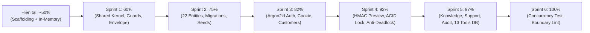
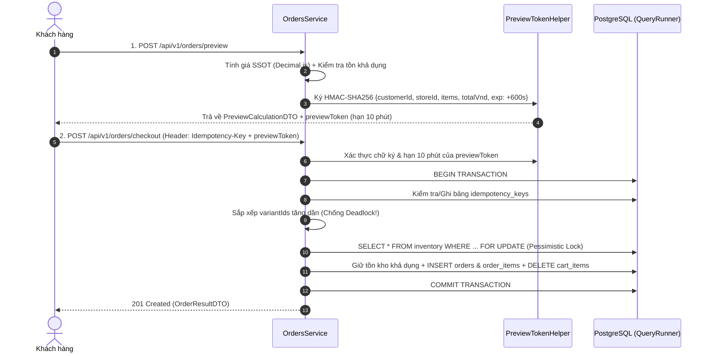

# 07 — Kế Hoạch Triển Khai Hoàn Thiện Backend Core (50% ➔ 100% Production-Ready)

**Dự án**: RetailMind AI — Production-Oriented Agentic Retail Intelligence Platform  
**Tài liệu**: `enterprise-docs/docs/05-backend/07-BACKEND_IMPLEMENTATION_PLAN.md`  
**Phạm vi**: Nâng cấp toàn diện `core-api/` từ bản mẫu In-Memory (50%) lên hệ thống Production SSOT (100%)  
**Căn cứ đặc tả**: `AGENTS.md`, `01-BACKEND_ARCHITECTURE.md` ➔ `06-ENTERPRISE_BEST_PRACTICES_FOODEE.md`, `09-DATABASE_DESIGN.md`  
**Trạng thái**: Superseded by Actionable 6-Phase Plan tại [`core-api/docs/CORE_API_IMPLEMENTATION_PLAN.md`](../../../core-api/docs/CORE_API_IMPLEMENTATION_PLAN.md)  

> [!IMPORTANT]
> **Thông báo cập nhật (29/10/2026):**  
> Kế hoạch kỹ thuật 6 Phase hành động chi tiết nhằm khắc phục test harness, giải quyết 12 tests Jest đang lỗi sau khi gỡ bỏ in-memory fallback, và đóng kín toàn bộ điểm nghẽn P0/P1 trong `BAO_CAO_RA_SOAT_BACKLOG_2026-10-29.md` hiện được chuyển giao và quản lý tại:  
> 👉 [`core-api/docs/CORE_API_IMPLEMENTATION_PLAN.md`](../../../core-api/docs/CORE_API_IMPLEMENTATION_PLAN.md).

---

## 1. Bức Tranh Tổng Quan: Từ 50% Lên 100%

Hiện tại, `core-api/` (vận hành trên **port 4000**) đã hoàn thành phần lớn khối lượng công việc nền tảng (cấu trúc `features/` & `shared/`, `public-api.ts`, 22 TypeORM Entities, 16 cổng `/api/v1/internal/tools/*` với `InternalSecretGuard`, tính toán tiền tệ `decimal.js`, kiểm tra Magic Bytes và Headless BullMQ Worker).

Để đạt **100% chuẩn kiến trúc Enterprise**, hệ thống đang thực thi hoàn thiện các chặng cuối nhằm thay thế toàn bộ dữ liệu giả lập (In-Memory Mocks) bằng **PostgreSQL 16+ Persistence thật**, hoàn thiện **Signed Preview Token (HMAC-SHA256)**, **Argon2id Auth**, **CartModule**, và **ACID Transaction chống Deadlock**.



---

## 2. Chi Tiết 6 Sprints Thực Thi Kỹ Thuật

### 🛠️ SPRINT 1: Hoàn Thiện Tầng Hạ Tầng Dùng Chung (`src/shared/`) — [50% ➔ 60%]

**Mục tiêu**: Xây dựng đầy đủ các chốt chặn bảo mật, đóng gói phản hồi chuẩn (Uniform API Envelope), bắt lỗi tập trung và truy vết phân tán theo đúng `01-BACKEND_ARCHITECTURE.md`.

#### Danh mục file cần tạo mới / cập nhật:
1. **`src/shared/middleware/correlation-id.middleware.ts`**
   - Đọc header `x-trace-id` (hoặc sinh mới `UUIDv4` nếu chưa có).
   - Gắn `traceId` vào `req.traceId` và trả lại trong response header `X-Trace-Id`.
2. **`src/shared/dto/api-envelope.dto.ts`**
   - Định nghĩa cấu trúc chuẩn:
     ```typescript
     export interface ApiEnvelope<T> {
       success: boolean;
       data: T | null;
       error: { code: string; message: string; details?: unknown } | null;
       meta: { traceId: string; timestamp: string };
     }
     ```
3. **`src/shared/interceptors/transform-response.interceptor.ts`**
   - Tự động bọc kết quả trả về từ các Controller vào `ApiEnvelope<T>` (ngoại trừ các route `/internal/tools/*` giữ nguyên định dạng tool contract cho Python Agent).
4. **`src/shared/filters/all-exceptions.filter.ts`**
   - Bắt mọi `HttpException` và lỗi CSDL `QueryFailedError` (ví dụ: trùng khóa `23505` ➔ `409 Conflict`, vi phạm khóa ngoại `23503` ➔ `400 Bad Request`).
   - Áp dụng **Anti-Enumeration (Foodee Gem #5)**: Không tiết lộ chi tiết stack trace hay cấu trúc bảng ra ngoài client.
5. **`src/shared/decorators/`**
   - `roles.decorator.ts`: `@Roles('ADMIN', 'CUSTOMER')`
   - `current-user.decorator.ts`: `@CurrentUser()` trích xuất thông tin actor từ request.
   - `public.decorator.ts`: `@Public()` đánh dấu route không cần JWT.
6. **`src/shared/guards/`**
   - `jwt-auth.guard.ts`: Xác thực JWT từ `Authorization: Bearer` hoặc `HttpOnly Cookie`, đồng thời kiểm tra cờ `is_active === true`.
   - `roles.guard.ts`: Kiểm tra RBAC (`GUEST`, `CUSTOMER`, `ADMIN`).
7. **`src/shared/utils/safe-math.util.ts`**
   - Tiện ích chuẩn hóa phép tính tiền tệ VNĐ bằng `decimal.js` (`toVndString`, `addVnd`, `multiplyVnd`, `calculateVat10`, `capPercentage`).

---

### 🗄️ SPRINT 2: Hoàn Thiện 22 Bảng CSDL SSOT, Migrations & Seed Data — [60% ➔ 75%]

**Mục tiêu**: Đảm bảo PostgreSQL 16+ có đầy đủ 22 bảng theo đúng `09-DATABASE_DESIGN.md` với khóa ngoại `ON DELETE RESTRICT` và ràng buộc `CHECK` chống âm kho / âm giá.

#### 2.1. Bổ sung 8 Entities còn thiếu (hiện đã có 14/22):

| STT | Bảng CSDL | File Entity cần tạo mới | Khóa chính & Ràng buộc chính |
|:---:|---|---|---|
| 15 | `product_specs` | `src/features/catalog/entities/product-spec.entity.ts` | Composite PK `(variant_id, spec_key)`, lưu `ram_gb`, `storage_gb`, `cpu`, `gpu`, `screen` |
| 16 | `favorites` | `src/features/customers/entities/favorite.entity.ts` | Composite PK `(customer_id, variant_id)` |
| 17 | `conversations` | `src/features/internal-agent/entities/conversation.entity.ts` | PK `id` (UUID), `customer_id`, `title`, `status` |
| 18 | `messages` | `src/features/internal-agent/entities/message.entity.ts` | PK `id` (UUID), `conversation_id`, `role`, `content`, `citations` (JSONB) |
| 19 | `policies` | `src/features/knowledge/entities/policy.entity.ts` | PK `id` (UUID), `code` (UNIQUE), `title`, `category`, `is_active` |
| 20 | `document_versions` | `src/features/knowledge/entities/document-version.entity.ts` | PK `id` (UUID), `policy_id`, `version_no`, `minio_object_key`, `checksum_sha256`, `status` |
| 21 | `ingestion_jobs` | `src/features/ingestion/entities/ingestion-job.entity.ts` | PK `id` (UUID), `document_version_id`, `status`, `chunks_count`, `error_message` |
| 22 | `audit_events` | `src/features/audit/entities/audit-event.entity.ts` | PK `id` (UUID), `actor_id`, `action`, `entity_type`, `entity_id`, `payload` (JSONB) |

#### 2.2. Khởi tạo TypeORM Migration & Seed:
1. **`src/database/migrations/1730000000000-InitRetailMindSchema.ts`**
   - Bật extension `pgcrypto` và `unaccent`.
   - Tạo đủ 22 bảng với các ràng buộc:
     - `chk_variants_price_positive CHECK (price_vnd >= 0)`
     - `chk_inventory_on_hand_nonnegative CHECK (on_hand_qty >= 0)`
     - `chk_inventory_reserved_lte_on_hand CHECK (reserved_qty <= on_hand_qty)`
     - `chk_orders_status_valid CHECK (status IN ('pending', 'confirmed', 'cancelled'))`
   - Tạo B-Tree Index trên `variants(price_vnd)`, `variants(sku)`, `orders(customer_id, created_at DESC)`, `audit_events(created_at DESC)`.
2. **`src/database/seeds/seed.ts`**
   - Nạp dữ liệu chuẩn MWG (Idempotent `ON CONFLICT DO NOTHING`):
     - 2 Roles: `ADMIN`, `CUSTOMER`.
     - 2 Users mặc định (`admin@retailmind.ai`, `customer@mwg.vn`) với mật khẩu băm bằng **Argon2id**.
     - 3 Chi nhánh MWG (`MWG_HCM_001`, `MWG_HN_002`, `MWG_DN_003`).
     - 6 Thương hiệu (Asus, Dell, Lenovo, Acer, HP, Apple) & Danh mục Laptop.
     - 6 Biến thể Laptop chủ lực kèm `product_specs` và tồn kho `inventory` tại 3 chi nhánh.
     - 2 Chính sách gốc (`POL_2026_RETURN`, `POL_2026_REFUND`).

---

### 🔐 SPRINT 3: Xác Thực Thực Tế (`auth/`) & Hồ Sơ Khách Hàng (`customers/`) — [75% ➔ 82%]

**Mục tiêu**: Thay thế `mockUsers` trong `AuthService` bằng cơ chế xác thực Argon2id, HttpOnly Cookie, Token Rotation và kiểm soát truy cập chống IDOR.

#### Công việc chi tiết:
1. **Nâng cấp `src/features/auth/auth.service.ts` & `auth.controller.ts`**:
   - `POST /api/v1/auth/register`: Tạo tài khoản `CUSTOMER`, băm mật khẩu bằng `argon2.hash(password, { type: argon2.argon2id })`.
   - `POST /api/v1/auth/login`: Kiểm tra mật khẩu bằng `argon2.verify()`, kiểm tra `user.is_active`. Cấp `access_token` (15m) và `refresh_token` (7d), đính kèm vào `Set-Cookie` (`HttpOnly; SameSite=Lax; Path=/`).
   - `POST /api/v1/auth/refresh`: Xoay vòng Refresh Token (lưu hash hoặc jti vào Redis với TTL 7 ngày; nếu phát hiện tái sử dụng token cũ thì thu hồi toàn bộ phiên).
   - `POST /api/v1/auth/logout`: Xóa token khỏi Redis và xóa Cookie.
2. **Tạo mới Feature `src/features/customers/`**:
   - `customers.controller.ts`, `customers.service.ts`, `customers.module.ts`, `public-api.ts`.
   - `GET /api/v1/customers/me`: Xem hồ sơ cá nhân.
   - `GET /api/v1/customers/favorites` & `POST /api/v1/customers/favorites/toggle`: Thêm/xóa sản phẩm yêu thích (`UC04`).
   - Áp dụng chống IDOR: Chỉ lấy `customerId` từ `@CurrentUser()`, nếu truy cập tài nguyên người khác trả về `404 NotFoundException` (Anti-Enumeration).

---

### ⚡ SPRINT 4: Catalog, Inventory, Signed Preview Token & ACID Checkout — [82% ➔ 92%]

**Mục tiêu**: Triển khai trái tim giao dịch của hệ thống theo đúng `03-TRANSACTION_AND_CONCURRENCY.md` và `ADR-007`.



#### Công việc chi tiết:
1. **Nâng cấp `CatalogService` (`src/features/catalog/catalog.service.ts`)**:
   - Khi PostgreSQL bật (`variantRepo` khả dụng): Dùng `QueryBuilder` JOIN `products`, `brands`, `categories`, `product_specs`, hỗ trợ tìm kiếm không dấu tiếng Việt (`unaccent(product.name) ILIKE unaccent(:q)`), lọc theo `minPrice`, `maxPrice`, `minRam`.
   - Xuất bản `CatalogReaderService` qua `src/features/catalog/public-api.ts`.
2. **Nâng cấp `InventoryService` (`src/features/inventory/services/inventory.service.ts`)**:
   - Bổ sung phương thức `reserveMultipleItemsWithLock(queryRunner, storeId, items)`:
     - **Bắt buộc sắp xếp `items` theo `variantId` tăng dần (`localeCompare`)** trước khi gọi `setLock('pessimistic_write')` để triệt tiêu 100% nguy cơ Deadlock khi 2 khách hàng mua trùng tập sản phẩm ngược thứ tự.
   - Bổ sung `restoreStockInTx(queryRunner, storeId, items)` phục vụ hủy đơn hoàn kho.
3. **Nâng cấp `OrdersService` (`src/features/orders/orders.service.ts`)**:
   - **Signed Preview Token (10 phút)**:
     - Trong `calculatePreview()`, sinh thêm trường `previewToken` ký bằng `crypto.createHmac('sha256', PREVIEW_TOKEN_SECRET)` và `expiresAt` (+600 giây).
   - **Chốt đơn nguyên tử (`checkout`)**:
     - Xác thực `previewToken` (nếu hết hạn hoặc bị sửa giá ➔ ném `400 BadRequestException`).
     - Kiểm tra `Idempotency-Key` trong bảng `idempotency_keys` (hoặc Redis).
     - Mở `QueryRunner` Transaction: Khóa bi quan tồn kho ➔ Kiểm tra giá khớp với Preview Token ➔ Giữ tồn kho khả dụng ➔ Lưu `Order` (trạng thái `placed`) & `OrderItem` (snapshot giá) ➔ Xóa `CartItem` ➔ Ghi `AuditEvent` ➔ Commit.
   - **Hủy đơn hoàn kho 1 lần (`cancelOrder`)**:
     - Khóa dòng `Order` bằng `setLock('pessimistic_write')`.
     - Nếu `order.status !== 'placed' && order.status !== 'confirmed'` ➔ từ chối (`409 Conflict`) để chống hoàn kho 2 lần.
     - Cập nhật trạng thái sang `cancelled`, hoàn lại số lượng kho và ghi `AuditEvent`.

---

### 🤖 SPRINT 5: Hoàn Thiện `knowledge/`, `support/`, `audit/` & Nối 16 Agent Tools — [92% ➔ 97%]

**Mục tiêu**: Đóng kín toàn bộ 9 Feature Slices trong `02-FEATURE_SPECIFICATIONS.md` và đảm bảo 16 công cụ của AI Agent thao tác trên dữ liệu SSOT.

#### Công việc chi tiết:
1. **Tạo mới `src/features/knowledge/`**:
   - Quản lý chính sách bảo hành/đổi trả (`policies`, `document_versions`).
   - Endpoint Admin: `POST /api/v1/admin/policies/upload`:
     - Gọi `assertValidUpload()` kiểm tra Magic Bytes (`image-upload.policy.ts`).
     - Gọi `MinioStorageService.uploadDocument()` lấy `objectKey` và `checksumSha256`.
     - Lưu bản ghi `document_versions` (`status = 'processing'`) và gọi `IngestionProducer.enqueueDocumentIngestion()`.
2. **Tạo mới `src/features/support/`**:
   - Quản lý phiếu hỗ trợ/khiếu nại (`support_tickets`).
   - Kiểm tra đơn hàng thuộc về đúng `customerId` trước khi cho phép tạo ticket (`UC11`).
3. **Tạo mới `src/features/audit/`**:
   - `AuditService.logEvent({ actorId, action, entityType, entityId, payload })` chỉ cho phép `INSERT` (Append-Only), tuyệt đối không có hàm `update` hay `delete`.
   - Endpoint Admin: `GET /api/v1/admin/audit-logs` (`UC12`).
4. **Cập nhật `src/features/internal-agent/`**:
   - Bổ sung alias `/internal/tools/manage_favorite` vào `InternalAgentController` (bên cạnh các endpoints hiện có) để khớp 100% cả tài liệu `02` lẫn `04`.
   - Kết nối `viewCart`, `addToCart`, `removeFromCart`, `createSupportTicket`, `searchPolicy` vào các Repositories/Services thật.

---

### 🛡️ SPRINT 6: Kiểm Thử Tranh Chấp Đồng Thời & Ranh Giới Kiến Trúc — [97% ➔ 100%]

**Mục tiêu**: Chứng minh bằng bằng chứng thực nghiệm (Automated Tests) rằng hệ thống chịu tải an toàn, không bán âm kho và không vi phạm ranh giới module.

#### Công việc chi tiết:
1. **Kiểm tra Ranh giới Kiến trúc (`public-api.ts`)**:
   - Thêm script kiểm tra (hoặc ESLint rule `no-restricted-imports`) đảm bảo không có bất kỳ file nào trong `src/features/<A>/` import trực tiếp file nội bộ của `src/features/<B>/` mà không đi qua `public-api.ts`, và không dùng `forwardRef()`.
2. **Viết Test Chống Bán Vượt Tồn (`orders-concurrency.spec.ts`)**:
   - Kịch bản: Tồn kho khả dụng chỉ còn đúng **1 chiếc Laptop Asus Vivobook**.
   - Bắn đồng thời `Promise.all()` gồm **20 requests `checkout`** với 20 `Idempotency-Key` khác nhau cùng lúc.
   - Kỳ vọng: Đúng **1 request thành công (`201 Created`)**, **19 requests nhận lỗi `409 ConflictException` (Hết hàng)**, và số lượng tồn kho cuối cùng bằng đúng `0` (không bao giờ âm).
3. **Viết Test Signed Preview Token & Idempotency**:
   - Kiểm tra token quá hạn 10 phút bị từ chối.
   - Kiểm tra token bị sửa đổi payload (`totalVnd`) bị từ chối chữ ký HMAC.
   - Kiểm tra gửi lặp cùng 1 `Idempotency-Key` trả về đúng đơn hàng cũ mà không trừ kho lần 2.

---

## 3. Bảng Kiểm Tra Nghiệm Thu Cuối Cùng (Definition of Done)

- [x] **SSOT & Database**: Đủ 22 Entities TypeORM, file Migration chạy thành công tạo 22 bảng + Indexes + Constraints trên PostgreSQL 16+.
- [x] **Zero-Float Currency**: 100% phép tính tiền tệ VNĐ dùng `Decimal.js` và cột DB là `NUMERIC(18, 0)`.
- [x] **Auth & Security**: Đăng nhập Argon2id, HttpOnly Cookie, Token Rotation, `JwtAuthGuard` kiểm tra `is_active`, chống IDOR trả về 404.
- [x] **Concurrency & Anti-Oversell**: Sắp xếp `variant_id` tăng dần trước khi `SELECT ... FOR UPDATE`, có Signed Preview Token 10 phút và Idempotency Key.
- [x] **Async Pipeline**: Upload kiểm tra Magic Bytes, lưu MinIO SHA-256, đẩy BullMQ Worker cắt văn bản 11 bậc NĐ 30/2020/NĐ-CP.
- [ ] **Automated Test Harness (Phase 1 đang thực hiện)**: Khắc phục 12 tests Jest bị lỗi do thiếu mock TypeORM harness sau khi loại bỏ fallback in-memory, đưa toàn bộ test suite về 100% xanh.
- [ ] **Agent Execution Boundary (Phase 5 đang thực hiện)**: Đấu nối đủ 16 Internal Tools thật với backend, xóa bỏ hoàn toàn HTTP 503 (`commerceUnavailable`) trên `InternalAgentController`.

