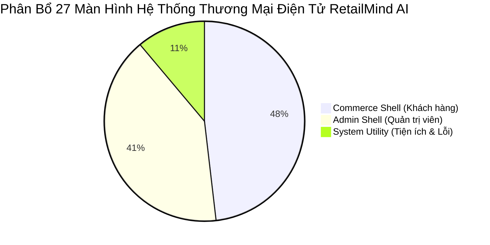
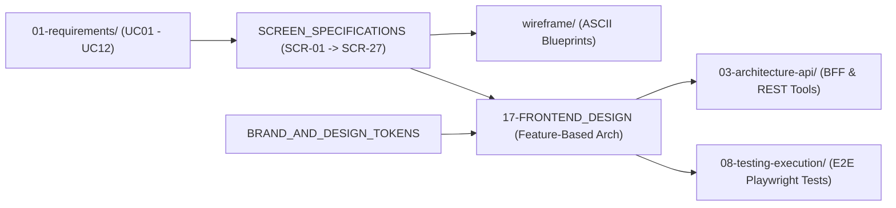

# 💻 Nhóm 06 — Giao Diện & Trải Nghiệm Người Dùng (Frontend & UX Design)

> **Vai trò kỹ thuật:** Frontend Architect / Lead UI-UX Designer / Design System Engineer  
> **Mục tiêu:** Xây dựng kiến trúc giao diện web/mobile client hiện đại, tối ưu hóa trải nghiệm người dùng, phân tách Shell kiến trúc, quản lý server-state bằng TanStack Query, đặc tả chi tiết 27 màn hình chuẩn thương mại điện tử và xây dựng cẩm nang Design Tokens chuẩn mực.

---

## 🗂️ Danh Mục Tài Liệu Thuộc Nhóm 06

| Thứ tự | Tên tài liệu | Mục đích kỹ thuật cốt lõi |
| :---: | :--- | :--- |
| **17** | [`17-FRONTEND_DESIGN.md`](17-FRONTEND_DESIGN.md) | Kiến trúc tổng thể Frontend: Feature-Based Architecture (`features/`), Dual-Shell Layout (Commerce Shell vs Admin Shell), BFF Reverse Proxy (`/api/proxy/[...path]`) với Duplex Streaming, Server Actions (`.action.ts`), Dynamic UI RBAC và Đa ngôn ngữ i18n. |
| **SCR**| [`SCREEN_SPECIFICATIONS.md`](SCREEN_SPECIFICATIONS.md) | Đặc tả chi tiết 27 màn hình thương mại điện tử (`SCR-01` $\rightarrow$ `SCR-27`): Route URL, Phân quyền truy cập 3 Personas, Bố cục Component, Các trạng thái UX (Loading, Empty, Error, Success), API tích hợp và Khóa bi quan CSDL. |
| **DS** | [`BRAND_AND_DESIGN_TOKENS.md`](BRAND_AND_DESIGN_TOKENS.md) | Hệ thống Design System: Design Tokens, Bảng màu (Minimal Tech: Royal Blue, Electric Cyan, Deep Slate, Jade Emerald, Honey Amber, Rose Crimson), Typography, Khoảng cách (Spacing), Micro-animations và Thư viện UI Components. |
| **WF** | [`wireframe/README.md`](wireframe/README.md) | Sơ đồ khung dây (Wireframe Blueprints) trực quan định dạng ASCII Art: Trang Chủ, Danh Mục & Bộ Lọc Đa Chiều, PDP & Tồn Kho Chi Nhánh, AI Advisor Chat, Giỏ Hàng & Checkout SSOT, Admin Dashboard, Quản Lý Tồn Kho và HITL Approval Gate. |

---

## 📊 Phân Bổ 27 Màn Hình Theo Phân Hệ (Screen Distribution)

* **Phân hệ Khách hàng (SCR-01 $\rightarrow$ SCR-13)**: Auth, Trang chủ, Danh mục lọc đa chiều, Chi tiết sản phẩm PDP, So sánh đối đầu 4 máy, AI Shopping Advisor (SSE streaming), Giỏ hàng Decimal, Checkout khóa tồn, Biên nhận đơn hàng, Lịch sử & Theo dõi vận chuyển, Cổng bảo hành 30 ngày, Ticket khiếu nại, Trung tâm quyền riêng tư PII NĐ 13/2023.
* **Phân hệ Quản trị (SCR-14 $\rightarrow$ SCR-24)**: Dashboard doanh thu & FinOps, PIM quản lý sản phẩm/SKU, Ma trận tồn kho chi nhánh, OMS quản lý đơn hàng, HITL Governance Gate, Quản trị tri thức RAG & Qdrant, Khuyến mãi & Quy tắc giá SSOT, Arize Phoenix Tracing, Sổ cái bất biến SHA-256 & RBAC, Quản lý siêu thị MWG Hubs, Cấu hình Resilience.
* **Phân hệ Tiện ích & Lỗi (SCR-25 $\rightarrow$ SCR-27)**: Trang 404 Not Found, Trang 500 Tự phục hồi Graceful Degradation (Zero-500 Guarantee), Trang Báo cáo sức khỏe dịch vụ (Service Health Dashboard).

---

## 🔗 Liên Kết Truy Xuất (Traceability Flow)

