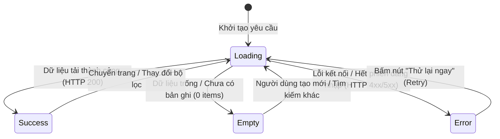

# 📱 Screen Specifications & UI Component Design (Đặc Tả Chi Tiết Màn Hình)

**Dự án**: RetailMind AI — Production-Oriented Agentic Retail Intelligence Platform  
**Tài liệu**: `enterprise-docs/docs/06-frontend/SCREEN_SPECIFICATIONS.md`  
**Phiên bản**: Production 2026 Edition  
**Quy chuẩn kiến trúc**: Next.js 16+ App Router, React 19, TypeScript Strict, TailwindCSS, Dual-Shell Layout  
**Căn cứ đặc tả**: `AGENTS.md`, `01_PRODUCT_VISION_AND_SCOPE.md`, `02_USE_CASES_AND_WORKFLOWS.md`, `09-DATABASE_DESIGN.md`  
**Trạng thái**: Approved for Architecture Baseline (Production 2026 Edition)  

---

## 📑 MỤC LỤC TỔNG QUAN

1. [Bảng Danh Mục 27 Màn Hình Chuẩn Thương Mại Điện Tử (Screen Master Matrix)](#1-bảng-danh-mục-27-màn-hình-chuẩn-thương-mại-điện-tử-screen-master-matrix)
2. [Phân Hệ Khách Hàng (Commerce Shell — Guest & Customer Journey)](#2-phân-hệ-khách-hàng-commerce-shell--guest--customer-journey)
   - [SCR-01: Xác Thực & Quản Lý Truy Cập (Auth Portal)](#scr-01-xác-thực--quản-lý-truy-cập-auth-portal)
   - [SCR-02: Trang Chủ & Tìm Kiếm Ngữ Nghĩa (Landing & Smart Search)](#scr-02-trang-chủ--tìm-kiếm-ngữ-nghĩa-landing--smart-search)
   - [SCR-03: Danh Mục Sản Phẩm & Bộ Lọc Nâng Cao (Product Catalog)](#scr-03-danh-mục-sản-phẩm--bộ-lọc-nâng-cao-product-catalog)
   - [SCR-04: Chi Tiết Sản Phẩm & Tồn Kho Chi Nhánh (Product Detail Page - PDP)](#scr-04-chi-tiết-sản-phẩm--tồn-kho-chi-nhánh-product-detail-page---pdp)
   - [SCR-05: Ma Trận So Sánh Kỹ Thuật Đối Đầu (Side-by-Side Comparison)](#scr-05-ma-trận-so-sánh-kỹ-thuật-đối-đầu-side-by-side-comparison)
   - [SCR-06: Cửa Sổ Trợ Lý Tư Vấn Thông Minh (AI Agentic Shopping Advisor)](#scr-06-cửa-sổ-trợ-lý-tư-vấn-thông-minh-ai-agentic-shopping-advisor)
   - [SCR-07: Giỏ Hàng & Tính Toán Số Học Chính Xác (Shopping Cart)](#scr-07-giỏ-hàng--tính-toán-số-học-chính-xác-shopping-cart)
   - [SCR-08: Đặt Hàng Đa Bước & Chọn Điểm Nhận Siêu Thị (Checkout & Store Hub)](#scr-08-đặt-hàng-đa-bước--chọn-điểm-nhận-siêu-thị-checkout--store-hub)
   - [SCR-09: Xác Nhận Đơn Hàng & Biên Nhận Khóa Tồn (Order Receipt)](#scr-09-xác-nhận-đơn-hàng--biên-nhận-khóa-tồn-order-receipt)
   - [SCR-10: Lịch Sử Đơn Hàng & Theo Dõi Hành Trình (Order Tracking)](#scr-10-lịch-sử-đơn-hàng--theo-dõi-hành-trình-order-tracking)
   - [SCR-11: Cổng Bảo Hành Điện Tử & Đổi Trả 30 Ngày (Warranty Portal)](#scr-11-cổng-bảo-hành-điện-tử--đổi-trả-30-ngày-warranty-portal)
   - [SCR-12: Trung Tâm Hỗ Trợ Khách Hàng & Ticket (Support Center)](#scr-12-trung-tâm-hỗ-trợ-khách-hàng--ticket-support-center)
   - [SCR-13: Hồ Sơ Khách Hàng & Quyền Riêng Tư PII (Privacy Center)](#scr-13-hồ-sơ-khách-hàng--quyền-riêng-tư-pii-privacy-center)
3. [Phân Hệ Quản Trị Bán Lẻ & Vận Hành (Admin Shell — Operations & Governance)](#3-phân-hệ-quản-trị-bán-lẻ--vận-hành-admin-shell--operations--governance)
   - [SCR-14: Bảng Điều Khiển Tổng Quan & Chỉ Số FinOps (Admin Dashboard)](#scr-14-bảng-điều-khiển-tổng-quan--chỉ-số-finops-admin-dashboard)
   - [SCR-15: Quản Lý Sản Phẩm & Biến Thể Laptop (PIM Hub)](#scr-15-quản-lý-sản-phẩm--biến-thể-laptop-pim-hub)
   - [SCR-16: Ma Trận Tồn Kho Đa Chi Nhánh (Branch Inventory Hub)](#scr-16-ma-trận-tồn-kho-đa-chi-nhánh-branch-inventory-hub)
   - [SCR-17: Quản Lý Đơn Hàng & Điều Phối Giao Hàng (OMS Hub)](#scr-17-quản-lý-đơn-hàng--điều-phối-giao-hàng-oms-hub)
   - [SCR-18: Cổng Phê Duyệt Tác Vụ Con Người (HITL Approval Gate)](#scr-18-cổng-phê-duyệt-tác-vụ-con-người-hitl-approval-gate)
   - [SCR-19: Quản Trị Kho Tri Thức RAG & Qdrant (Knowledge Hub)](#scr-19-quản-trị-kho-tri-thức-rag--qdrant-knowledge-hub)
   - [SCR-20: Cấu Hình Khuyến Mãi & Quy Tắc Giá SSOT (Promotion Engine)](#scr-20-cấu-hình-khuyến-mãi--quy-tắc-giá-ssot-promotion-engine)
   - [SCR-21: Giám Sát Độ Trễ LLM & Arize Phoenix (Observability Traces)](#scr-21-giám-sát-độ-trễ-llm--arize-phoenix-observability-traces)
   - [SCR-22: Sổ Cái Bất Biến SHA-256 & Phân Quyền RBAC (Audit & RBAC)](#scr-22-sổ-cái-bất-biến-sha-256--phân-quyền-rbac-audit--rbac)
   - [SCR-23: Quản Lý Chi Nhánh & Điểm Bán Siêu Thị MWG (Store Hubs)](#scr-23-quản-lý-chi-nhánh--điểm-bán-siêu-thị-mwg-store-hubs)
   - [SCR-24: Cấu Hình Hệ Thống & Khả Năng Tự Phục Hồi (Resilience Settings)](#scr-24-cấu-hình-hệ-thống--khả-năng-tự-phục-hồi-resilience-settings)
4. [Phân Hệ Tiện Ích & Trạng Thái Hệ Thống (System States & Fallbacks)](#4-phân-hệ-tiện-ích--trạng-thái-hệ-thống-system-states--fallbacks)
   - [SCR-25: Trang Lỗi 404 Không Tìm Thấy Trang (Not Found Page)](#scr-25-trang-lỗi-404-không-tìm-thấy-trang-not-found-page)
   - [SCR-26: Trang Lỗi 500 & Tự Phục Hồi Graceful Degradation](#scr-26-trang-lỗi-500--tự-phục-hồi-graceful-degradation)
   - [SCR-27: Trang Báo Cáo Sức Khỏe Dịch Vụ (Service Health Dashboard)](#scr-27-trang-báo-cáo-sức-khỏe-dịch-vụ-service-health-dashboard)
5. [Quy Chuẩn Trạng Thái UX Cốt Lõi (Core UX States & Micro-interactions)](#5-quy-chuẩn-trạng-thái-ux-cốt-lõi-core-ux-states--micro-interactions)

---

## 1. BẢNG DANH MỤC 27 MÀN HÌNH CHUẨN THƯƠNG MẠI ĐIỆN TỬ (SCREEN MASTER MATRIX)

Toàn bộ 27 màn hình được phân loại chặt chẽ theo 3 Personas (`Guest`, `Customer`, `Admin`), 2 Layout Shells (`Commerce Shell`, `Admin Shell`) và ánh xạ 1-1 với 12 Use Cases của dự án:

| Mã MH | Tên Màn Hình Nghiệp Vụ | Đường Dẫn URL | Vai Trò (Role) | Layout Shell | Use Case Ánh Xạ | API Endpoint Tích Hợp |
| :---: | :--- | :--- | :---: | :---: | :---: | :--- |
| **`SCR-01`** | Đăng Nhập / Đăng Ký / Quên MK | `/login`, `/register`, `/forgot` | Public | Auth Shell | UC11 | `POST /api/v1/auth/login` `POST /api/v1/auth/register` |
| **`SCR-02`** | Trang Chủ & Tìm Kiếm Ngữ Nghĩa | `/` | Guest, Customer | Commerce Shell | UC01, UC02 | `GET /api/v1/products/featured` `POST /api/v1/search/semantic` |
| **`SCR-03`** | Danh Mục Laptop & Bộ Lọc Đa Chiều | `/catalog`, `/products` | Guest, Customer | Commerce Shell | UC02 | `GET /api/v1/products` `GET /api/v1/categories` |
| **`SCR-04`** | Chi Tiết Laptop & Tồn Kho Chi Nhánh | `/products/[sku]` | Guest, Customer | Commerce Shell | UC02, UC06 | `GET /api/v1/products/{sku}` `GET /api/v1/inventory/availability` |
| **`SCR-05`** | Ma Trận So Sánh Kỹ Thuật Đối Đầu | `/compare` | Guest, Customer | Commerce Shell | UC02 | `GET /api/v1/products/compare` |
| **`SCR-06`** | Trợ Lý Tư Vấn Trí Tuệ Nhân Tạo AI | Drawer / Floating Widget | Guest, Customer | Commerce Shell | UC01, UC08 | `POST /api/proxy/chat/stream` (SSE) `GET /api/v1/conversations/{id}` |
| **`SCR-07`** | Giỏ Hàng & Tính Toán Bảng Tiền | `/cart` | Customer | Commerce Shell | UC03 | `GET /api/v1/cart` `POST /api/v1/cart/items` |
| **`SCR-08`** | Đặt Hàng & Chọn Điểm Nhận Siêu Thị | `/checkout` | Customer | Commerce Shell | UC03, UC06 | `POST /api/proxy/orders/checkout` `GET /api/v1/stores` |
| **`SCR-09`** | Biên Nhận Đơn Hàng & Khóa Tồn | `/checkout/success`, `/orders/[id]/receipt` | Customer | Commerce Shell | UC03 | `GET /api/v1/orders/{id}` |
| **`SCR-10`** | Lịch Sử Đơn Hàng & Tra Cứu Vận Chuyển | `/orders`, `/orders/[id]` | Customer | Commerce Shell | UC04 | `GET /api/v1/orders` `POST /api/v1/orders/{id}/cancel` |
| **`SCR-11`** | Cổng Bảo Hành & Đổi Trả 30 Ngày | `/warranty`, `/warranty/[serial]` | Customer | Commerce Shell | UC04, UC05 | `GET /api/v1/warranty/lookup` `POST /api/v1/warranty/claims` |
| **`SCR-12`** | Trung Tâm Hỗ Trợ & Phiếu Khiếu Nại | `/support`, `/support/tickets` | Customer | Commerce Shell | UC05 | `GET/POST /api/v1/support/tickets` `GET /api/v1/support/faqs` |
| **`SCR-13`** | Hồ Sơ Khách Hàng & Quyền Riêng Tư | `/profile`, `/profile/privacy` | Customer | Commerce Shell | UC11 | `GET/PUT /api/v1/users/profile` `POST /api/v1/privacy/export-data` |
| **`SCR-14`** | Bảng Điều Khiển Tổng Quan & FinOps | `/admin`, `/admin/dashboard` | Admin | Admin Shell | UC09, UC12 | `GET /api/v1/admin/analytics/overview` `GET /api/v1/admin/finops/ledger` |
| **`SCR-15`** | Quản Lý Sản Phẩm & Biến Thể SKU | `/admin/catalog`, `/admin/products` | Admin | Admin Shell | UC02 | `GET/POST/PUT /api/v1/admin/products` `POST /api/v1/admin/variants` |
| **`SCR-16`** | Quản Lý Tồn Kho Chi Nhánh Đa Kênh | `/admin/inventory` | Admin | Admin Shell | UC06 | `GET /api/v1/admin/inventory` `PUT /api/v1/admin/inventory/adjust` |
| **`SCR-17`** | Quản Lý Đơn Hàng & Điều Phối Kho | `/admin/orders`, `/admin/orders/[id]` | Admin | Admin Shell | UC03, UC04 | `GET /api/v1/admin/orders` `PUT /api/v1/admin/orders/{id}/status` |
| **`SCR-18`** | Cổng Duyệt Tác Vụ Con Người HITL | `/admin/hitl`, `/admin/hitl/[taskId]` | Admin | Admin Shell | UC07 | `GET /api/v1/admin/hitl/queue` `POST /api/v1/admin/hitl/{id}/action` |
| **`SCR-19`** | Quản Trị Tri Thức RAG & Chỉ Mục Qdrant | `/admin/knowledge` | Admin | Admin Shell | UC08 | `GET /api/v1/admin/knowledge/docs` `POST /api/v1/admin/knowledge/sync` |
| **`SCR-20`** | Khuyến Mãi & Quy Tắc Giá SSOT | `/admin/promotions` | Admin | Admin Shell | UC10 | `GET/POST /api/v1/admin/promotions` `PUT /api/v1/admin/promotions/{id}` |
| **`SCR-21`** | Giám Sát Arize Phoenix & OTel Traces | `/admin/observability` | Admin | Admin Shell | UC09 | `GET /api/v1/admin/observability/traces` `GET http://localhost:6006` |
| **`SCR-22`** | Sổ Cái SHA-256 & Ma Trận Phân Quyền | `/admin/audit-logs`, `/admin/rbac` | Admin | Admin Shell | UC11, UC12 | `GET /api/v1/admin/audit-ledger` `GET/PUT /api/v1/admin/rbac/roles` |
| **`SCR-23`** | Quản Lý Chi Nhánh & Điểm Bán Siêu Thị | `/admin/stores` | Admin | Admin Shell | UC06 | `GET/POST/PUT /api/v1/admin/stores` |
| **`SCR-24`** | Cài Đặt Hệ Thống & Khả Năng Chống Chịu | `/admin/settings` | Admin | Admin Shell | UC12 | `GET/PUT /api/v1/admin/settings/resilience` |
| **`SCR-25`** | Trang Lỗi 404 Không Tìm Thấy | `/_not-found`, `/404` | Public | Utility Shell | All | N/A |
| **`SCR-26`** | Trang Lỗi 500 Tự Phục Hồi Graceful | `/500` | Public | Utility Shell | All | N/A |
| **`SCR-27`** | Trang Báo Cáo Sức Khỏe Dịch Vụ | `/status` | Public | Utility Shell | UC09 | `GET /api/v1/health` |

---

## 2. PHÂN HỆ KHÁCH HÀNG (COMMERCE SHELL — GUEST & CUSTOMER JOURNEY)

### SCR-01: Xác Thực & Quản Lý Truy Cập (Auth Portal)
- **Mục tiêu**: Đăng nhập, đăng ký tài khoản khách hàng, phục hồi mật khẩu bảo mật. Bảo vệ mật khẩu theo chuẩn Argon2id, nhận cặp Access Token (15 phút) và Refresh Token trong cookie HttpOnly.
- **Bố cục chính**:
  - Khung kính mờ (Glassmorphism card) đặt trên nền hoa văn `FoldedRibbonMeshPattern`.
  - Form nhập Email/Số điện thoại (tự động nhận diện chuẩn vi-VN), Mật khẩu có nút ẩn/hiện mắt kính.
  - Checkbox "Ghi nhớ đăng nhập", liên kết "Quên mật khẩu?", nút mạng xã hội (Google SSO, Apple ID).
- **Trạng thái UX**:
  - *Loading*: Nút bấm hiển thị vòng quay `RefreshCw` và text *"Đang xác thực an toàn..."*.
  - *Error*: Banner hồng ngọc `ts-badge-danger` báo sai mật khẩu hoặc tài khoản tạm khóa.

---

### SCR-02: Trang Chủ & Tìm Kiếm Ngữ Nghĩa (Landing & Smart Search)
- **Mục tiêu**: Điểm chạm đầu tiên tạo ấn tượng "WOW" cho khách hàng với triết lý Minimal Tech / Cyber-Retail.
- **Bố cục chính**:
  - **Hero Section**: Tiêu đề Display H1 cách điệu, khẩu hiệu *"Trí Tuệ Bán Lẻ Đa Kênh — Mua Sắm Chuẩn Xác"*, tranh minh họa 3D `hero-exam-orbit-3d.png` xoay nhẹ nhàng.
  - **Thanh Tìm Kiếm Ngữ Nghĩa (Omni Search Bar)**: Gõ tự nhiên bằng tiếng Việt (ví dụ: *"laptop dưới 20 triệu cho sinh viên kinh tế pin trâu"*), hệ thống tự bóc tách entity qua Semantic Parser.
  - **Banner Ưu Đãi & Đổi Trả 30 Ngày**: 3 huy hiệu cam kết vàng (Đổi mới 30 ngày miễn phí, Bảo hành 24 tháng chính hãng, Giá niêm yết PostgreSQL SSOT).
  - **Lưới Sản Phẩm Tiêu Biểu**: 8 mẫu laptop thịnh hành với thông số kỹ thuật tóm tắt.

---

### SCR-03: Danh Mục Laptop & Bộ Lọc Đa Chiều (Product Catalog)
- **Mục tiêu**: Cho phép khách hàng duyệt, tìm kiếm và lọc danh mục laptop theo hàng chục tiêu chí kỹ thuật phức tạp trong thời gian dưới 100ms.
- **Bố cục chính**:
  - **Sidebar Bộ Lọc Đa Chiều (Faceted Filters)**:
    - *Khoảng giá (Price Slider)*: Từ 10.000.000 ₫ đến 60.000.000 ₫ (định dạng VNĐ `formatVND()`).
    - *Thương hiệu*: Asus, Dell, Lenovo, Apple, HP, Acer, MSI.
    - *Dung lượng RAM*: 8GB, 16GB, 32GB, 64GB.
    - *Vi xử lý (CPU)*: Intel Core i5/i7/Ultra, AMD Ryzen 5/7, Apple Silicon M2/M3.
    - *Nhu cầu sử dụng*: Học tập - Văn phòng, Đồ họa - Kỹ thuật, Gaming, Mỏng nhẹ cao cấp.
    - *Tình trạng hàng*: Chỉ hiện sản phẩm còn hàng tại chi nhánh gần tôi.
  - **Lưới Thẻ Laptop (`.ts-feature-card`)**: Ảnh render 3D, nhãn giá niêm yết SSOT, RAM badge, nút so sánh nhanh, nút thêm vào giỏ.

---

### SCR-04: Chi Tiết Sản Phẩm & Tồn Kho Chi Nhánh (Product Detail Page - PDP)
- **Mục tiêu**: Cung cấp toàn diện thông số kỹ thuật, bảo đảm khách hàng hiểu rõ từng linh kiện trước khi ra quyết định mua hàng.
- **Bố cục chính**:
  - **Bộ Sưu Tập Hình Ảnh Đa Chiều**: Khung hiển thị ảnh lớn có zoom kính lúp, thumbnail 3D góc xoay.
  - **Khối Giá & Khuyến Mãi (SSOT)**: Giá niêm yết in đậm chữ lớn, số tiền tiết kiệm, mã giảm giá áp dụng được.
  - **Bản Đồ Tồn Kho Chi Nhánh (Branch Stock Availability Matrix)**:
    - Nhập địa chỉ hoặc chọn tỉnh/thành (Hà Nội, TP.HCM, Đà Nẵng).
    - Danh sách các siêu thị kèm số lượng máy sẵn sàng (ví dụ: *136 Nguyễn Thái Học, Q.1: Còn 12 máy*).
  - **Bảng Thông Số Kỹ Thuật Đầy Đủ**: Bảng accordion phân loại rõ ràng: Vi xử lý, Bộ nhớ & Ổ cứng, Màn hình, Đồ họa, Cổng kết nối, Trọng lượng & Pin.
  - **Chính Sách Đổi Mới & Bảo Hành Cam Kết**: Thẻ thông tin trích xuất trực tiếp từ quy chế bán lẻ MWG.

---

### SCR-05: Ma Trận So Sánh Kỹ Thuật Đối Đầu (Side-by-Side Comparison)
- **Mục tiêu**: So sánh trực diện từ 2 đến 4 mẫu laptop trên cùng một màn hình để khách hàng phân định ưu nhược điểm kỹ thuật rõ ràng.
- **Bố cục chính**:
  - Thanh ghim cố định tiêu đề & ảnh sản phẩm khi cuộn trang.
  - Bảng so sánh đa tầng:
    - *Hàng giá tiền*: Làm nổi bật máy có giá tốt nhất bằng nhãn xanh Jade.
    - *Hàng hiệu năng*: Đánh giá CPU Score, RAM Bus speed, TGP của card đồ họa.
    - *Hàng màn hình*: Tần số quét, độ phủ màu sRGB/DCI-P3, độ sáng nits.
    - *Hàng thời lượng pin & trọng lượng*: Trực quan hóa bằng thanh tiến trình ngang.
  - Nút chuyển đổi nhanh *"Chỉ xem điểm khác biệt"* giúp loại bỏ các thông số trùng lặp.

---

### SCR-06: Cửa Sổ Trợ Lý Tư Vấn Thông Minh (AI Agentic Shopping Advisor)
- **Mục tiêu**: Trải nghiệm tư vấn trực tuyến tương đương nhân viên kỹ thuật bán hàng chuyên nghiệp tại cửa hàng MWG.
- **Bố cục chính**:
  - Drawer trượt mượt mà từ cạnh phải hoặc giao diện trang toàn màn hình.
  - Luồng streaming phản hồi token chữ hiển thị dần theo Server-Sent Events (SSE).
  - **Thẻ Trích Dẫn Chính Sách (RAG Citations)**: Trích xuất chính sách bảo hành, đổi trả, trần phạt Điều 301 Luật Thương Mại kèm Grounding Score (độ trung thực > 90%).
  - **Thẻ Gợi Ý Sản Phẩm Động**: Thẻ laptop nhỏ gọn nhúng thẳng vào dòng chat, bấm nút *"Đặt Mua Ngay"* hoặc *"Xem Chi Tiết"* trực tiếp mà không ngắt hội thoại.
  - **Harness Audit Trail**: Hộp kiểm toán hiển thị minh bạch 10 tầng phòng thủ và suy luận của Agent.

---

### SCR-07: Giỏ Hàng & Tính Toán Số Học Chính Xác (Shopping Cart)
- **Mục tiêu**: Quản lý danh sách sản phẩm dự định mua, tính toán tiền hàng chuẩn xác tuyệt đối qua thư viện `decimal.js` / kiểu `NUMERIC(18,0)` để triệt tiêu sai số dấu phẩy động.
- **Bố cục chính**:
  - Danh sách từng mục sản phẩm: Ảnh, SKU, Tên biến thể, Đơn giá, Bộ tăng/giảm số lượng (+/-) có chặn số lượng khả dụng tại kho.
  - Ô nhập mã ưu đãi (Discount Voucher) với cơ chế kiểm tra điều kiện áp dụng tức thời.
  - **Bảng Phân Tách Tiền Tệ Minh Bạch**:
    - *Tạm tính (Subtotal)*: Tổng giá sản phẩm.
    - *Chiết khấu (Discount)*: Số tiền giảm trừ hợp lệ.
    - *Thuế Giá Trị Gia Tăng (VAT 10%)*: Tính chuẩn theo quy định Bộ Tài Chính.
    - *Tổng thanh toán cuối cùng (Grand Total)*: Số tiền VNĐ chính xác.
  - Nút bấm chính `.ts-cta`: *"Tiến Hành Đặt Hàng"*.

---

### SCR-08: Đặt Hàng Đa Bước & Chọn Điểm Nhận Siêu Thị (Checkout & Store Hub)
- **Mục tiêu**: Khách hàng hoàn tất thông tin giao nhận trong tối đa 3 bước với trải nghiệm mượt mà, áp dụng khóa bi quan tạm giữ hàng.
- **Bố cục chính**:
  - **Bước 1: Hình Thức Nhận Hàng**:
    - *Tùy chọn A*: Nhận tại siêu thị MWG gần nhất (Bản đồ chọn điểm bán, kiểm tra tồn kho tại chỗ).
    - *Tùy chọn B*: Giao hàng tận nơi miễn phí (Nhập họ tên, SĐT, Tỉnh/Thành, Quận/Huyện, Địa chỉ).
  - **Bước 2: Phương Thức Thanh Toán**:
    - Thanh toán khi nhận hàng (COD).
    - Chuyển khoản QR Napas247 tự động nhận diện mã đơn.
    - Thẻ ATM nội địa / Thẻ quốc tế Visa, Mastercard.
  - **Bước 3: Xác Nhận Cuối & Khóa Tồn Kho**:
    - Đếm ngược hiệu lực giữ tồn kho khả dụng (10 phút).
    - Nút bấm chốt đơn được bảo vệ nghiêm ngặt bởi `Idempotency-Key` (chặn bấm đúp 100%).

---

### SCR-09: Biên Nhận Đơn Hàng & Khóa Tồn (Order Receipt)
- **Mục tiêu**: Xác nhận giao dịch thành công, cấp mã đơn hàng chính thức và cung cấp hướng dẫn nhận hàng chi tiết.
- **Bố cục chính**:
  - Huy hiệu thành công màu xanh Jade kèm âm thanh vi tương tác nhẹ nhàng.
  - Mã đơn hàng dạng chữ hoa nổi bật: `MWG-YYYYMMDD-XXXX`.
  - Thông tin điểm nhận hàng hoặc địa chỉ giao, thời gian dự kiến sẵn sàng nhận máy (trong vòng 1 giờ đối với nhận tại siêu thị).
  - Tải biên nhận đơn hàng PDF hoặc mã QR nhận hàng tại quầy siêu thị.

---

### SCR-10: Lịch Sử Đơn Hàng & Tra Cứu Vận Chuyển (Order Tracking)
- **Mục tiêu**: Khách hàng chủ động theo dõi toàn bộ các đơn hàng đã đặt, tiến độ giao nhận và snapshot cấu hình tại thời điểm mua.
- **Bố cục chính**:
  - Danh sách đơn hàng phân chia theo tab: Tất cả, Đang xử lý, Đang vận chuyển, Hoàn thành, Đã hủy.
  - **Thanh Tiến Trình Giao Hàng Trực Quan (Order Stepper)**:
    - `1. Đã đặt hàng` $\rightarrow$ `2. Đã xác nhận & Giữ kho` $\rightarrow$ `3. Đang đóng gói` $\rightarrow$ `4. Đang giao hàng` $\rightarrow$ `5. Hoàn tất`.
  - Nút bấm hành động: *"Hủy đơn hàng"* (nếu chưa xuất kho), *"Tải hóa đơn VAT điện tử"*, *"Yêu cầu bảo hành / đổi trả"*.

---

### SCR-11: Cổng Bảo Hành Điện Tử & Đổi Trả 30 Ngày (Warranty Portal)
- **Mục tiêu**: Tra cứu thời hạn bảo hành chính hãng theo số Serial/IMEI máy, tạo yêu cầu đổi mới trong 30 ngày nếu phát sinh lỗi kỹ thuật.
- **Bố cục chính**:
  - Ô tra cứu nhanh theo Serial Number hoặc Mã hóa đơn.
  - Thẻ thông tin bảo hành: Ngày kích hoạt, Ngày hết hạn bảo hành 24 tháng, Số ngày còn lại trong chính sách đổi trả 30 ngày miễn phí.
  - Nút gửi yêu cầu thẩm định lỗi kỹ thuật để đổi máy mới.

---

### SCR-12: Trung Tâm Hỗ Trợ Khách Hàng & Ticket (Support Center)
- **Mục tiêu**: Kênh tiếp nhận và giải quyết khiếu nại, sự cố đơn hàng hoặc tư vấn kỹ thuật chuyên sâu.
- **Bố cục chính**:
  - Danh sách câu hỏi thường gặp (FAQ Accordion) có thể tìm kiếm theo từ khóa.
  - Form tạo phiếu hỗ trợ (Ticket): Chọn đơn hàng liên quan, loại vấn đề (Giao trễ, Lỗi phần cứng, Khiếu nại thái độ phục vụ), đính kèm ảnh lỗi.
  - Lịch sử phản hồi từ đội ngũ CSKH MWG theo thời gian thực.

---

### SCR-13: Hồ Sơ Khách Hàng & Quyền Riêng Tư (Privacy Center)
- **Mục tiêu**: Quản lý thông tin tài khoản và thực thi quyền của chủ thể dữ liệu theo Luật Bảo vệ dữ liệu cá nhân 91/2025/QH15 và Nghị định 13/2023/NĐ-CP.
- **Bố cục chính**:
  - Thông tin cá nhân cơ bản: Họ tên, Email, Số điện thoại (ẩn 3 số giữa để bảo vệ PII).
  - Sổ địa chỉ giao hàng (Mặc định, Cơ quan, Nhà riêng).
  - **Trung Tâm Quyền Riêng Tư (Privacy Control)**:
    - Nút bấm *"Tải về toàn bộ dữ liệu cá nhân của tôi"* (Data Portability).
    - Nút bấm *"Yêu cầu xóa tài khoản & làm sạch dữ liệu PII"* (Right to be Forgotten).

---

## 3. PHÂN HỆ QUẢN TRỊ BÁN LẺ & VẬN HÀNH (ADMIN SHELL — OPERATIONS & GOVERNANCE)

### SCR-14: Bảng Điều Khiển Tổng Quan & Chỉ Số FinOps (Admin Dashboard)
- **Mục tiêu**: Cung cấp bức tranh toàn cảnh về doanh số bán lẻ, tình hình đơn hàng và chi phí vận hành AI (FinOps Telemetry).
- **Bố cục chính**:
  - **4 Thẻ Chỉ Số Cốt Lõi (KPI Cards)**:
    - *Doanh thu hôm nay (VNĐ)*: Tăng trưởng so với ngày hôm qua.
    - *Tổng đơn hàng mới*: Số đơn cần xử lý ngay.
    - *Chi phí Token suy luận AI*: Tính theo USD/VNĐ từ DuckDB FinOps Ledger.
    - *Tỷ lệ hội thoại AI chuyển đổi thành công (Conversion Rate)*: % người dùng mua máy sau khi chat với Advisor.
  - Biểu đồ phổ doanh số theo phân khúc laptop và biểu đồ chi phí token LLM theo thời gian thực.
  - Bảng top 5 sản phẩm bán chạy nhất trong ngày.

---

### SCR-15: Quản Lý Sản Phẩm & Biến Thể Laptop (PIM Hub)
- **Mục tiêu**: Thêm mới, chỉnh sửa thông số kỹ thuật, quản lý giá niêm yết duy nhất từ PostgreSQL SSOT.
- **Bố cục chính**:
  - Bảng danh mục sản phẩm có phân trang, tìm kiếm SKU, lọc theo hãng máy.
  - Modal/Form thêm mới sản phẩm:
    - Tên máy, Thương hiệu, Phân khúc người dùng.
    - Danh sách biến thể (Variants): Mã SKU, CPU, RAM, Ổ cứng, Card đồ họa, Giá niêm yết `NUMERIC(18,0)`.
    - Danh sách các đặc điểm nổi bật (Highlights) phục vụ cho Agentic RAG.
  - Thao tác khóa/mở bán sản phẩm trên toàn hệ thống tức thì.

---

### SCR-16: Ma Trận Tồn Kho Đa Chi Nhánh (Branch Inventory Hub)
- **Mục tiêu**: Kiểm soát tồn kho vật lý, số lượng đang tạm giữ cho đơn hàng chờ thanh toán, và số lượng khả dụng bán ra tại từng chi nhánh siêu thị.
- **Bố cục chính**:
  - Bộ lọc chọn chi nhánh siêu thị (MWG_HCM_001, MWG_HN_002, MWG_DN_003).
  - **Ma Trận Bảng Tồn Kho**:
    - Cột SKU & Tên sản phẩm.
    - Cột Tồn vật lý (Physical Stock).
    - Cột Đang giữ chỗ (Reserved Stock - Khóa bi quan).
    - Cột Tồn khả dụng (Available Stock = Physical - Reserved).
    - Cột Ngưỡng an toàn (Safety Threshold): Đổi màu cảnh báo vàng nếu dưới ngưỡng.
  - Nút điều chỉnh kiểm kê định kỳ có lưu vết kiểm toán bắt buộc.

---

### SCR-17: Quản Lý Đơn Hàng & Điều Phối Kho (OMS Hub)
- **Mục tiêu**: Tiếp nhận đơn hàng mới, kiểm soát trạng thái thanh toán, chỉ định xuất kho từ chi nhánh gần khách hàng nhất.
- **Bố cục chính**:
  - Bảng danh sách đơn hàng toàn quốc: Mã đơn, Thời gian tạo, Tên khách hàng, Tổng tiền, Trạng thái đơn, Chi nhánh phụ trách.
  - Chi tiết đơn hàng: Xem danh mục sản phẩm, đối chiếu `Idempotency-Key`, kiểm tra snapshot giá lúc mua.
  - Thao tác chuyển đổi trạng thái: *Xác nhận $\rightarrow$ Xuất kho $\rightarrow$ Giao hàng $\rightarrow$ Hoàn tất*.

---

### SCR-18: Cổng Phê Duyệt Tác Vụ Con Người (HITL Approval Gate)
- **Mục tiêu**: Hàng đợi phê duyệt các hành động nhạy cảm vượt hạn mức tự động của Agent (như bồi hoàn tiền hàng > 200.000 VNĐ, đổi máy ngoài 30 ngày) theo Điều 10 Đạo luật AI.
- **Bố cục chính**:
  - Danh sách tác vụ đang chờ duyệt (`status: PENDING`) với nhãn nhấp nháy cảnh báo.
  - Thẻ thông tin chi tiết:
    - *Khách hàng liên quan & Đơn hàng*.
    - *Hành động nhạy cảm đề xuất*: Ví dụ *"Bồi hoàn 500.000 VNĐ vào ví khách"*.
    - *Lý do kích hoạt HITL*: Trích dẫn ngưỡng an toàn và lý do phát sinh sự cố.
  - 2 nút bấm thao tác có xác thực mật khẩu quản trị: *"Phê Duyệt Cho Phép Thực Thi"* hoặc *"Từ Chối Yêu Cầu"*.

---

### SCR-19: Quản Trị Kho Tri Thức RAG & Qdrant (Knowledge Hub)
- **Mục tiêu**: Tải lên chính sách bán lẻ, quy chuẩn kỹ thuật sản phẩm, đồng bộ hóa sang Vector DB Qdrant với chỉ mục HNSW Cosine Distance.
- **Bố cục chính**:
  - Khu vực kéo thả tải lên văn bản chính sách (`.md`, `.txt`, `.pdf`).
  - Hệ thống tự động băm mã toàn vẹn SHA-256 để quản lý phiên bản tài liệu (Doc Versioning).
  - Bảng danh mục tài liệu đã chỉ mục: Tên tài liệu, Bộ sưu tập Qdrant, Số lượng Chunks, Kích thước Vector (768 chiều), Thời gian đồng bộ lần cuối.
  - Nút bấm *"Đồng Bộ Lại Toàn Bộ Qdrant"* (Re-index) kích hoạt tiến trình chạy ngầm.

---

### SCR-20: Cấu Hình Khuyến Mãi & Quy Tắc Giá SSOT (Promotion Engine)
- **Mục tiêu**: Tạo lập các chương trình khuyến mãi, mã voucher giảm giá, bảo đảm không bị âm giá hoặc chồng chéo khuyến mãi sai quy định.
- **Bố cục chính**:
  - Danh sách mã khuyến mãi đang kích hoạt và đã hết hạn.
  - Form tạo mã mới:
    - Mã voucher (VD: `MWG_VIP500`).
    - Hình thức: Giảm tiền cố định (VNĐ) hoặc Giảm theo tỷ lệ phần trăm (%) có chặn trần tối đa.
    - Giá trị đơn hàng tối thiểu áp dụng.
    - Giới hạn số lượt dùng toàn hệ thống & Số lượt dùng tối đa trên mỗi khách hàng.
    - Khoảng thời gian hiệu lực từ ngày đến ngày.

---

### SCR-21: Giám Sát Arize Phoenix & OTel Traces (Observability Traces)
- **Mục tiêu**: Giám sát sâu chuỗi suy luận của Agentic LLM (Spans, Tokens, Latency) và các lần gọi công cụ Tool Calling.
- **Bố cục chính**:
  - Nhúng trực tiếp hoặc liên kết sang giao diện Arize Phoenix UI (cổng 6006).
  - Bảng tóm tắt các Spans gần nhất: Trace ID, Tên hàm/Công cụ (`check_laptop_stock`, `calculate_cart_preview`), Thời gian thực thi (ms), Lượng token tiêu thụ.
  - Bộ lọc xem các trace có độ trễ cao (> 500ms) hoặc có lỗi cảnh báo.

---

### SCR-22: Sổ Cái Bất Biến SHA-256 & Phân Quyền RBAC (Audit & RBAC)
- **Mục tiêu**: Đảm bảo tính minh bạch, không thể chối bỏ (Non-repudiation) của mọi hành động nhạy cảm trong hệ thống theo cơ chế băm chuỗi liên hoàn.
- **Bố cục chính**:
  - **Tab 1: Sổ Cái Chuỗi Băm Liên Hoàn (Tamper-Evident Hash Chain Ledger)**:
    - Bảng hiển thị: Thời gian, Tác nhân (Actor), Hành động (Action), Đối tượng (Target), Khối băm $H_i = \text{SHA256}(H_{i-1} \parallel \text{Action})$.
    - Nút bấm *"Kiểm Tra Tính Toàn Vẹn Sổ Cái"* quét toàn bộ chuỗi băm để phát hiện can thiệp trái phép.
  - **Tab 2: Ma Trận Phân Quyền 3 Personas (RBAC Matrix)**:
    - Khách vãng lai (`Guest`), Khách hàng (`Customer`), Quản trị viên (`Admin`).
    - Bảng quyền hạn CSDL PostgreSQL và quyền gọi Tool Calling tương ứng.

---

### SCR-23: Quản Lý Chi Nhánh & Điểm Bán Siêu Thị MWG (Store Hubs)
- **Mục tiêu**: Quản lý mạng lưới siêu thị Thế Giới Di Động / Điện Máy Xanh, tọa độ định vị và giờ mở cửa phục vụ chọn điểm nhận hàng.
- **Bố cục chính**:
  - Bản đồ phân bố chi nhánh siêu thị trên toàn quốc.
  - Danh sách chi nhánh: Mã siêu thị (MWG_HCM_001, MWG_HN_002), Tên điểm bán, Địa chỉ chi tiết, Số điện thoại hỗ trợ, Trạng thái hoạt động.
  - Thao tác bật/tắt nhận đơn trực tuyến tại từng điểm bán khi bảo trì hoặc quá tải.

---

### SCR-24: Cấu Hình Hệ Thống & Khả Năng Tự Phục Hồi (Resilience Settings)
- **Mục tiêu**: Thiết lập các tham số bảo vệ hệ thống: Cửa sổ trượt Rate Limiter, Ngưỡng ngắt mạch Circuit Breaker, và Thời gian tồn tại của Cache.
- **Bố cục chính**:
  - Tham số Rate Limiter: Giới hạn số lượng request/phút trên mỗi IP hoặc Token (mặc định: 30 req/phút).
  - Tham số Circuit Breaker: Ngưỡng lỗi để ngắt mạch (50% lỗi trong 10 giây), thời gian chờ phục hồi (Half-Open: 15 giây).
  - Cấu hình địa chỉ kết nối NestJS Backend và LangGraph Agent runtime.

---

## 4. PHÂN HỆ TIỆN ÍCH & TRẠNG THÁI HỆ THỐNG (SYSTEM STATES & FALLBACKS)

### SCR-25: Trang Lỗi 404 Không Tìm Thấy Trang (Not Found Page)
- **Mục tiêu**: Giữ chân người dùng khi truy cập đường link gãy hoặc sản phẩm đã ngừng kinh doanh.
- **Bố cục chính**:
  - Hình minh họa 3D khối lập phương công nghệ `icon-cube.png`.
  - Thông báo thân thiện: *"Rất tiếc, trang bạn tìm kiếm không tồn tại hoặc đã được chuyển địa chỉ."*
  - Nút bấm quay về Trang Chủ hoặc mở Trợ lý AI để tìm laptop tương đương.

---

### SCR-26: Trang Lỗi 500 & Tự Phục Hồi Graceful Degradation
- **Mục tiêu**: Đảm bảo trải nghiệm người dùng không bị gián đoạn hoàn toàn khi có sự cố mạng hoặc một microservice gặp trục trặc (Zero-500 Guarantee).
- **Bố cục chính**:
  - Thông báo nhẹ nhàng: *"Hệ thống đang tự động kích hoạt chế độ phục hồi an toàn."*
  - Hiển thị danh mục laptop từ bộ nhớ đệm ngoại tuyến (Offline Baseline Catalog).
  - Nút bấm *"Thử tải lại dữ liệu"* hoặc *"Tiếp tục duyệt danh mục lưu trữ sẵn"*.

---

### SCR-27: Trang Báo Cáo Sức Khỏe Dịch Vụ (Service Health Dashboard)
- **Mục tiêu**: Báo cáo minh bạch tình trạng hoạt động của các dịch vụ cốt lõi trong hạ tầng cho đội ngũ kỹ thuật và người dùng.
- **Bố cục chính**:
  - Chỉ báo đèn xanh/vàng/đỏ cho từng thành phần:
    - *PostgreSQL SSOT Database*: 🟢 Operational (Latency: 2ms).
    - *Qdrant Vector Engine*: 🟢 Operational (Latency: 8ms).
    - *NestJS Core Commerce API*: 🟢 Operational (Port 3001).
    - *Python LangGraph Agent Runtime*: 🟢 Operational (Port 8000).
    - *Arize Phoenix Tracing Collector*: 🟢 Operational (Port 6006).
  - Biểu đồ thời gian hoạt động liên tục (Uptime 99.99%).

---

## 5. QUY CHUẨN TRẠNG THÁI UX CỐT LÕI (CORE UX STATES & MICRO-INTERACTIONS)

Mọi màn hình trong danh mục trên bắt buộc phải triển khai đầy đủ 4 trạng thái giao diện chuẩn mực:

1. **Trạng Thái Đang Tải (Loading State)**:
   - Sử dụng hiệu ứng khung xương phát sáng nhẹ (Skeleton Shimmer) có cùng kích thước với card/bảng sản phẩm thật.
   - Nghiêm cấm dùng màn hình trắng trơn hoặc biểu tượng xoay thô sơ giữa trang.
2. **Trạng Thái Dữ Liệu Rỗng (Empty State)**:
   - Hiển thị tranh minh họa 3D tương ứng từ `public/brand/icons-3d/` (ví dụ: giỏ hàng trống, không tìm thấy laptop phù hợp).
   - Đi kèm câu gợi ý hành động cụ thể (Call-to-Action) giúp người dùng tiếp tục hành trình.
3. **Trạng Thái Lỗi (Error State)**:
   - Giải thích nguyên nhân bằng tiếng Việt rõ ràng, dễ hiểu; tuyệt đối không hiển thị lỗi thô kỹ thuật (như `TypeError: cannot read property of undefined`).
   - Cung cấp nút bấm *"Thử lại"* (Retry with exponential backoff).
4. **Trạng Thái Thành Công (Success State)**:
   - Phản hồi tức thì trong vòng 100ms với hiệu ứng đổ bóng mượt mà và nhãn trạng thái chuẩn semantic token (`.ts-badge-success`).
