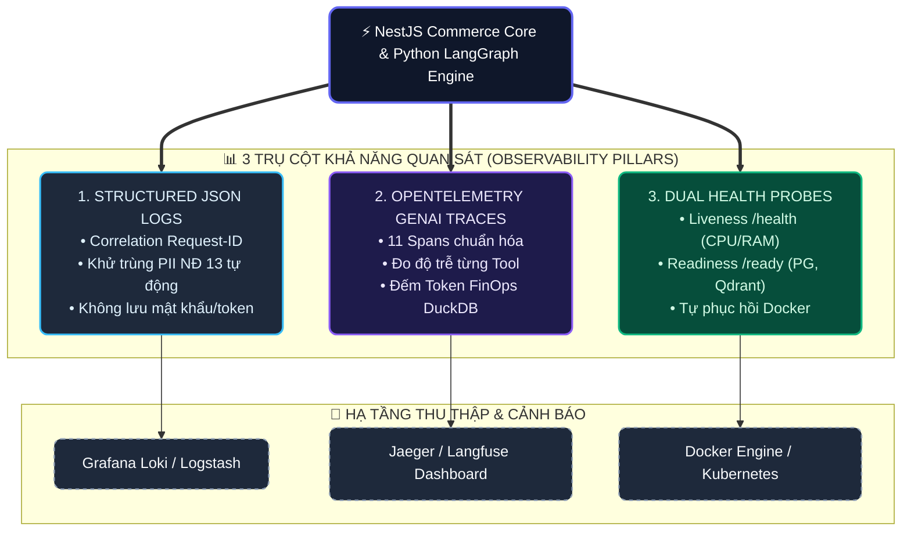
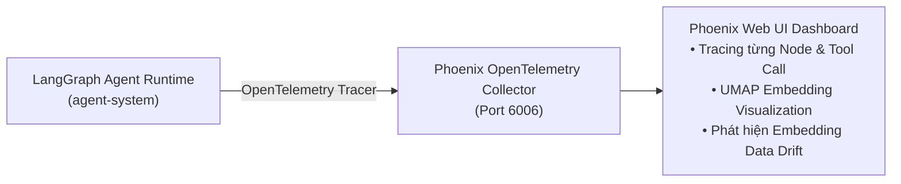

# 18 — Observability, Logging & Monitoring Specification

**Dự án**: RetailMind AI — Production-Oriented Agentic Retail Intelligence Platform  
**Tài liệu**: `enterprise-docs/docs/07-operations-devops/18-OBSERVABILITY.md`  
**Căn cứ đặc tả**: `docs/research/evaluation.md` & `prompt_sections/04_PHASE_PLAN.md` (P8)  
**Trạng thái**: Approved for Architecture Baseline (Production 2026 Edition)  

---

## 1. Kiến Trúc Khả Năng Quan Sát 3 Trụ Cột (Observability Architecture)

Hệ thống được thiết kế theo 3 trụ cột khả năng quan sát tiêu chuẩn: **Structured JSON Logging**, **OpenTelemetry Tracing** và **Dual Health Checks**:



---

## 2. Định Dạng Nhật Ký Có Cấu Trúc (Structured JSON Logging)

Mọi log ghi ra console (`stdout`) đều ở định dạng JSON chuẩn để dễ dàng phân tích và cảnh báo tự động:

```json
{
  "timestamp": "2026-10-20T18:00:00.150Z",
  "level": "INFO",
  "logger": "app.modules.agents.orchestrator",
  "message": "Tool execution completed successfully.",
  "context": {
    "request_id": "req-c8d7e9f1-4b2a-4f9e-8c3d-1a2b3c4d5e6f",
    "user_id": "usr-8a2f1c3d-...",
    "role": "CUSTOMER",
    "conversation_id": "conv-9f1e2d3c-...",
    "tool_name": "search_products",
    "step_index": 1,
    "latency_ms": 32.4,
    "items_found": 3
  }
}
```

### Quy Tắc Thanh Lọc Nhật Ký Bắt Buộc:
* **CẤM TUYỆT ĐỐI GHI**: `password_hash`, `jwt_token`, `api_key`, `credit_card`.
* **LÀM SẠCH PII TIẾNG VIỆT**: Mọi trường văn bản người dùng trong log đều phải đi qua bộ lọc thay thế `[REDACTED_CCCD]`, `[REDACTED_PHONE]`, `[REDACTED_EMAIL]`.

---

## 3. Điểm Kiểm Tra Sức Khỏe Dịch Vụ (`/health` & `/ready`)

Hệ thống cung cấp 2 endpoint độc lập phục vụ kiểm tra sức khỏe liveness và readiness:

### 3.1. Liveness Probe (`GET /health`)
Xác nhận ứng dụng FastAPI còn phản hồi, trả về HTTP `200 OK`:
```json
{
  "status": "UP",
  "version": "1.0.0",
  "uptime_seconds": 3600
}
```

### 3.2. Readiness Probe (`GET /ready`)
Xác nhận khả năng phục vụ lưu lượng mạng bằng cách kiểm tra kết nối tới các dịch vụ phụ thuộc:
```json
{
  "status": "READY",
  "dependencies": {
    "postgresql": { "status": "UP", "latency_ms": 2.1 },
    "qdrant": { "status": "UP", "latency_ms": 4.5 },
    "llm_provider": { "status": "UP", "latency_ms": 120.0 }
  }
}
```
* Nếu PostgreSQL hoặc Qdrant mất kết nối, endpoint trả về mã lỗi HTTP `503 Service Unavailable`.

---

## 4. Chỉ Số Đo Lường Định Lượng AI & Nghiệp Vụ (Key Telemetry Metrics)

1. **Hiệu Năng & Độ Trễ (Latency Distribution)**:
   - $P50 \le 800\text{ms}$, $P95 \le 2500\text{ms}$ cho câu trả lời tư vấn AI Agent có gọi tool.
   - $P50 \le 50\text{ms}$, $P95 \le 150\text{ms}$ cho các API truy vấn Catalog và Giỏ hàng.
2. **Độ Tin Cậy Tác Tử AI (Agent Reliability)**:
   - Tỷ lệ hoàn thành nhiệm vụ (Task Completion Rate) $\ge 95\%$.
   - Tỷ lệ vượt ngưỡng lặp (`MAX_STEPS > 5`) $\le 1\%$.
   - 0 trường hợp hallucination về giá niêm yết và số lượng tồn kho khả dụng.

---

## 5. Tích Hợp Arize Phoenix — Giám Sát AI Agent Tự Lưu Trữ (Self-Hosted AI Tracing)

Nhằm bảo vệ dữ liệu khách hàng theo Nghị định 13/2023/NĐ-CP và không bị giới hạn số lượng traces từ các dịch vụ SaaS đám mây, hệ thống tích hợp **Arize Phoenix** (Mã nguồn mở, 0 đồng chi phí):



### 5.1. Các Tính Năng Giám Sát Chuyên Biệt Cho AI Agent
1. **LangGraph StateGraph Tracing**: Ghi vết thời gian thực từng bước chuyển trạng thái (`router_node` $\to$ `search_products` $\to$ `format_response`), ghi nhận chính xác input, output, số token tiêu thụ và độ trễ từng tool.
2. **Trực Quan Hóa Không Gian Vector (Embedding UMAP)**: Chiếu không gian vector 1536 chiều của các câu hỏi khách hàng lên biểu đồ 2D/3D để đối chiếu với các vector chính sách trong Qdrant.
3. **Phát Hiện Trôi Dữ Liệu & Câu Hỏi Ngoài Vùng Tri Thức (Out-of-Domain Drift)**: Nhận diện khi khách hàng hỏi những nội dung không liên quan đến laptop (ví dụ: tư vấn bất động sản, code game) để tinh chỉnh bộ định tuyến Router.

### 5.2. Khởi Chạy Phoenix Qua Docker Compose
```yaml
  phoenix:
    image: arize-ai/phoenix:latest
    container_name: retailmind_phoenix
    ports:
      - "6006:6006"
    environment:
      - PHOENIX_PORT=6006
    restart: unless-stopped
```

