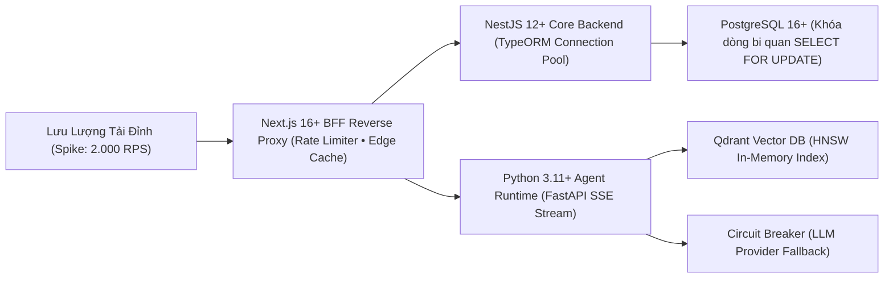
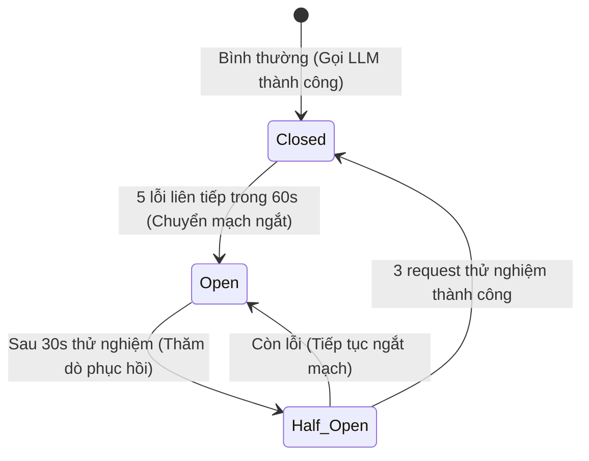

# 20 — Performance & Spike Load Engineering Plan

**Dự án**: RetailMind AI — Production-Oriented Agentic Retail Intelligence Platform  
**Tài liệu**: `enterprise-docs/docs/07-operations-devops/20-PERFORMANCE_PLAN.md`  
**Căn cứ đặc tả**: `docs/research/security-reliability.md` & `prompt_sections/04_PHASE_PLAN.md` (P8)  
**Trạng thái**: Approved for Architecture Baseline (Production 2026 Edition)  

---

## 1. Mục Tiêu Chịu Tải Đỉnh (Spike Load Targets)

Trong các sự kiện mở bán Laptop Flash-Sale hoặc ra mắt dòng chip AI mới, lưu lượng truy cập có thể tăng vọt từ 0 lên **1.000 - 3.000 requests/giây**.

Hệ thống được thiết kế để chịu tải mượt mà thông qua kiến trúc phân tầng:



---

## 2. Quản Lý Kết Nối & Tối Ưu Hóa CSDL (TypeORM Connection Pooling)

* **Vấn đề**: Mở quá nhiều kết nối CSDL trực tiếp sẽ làm cạn kiệt bộ nhớ RAM của máy chủ và gây nghẽn PostgreSQL.
* **Giải pháp**: Sử dụng cấu hình Connection Pool qua TypeORM `pg` driver trong NestJS 12+:
  - `extra.max`: 20 kết nối tối đa trong pool.
  - `extra.min`: 5 kết nối thường trực.
  - `extra.idleTimeoutMillis`: 30.000ms (30 giây giải phóng kết nối nhàn rỗi).
  - Kết nối được trả lại pool ngay lập tức khi hoàn thành transaction chốt đơn, không giữ kết nối trong thời gian client chờ stream SSE.

---

## 3. Triệt Tiêu Hoàn Toàn Lỗi N+1 Query & Tối Ưu B-Tree Index

* **Quy Tắc Bắt Buộc**: Cấm tuyệt đối việc truy vấn quan hệ lặp trong vòng lặp `for` khi serialize danh mục sản phẩm và biến thể.
* **Bắt Buộc Sử Dụng Eager Loading (`relations` / `leftJoinAndSelect`) trong TypeORM**:
```typescript
// ❌ SAI LẦM: Query N lần trong vòng lặp
const products = await this.productRepo.find();
for (const p of products) {
  const variants = await this.variantRepo.find({ where: { productId: p.id } }); // Gây N câu lệnh SQL!
}

// ✅ CHUẨN MỰC: Chỉ 1 câu lệnh SQL JOIN tối ưu với B-Tree index
const products = await this.productRepo.find({
  where: { isActive: true },
  relations: ['variants', 'brand', 'category'],
});
```
* **Chỉ mục B-Tree Chiến Lược**:
  - `idx_variants_product_id`: Tối ưu phép nối JOIN giữa Product và Variant.
  - `idx_inventory_store_variant`: Composite index tăng tốc độ khóa dòng `SELECT ... FOR UPDATE` khi chốt đơn.
  - `idx_orders_customer_created`: Tối ưu hóa truy vấn xem lịch sử đơn hàng cá nhân có phân trang.

---

## 4. Cơ Chế Ngắt Mạch (Circuit Breaker) Bảo Vệ Khỏi Sập LLM Provider

Khi LLM Provider ngoại vi gặp sự cố (HTTP 429 Too Many Requests, HTTP 503 hoặc timeout $> 10$ giây), hệ thống kích hoạt **Circuit Breaker 3 trạng thái**:



* **Trạng thái `Open`**: Hệ thống lập tức ngắt gọi LLM bên ngoài và kích hoạt cơ chế phản hồi dự phòng tất định (Deterministic Fallback Response), thông báo: *"Hệ thống tư vấn AI đang bảo trì cao tải, quý khách vui lòng sử dụng bộ lọc danh mục trực tiếp trên thanh công cụ"*.

---

## 5. Kịch Bản Kiểm Thử Áp Lực Locust / K6

1. **Catalog Browsing & Search**: 500 VUs duyệt laptop, lọc RAM $\ge 16$GB, giá $\le 20$ triệu VNĐ. Yêu cầu $P95 \le 100\text{ms}$.
2. **Concurrent Checkout Race**: 100 VUs cùng gửi request chốt mua 1 chiếc laptop duy nhất tại chi nhánh Quận 1. Yêu cầu: Đúng 1 request thành công (`201 Created`), 99 requests còn lại nhận `409 Conflict`, tồn kho cuối cùng chính xác bằng 0.

---

## 6. Chiến Lược Phân Tầng Mô Hình (Model Cascading) & Tiết Kiệm Chi Phí API Đến 80%

Để ngăn chặn việc cạn kiệt ngân sách khi có hàng ngàn lượt chat mỗi ngày, hệ thống triển khai kiến trúc **Phân tầng mô hình (Model Cascading Strategy)** thay vì dùng một mô hình đắt tiền cho mọi tác vụ:

```mermaid
flowchart TD
    UserQuery["Khách hàng gửi câu hỏi"] --> RouterNode["Router Node (Model Nhẹ & Siêu Rẻ)"]
    
    RouterNode -->|1. Phân loại ý định & Trích xuất tham số| FastModel["Tier 1: Fast & Cheap Model<br/>(gpt-4o-mini / gemini-1.5-flash)<br/>• Chi phí: ~0.15$/1M tokens<br/>• Độ trễ: < 400ms"]
    
    FastModel --> SimpleCheck{"Yêu cầu phức tạp?"}
    
    SimpleCheck -->|Không: Tra cứu cấu hình, giá, tồn kho (UC01, UC03)| SimpleResponse["Hoàn tất phản hồi (Tiết kiệm 85% chi phí)"]
    
    SimpleCheck -->|Có: So sánh đối đầu 4 laptop (UC02) hoặc RAG nhạy cảm (UC08)| ReasoningModel["Tier 2: High-Reasoning Model<br/>(gpt-4o / claude-3-5-sonnet)<br/>• Suy luận logic cấu hình sâu sắc<br/>• Kiểm chứng trích dẫn NĐ 30"]
```

### 6.1. Quy Chuẩn Khóa Tham Số Mô Hình (Deterministic Parameters)
1. **Thiết lập `temperature = 0`**: Bắt buộc cho toàn bộ các node phân loại, routing và gọi công cụ (tool calling) để loại bỏ tính ngẫu nhiên, giảm token dư thừa và triệt tiêu ảo giác.
2. **Giới hạn `max_tokens` Nghiêm Ngặt**:
   - Câu hỏi tra cứu ngắn gọn: `max_tokens = 500`.
   - Phân tích so sánh đa thông số: `max_tokens = 1500`.

### 6.2. Cơ Chế Băm Prompt & Bộ Nhớ Đệm Redis (Prompt Hashing & Cache)
Các câu hỏi phổ biến trong bán lẻ (ví dụ: *"Laptop nào tốt cho lập trình dưới 20 triệu?"*) được băm mã SHA-256 và lưu kết quả trên Redis Cache trong 1 giờ. Nếu câu hỏi trùng lặp xuất hiện, hệ thống phản hồi tức thì dưới 10ms mà không tốn bất kỳ chi phí API nào.

---

## 7. Bảng Dự Toán Chi Phí Vận Hành (Cost Budgeting Table)

| Thành Phần / Giai Đoạn | Mô Hình Đảm Nhiệm | Định Mức Token / Request | Chi Phí Ước Tính (1.000 Requests) |
|---|---|:---:|:---:|
| **Routing & Parameter Extraction** | `gpt-4o-mini` | ~400 tokens | ~$0.15 |
| **Comparative Reasoning (UC02)** | `gpt-4o` | ~1.500 tokens | ~$3.75 |
| **RAG Policy Explanation (UC08)** | `gpt-4o-mini` | ~800 tokens | ~$0.30 |
| **Cached Repetitive Queries** | Redis In-Memory | 0 tokens (Cache Hit) | $0.00 |
| **Tổng chi phí tối ưu trung bình** | **Model Cascading** | **~600 tokens (trung bình)** | **~$0.45 - $0.80 / 1.000 requests** |

