# 21 — Deployment, Infrastructure & CI/CD Specification

**Dự án**: RetailMind AI — Production-Oriented Agentic Retail Intelligence Platform  
**Tài liệu**: `enterprise-docs/docs/07-operations-devops/21-DEPLOYMENT.md`  
**Căn cứ đặc tả**: `docs/database/07_migration_plan.md` & `prompt_sections/04_PHASE_PLAN.md` (P1 & P8)  
**Trạng thái**: Approved for Architecture Baseline (Production 2026 Edition)  

---

## 1. Ma Trận Môi Trường Vận Hành (Environments Matrix)

| Môi Trường | Mục Đích Sử Dụng | Cơ Chế Triển Khai | CSDL & Vector DB | Tự Động Hóa CI/CD |
|:--- |:--- |:--- |:--- |:--- |
| **Local (Dev)** | Phát triển tính năng, kiểm thử đơn vị & API | Docker Compose nội bộ | PostgreSQL 16 + Qdrant trong container | Chạy lệnh `docker compose up` |
| **Staging (Demo)** | Kiểm thử tích hợp E2E, demo phỏng vấn | Cloud VM / Docker Compose | PostgreSQL 16 riêng biệt + Qdrant | Tự động deploy khi merge `main` |
| **Production** | Môi trường triển khai thực tế | Kubernetes / AWS ECS / Nginx Reverse Proxy | Managed Cloud SQL + Qdrant Cloud | Tự động build & deploy qua Git Tag |

---

## 2. Cấu Hình Docker Compose Nền Tảng (ADR-007 Polyglot Tri-Tier)

File `docker-compose.yml` chuẩn hóa điều phối toàn bộ các dịch vụ:

```yaml
version: '3.8'

services:
  postgres:
    image: postgres:16-alpine
    container_name: retailmind_postgres
    environment:
      POSTGRES_DB: retailmind_db
      POSTGRES_USER: retailmind_user
      POSTGRES_PASSWORD: secure_password_change_me
    ports:
      - "5432:5432"
    volumes:
      - pgdata:/var/lib/postgresql/data
    healthcheck:
      test: ["CMD-SHELL", "pg_isready -U retailmind_user -d retailmind_db"]
      interval: 5s
      timeout: 5s
      retries: 5

  redis:
    image: redis:7-alpine
    container_name: retailmind_redis
    ports:
      - "6379:6379"
    volumes:
      - redis_data:/data
    healthcheck:
      test: ["CMD", "redis-cli", "ping"]
      interval: 5s
      timeout: 5s
      retries: 5

  minio:
    image: minio/minio:latest
    container_name: retailmind_minio
    ports:
      - "9000:9000" # S3 API
      - "9001:9001" # Web Console
    environment:
      MINIO_ROOT_USER: minioadmin
      MINIO_ROOT_PASSWORD: minioadmin
    command: server /data --console-address ":9001"
    volumes:
      - minio_data:/data
    healthcheck:
      test: ["CMD", "curl", "-f", "http://localhost:9000/minio/health/live"]
      interval: 5s
      timeout: 5s
      retries: 5

  qdrant:
    image: qdrant/qdrant:latest
    container_name: retailmind_qdrant
    ports:
      - "6333:6333" # REST API
      - "6334:6334" # gRPC
    volumes:
      - qdrant_storage:/qdrant/storage
    healthcheck:
      test: ["CMD", "curl", "-f", "http://localhost:6333/healthz"]
      interval: 5s
      timeout: 5s
      retries: 5

  phoenix:
    image: arizephoenix/phoenix:latest
    container_name: retailmind_phoenix
    ports:
      - "6006:6006" # UI & OTel collector
    environment:
      - PHOENIX_PORT=6006
      - PHOENIX_HOST=0.0.0.0
    restart: unless-stopped

  backend:
    build:
      context: .
      dockerfile: deploy/Dockerfile.backend
    container_name: retailmind_backend_nestjs
    ports:
      - "4000:4000"
    environment:
      - PORT=4000
      - DB_HOST=postgres
      - DB_PORT=5432
      - DB_USERNAME=retailmind_user
      - DB_PASSWORD=secure_password_change_me
      - DB_DATABASE=retailmind_db
      - REDIS_HOST=redis
      - REDIS_PORT=6379
      - MINIO_ENDPOINT=minio
      - MINIO_PORT=9000
      - AGENT_SERVICE_URL=http://agent:8000
      - INTERNAL_TOOL_SECRET=secret_token_internal_retailmind
    depends_on:
      postgres:
        condition: service_healthy
      redis:
        condition: service_healthy

  agent:
    build:
      context: .
      dockerfile: deploy/Dockerfile.agent
    container_name: retailmind_agent_python
    ports:
      - "8000:8000"
    environment:
      - PORT=8000
      - QDRANT_URL=http://qdrant:6333
      - NESTJS_BACKEND_URL=http://backend:4000
      - INTERNAL_TOOL_SECRET=secret_token_internal_retailmind
      - PHOENIX_COLLECTOR_ENDPOINT=http://phoenix:6006
      - OPENAI_API_KEY=${OPENAI_API_KEY:-mock_key}
    depends_on:
      qdrant:
        condition: service_healthy
      backend:
        condition: service_started

  frontend:
    build:
      context: .
      dockerfile: deploy/Dockerfile.frontend
    container_name: retailmind_frontend_nextjs
    ports:
      - "3000:3000"
    environment:
      - NEXT_PUBLIC_API_URL=http://localhost:4000
      - NEXT_PUBLIC_AGENT_STREAM_URL=http://localhost:4000/api/v1/conversations
    depends_on:
      - backend

volumes:
  pgdata:
  redis_data:
  minio_data:
  qdrant_storage:
```

---

## 3. Kiến Trúc Multi-Stage Dockerfile Chuẩn Enterprise

### 3.1. NestJS Core Backend (`deploy/Dockerfile.backend` • `core-api`)
```dockerfile
# Stage 1: Build NestJS with TypeORM
FROM node:20-alpine AS builder
WORKDIR /app
COPY core-api/package*.json ./
RUN npm ci
COPY core-api ./
RUN npm run build

# Stage 2: Production Runtime
FROM node:20-alpine AS runner
WORKDIR /app
ENV NODE_ENV=production PORT=4000
COPY core-api/package*.json ./
RUN npm ci --only=production
COPY --from=builder /app/dist ./dist
EXPOSE 4000
CMD ["node", "dist/main"]
```

### 3.2. Python AI Agent Service (`deploy/Dockerfile.agent` • `agent-system`)
```dockerfile
FROM python:3.11-slim
WORKDIR /app
ENV PYTHONUNBUFFERED=1 PYTHONDONTWRITEBYTECODE=1 PORT=8000
RUN apt-get update && apt-get install -y --no-install-recommends build-essential curl && rm -rf /var/lib/apt/lists/*
COPY agent-system/requirements.txt /app/requirements.txt
RUN pip install --no-cache-dir -r requirements.txt
COPY agent-system /app
COPY contracts /app/contracts
COPY data /app/data
EXPOSE 8000
CMD ["uvicorn", "main:app", "--host", "0.0.0.0", "--port", "8000"]
```

### 3.3. Next.js Frontend Client (`deploy/Dockerfile.frontend` • `web-client`)
```dockerfile
FROM node:20-alpine AS builder
WORKDIR /app
COPY web-client/package*.json ./
RUN npm ci
COPY web-client ./
RUN npm run build

FROM node:20-alpine AS runner
WORKDIR /app
ENV NODE_ENV=production PORT=3000
COPY --from=builder /app/public ./public
COPY --from=builder /app/.next/standalone ./
COPY --from=builder /app/.next/static ./.next/static
EXPOSE 3000
CMD ["node", "server.js"]
```

---

## 4. Đường Ống CI/CD Chuẩn Mực (GitHub Actions Workflow)

```mermaid
flowchart LR
    %% ==========================================
    %% CI/CD PIPELINE STYLES
    %% ==========================================
    classDef gitStyle fill:#1E293B,stroke:#F59E0B,stroke-width:2px,color:#FEF3C7,rx:8,ry:8
    classDef checkStyle fill:#0F172A,stroke:#38BDF8,stroke-width:1.5px,color:#E0F2FE,rx:6,ry:6
    classDef secStyle fill:#3B0764,stroke:#EC4899,stroke-width:2px,color:#FCE7F3,rx:8,ry:8
    classDef buildStyle fill:#1E1B4B,stroke:#8B5CF6,stroke-width:2px,color:#EDE9FE,rx:8,ry:8
    classDef deployStyle fill:#064E3B,stroke:#10B981,stroke-width:2.5px,color:#D1FAE5,rx:10,ry:10

    Push["1. Git Push / PR<br/>(main / release branch)"]:::gitStyle
    Lint["2. Linting & Formatting<br/>(Ruff PEP8 • ESLint)"]:::checkStyle
    Static["3. Strict Type Check<br/>(mypy --strict • tsc)"]:::checkStyle
    Test["4. Automated Test Suite<br/>(pytest trên Postgres thật)"]:::checkStyle
    Security["5. Secrets & PII Scan<br/>(TruffleHog • Regex NĐ 13)"]:::secStyle
    Build["6. Multi-stage Docker<br/>(Build & Push Image Ghcr.io)"]:::buildStyle
    Deploy["7. Zero-Downtime Rollout<br/>(Docker Compose Healthcheck)"]:::deployStyle

    Push ==> Lint
    Lint ==> Static
    Static ==> Test
    Test ==> Security
    Security ==> Build
    Build ==> Deploy
```


