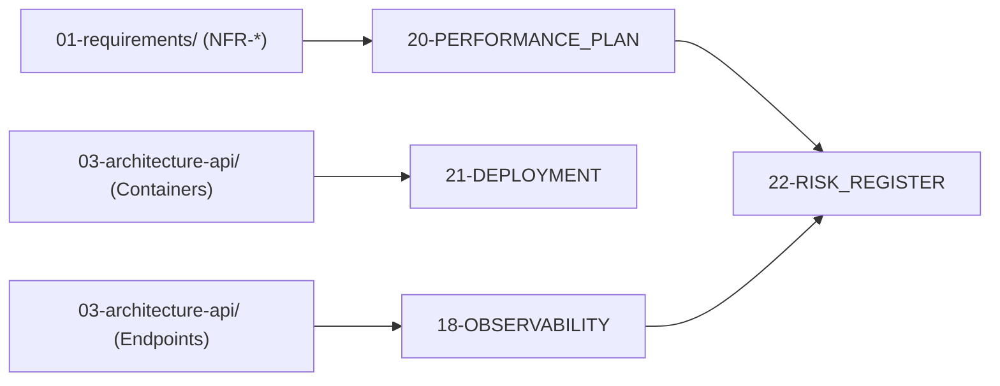

# ⚙️ Nhóm 07 — Vận Hành, Giám Sát & Triển Khai (Operations, SRE & DevOps)

> **Vai trò kỹ thuật:** DevOps Engineer / Site Reliability Engineer (SRE) / Infrastructure Architect  
> **Mục tiêu:** Thiết lập khả năng quan sát 360 độ (Observability), đảm bảo hệ thống chịu được tải đỉnh (Spikes) hàng ngàn người dùng, xây dựng đường ống CI/CD tự động hóa kiểm thử và quản lý rủi ro vận hành (Risk Register).

---

## 🗂️ Danh Mục Tài Liệu Thuộc Nhóm 07

| Thứ tự | Tên tài liệu | Mục đích kỹ thuật cốt lõi |
| :---: | :--- | :--- |
| **18** | [`18-OBSERVABILITY.md`](18-OBSERVABILITY.md) | Kiến trúc khả năng quan sát: Structured JSON Logging (NestJS Winston / Python Structlog), OpenTelemetry Tracing, Arize Phoenix (Cổng 6006), Dual Health Checks (`/health`, `/ready`) và Quy tắc thanh lọc PII. |
| **20** | [`20-PERFORMANCE_PLAN.md`](20-PERFORMANCE_PLAN.md) | Kế hoạch chịu tải đỉnh: Cấu hình Connection Pooler (PgBouncer), Chiến lược đệm Redis, Triệt tiêu lỗi N+1, Model Cascading và Kiểm thử áp lực K6. |
| **21** | [`21-DEPLOYMENT.md`](21-DEPLOYMENT.md) | Ma trận môi trường (Local, Staging, Production), Multi-stage Dockerfiles, Đường ống CI/CD GitHub Actions và Chiến lược phát hành Zero-downtime. |
| **22** | [`22-RISK_REGISTER.md`](22-RISK_REGISTER.md) | Sổ đăng ký rủi ro hệ thống (`RSK-01` $\rightarrow$ `RSK-08`): Phân tích xác suất, mức độ tác động và kế hoạch ứng phó chi tiết. |

---

## 🔗 Liên Kết Truy Xuất (Traceability Flow)

