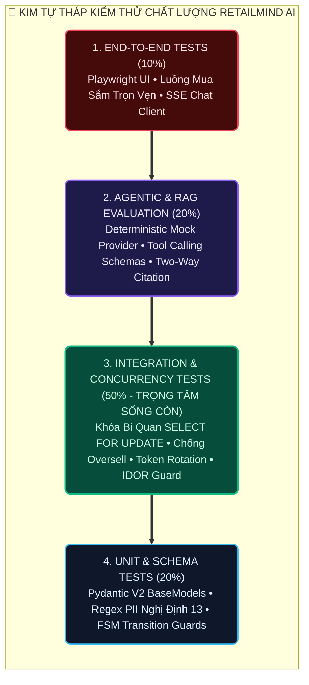
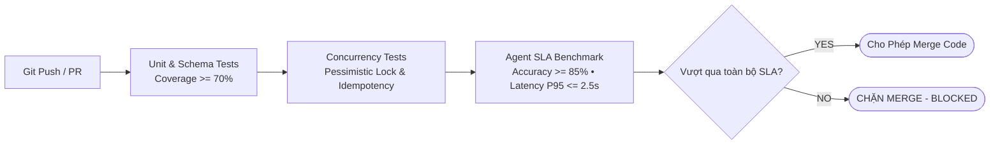

# 19 — Quality Assurance & Test Strategy Specification

**Dự án**: RetailMind AI — Production-Oriented Agentic Retail Intelligence Platform  
**Tài liệu**: `enterprise-docs/docs/08-testing-execution/19-TEST_STRATEGY.md`  
**Công cụ kiểm thử**: pytest (pytest-asyncio), Playwright E2E, Locust Load Testing  
**Căn cứ đặc tả**: `docs/requirements/traceability-matrix.md` & `docs/progress/TEST_RESULTS.md`  
**Trạng thái**: Approved for Architecture Baseline (Production 2026 Edition)  

---

## 1. Kim Tự Tháp Kiểm Thử Chất Lượng (Testing Pyramid)

Dự án áp dụng mô hình kim tự tháp kiểm thử đa tầng lấy **Integration & Concurrency Tests (50%)** làm trọng tâm để bảo đảm tính đúng đắn của các giao dịch thương mại và ranh giới an toàn của tác tử AI:



---

## 2. Danh Mục 17 Ca Kiểm Thử Chấp Nhận Sống Còn (Critical Acceptance Tests)

Toàn bộ 17 ca kiểm thử nghiệm thu hệ thống đã được lập kế hoạch chi tiết. Trạng thái hiện tại ở Phase 0 được ghi nhận trung thực là **`NOT_RUN`**:

| Mã AT | Ca Sử Dụng Mục Tiêu | Loại Kiểm Thử | Lệnh CLI Thực Thi Kiểm Thử | Khẳng Định Sống Còn (Assertion) | Trạng Thái |
|:---:|:---:|---|---|---|:---:|
| **`AT-UC01-01`** | UC01 | Auth / Feature | `pytest tests/api/test_auth.py -k "register_success"` | Tạo Customer thành công, hash mật khẩu chuẩn Argon2id | `NOT_RUN` |
| **`AT-UC01-02`** | UC01 | Security | `pytest tests/api/test_auth.py -k "invalid_password"` | Nhận `401 Unauthorized`, không rò rỉ hash trong log | `NOT_RUN` |
| **`AT-UC01-03`** | UC01 | Security | `pytest tests/api/test_auth.py -k "refresh_token"` | Xoay vòng Refresh Token thành công, hủy token cũ | `NOT_RUN` |
| **`AT-UC01-04`** | UC01 | Security | `pytest tests/api/test_auth.py -k "unauthenticated"` | Nhận `401` khi thiếu Bearer Token | `NOT_RUN` |
| **`AT-UC02-01`** | UC02 | Catalog | `pytest tests/api/test_catalog.py -k "filter"` | Trả về đúng máy có giá $\le$ 20 triệu và RAM $\ge$ 16GB | `NOT_RUN` |
| **`AT-UC02-02`** | UC02 | Catalog | `pytest tests/api/test_catalog.py -k "compare"` | Trả về ma trận so sánh 2–4 sản phẩm chuẩn xác | `NOT_RUN` |
| **`AT-UC03-01`** | UC03 | Agent | `pytest tests/agent/test_advisor.py -k "tool_calling"` | Agent gọi đúng tool `search_products`, trích dẫn chuẩn | `NOT_RUN` |
| **`AT-UC03-02`** | UC03 | Security (IDOR) | `pytest tests/agent/test_advisor.py -k "idor"` | Khách hàng A không thể can thiệp thread của khách B (`403`) | `NOT_RUN` |
| **`AT-UC04-01`** | UC04 | Inventory | `pytest tests/api/test_inventory.py -k "available_stock"` | Tính chính xác `available = on_hand - reserved` | `NOT_RUN` |
| **`AT-UC05-01`** | UC05 | RAG Retrieval | `pytest tests/rag/test_policy_rag.py -k "two_way"` | Chỉ trích dẫn tài liệu đang ở trạng thái `published` | `NOT_RUN` |
| **`AT-UC05-02`** | UC05 | RAG Quality | `pytest tests/rag/test_policy_rag.py -k "abstention"` | Từ chối trả lời lịch sự khi câu hỏi ngoài chính sách | `NOT_RUN` |
| **`AT-UC06-01`** | UC06 | Commerce | `pytest tests/api/test_favorites.py` | Quản lý danh mục yêu thích cá nhân đúng sở hữu | `NOT_RUN` |
| **`AT-UC07-01`** | UC07 | Commerce | `pytest tests/api/test_cart.py -k "no_reservation"` | Thêm vào giỏ không làm thay đổi `reserved_qty` kho | `NOT_RUN` |
| **`AT-UC08-01`** | UC08 | Concurrency | `pytest tests/api/test_checkout_concurrency.py` | 2 luồng cùng mua máy còn 1 tồn: 1 thành công, 1 nhận 409 | `NOT_RUN` |
| **`AT-UC08-02`** | UC08 | Idempotency | `pytest tests/api/test_checkout.py -k "idempotency"` | Gửi lại cùng key trả về cùng kết quả, không trừ kho 2 lần | `NOT_RUN` |
| **`AT-UC09-01`** | UC09 | Inventory / FSM | `pytest tests/api/test_order_cancel.py` | Hủy đơn hoàn trả tồn kho nguyên tử chính xác 1 lần | `NOT_RUN` |
| **`AT-UC10-01`** | UC10 | Support | `pytest tests/api/test_support.py` | Tạo ticket gắn đơn hàng của mình thành công | `NOT_RUN` |
| **`AT-UC11-01`** | UC11 | Admin Catalog | `pytest tests/api/test_admin_catalog.py` | Bị chặn `409` nếu chỉnh `on_hand_qty < reserved_qty` | `NOT_RUN` |
| **`AT-UC12-01`** | UC12 | Admin Ops | `pytest tests/api/test_admin_ops.py -k "supersedes"` | Xuất bản version mới tự động hạ version cũ sang superseded | `NOT_RUN` |

---

## 3. Ma Trận Truy Xuất Nguồn Gốc Yêu Cầu (Requirements Traceability Matrix - RTM)

| Use Case (UC) | Yêu Cầu Chức Năng (FR) | Điểm Cuối API | Module & Service Sở Hữu | Ràng Buộc Bất Biến Kiểm Soát | Ca Kiểm Thử Tương Ứng | Phân Kỳ |
|:---:|---|---|---|---|---|:---:|
| **UC01** | `FR-AUTH-001..006` | `/api/v1/auth/*` | `identity.AuthService` | Email unique, Argon2id, Bearer JWT | `AT-UC01-01..04` | **P1** |
| **UC02** | `FR-CATALOG-001..005` | `/api/v1/products` | `catalog.CatalogService` | Parameterized SQL, Soft delete | `AT-UC02-01..02` | **P2** |
| **UC03** | `FR-AGENT-001..006` | `/api/v1/conversations` | `agents.AgentOrchestrator` | `MAX_STEPS = 5`, PII sanitized | `AT-UC03-01..02` | **P4** |
| **UC04** | `FR-INVENTORY-001..004` | `/api/v1/stores/*/inventory` | `inventory.InventoryService` | `available = on_hand - reserved` | `AT-UC04-01` | **P2** |
| **UC05** | `FR-RAG-001..005` | `/api/v1/knowledge/ask` | `knowledge.RAGService` | Trích dẫn 2 chiều, Honest abstention | `AT-UC05-01..02` | **P3** |
| **UC06** | `FR-CART-001`, `FR-USER` | `/api/v1/favorites` | `commerce.FavoriteService` | Composite PK `(customer_id, variant_id)` | `AT-UC06-01` | **P5** |
| **UC07** | `FR-CART-001..005` | `/api/v1/cart/*` | `commerce.CartService` | Không giữ kho khi thêm vào giỏ | `AT-UC07-01` | **P5** |
| **UC08** | `FR-ORDER-001..005` | `/api/v1/orders/confirm` | `commerce.CheckoutService` | Khóa bi quan `SELECT ... FOR UPDATE` | `AT-UC08-01..02` | **P5** |
| **UC09** | `FR-ORDER-006..008` | `/api/v1/orders/*/cancel` | `commerce.OrderService` | Hoàn trả kho đúng 1 lần duy nhất | `AT-UC09-01` | **P5** |
| **UC10** | `FR-TICKET-001..004` | `/api/v1/support/tickets` | `support.SupportService` | Khách chỉ được tạo ticket cho đơn của mình | `AT-UC10-01` | **P5** |
| **UC11** | `FR-ADMIN-001..003` | `/api/v1/admin/catalog` | `catalog.AdminService` | `on_hand_qty >= reserved_qty` | `AT-UC11-01` | **P2** |
| **UC12** | `FR-ADMIN-004..006` | `/api/v1/admin/policies` | `knowledge.AdminService` | Tự động hạ version cũ sang superseded | `AT-UC12-01` | **P3** |

---

## 4. Khung Cam Kết SLA Kiểm Thử Định Lượng (Quantitative Evaluation SLA Framework)

Nhằm triệt tiêu căn bệnh "đánh giá cảm tính" (Vibe Check) và bảo đảm độ tin cậy tuyệt đối cho hệ thống thương mại bán lẻ, RetailMind AI thiết lập khung cam kết chất lượng định lượng với các chỉ số đo lường độc lập:

| Chỉ số (Metric) | Định nghĩa & Công thức toán học | Ngưỡng Cam Kết SLA (Threshold) | Phương pháp kiểm định |
|---|---|:---:|---|
| **Độ chính xác Agent (Accuracy)** | $$\text{Accuracy} = \frac{\text{Số test case định tuyến & tool call đúng}}{\text{Tổng số 50 ca kiểm thử trong Golden Dataset}}$$ | $\mathbf{\ge 85\%}$ | Chạy tự động `pytest tests/agent` đối chiếu nhãn chuẩn. |
| **Độ trung thực RAG (Faithfulness)** | $$\text{Faithfulness} = \frac{\text{Số luận điểm RAG có trích dẫn đúng chunk_id hợp lệ}}{\text{Tổng số luận điểm trả lời}}$$ | $\mathbf{100\%}$ | Calibrated LLM Judge + Kiểm tra ID chunk trong CSDL. |
| **Tỷ lệ ảo giác (Hallucination Rate)** | $$\text{Hallucination} = \frac{\text{Số thông tin giá/tồn kho/chính sách bịa đặt}}{\text{Tổng số phản hồi}}$$ | $\mathbf{0.0\%}$ | Tuyệt đối cấm hallucination giá, tồn kho khả dụng và bảo hành. |
| **Độ trễ phản hồi (P95 Latency)** | $$P95(\text{End-to-End Response Time})$$ | $\mathbf{\le 2.5\text{s}}$ | Locust / k6 load testing (TTFT $< 800\text{ms}$). |
| **Độ bao phủ mã nguồn (Code Coverage)** | $$\text{Coverage} = \frac{\text{Dòng lệnh thực thi trong test}}{\text{Tổng số dòng mã nguồn (LOC)}}$$ | $\mathbf{\ge 70\%}$ | `pytest-cov` đo lường, fail-under threshold = 70%. |

### Phân Bổ Ngưỡng Coverage Theo Từng Module

* **Commerce & Concurrency Engine (`core-api/src/features/orders`, `inventory`):** $\ge 85\%$ (Bắt buộc 100% cho luồng trừ tồn kho và khóa bi quan `SELECT FOR UPDATE`).
* **Agent Routing & Tool Schemas (`agent-system/domains`):** $\ge 90\%$ (Kiểm thử tính tương thích Pydantic V2).
* **API Endpoints & Controllers:** $\ge 80\%$.
* **Toàn bộ hệ sinh thái (Total Average):** $\ge 70\%$.

---

## 5. Quy Chuẩn Tự Động Hóa CI/CD Gating (Automated Quality Gate)

Mọi Pull Request đẩy vào repository đều phải vượt qua bộ lọc chất lượng tự động trong GitHub Actions Pipeline:

```ini
# pytest.ini — Cấu hình kiểm thử định lượng bắt buộc
[pytest]
testpaths = tests
asyncio_mode = auto
addopts = -v --cov=src --cov-report=term-missing --cov-fail-under=70

[coverage:run]
source = src
omit =
    */tests/*
    */migrations/*
    */__init__.py
```


