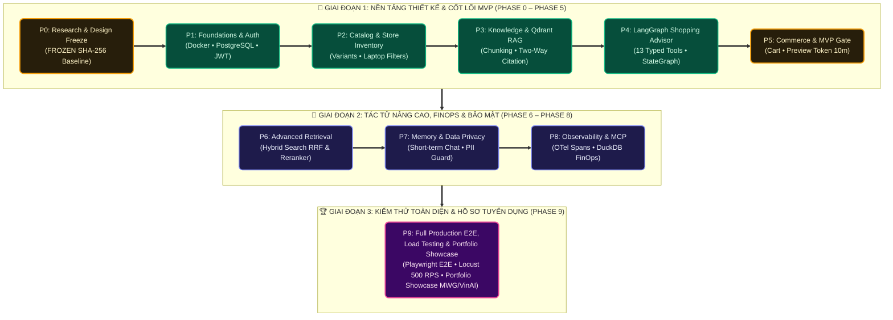

# 23 — Step-by-Step Master Implementation Roadmap (Phases 0–9)

**Dự án**: RetailMind AI — Production-Oriented Agentic Retail Intelligence Platform  
**Tài liệu**: `enterprise-docs/docs/08-testing-execution/23-IMPLEMENTATION_PLAN.md`  
**Căn cứ đặc tả**: `prompt_sections/04_PHASE_PLAN.md` & `PLANS.md`  
**Chế độ thực thi**: `EXECUTION_MODE=PHASED`  
**Trạng thái**: Approved for Architecture Baseline (Production 2026 Edition)  

---

## 1. Nguyên Tắc Thực Thi Bắt Buộc (Master Implementation Principles)

1. **Kỷ Luật Khóa Phạm Vi (Scope Lock)**: Chỉ triển khai đúng 3 Personas (`Guest`, `Customer`, `Admin`), 12 Use Cases (`UC01` đến `UC12`), 22 bảng CSDL quan hệ. Nghiêm cấm mở rộng ngoài phạm vi khi chưa có RFC được duyệt.
2. **Kỷ Luật Cổng Chất Lượng (Quality Gate Discipline)**: Mỗi phân kỳ kết thúc bằng một Quality Gate nghiêm ngặt. Không bao giờ được phép chuyển sang phase tiếp theo nếu chưa thỏa mãn 100% tiêu chí cổng.
3. **Báo Cáo Trung Thực**: Tuyệt đối không gán nhãn `DONE` cho tính năng chưa viết code thật; các bài test chưa chạy giữ nguyên nhãn `NOT_RUN`.

---

## 2. Bản Đồ 10 Phân Kỳ Triển Khai (Phase-by-Phase Roadmap)

---

## 3. Đặc Tả Chi Tiết Từng Phân Kỳ

### Phase 0 — Khảo Sát Nguồn & Đóng Băng Thiết Kế Kiến Trúc
* **Trạng thái**: `REVIEWED — RECOMMEND APPROVAL (Awaiting Human Sign-off)`.
* **Nội dung**: Khảo sát 16 repos mã nguồn mở; đặc tả 12 Use Cases; đóng băng 22 bảng CSDL quan hệ; thiết kế C4 3 tầng; ban hành 6 ADRs; ma trận truy vết 10 cột khép kín; niêm phong 38 mã băm SHA-256 trong `DESIGN_BASELINE_v1.md`.
* **Gate P0**: Toàn bộ tiêu chí P0-G01..G10 được thẩm định; cần chữ ký xác nhận của Product Owner để mở khóa Phase 1.

---

### Phase 1 — Nền Tảng Khung Dự Án & Định Danh (Foundations & Auth)
* **Mục tiêu**: Hạ tầng chạy thật với Docker Compose (7 services), cấu hình TypeORM Migration, module Identity & Auth (UC01) trong NestJS Core Backend (ADR-007).
* **CSDL**: Bảng `roles` và `users`. Nạp dữ liệu seed vai trò (`CUSTOMER`, `ADMIN`).
* **Endpoints**: `/api/v1/auth/register`, `/api/v1/auth/login`, `/api/v1/auth/refresh`, `/api/v1/auth/logout`, `/api/v1/auth/me`.
* **Tests**: Jest tests tại backend và Pytest tại agent cho `AT-UC01-01` đến `AT-UC01-04`.
* **Gate P1**: `docker compose up --build` chạy sạch; 100% tests auth pass; kiểm soát Bearer JWT và kiểm tra `is_active`.

---

### Phase 2 — Danh Mục Laptop & Tồn Kho Chi Nhánh (Catalog & Inventory)
* **Mục tiêu**: CRUD danh mục, bộ lọc laptop đa tiêu chí và tồn kho chi nhánh (UC02, UC04, UC11).
* **CSDL**: Bảng `brands`, `categories`, `products`, `variants`, `product_specs`, `stores`, `inventory`.
* **Endpoints**: `GET /api/v1/products`, `GET /api/v1/variants/{id}`, `GET /api/v1/products/compare`, `GET /api/v1/stores/{s_id}/inventory/{v_id}`, `/api/v1/admin/products`, `/api/v1/admin/inventory`.
* **Tests**: `AT-UC02-01..02`, `AT-UC04-01`, `AT-UC11-01`.
* **Gate P2**: Lọc máy dưới 20 triệu RAM $\ge 16$GB chính xác 100%; công thức tồn khả dụng đúng; Guest không thể mutate kho; 0 lỗi N+1.

---

### Phase 3 — Tri Thức Doanh Nghiệp & Dense RAG (Knowledge & Qdrant RAG)
* **Mục tiêu**: Vòng đời nạp văn bản chính sách, chỉ mục vector Qdrant và tra cứu xác minh trích dẫn 2 chiều (UC05, UC12-RAG).
* **CSDL & Vector**: Bảng `policies`, `document_versions`, `ingestion_jobs`; Qdrant collection `retail_policies`.
* **Endpoints**: `POST /api/v1/knowledge/ask`, `/api/v1/admin/policies/upload`, `/api/v1/admin/policies/publish`.
* **Tests**: `AT-UC05-01..02`, `AT-UC12-01`.
* **Gate P3**: Chỉ mục Qdrant hoạt động; chặn trích dẫn chính sách private/draft; từ chối trả lời lịch sự khi thiếu bằng chứng.

---

### Phase 4 — Điều Phối Tác Tử LangGraph & Trợ Lý Mua Sắm (Agentic Advisor)
* **Mục tiêu**: LangGraph StateGraph điều phối 1 tác tử duy nhất với 13 Typed Tools định kiểu Pydantic và SSE streaming (UC03, UC06-Chat).
* **CSDL**: Bảng `conversations`, `messages`. SQLite/PostgreSQL Checkpoint.
* **Endpoints**: `POST /api/v1/conversations/{id}/messages` (SSE), `GET /api/v1/conversations`.
* **Tests**: `AT-UC03-01..02`.
* **Gate P4**: Gọi đúng internal tools; schema failure bị chặn; trần `MAX_STEPS = 5` ngắt mạch; không rò rỉ IDOR giữa các phiên; trích dẫn chính sách hợp lệ.

---

### Phase 5 — Giao Dịch Thương Mại & Cổng MVP (Transactional Commerce) — **MVP GATE**
* **Mục tiêu**: Giỏ hàng, Signed Preview Token 10 phút, chốt đơn giả lập có khóa bi quan chống Oversell, hủy đơn hoàn kho và Ticket (UC06–UC10, UC12-Ticket).
* **CSDL**: Bảng `carts`, `cart_items`, `orders`, `order_items`, `idempotency_keys`, `support_tickets`, `favorites`.
* **Endpoints**: `/api/v1/cart/*`, `/api/v1/orders/preview`, `/api/v1/orders/confirm`, `/api/v1/orders/*/cancel`, `/api/v1/support/tickets`.
* **Tests**: `AT-UC06-01`, `AT-UC07-01`, `AT-UC08-01..02`, `AT-UC09-01`, `AT-UC10-01`.
* **Gate P5**: 2 request song song mua máy còn 1 tồn: đúng 1 request thành công, 1 nhận 409; Idempotency không trừ kho 2 lần; hủy đơn hoàn kho đúng 1 lần; Cấm AI tự chốt đơn.

---

### Phase 6 — Nâng Cao RAG & Đánh Giá Khoa Học (Hybrid Search & Evaluation)
* **Mục tiêu**: BM25 Sparse Search + Dense Retrieval + RRF (Reciprocal Rank Fusion) + Cross-Encoder Reranker; đo lường Recall@K, MRR/nDCG.
* **Gate P6**: Chạy so sánh 4 chế độ (`dense_only`, `sparse_only`, `hybrid`, `hybrid_rerank`) trên cùng tập dữ liệu; báo cáo độ trễ và đánh đổi trung thực; không làm giả số liệu.

---

### Phase 7 — Bộ Nhớ Dài Hạn & An Toàn Bảo Mật (Memory & Privacy Guard)
* **Mục tiêu**: Bộ lọc làm sạch PII tiếng Việt (Nghị định 13/2023/NĐ-CP & Luật 91/2025/QH15); Quản lý tùy chọn sở thích khách hàng (Opt-in Preferences); Context Budgeting.
* **Gate P7**: Cô lập session người dùng tuyệt đối; kiểm thử bộ lọc PII với mock provider; không rò rỉ CCCD/SĐT trong log và SSE.

---

### Phase 8 — Kỹ Nghệ Sản Xuất & MCP Server (Production Hardening & MCP)
* **Mục tiêu**: OpenTelemetry GenAI Tracing, Structured JSON logs, Locust Load Testing, Fault Injection (DB/Qdrant/LLM down) và Read-only MCP Server qua official SDK.
* **Gate P8**: Báo cáo chịu tải $P95 \le 2.5$s; MCP Server hoạt động ở chế độ Read-only an toàn, chặn mọi mutation.

---

### Phase 9 — Tích Hợp Toàn Diện, Portfolio & Bàn Giao (Full E2E & Portfolio)
* **Mục tiêu**: Playwright E2E regression; kiểm thử tương thích đa trình duyệt; hoàn thiện hồ sơ Portfolio / CV chuẩn kỹ sư AI cho chuỗi bán lẻ.
* **Gate P9**: `docker compose up` chạy toàn diện từ zero; video demo 5–8 phút; bảng đối chiếu tính năng minh bạch.
