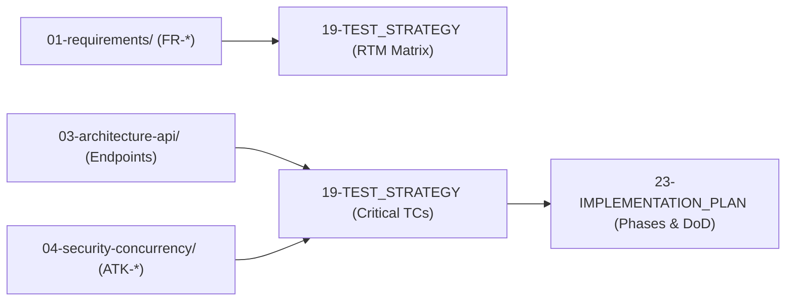

# 🧪 Nhóm 08 — Đảm Bảo Chất Lượng & Kế Hoạch Thực Thi (Testing & Implementation)

> **Vai trò kỹ thuật:** QA Lead / Test Automation Engineer / Technical Project Manager  
> **Mục tiêu:** Thiết lập kim tự tháp kiểm thử tự động, danh mục kịch bản kiểm thử sống còn, xây dựng Ma trận Truy xuất Nguồn gốc Yêu cầu (RTM) và vạch ra lộ trình thi công 10-15 Phase chi tiết với Definition of Done (DoD) định lượng.

---

## 🗂️ Danh Mục Tài Liệu Thuộc Nhóm 08

| Thứ tự | Tên tài liệu | Mục đích kỹ thuật cốt lõi |
| :---: | :--- | :--- |
| **19** | [`19-TEST_STRATEGY.md`](19-TEST_STRATEGY.md) | Chiến lược kiểm thử tự động: Kim tự tháp kiểm thử, Danh mục 17 Acceptance Tests (`AT-*`), Khung Cam Kết SLA Kiểm Thử Định Lượng (Accuracy $\ge 85\%$, Latency $\le 2.5\text{s}$, Faithfulness $100\%$, Coverage $\ge 70\%$) và Ma trận RTM. |
| **23** | [`23-IMPLEMENTATION_PLAN.md`](23-IMPLEMENTATION_PLAN.md) | Lộ trình thi công từng bước chia thành 10-14 Phase tuần tự: Mục tiêu, Phụ thuộc, Tệp tin ảnh hưởng, Thay đổi CSDL, Endpoints, An ninh, Tests và Tiêu chuẩn nghiệm thu (DoD). |

---

## 🔗 Liên Kết Truy Xuất (Traceability Flow)

