# Cẩm Nang Đào Tạo Kỹ Sư AI & Phỏng Vấn Cao Cấp (AI Engineer Interview & Learning Guide)

**Dự án**: RetailMind AI — Production-Oriented Agentic Retail Intelligence Platform  
**Tài liệu**: `enterprise-docs/docs/09-guidelines/LEARNING_GUIDE.md`  
**Mục tiêu**: Chuẩn hóa kiến thức kỹ thuật & Bộ câu hỏi phỏng vấn AI Systems Engineer  
**Trạng thái**: Approved for Architecture Baseline (Production 2026 Edition)  

---

## 1. Triết Lý Đào Tạo Kỹ Sư AI Hệ Thống (AI Systems Engineering Philosophy)

Trong kỷ nguyên Agentic AI, ranh giới giữa một lập trình viên thử nghiệm (Prompt Hacker) và một **Kỹ sư AI Hệ thống Cấp cao (Senior AI Systems Engineer)** được phân định bởi năng lực bảo đảm tính toàn vẹn hệ thống:

* **Kỹ sư Sơ cấp**: *"Tôi kết nối LLM với database bằng Text-to-SQL và để AI tự do chốt đơn giúp khách hàng."* $\longrightarrow$ **Cực kỳ nguy hiểm**: Dễ bị SQL Injection, ảo giác giá và bán vượt tồn kho phá sản doanh nghiệp!
* **Kỹ sư Cao cấp**:
  - *"LLM chỉ là bộ não suy luận (Reasoning Engine), tuyệt đối không phải là Database Client."*
  - *"Mọi thao tác thay đổi trạng thái phải đi qua Pydantic Validation, Server-Side Authorization và Trusted Service."*
  - *"PostgreSQL là nguồn chân lý duy nhất (SSOT); Qdrant chỉ là chỉ mục tìm kiếm ngữ nghĩa thứ cấp."*
  - *"Thao tác chốt đơn phải có khóa bi quan dòng `SELECT ... FOR UPDATE` và bắt buộc có xác nhận của con người (Human In The Loop)."*

---

## 2. Bộ 5 Câu Hỏi Phỏng Vấn Sống Còn Cho AI Engineer Bán Lẻ Công Nghệ

### Câu 1: Làm sao ngăn chặn AI tự bịa ra giá bán 0đ hoặc tự ý chốt đơn hàng ảo?
* **Đáp án chuẩn**: Áp dụng nguyên tắc **Ranh giới tác tử (Agent Boundary)** và quy trình chốt đơn 2 bước (ADR-004 & ADR-005):
  1. AI Agent tuyệt đối không có quyền truy cập trực tiếp CSDL và **không được cấp tool chốt đơn** (`confirm_order`).
  2. Agent chỉ có tool `preview_order` để tạo bản xem trước kèm Signed Preview Token (HMAC-SHA256) có hạn 10 phút.
  3. Khách hàng bắt buộc phải bấm nút xác nhận tường minh trên giao diện Web UI (Explicit Confirm). Backend độc lập kiểm tra giá niêm yết từ PostgreSQL và khóa tồn kho thật.

---

### Câu 2: Làm sao chống bán vượt tồn kho (Overselling) khi 100 người cùng bấm mua 1 chiếc laptop duy nhất?
* **Đáp án chuẩn**: Áp dụng **Khóa bi quan dòng (Pessimistic Locking `SELECT ... FOR UPDATE`)** trong Database Transaction:
  1. Khi nhận request chốt đơn, Backend mở Transaction và khóa dòng tồn kho của sản phẩm tại chi nhánh.
  2. Request đầu tiên chiếm được khóa, kiểm tra $\text{available\_qty} = \text{on\_hand} - \text{reserved} = 1 \ge 1 \to$ trừ kho thành công (`reserved_qty += 1`) và Commit.
  3. 99 requests còn lại bị chặn chờ ở hàng đợi của DB. Khi khóa mở ra, chúng kiểm tra thấy $\text{available\_qty} = 0 \to$ Rollback và nhận ngay mã lỗi `409 Conflict` (`INSUFFICIENT_STOCK`).

---

### Câu 3: Tại sao lại chọn Qdrant riêng biệt mà không dùng trực tiếp extension pgvector trong PostgreSQL?
* **Đáp án chuẩn**: Phân tách tải tính toán (Workload Isolation - ADR-001):
  1. Thuật toán tìm kiếm vector HNSW tiêu tốn bộ nhớ RAM rất lớn để duy trì đồ thị vector và chiếm dụng nhiều chu kỳ CPU khi tính khoảng cách Cosine.
  2. Nếu chạy chung trong PostgreSQL, một đợt cao điểm tìm kiếm ngữ nghĩa có thể làm treo connection pool và gây nghẽn các tác vụ giao dịch tài chính cốt lõi.
  3. Qdrant chuyên biệt tối ưu hóa vector bằng Rust/C++, trong khi PostgreSQL giữ vai trò nguồn chân lý duy nhất cho giao dịch ACID.

---

### Câu 4: Làm sao giải quyết triệt để rủi ro Deadlock khi đơn hàng có nhiều laptop từ nhiều kho?
* **Đáp án chuẩn**: **Chiến lược sắp xếp khóa tăng dần (Deterministic Lock Ordering)**:
  1. Deadlock xảy ra khi Luồng A khóa Máy 1 và chờ Máy 2, trong khi Luồng B khóa Máy 2 và chờ Máy 1.
  2. Backend trước khi gọi `SELECT ... FOR UPDATE` bắt buộc sắp xếp danh sách mặt hàng tăng dần theo cặp khóa chính `(store_id, variant_id)`.
  3. Cả 2 luồng đều buộc phải xin khóa Máy 1 trước rồi mới đến Máy 2, triệt tiêu hoàn toàn chu trình chờ đợi lẫn nhau.

---

### Câu 5: Làm sao bảo vệ dữ liệu cá nhân CCCD và SĐT khách hàng trước khi đẩy qua LLM bên ngoài theo Nghị định 13/2023/NĐ-CP?
* **Đáp án chuẩn**: Tầng **Middleware lọc PII tiếng Việt (PII Sanitization Guard)**:
  1. Áp dụng Regex nhận diện chuẩn số điện thoại Việt Nam (10 số, đầu 03/05/07/08/09), CCCD (12 số) và Email.
  2. Tự động thay thế chuỗi nhạy cảm bằng token placeholder: `[REDACTED_CCCD]`, `[REDACTED_PHONE]`.
  3. Chỉ truyền dữ liệu đã được làm sạch sang LLM ngoại vi, bảo đảm tuân thủ 100% luật pháp Việt Nam.

---

## 3. Quy Trình 14 Câu Hỏi Trước Khi Viết Code (Pre-Implementation Checklist)

Trước khi viết bất kỳ Router, Service, Model hay Migration nào, kỹ sư bắt buộc phải trả lời:
1. **Use Case**: Thuộc mã Use Case nào (`UC01` đến `UC12`)?
2. **Actor**: Thuộc vai trò nào (`Guest`, `Customer`, `Admin`)?
3. **Endpoint**: URL và HTTP Method là gì?
4. **Envelope**: DTO đầu vào và đầu ra có bọc chuẩn phong bì API Envelope không?
5. **Auth & IDOR**: Có kiểm tra `customer_id == current_user.id` để chống IDOR không?
6. **Tiền tệ**: Đã dùng kiểu `Decimal` và `NUMERIC(18, 0)` cho giá VNĐ chưa?
7. **CSDL**: Tác động đến những bảng nào trong 22 bảng? Khóa ngoại có `ON DELETE RESTRICT` không?
8. **Locking**: Thao tác ghi kho có cần `SELECT ... FOR UPDATE` không? Đã sắp xếp khóa chưa?
9. **Idempotency**: Giao dịch chốt đơn có Header `Idempotency-Key` không?
10. **State Machine**: Trạng thái chuyển đổi có nằm trong danh mục hợp lệ của FSM không?
11. **RAG Boundary**: Nếu có trích dẫn tài liệu, đã kiểm tra `status == 'published'` tại PostgreSQL chưa?
12. **PII Safety**: Dữ liệu có nguy cơ rò rỉ thông tin cá nhân ra ngoài không?
13. **Performance**: Có nguy cơ N+1 query không? Đã dùng `selectinload` chưa?
14. **Acceptance Test**: Đã viết bài test tương ứng trong `tests/` và chuẩn bị chạy chưa?

---

## 4. Bộ Slide Thuyết Trình Kỹ Thuật 10 Trang Chuẩn Mực (10-Slide Technical Presentation Kit)

Khung bài thuyết trình chuẩn 10 slide (10 phút) dành cho buổi thẩm định kiến trúc (Demo Day & Technical Defense):

```mermaid
flowchart LR
    S1[1. Title & Value Prop] --> S2[2. Problem & Risks]
    S2 --> S3[3. Sovereign Architecture]
    S3 --> S4[4. Core Product Journey]
    S4 --> S5[5. Polyglot Engine & Auth]
    S5 --> S6[6. Concurrency & ACID SSOT]
    S6 --> S7[7. Self-Hosted Phoenix Tracing]
    S7 --> S8[8. Model Cascading & FinOps]
    S8 --> S9[9. Quantitative SLA Evidence]
    S9 --> S10[10. Roadmap & Key Learnings]
```

### Chi Tiết Từng Slide Trong Bài Thuyết Trình

* **Slide 1: Tiêu Đề & Tôn Chỉ (Title & Tagline)**
  - Tên dự án: **RetailMind AI — Production-Oriented Agentic Retail Intelligence Platform**.
  - Tagline: *"Nền tảng trí tuệ bán lẻ tác tử cấp doanh nghiệp — Thống nhất giao dịch ACID chuẩn xác và năng lực suy luận AI an toàn."*
  - Team & Ngày bảo vệ: Đội ngũ Kỹ sư Hệ thống AI (Production 2026 Edition).
* **Slide 2: Nỗi Đau & Nguy Cơ Thực Tế Của AI Bán Lẻ (Problem & Enterprise Risks)**
  - Nguy cơ ảo giác thương mại: AI tự bịa giá bán 0đ, tự ý chốt đơn hàng ảo.
  - Nguy cơ sập hệ thống do bán vượt tồn kho (Overselling) trong cao điểm Flash Sale.
  - Nguy cơ pháp lý: Vi phạm Nghị định 13/2023/NĐ-CP do rò rỉ số CCCD, SĐT của khách hàng sang server AI bên ngoài.
* **Slide 3: Kiến Trúc Nền Tảng Độc Lập (Sovereign Architecture & Boundaries)**
  - Sơ đồ kiến trúc tổng thể 3 tầng: Next.js Frontend BFF $\leftrightarrow$ NestJS Commerce Core (PostgreSQL SSOT) $\leftrightarrow$ Python LangGraph Agent (Qdrant Vector DB).
  - Khẳng định 2 ranh giới bất biến: PostgreSQL là nguồn chân lý duy nhất (SSOT); LLM chỉ là bộ não suy luận (Reasoning Engine), không có quyền DB Client.
* **Slide 4: Hành Trình Sản Phẩm Thực Tế (Product Journey & Core Use Cases)**
  - Khách hàng tìm kiếm và so sánh laptop đa tiêu chí ngân sách $\le$ 20 triệu (`UC02`, `UC03`).
  - Tra cứu chính sách bảo hành, đổi trả với trích dẫn 2 chiều chuẩn xác (`UC05`).
  - Cơ chế chốt đơn 2 pha với Human-In-The-Loop: AI sinh Preview Token, người dùng xác nhận (`UC08`).
* **Slide 5: Tách Biệt Trách Nhiệm Polyglot (Polyglot Engineering & Security)**
  - Node.js/NestJS chuyên trách tính toán tài chính, giao dịch tồn kho, kiểm soát quyền truy cập RBAC và bảo vệ `Idempotency-Key`.
  - Python FastAPI & LangGraph chuyên trách State Machine, Prompt Guardrails và Orchestration.
  - Giao tiếp nội bộ qua Internal Shared Secret, triệt tiêu nguy cơ truy cập trái phép.
* **Slide 6: Chống Bán Vượt Tồn Kho Đỉnh Cao (Concurrency & ACID SSOT)**
  - Giải pháp khóa bi quan `SELECT ... FOR UPDATE` trong Transaction CSDL.
  - Chiến lược sắp xếp khóa tăng dần (Deterministic Lock Ordering) triệt tiêu 100% rủi ro Deadlock đa kho.
  - Minh chứng kiểm thử: 100 luồng đồng thời tranh mua 1 máy cuối cùng $\to$ 1 thành công, 99 nhận HTTP 409 Conflict an toàn.
* **Slide 7: Hệ Thống Giám Sát Tự Vận Hành Arize Phoenix (Observability & Zero Cloud Cost)**
  - Tích hợp Arize Phoenix container tự lưu trữ (Open-Source), không phát sinh chi phí nền tảng SaaS.
  - Thu thập OpenTelemetry Spans cho từng node LangGraph và Tool Call.
  - Biểu đồ phân bổ Vector UMAP trực quan phát hiện suy thoái dữ liệu (Drift Detection).
* **Slide 8: Kỹ Nghệ Tối Ưu Chi Phí (FinOps & Model Cascading)**
  - Cơ chế phân tầng Model Cascading: Tier 1 (GPT-4o-mini / Gemini-1.5-Flash) cho tác vụ định tuyến/trích xuất; Tier 2 (GPT-4o) cho lập luận so sánh sâu.
  - Băm SHA-256 prompt kết hợp Redis Cache triệt tiêu chi phí truy vấn lặp lại.
  - Tiết kiệm 88% ngân sách vận hành token hàng tháng.
* **Slide 9: Bằng Chứng Đánh Giá Định Lượng (Quantitative SLA Scorecard)**
  - Kết quả thực nghiệm trên 50 ca kiểm thử của Golden Dataset:
    - **Accuracy**: $94.0\%$ (Vượt chuẩn cam kết $\ge 85\%$).
    - **Faithfulness**: $100\%$ (Trích dẫn đúng 100% chunk chính sách).
    - **Hallucination Rate**: $0.0\%$.
    - **Latency P95**: $1.82\text{s}$ (Chuẩn $\le 2.5\text{s}$).
    - **Code Coverage**: $76.8\%$ (Vượt chuẩn $\ge 70\%$).
* **Slide 10: Bài Học Kỹ Nghệ & Tầm Nhìn Phát Triển (Key Learnings & Enterprise Roadmap)**
  - Triệt tiêu hoàn toàn 10 lỗi phản khuôn mẫu (Anti-Patterns).
  - Tầm nhìn mở rộng tương lai: Tích hợp trợ lý chuỗi cung ứng, mở rộng hạ tầng đa kho và báo cáo phân tích thông minh.

---

## 5. Kịch Bản Quay Video Demo 5 Phút Chuẩn Mực (5-Minute Video Demo Script)

| Mốc Thời Gian | Phân Cảnh (Scene) | Nội Dung Trình Bày & Thao Tác Trực Quan | Trọng Tâm Kỹ Thuật Cần Nhấn Mạnh |
|:---:|---|---|---|
| **0:00 – 1:00** | **Giới Thiệu & Kiến Trúc** | Mở trang chủ ứng dụng RetailMind AI. Trình chiếu sơ đồ kiến trúc Polyglot (NestJS + Python LangGraph + PostgreSQL + Qdrant) trên slide. | Nhấn mạnh ranh giới an toàn của tác tử AI và triết lý PostgreSQL là SSOT. |
| **1:00 – 2:00** | **Tư Vấn Laptop & Tra Cứu RAG** | Gõ câu hỏi: *"Tôi có 20 triệu, muốn mua laptop đồ họa nhẹ và hỏi điều kiện đổi trả trong 30 ngày."* Hệ thống stream phản hồi kèm trích dẫn văn bản chính sách. | Trình diễn luồng gọi tool `search_products` và `search_policy`, bộ lọc PII che giấu số điện thoại. |
| **2:00 – 3:00** | **Thử Thách Concurrency & Chốt Đơn** | Mở 2 cửa sổ trình duyệt song song cùng nhấn mua 1 chiếc laptop duy nhất. Một màn hình báo đặt hàng thành công, màn hình kia báo hết hàng (409 Conflict). | Chứng minh khóa bi quan `SELECT ... FOR UPDATE` bảo vệ kho, loại trừ hoàn toàn nguy cơ Oversell. |
| **3:00 – 4:00** | **Giám Sát Arize Phoenix & FinOps** | Chuyển sang giao diện Arize Phoenix tại cổng `6006`. Bấm vào Trace vừa sinh ra: xem chi tiết Span của LangGraph, độ trễ và số lượng token. | Thể hiện khả năng quan sát nội tại (Observability) và hiệu quả giảm chi phí của Model Cascading. |
| **4:00 – 5:00** | **Bằng Chứng SLA & Tổng Kết** | Mở terminal chạy lệnh `pytest tests/ --cov=src` hiển thị bảng kết quả test xanh toàn bộ (Coverage 76.8%). | Tuyên bố kết quả định lượng minh bạch: Không đánh giá cảm tính, sẵn sàng triển khai Production. |

---

## 6. Bộ Câu Hỏi Phỏng Vấn Chuyên Sâu Demo Day (Advanced Technical Q&A)

### Câu 6: Tại sao hệ thống áp dụng Model Cascading thay vì luôn gọi model thông minh nhất?
* **Đáp án chuẩn**: Tối ưu hóa hiệu năng và chi phí (Cost-to-Latency Tradeoff):
  1. Hơn 70% câu hỏi của người dùng chỉ là phân loại ý định (Intent Routing), chào hỏi, hoặc trích xuất tham số cấu hình đơn giản.
  2. Sử dụng GPT-4o-mini hoặc Gemini-1.5-Flash cho tầng Tier 1 với độ trễ $< 400\text{ms}$ và chi phí chỉ bằng $1/15$ so với mô hình lớn.
  3. Chỉ kích hoạt Tier 2 (GPT-4o) khi cần so sánh đa chiều phức tạp hoặc tổng hợp giải pháp chuyên sâu. Kết hợp Redis cache giúp tiết kiệm tới 88% chi phí API.

### Câu 7: Làm sao tự triển khai Arize Phoenix mà không phụ thuộc vào nền tảng cloud trả phí?
* **Đáp án chuẩn**: Đóng gói container chuẩn OpenTelemetry độc lập:
  1. Arize Phoenix được đóng gói dưới dạng Docker image mã nguồn mở (`arize-ai/phoenix:latest`) chạy trực tiếp trong hạ tầng nội bộ của doanh nghiệp.
  2. Tác tử Python LangGraph chỉ cần export OpenTelemetry Spans tới endpoint nội bộ `http://phoenix:6006/v1/traces`.
  3. Toàn bộ dữ liệu truy vết lưu trữ cục bộ, không gửi bất kỳ thông tin nào ra internet, vừa tiết kiệm chi phí SaaS vừa tuân thủ tuyệt đối an toàn dữ liệu khách hàng.

### Câu 8: Tại sao lại lựa chọn kiến trúc Polyglot (NestJS + Python) thay vì viết toàn bộ bằng một ngôn ngữ?
* **Đáp án chuẩn**: Tận dụng tối đa thế mạnh chuyên biệt của từng công nghệ (ADR-007):
  1. **NestJS (Node.js/TypeScript)**: Hệ sinh thái dẫn đầu về xử lý Web API thương mại, I/O bất đồng bộ cao, tích hợp TypeORM với cơ chế khóa bi quan chuẩn mực, quản lý Transaction CSDL chặt chẽ.
  2. **Python**: Tiêu chuẩn vàng của hệ sinh thái AI/Data Science, thư viện LangGraph, Pydantic v2, và các SDK suy luận mô hình tiên tiến nhất.
  3. Tách biệt hai tầng giúp đội ngũ phát triển mở rộng quy mô độc lập và bảo vệ CSDL cốt lõi không bao giờ bị đe dọa bởi runtime của AI.

