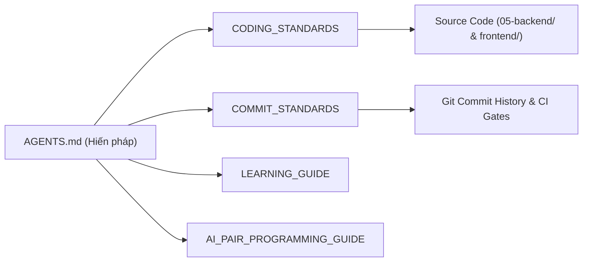

# 📏 Nhóm 09 — Quy Chuẩn Lập Trình & Quản Trị Kỹ Thuật (Guidelines & Engineering Culture)

> **Vai trò kỹ thuật:** Lead Architect / Engineering Manager / Technical Mentor  
> **Mục tiêu:** Thiết lập văn hóa kỹ thuật chuẩn mực, quy chuẩn viết code sạch (Clean Code), quy chuẩn commit Git chuẩn production (Conventional Commits), cẩm nang đào tạo kỹ sư và quy trình cộng tác cùng trợ lý AI.

---

## 🗂️ Danh Mục Tài Liệu Thuộc Nhóm 09

| Thứ tự | Tên tài liệu | Mục đích kỹ thuật cốt lõi |
| :---: | :--- | :--- |
| **CS** | [`CODING_STANDARDS.md`](CODING_STANDARDS.md) | Quy chuẩn viết code: Clean Code, Thin Controller, Quy chuẩn AST Safe Calculator (Zero `eval`), Bảng danh mục 10 Lỗi Phản Khuôn Mẫu (Anti-Patterns Checklist) và Linter/Formatters. |
| **CM** | [`COMMIT_STANDARDS.md`](COMMIT_STANDARDS.md) | Quy chuẩn Git Commit chuẩn Production: Tuân thủ Conventional Commits 1.0.0, Danh mục Types, Phân định Scopes trong Monorepo, Cấu trúc Body/Footer và Quality Gates. |
| **LG** | [`LEARNING_GUIDE.md`](LEARNING_GUIDE.md) | Cẩm nang đào tạo kỹ sư AI & Phỏng vấn cao cấp: Quy trình 14 câu hỏi trước khi code, Bộ Slide thuyết trình 10 trang (Pitch Deck), Kịch bản Video Demo 5 phút và Bộ câu hỏi phỏng vấn chuyên sâu. |
| **AI** | [`AI_PAIR_PROGRAMMING_GUIDE.md`](AI_PAIR_PROGRAMMING_GUIDE.md) | Hướng dẫn cộng tác cùng AI Agents: Thiết lập ngữ cảnh, phòng chống ảo giác (Hallucination), kiểm chứng độc lập và quy trình nghiệm thu mã nguồn do AI sinh ra. |

---

## 🔗 Liên Kết Truy Xuất (Traceability Flow)

