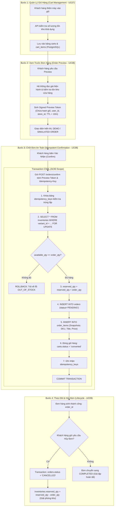

# Phân Tích & Thiết Kế Luồng Giao Dịch Thương Mại (Commerce Transactional Flow Analysis)

**Dự án:** RetailMind AI — Production-Oriented Agentic Retail Intelligence Platform  
**Tài liệu:** `docs/research/commerce-flow.md`  
**Căn cứ đặc tả:** `prompt_sections/01_PRODUCT_AND_REFERENCES.md` (Mục 1.2, 1.3) & `prompt_sections/07_DATABASE_DESIGN.md`  
**Giai đoạn:** Phase 0 (Research & Feasibility Audit)  
**Trạng thái:** CANDIDATE BASELINE (COMMERCE ARCHITECTURE AUDITED)  

---

## 1. Đặt Vấn Đề: Bài Toán Thực Tiễn Trong E-Commerce

Trong các ứng dụng thương mại điện tử kết hợp AI, sai lầm phổ biến nhất của các kỹ sư mới vào nghề là coi việc "đặt hàng" chỉ đơn giản là gọi hàm `create_order()` và chèn một dòng vào database. Cách làm ngây thơ này sẽ ngay lập tức sụp đổ khi gặp các vấn đề thực tế:
1. **Tranh chấp đồng thời (Race Conditions):** Chiếc laptop tồn kho chỉ còn 1 máy duy nhất tại chi nhánh Quận 1, hai khách hàng cùng lúc nhấn nút mua $\rightarrow$ Hệ thống bị âm kho (`on_hand = -1`).
2. **Gửi lặp mạng (Network Retries & Double Submissions):** Khách hàng mạng lag bấm nút Chốt đơn 3 lần liên tiếp $\rightarrow$ Hệ thống trừ kho 3 lần và sinh ra 3 đơn hàng trùng lặp.
3. **Biến động giá (Price Drifts):** Giá laptop hôm nay là 20 triệu, khách mua xong, tuần sau admin tăng giá lên 22 triệu $\rightarrow$ Doanh thu và hóa đơn của đơn hàng cũ bị cập nhật sai lệch theo giá mới nếu chỉ lưu khóa ngoại `variant_id`.
4. **Ảo giác giao dịch từ AI (Agent Hallucinated Mutations):** Chatbot tự ý tạo đơn hàng hoặc sửa đổi giỏ hàng mà khách hàng không hề hay biết hoặc không có xác nhận tường minh.

Tài liệu này phân tích chi tiết giải pháp kỹ thuật giải quyết triệt để 4 vấn đề trên trong RetailMind AI.

---

## 2. So Sánh Kiến Trúc: Khảo Sát Nguồn Mở vs Chuẩn RetailMind AI

| Khía cạnh kỹ thuật | Giải pháp trong các repo khảo sát (`ecommerce-agent`, `FlowAssist`) | Chuẩn thiết kế Enterprise của RetailMind AI |
|---|---|---|
| **Cơ chế giỏ hàng** | Mảng JSON lưu trong bộ nhớ tạm (In-memory/Session) hoặc SQLite không có ràng buộc. | Bảng CSDL quan hệ chuẩn hóa: `carts` (1 active cart/user) và `cart_items` (Unique `cart_id + variant_id`). |
| **Giá sản phẩm trên đơn** | Tham chiếu trực tiếp khóa ngoại `product_id`; lấy giá động từ bảng sản phẩm. | **Price Snapshotting:** Bảng `order_items` lưu cố định `sku_snapshot`, `title_snapshot`, `unit_price_vnd` bằng kiểu `NUMERIC(18,0)` tại đúng thời điểm chốt. |
| **Kiểm soát đồng thời tồn kho** | Kiểm tra bằng lệnh `SELECT` thường rồi `UPDATE` (Dễ bị race condition giữa 2 câu lệnh). | **Pessimistic Row-Locking:** Thực thi lệnh `SELECT ... FOR UPDATE` bên trong Transaction ACID, cô lập hoàn toàn giao dịch. |
| **Chống lặp đơn hàng** | Không có; phụ thuộc vào việc người dùng không click đúp trên UI. | **Idempotency Key Pattern:** Bảng `idempotency_keys` lưu mã UUID/Hash của request, trả về kết quả cũ nếu bị gửi lại trong vòng 24h. |
| **Ranh giới phê duyệt AI** | Chatbot tự động gọi tool tạo đơn hàng trong nền. | **Two-Phase Commit with Human Sign-off:** AI chỉ sinh `Preview Token`; khách hàng bắt buộc phải nhấn nút **Confirm** trên Web. |

---

## 3. Kiến Trúc Luồng Mua Hàng 4 Bước Chuẩn Mực



---

## 4. Giải Phẫu Kỹ Thuật Các Chốt Chặn Trọng Yếu

### 4.1. Cơ Chế Khóa Hàng Tồn Kho (Atomic Inventory Reservation)
Hệ thống không trừ thẳng vào `on_hand_qty` (số lượng thực có trong kho) ngay khi đặt, mà sử dụng cơ chế giữ hàng thông qua trường `reserved_qty`:
$$\text{available\_qty} = \text{on\_hand\_qty} - \text{reserved\_qty}$$
- Khi tạo đơn: `reserved_qty = reserved_qty + quantity`.
- Khi xuất hàng thành công: `on_hand_qty = on_hand_qty - quantity` và `reserved_qty = reserved_qty - quantity`.
- Khi đơn hàng bị hủy: `reserved_qty = reserved_qty - quantity` (Kho lập tức hồi phục nguyên tử mà không làm sai lệch số liệu thực tế).
- Mọi thao tác tính toán đều được bảo vệ bằng câu lệnh:
  ```sql
  SELECT on_hand_qty, reserved_qty 
  FROM inventories 
  WHERE variant_id = :variant_id AND store_id = :store_id 
  FOR UPDATE;
  ```

### 4.2. Cơ Chế Chống Trùng Lặp Giao Dịch (Idempotency Key Engine)
- Client sinh một chuỗi ngẫu nhiên `Idempotency-Key: UUIDv4` gửi kèm trong Header của request tạo đơn.
- Khi nhận request:
  - Nếu `idempotency_key` chưa tồn tại trong bảng `idempotency_keys`: Tiến hành mở transaction tạo đơn và lưu kết quả phản hồi `response_payload` kèm status `201 Created`.
  - Nếu `idempotency_key` đã tồn tại và đang ở trạng thái `PROCESSING`: Trả về `409 Conflict` (yêu cầu đang được xử lý, vui lòng không spam).
  - Nếu `idempotency_key` đã hoàn tất: Trả về nguyên văn kết quả `response_payload` trước đó kèm status `200 OK` mà **không trừ kho lần 2**.

### 4.3. Đóng Băng Giá Bán Bất Biến (Price Snapshotting)
Bảng `order_items` lưu trữ các trường dữ liệu độc lập hoàn toàn với bảng `variants`:
```sql
CREATE TABLE order_items (
    id UUID PRIMARY KEY,
    order_id UUID NOT NULL REFERENCES orders(id) ON DELETE RESTRICT,
    variant_id UUID NOT NULL REFERENCES variants(id) ON DELETE RESTRICT,
    sku_snapshot VARCHAR(80) NOT NULL,
    title_snapshot VARCHAR(240) NOT NULL,
    unit_price_vnd NUMERIC(18, 0) NOT NULL CHECK (unit_price_vnd >= 0),
    quantity INTEGER NOT NULL CHECK (quantity > 0),
    line_total_vnd NUMERIC(18, 0) NOT NULL CHECK (line_total_vnd >= 0),
    created_at TIMESTAMPTZ NOT NULL DEFAULT now(),
    UNIQUE (order_id, variant_id)
);
```
Nguyên tắc: `line_total_vnd = unit_price_vnd * quantity` được kiểm tra tính toán máy chủ bằng thư viện `Decimal` chính xác, ngăn chặn hoàn toàn lỗi dấu phẩy động của kiểu `FLOAT`.

---

## 5. Kết Luận Khảo Sát Luồng Mua Hàng
Nhờ áp dụng mô hình thiết kế trên, RetailMind AI loại bỏ hoàn toàn các rủi ro chết người của các dự án chatbot bán hàng thông thường, biến một demo học tập thành một sản phẩm có tính toàn vẹn giao dịch ngang tầm hệ thống Enterprise thực tế.
