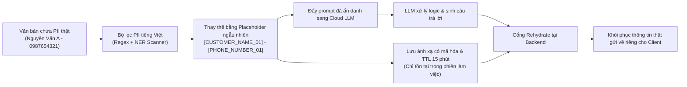
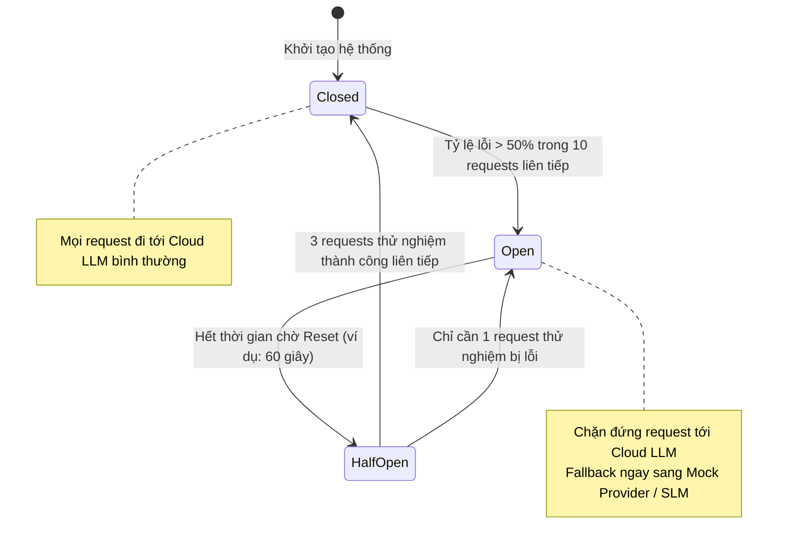

# Phân Tích An Ninh, Ranh Giới Tin Cậy & Kỹ Nghệ Bền Bỉ (Security & Reliability Engineering)

**Dự án:** RetailMind AI — Production-Oriented Agentic Retail Intelligence Platform  
**Tài liệu:** `docs/research/security-reliability.md`  
**Căn cứ đặc tả:** `prompt_sections/01_PRODUCT_AND_REFERENCES.md` (Mục 1.2, 3) & `prompt_sections/03_PRIVACY_AND_SECURITY.md`  
**Giai đoạn:** Phase 0 (Research & Feasibility Audit)  
**Trạng thái:** CANDIDATE BASELINE (SECURITY & RESILIENCE AUDITED)  

---

## 1. Triết Lý Ranh Giới An Toàn Zero-Trust (Trust Boundaries)

Trong một hệ thống AI tích hợp thương mại điện tử, nguy cơ bảo mật xuất hiện từ nhiều hướng. RetailMind AI áp dụng mô hình **Zero-Trust**: Mọi luồng dữ liệu giao tiếp qua biên giới hệ thống đều bị coi là nguy hiểm tiềm tàng.

```text
┌────────────────────────────────────────────────────────────────────────┐
│                        VÙNG KHÔNG TIN CẬY (UNTRUSTED)                  │
│  - Người dùng bên ngoài (Guest / Customer Prompt)                      │
│  - Dữ liệu văn bản từ Internet / Tài liệu RAG bên thứ ba               │
│  - Kết quả sinh ra từ Cloud LLM (Có thể chứa Hallucination/Jailbreak)  │
└────────────────────────────────────────────────────────────────────────┘
                                    │
                  [CHỐT CHẶN AN NINH & HARNESS GATEWAY]
                                    │
┌────────────────────────────────────────────────────────────────────────┐
│                         VÙNG TIN CẬY (TRUSTED CORE)                    │
│  - FastAPI Application Backend Services                                │
│  - PostgreSQL Database (Nguồn sự thật cho Giá, Tồn kho, Đơn hàng)      │
│  - Secrets Manager (.env, JWT Private Key, DB Credentials)             │
│  - Quản trị viên hệ thống (Admin)                                      │
└────────────────────────────────────────────────────────────────────────┘
```

---

## 2. Bảo Vệ Dữ Liệu Cá Nhân & Chốt Chặn PII Tiếng Việt (PII Egress Guard)

### 2.1. Nhận Thức Pháp Lý Thực Tế
Hệ thống tuân thủ nghiêm ngặt các quy định bảo vệ dữ liệu hiện hành tại Việt Nam:
* **Nghị định 13/2023/NĐ-CP** về bảo vệ dữ liệu cá nhân.
* **Luật Bảo vệ dữ liệu cá nhân 91/2025/QH15** và **Nghị định 356/2025/NĐ-CP** (chính thức có hiệu lực từ **01/01/2026**).

### 2.2. Kỹ Thuật Mã Hóa Giả Danh Đảo Ngược Được (Reversible Pseudonymization)
Khi khách hàng vô tình nhập thông tin cá nhân vào đoạn chat (ví dụ: *"Tôi là Nguyễn Văn A, CCCD 079099001234, SĐT 0987654321, cần tư vấn máy..."*), hệ thống **nghiêm cấm gửi trực tiếp chuỗi này sang máy chủ của Cloud LLM**.



### Quy tắc bất biến của PII Egress Guard:
1. **Chế độ Fail-Closed:** Nếu bộ lọc PII phát hiện nghi vấn rò rỉ dữ liệu nhạy cảm mà không thể thay thế an toàn, hệ thống lập tức từ chối gửi request sang mô hình bên thứ ba.
2. **Không ghi PII vào Log / Trace:** Các công cụ theo dõi như Prometheus, Grafana, OpenTelemetry và bảng `audit_events` chỉ được phép ghi mã định danh `user_id`, thời gian xử lý và mã lỗi đã làm sạch; tuyệt đối không log chuỗi PII thô.

---

## 3. Kỹ Nghệ Bền Bỉ Cho Hạ Tầng AI (AI Resilience Engineering)

Khi kết nối với các dịch vụ AI đám mây (OpenAI, Anthropic, Google), độ trễ mạng và lỗi quá tải là điều không thể tránh khỏi. RetailMind AI áp dụng 3 kỹ thuật đàn hồi:

### 3.1. Ngắt Mạch Tự Động (Circuit Breaker 3 Trạng Thái)


### 3.2. Chiến Lược Thử Lại Có Độ Lùi Số Mũ & Nhiễu Ngẫu Nhiên (Exponential Backoff with Full Jitter)
Khi gặp các lỗi tạm thời (`HTTP 429 Too Many Requests` hoặc `HTTP 503 Service Unavailable`), hệ thống không gửi lại dồn dập (tránh bão request - thundering herd) mà tính toán độ trễ thử lại:
$$t_{\text{sleep}} = \text{random}(0, \min(T_{\text{max}}, T_{\text{base}} \times 2^{\text{attempt}}))$$
- Giới hạn tối đa 3 lần thử lại (`max_retries = 3`).
- **Nghiêm cấm tự động thử lại các thao tác chốt đơn (Order Confirm mutations)** nếu không có Idempotency Key bảo vệ.

### 3.3. Thang Cứu Hộ Đa Tầng (Fallback Ladder)
Nếu Cloud LLM gặp sự cố ngừng hoạt động toàn cầu, hệ thống tự động giáng cấp dịch vụ một cách mềm dẻo:
$$\text{Frontier Cloud LLM} \longrightarrow \text{Local Small Language Model (SLM)} \longrightarrow \text{Deterministic Mock Provider}$$
Giao diện người dùng sẽ hiển thị thông báo rõ ràng cho khách hàng biết hệ thống đang vận hành ở chế độ dự phòng cứu hộ.

---

## 4. Cô Lập Môi Trường Thực Thi Hệ Thống (Sandbox & OS Isolation)

* **Bài học cảnh báo từ repo `NeoCyber05/Docker-Agent-CLI`:**
  - Dự án này cung cấp công cụ cho phép AI gọi lệnh `docker run` và thực thi bash shell.
  - **RetailMind AI cấm tuyệt đối thiết kế này:** Không cấp quyền Socket Docker, không cấp quyền gọi module `subprocess` hay `os.system` cho bất kỳ Shopping Agent nào.
* **Quy chuẩn triển khai Docker an toàn:**
  - Container chạy dưới quyền người dùng không có đặc quyền (`non-root user`: `appuser:1000`).
  - Hệ thống tệp dạng chỉ đọc (`read-only root filesystem`).
  - Giới hạn tài nguyên RAM tối đa 2GB và CPU 1.5 cores cho mỗi container để chống tấn công cạn kiệt tài nguyên (DoS).
