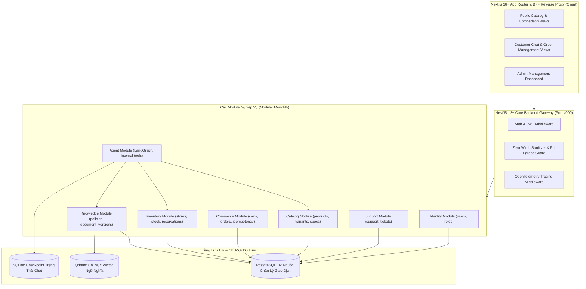

# Các Quyết Định Tích Hợp Kiến Trúc Cốt Lõi (Architecture Integration Decisions)

**Dự án:** RetailMind AI — Production-Oriented Agentic Retail Intelligence Platform  
**Tài liệu:** `docs/research/integration-decisions.md`  
**Căn cứ đặc tả:** `prompt_sections/01_PRODUCT_AND_REFERENCES.md` (Mục 3) & `prompt_sections/02_ARCHITECTURE_AND_DOMAIN.md` (Mục 4.6)  
**Giai đoạn:** Phase 0 (Research & Feasibility Audit)  
**Trạng thái:** CANDIDATE BASELINE (INTEGRATION DECISIONS AUDITED)  

---

## 1. Mục Đích & Cơ Sở Quyết Định

Tài liệu này tổng hợp toàn bộ các kết luận rút ra từ quá trình khảo sát 16 kho mã nguồn mở và nền tảng doanh nghiệp, chuyển hóa thành các **Quyết Định Tích Hợp Kiến Trúc Cốt Tử (Architecture Integration Decisions)** cho dự án RetailMind AI. Đây là nền móng trực tiếp để hình thành các hồ sơ quyết định kiến trúc chính thức (ADR-001 đến ADR-008).

---

## 2. Bảng Tổng Hợp 10 Quyết Định Tích Hợp Then Chốt (Cập Nhật Thực Chiến)

| Mã Quyết Định | Vấn đề kiến trúc (Problem) | Các lựa chọn xem xét (Options Considered) | Lựa chọn chính thức (Selected Decision) | Căn cứ kỹ thuật & Luận điểm thực tiễn (Rationale) |
|:---:|---|---|---|---|
| **INT-01** | **Phong cách kiến trúc hệ thống (System Architecture Style)** | 1. Microservices phân tán (Docker Swarm/K8s) 2. Phân tán gộp từ nhiều repo GitHub 3. **Modular Monolith / Polyglot** | **Polyglot Tri-Tier (Next.js + NestJS + Python Agent — ADR-007)** | Tận dụng tối đa thế mạnh chuyên biệt: Next.js cho SEO SSR, NestJS cho tính toàn vẹn giao dịch ACID, và Python cho hệ sinh thái AI LangGraph. |
| **INT-02** | **Lựa chọn cơ sở dữ liệu Vector & Dữ liệu giao dịch** | 1. Chỉ dùng PostgreSQL với `pgvector` 2. Dùng Vector DB lưu tất cả 3. **PostgreSQL + Qdrant** | **PostgreSQL (Source of Truth) + Qdrant (Secondary Retrieval)** | PostgreSQL là nguồn chân lý duy nhất cho giá bán, tồn kho, đơn hàng và phiên bản tài liệu. Qdrant chuyên biệt hóa cho việc đánh chỉ mục vector HNSW hiệu năng cao, tìm kiếm ngữ nghĩa độc lập. |
| **INT-03** | **Cơ chế điều phối tác tử (Agent Orchestration)** | 1. Multi-Agent Swarm (Nhiều agent tranh biện) 2. AutoGen / CrewAI tự do 3. **LangGraph StateGraph** | **Single Orchestrator với LangGraph Typed State Machine** | Tránh bẫy phức tạp hóa (Over-engineering). Mô hình một đồ thị trạng thái hữu hạn cho phép kiểm soát chặt chẽ số bước lặp (`MAX_STEPS = 5`), dễ debug, dễ ghi vết trace và có hành vi tất định. |
| **INT-04** | **Giao thức kết nối công cụ của Agent** | 1. Model Context Protocol (MCP) ngay từ đầu 2. **Internal Python Pydantic Tools** 3. Gọi REST API vòng ngoài | **Internal Tools trước; Adapter MCP Read-only ở Phase 8** | Các công cụ nội bộ (`search_products`, `view_cart`) chạy trực tiếp trong tiến trình Python cho tốc độ tức thì dưới 5ms; chỉ mở rộng chuẩn MCP cho các công cụ đọc khi cần tích hợp ngoài ở P8. |
| **INT-05** | **Chiến lược truy vấn dữ liệu sản phẩm** | 1. Unrestricted Text-to-SQL 2. Text-to-SQL có validate regex 3. **Typed Parameterized SQL Tools** | **Typed Parameterized SQL Queries (Loại bỏ 100% Text-to-SQL)** | Khảo sát từ `ecommerce-agent` cho thấy Text-to-SQL cực kỳ dễ bị SQL Injection và làm sập index. Sử dụng Tool tham số hóa với Pydantic đảm bảo an toàn tuyệt đối và tối ưu hóa câu lệnh. |
| **INT-06** | **Xử lý tranh chấp giao dịch & Quản lý tồn kho** | 1. Optimistic Locking (Kiểm tra version) 2. Trừ kho trực tiếp không giữ chỗ 3. **Pessimistic Locking + Reservation** | **Pessimistic Row-Locking (`FOR UPDATE`) + Atomic Reservation** | Ngăn chặn race condition khi nhiều người cùng mua máy tính tồn kho = 1; lưu snapshot giá vào `order_items` để đóng băng lịch sử giao dịch và dùng `idempotency_keys` chống gửi đúp. |
| **INT-07** | **Phân quyền truy cập tính năng AI Chat** | 1. Mở AI Chat cho cả Khách vãng lai (Guest) 2. **Chỉ dành cho Customer đã đăng nhập** | **Authenticated Customer cho AI Chat; Guest dùng Search công khai** | Phòng thủ cạn kiệt tài nguyên GPU (Denial of Wallet), chống spam bot và đảm bảo lịch sử hội thoại luôn gắn với định danh người dùng an toàn. |
| **INT-08** | **Vòng đời tài liệu & Đảm bảo trích dẫn chính xác** | 1. Nạp thẳng văn bản vào Vector DB 2. **PostgreSQL Versioning + Qdrant Vectors** | **PostgreSQL `document_versions` quản lý xuất bản + Qdrant lọc ACL** | Giúp việc rút hồi (`withdrawn`) hoặc thay thế (`superseded`) tài liệu có hiệu lực ngay lập tức tại CSDL, ngăn chặn triệt để việc AI trích dẫn các điều khoản bảo hành đã hết hạn. |
| **INT-09** | **Kiến trúc Frontend BFF Proxy & Data Fetching** | 1. Client gọi trực tiếp API Backend 2. Lưu token trong localStorage 3. **BFF Proxy + HttpOnly Cookie** | **Next.js BFF Reverse Proxy (`/api/proxy/[...path]`) + HttpOnly Cookie (ADR-009)** | Vô hiệu hóa nguy cơ rò rỉ token qua XSS; xử lý CORS tại server; hỗ trợ truyền dòng SSE streaming thời gian thực với `duplex: 'half'`; phân tách Queries `.get.ts` và Server Actions `.action.ts`. |
| **INT-10** | **RAG Tiếng Việt, Ingestion Idempotent & Lọc Ký Tự Lạ** | 1. Cắt đoạn văn bản theo số từ thô 2. Ghi đè vector không kiểm tra 3. **11-Tier Separators + Idempotent Ingestion** | **Cắt 11 bậc NĐ 30/2020/NĐ-CP + Xóa Idempotent + Lọc CJK + Citation Whitelist (ADR-008)** | Bảo toàn trọn vẹn ngữ nghĩa các điều khoản bảo hành máy tính; triệt tiêu hoàn toàn stale vectors và ảo giác ký tự Trung-Nhật-Hàn; kiểm định trích dẫn grounded 100%. |

---

## 3. Bản Đồ Ranh Giới Module Trong Kiến Trúc Đề Xuất

---

## 4. Tác Động & Định Hướng Triển Khai Cho Các Phase Tiếp Theo
* Toàn bộ 8 quyết định trên tạo thành một thể thống nhất, giải quyết triệt để sự mâu thuẫn giữa tính năng động của AI và tính nghiêm ngặt của hệ thống giao dịch thương mại.
* Các quyết định này sẽ được kiểm chứng chính thức tại cổng **Phase 0 Design Freeze** trước khi viết bất kỳ dòng mã nguồn nào trong Phase 1.
