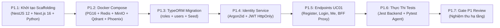

# Kế Hoạch Hành Động Tiếp Theo (Next Actions & Phase 1 Execution Blueprint)

**Dự án:** RetailMind AI — Production-Oriented Agentic Retail Intelligence Platform  
**Tài liệu:** `docs/progress/NEXT_ACTIONS.md`  
**Căn cứ đặc tả:** `prompt_sections/04_PHASE_PLAN.md` (P0.6, Gate P0 & Phase 1), `AGENTS.md`  
**Thời điểm lập:** 2026-10-20T17:55:00+07:00  
**Giai đoạn chuyển tiếp:** Chuyển từ Phase 0 (Design Freeze) sang Phase 1 (Foundations & Auth)  

---

## 1. Hành Động Trước Mắt (Immediate Action Items — Gate P0 Sign-Off)

Gói công việc Phase 0 hiện đã hoàn thành 100% hồ sơ kỹ thuật và đạt trạng thái `REVIEWED — RECOMMEND APPROVAL`.

> [!IMPORTANT]
> **Điều Kiện Tiên Quyết (Prerequisite):**  
> Tuân thủ nghiêm ngặt [AGENTS.md](../../AGENTS.md), AI không tự ý kích hoạt Phase 1. Dự án cần **chữ ký phê duyệt chính thức (Sign-off)** từ Product Owner (Người Dùng) tại [00-DESIGN_REVIEW.md](../03-architecture-api/00-DESIGN_REVIEW.md).
> 
> *Khi Người Dùng ra lệnh phê duyệt hoặc yêu cầu: `APPROVED` / `Tiếp tục Phase 1`, hệ thống sẽ lập tức khởi chạy Phase 1 theo đúng kế hoạch dưới đây.*

---

## 2. Kế Hoạch Triển Khai Chi Tiết Phase 1 (Phase 1 Execution Plan)

### Mục Tiêu Cốt Lõi Của Phase 1:
Xây dựng nền tảng hạ tầng chạy thật (Running Polyglot Application Stack), hệ thống định danh người dùng (Identity & Auth Service) theo đúng lược đồ CSDL PostgreSQL 16+ đã đóng băng, và hoàn thành Use Case đầu tiên `UC01: Xác Thực & Quản Trị Phiên` theo kiến trúc ADR-007.

### Chi Tiết Từng Gói Công Việc Con Thuộc Phase 1:

#### Phân Đoạn P1.1 — Khởi Tạo Khung Ứng Dụng (Workspace & Scaffolding):
* Thiết lập cấu trúc monorepo Polyglot theo ADR-007:
  - `core-api/`: NestJS 12+, TypeORM, PostgreSQL Driver, Redis, MinIO S3 client, BullMQ.
  - `web-client/`: Next.js 16+ (App Router, React 19, TypeScript, TailwindCSS), Feature-Based Architecture, BFF Reverse Proxy (`/api/proxy/[...path]`).
  - `agent-system/`: Python 3.11+, FastAPI (Async), LangGraph StateGraph, Pydantic v2 Typed Tools, Qdrant Client.
* Cấu hình ConfigModule / Pydantic Settings quản lý biến môi trường an toàn.
* Tạo file mẫu môi trường `.env.example` chứa toàn bộ biến cấu hình kết nối DB, Redis, MinIO, Qdrant, Phoenix, JWT Secrets.
* Cài đặt middleware: Structured JSON logging, Request ID tracing, CORS và Global Exception Handler bọc theo chuẩn phong bì API Envelope.

#### Phân Đoạn P1.2 — Khởi Chạy Hạ Tầng Docker Compose (Infrastructure Baseline):
* Tạo file `docker-compose.yml` 7 dịch vụ:
  - Dịch vụ `postgres`: PostgreSQL 16 Alpine, port `5432`, volume persistent `pgdata`, healthcheck định kỳ `pg_isready`.
  - Dịch vụ `redis`: Redis 7 Alpine, port `6379`.
  - Dịch vụ `minio`: MinIO S3 Object Storage, ports `9000` & `9001`.
  - Dịch vụ `qdrant`: Qdrant latest, port `6333` (REST) và `6334` (gRPC).
  - Dịch vụ `phoenix`: Arize Phoenix LLM Tracing & UMAP drift, port `6006`.
  - Dịch vụ `backend` & `frontend`.
* Khởi động container và kiểm tra kết nối mạng nội bộ.

#### Phân Đoạn P1.3 — Cơ Sở Dữ Liệu & Di Trú Phase 1 (Database Migration):
* Cấu hình TypeORM Migration với PostgreSQL 16.
* Viết Migration Script khởi tạo 22 bảng CSDL theo đúng kế hoạch `09-DATABASE_DESIGN.md`:
  - Tạo bảng `roles` (`id`, `name`, `description`, `created_at`).
  - Tạo bảng `users` (`id`, `role_id`, `email`, `password_hash`, `full_name`, `phone_number`, `is_active`, `created_at`, `updated_at`).
  - Tạo trigger tự động cập nhật `updated_at`.
* Chạy migration và nạp bộ dữ liệu seed tất định: 3 vai trò (`GUEST`, `CUSTOMER`, `ADMIN`) và 1 tài khoản Admin mặc định để phục vụ kiểm thử.

#### Phân Đoạn P1.4 — Xây Dựng Phân Hệ Định Danh (Identity & Authentication Service):
* Cài đặt thư viện bảo mật: `argon2` và `@nestjs/jwt`.
* Xây dựng `PasswordHasher`: Băm mật khẩu với thuật toán Argon2id.
* Xây dựng `TokenService`:
  - Tạo JWT Access Token (hạn 15 phút, chứa `sub=user_id`, `role`, `email`).
  - Tạo JWT Refresh Token (hạn 7 ngày) lưu trong HttpOnly Cookie bảo mật.
  - Cơ chế xoay vòng Refresh Token (Token Rotation) chống replay attack.
* Xây dựng Guards xác thực: `JwtAuthGuard` và `RolesGuard` (`@Roles('ADMIN')`).

#### Phân Đoạn P1.5 — Triển Khai API Endpoints UC01 (Authentication APIs):
* `POST /api/v1/auth/register`: Đăng ký tài khoản Customer mới (xác thực email hợp lệ, độ dài mật khẩu $\ge$ 8 ký tự).
* `POST /api/v1/auth/login`: Xác thực thông tin đăng nhập, trả về HttpOnly Cookie và thông tin người dùng.
* `POST /api/v1/auth/refresh`: Cấp lại Access Token mới từ Refresh Token hợp lệ.
* `POST /api/v1/auth/logout`: Hủy phiên đăng nhập và xóa HttpOnly Cookie.
* `GET /api/v1/auth/me`: Lấy thông tin cá nhân của người dùng đang đăng nhập (bảo vệ bởi Bearer JWT).

#### Phân Đoạn P1.6 — Thực Thi Bộ Kiểm Thử Chấp Nhận UC01 (Acceptance Testing):
* Khởi tạo bộ kiểm thử unit & e2e:
* Thực thi kiểm thử tự động với Jest:
  - `AT-UC01-01`: Đăng ký Customer thành công.
  - `AT-UC01-02`: Đăng nhập thất bại khi sai mật khẩu (`401 Unauthorized`).
  - `AT-UC01-03`: Xoay vòng Refresh Token thành công.
  - `AT-UC01-04`: Truy cập `/api/v1/auth/me` khi chưa đăng nhập bị chặn (`401 Unauthorized`).
* Cập nhật kết quả chạy thật vào báo cáo kiểm thử.

#### Phân Đoạn P1.7 — Đánh Giá Tiêu Chuẩn Cổng Gate P1:
* Kiểm tra `docker compose up --build` chạy sạch sẽ không lỗi.
* Toàn bộ migrations Phase 1 và dữ liệu seed hoạt động tất định.
* 100% kiểm thử UC01 đạt trạng thái `PASSED`.
* Lập báo cáo Gate P1 trước khi chuyển sang **Phase 2 (Catalog & Store Inventory)**.

---

## 3. Điều Kiện Kích Hoạt (Trigger Condition)

Hệ thống đang dừng tại ranh giới Gate P0.  
Chỉ cần nhận được lệnh xác nhận từ người dùng:
> **"Duyệt Gate P0"** hoặc **"Tiếp tục Phase 1"**

Toàn bộ quy trình triển khai Phân đoạn P1.1 và P1.2 sẽ được khởi động ngay lập tức!
