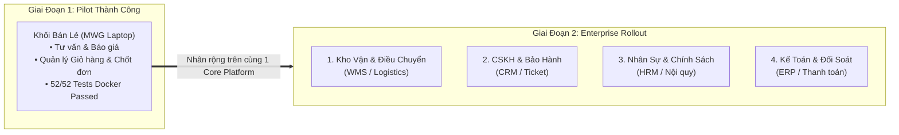
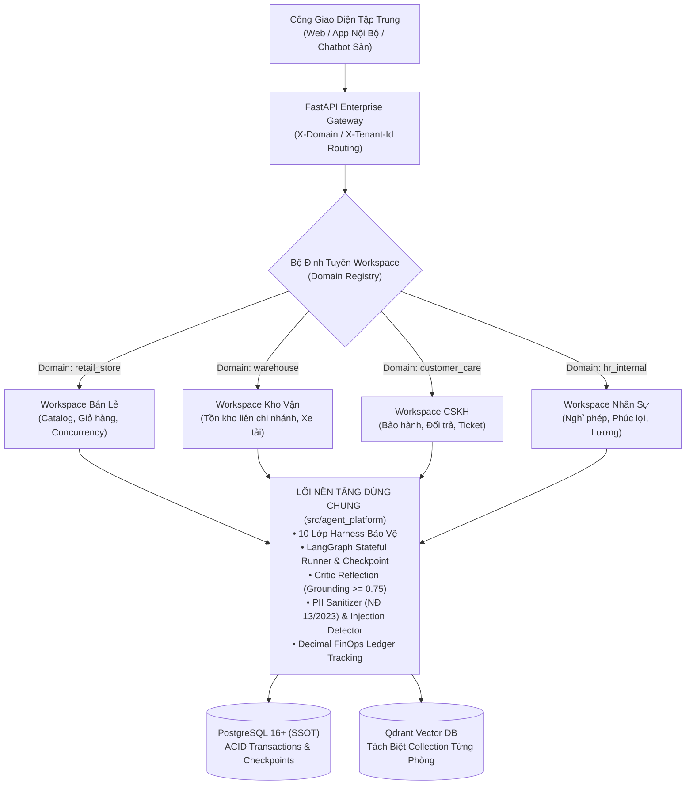
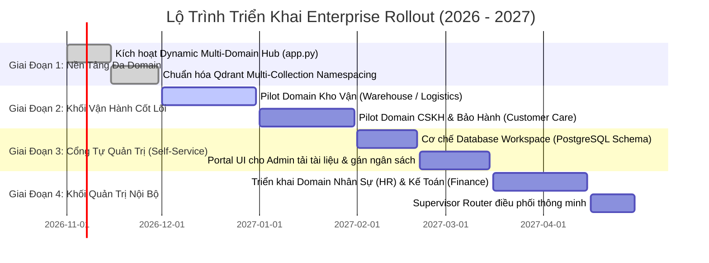

# KẾ HOẠCH CHIẾN LƯỢC GIAI ĐOẠN 2: ENTERPRISE ROLLOUT
## Đề Án Nhân Rộng Nền Tảng Tác Tử AI Toàn Doanh Nghiệp (Multi-Tenant AI Platform)

---

| **Thông tin** | **Chi tiết** |
|---|---|
| **Dự án** | **RetailMind AI Platform — Enterprise Expansion** |
| **Giai đoạn** | **Phase 2: Enterprise Rollout (2026 - 2027)** |
| **Người lập** | Senior AI Systems Architect & Core Engineering Team |
| **Kính gửi** | Ban Giám Đốc / Giám Đốc Công Nghệ (CTO) / Trưởng Khối Vận Hành |
| **Trạng thái Baseline** | Phase 1 (Pilot Retail) hoàn tất **~84%**, 52/52 tests passed trong Docker, 7 containers live |
| **Ngày lập** | 28/10/2026 |

---

## Executive Summary (Tóm Tắt Điều Hành)

Dự án **RetailMind AI (Phase 1)** đã triển khai thành công mô hình thử nghiệm (Pilot) cho nghiệp vụ Bán lẻ Thiết bị Công nghệ (Laptop MWG). Hệ thống đã chứng minh được:
1. **Kiến trúc Vững chắc**: Đạt tiêu chuẩn *Clean Architecture* và nguyên lý *Agent = Model + Harness* (10 lớp bảo vệ, không hallucination, đạt điểm đối soát tri thức $\ge 0.75$).
2. **An Toàn Giao Dịch & Dữ Liệu**: Khóa bi quan `SELECT ... FOR UPDATE` triệt tiêu bán vượt tồn; khử sạch thông tin nhạy cảm (PII) theo Nghị định 13/2023/NĐ-CP; Human-in-the-Loop (HITL) chặn 100% rủi ro bồi hoàn trái phép.
3. **Tiết Kiệm Chi Phí Tối Đa**: Cơ chế **"Zero Domain in Core"** cho phép **tái sử dụng 100% bộ mã nguồn lõi (`agent_platform`)** cho các phòng ban khác mà không cần viết lại hệ thống.

**Đề xuất Giai đoạn 2 (Enterprise Rollout):** 
Mở rộng nền tảng từ 1 phòng ban (Bán lẻ) sang **mô hình Đa Phòng Ban (Multi-Tenant AI Enterprise)** phục vụ toàn bộ các khối nghiệp vụ trọng yếu của tập đoàn: **Kho vận & Điều chuyển (Logistics/WMS)**, **Chăm sóc Khách hàng & Hậu mãi (Customer Care/CRM)**, **Quản trị Nhân sự (HR/HRM)** và **Tài chính - Kế toán**.

---

## 1. Mục Tiêu Chiến Lược & Kỳ Vọng Kinh Doanh (Business Objectives & ROI)

### 1.1. Mục Tiêu Đo Lường Được (KPIs)
- **Tự động hóa tác vụ lặp (Automation Rate)**: Tự động hóa **45% - 60%** các yêu cầu tra cứu và tạo đơn thủ công giữa các phòng ban.
- **Thời gian phản hồi nghiệp vụ (SLA)**: Giảm thời gian xử lý yêu cầu điều chuyển kho và thẩm định bảo hành từ **24 giờ xuống dưới 3 phút**.
- **Tiết kiệm chi phí đầu tư (CapEx & OpEx)**: Tiết kiệm **70% chi phí phát triển phần mềm** so với việc mỗi phòng ban tự mua hoặc thuê ngoài làm chatbot riêng lẻ.
- **Kiểm soát chi phí AI minh bạch (FinOps)**: Định mức và phân bổ ngân sách tiền Token API chi tiết đến từng phòng ban, loại bỏ lãng phí tài nguyên.

---

## 2. Kiến Trúc Mở Rộng: 1 Core Engine — Đa Workspace

Dựa trên mô hình chuẩn mực từ các tập đoàn lớn (Microsoft Semantic Kernel, Dify Enterprise, LangGraph Clean Architecture):

### 2.1. Cơ Chế Cô Lập Tuyệt Đối (Data & Access Isolation)
1. **Cô lập Tri thức (Vector Collection Isolation)**: Mỗi phòng ban sở hữu một collection Qdrant độc lập (`mwg_retail_catalog`, `mwg_warehouse_knowledge`, `mwg_hr_policies`). Triệt tiêu 100% rủi ro lẫn lộn thông tin giữa nội bộ và khách hàng.
2. **Cô lập Công cụ (Server-side RBAC & Tool Scoping)**: Agent Bán lẻ tuyệt đối không thể nhìn thấy hoặc gọi các công cụ liên quan đến lương thưởng hay bảng kê điều chuyển kho.
3. **Cô lập Dữ liệu Định danh (Tenant Guard)**: Mọi truy vấn đều đính kèm mã phòng ban (`tenant_id`), bảo vệ chống lỗ hổng rò rỉ dữ liệu chéo (Cross-Tenant Data Leak).

---

## 3. Lộ Trình Triển Khai 4 Giai Đoạn (Phased Roadmap)

Kế hoạch kéo dài trong **6 tháng (Chia làm 4 Sprint Quý)**:

### Chi Tiết Từng Giai Đoạn:

#### 🔹 Giai đoạn 2.1: Chuẩn Hóa Hạ Tầng Đa Domain (Tháng 11/2026)
- Kích hoạt cơ chế nạp động `harness_pool` trong [`app.py`](file:///c:/Users/Admin/Desktop/ExcelMCP/MWG_AI_Engineer_Interview_Study_Kit/RetailMind_AI/agent-system/src/agent_platform/api/app.py) qua [`DomainRegistry`](file:///c:/Users/Admin/Desktop/ExcelMCP/MWG_AI_Engineer_Interview_Study_Kit/RetailMind_AI/agent-system/src/agent_platform/domain/registry.py).
- Tách biệt các Collection trong cụm Qdrant hiện tại.
- *Kết quả bàn giao*: 1 Container có khả năng phục vụ song song nhiều phòng ban dựa trên Header `X-Domain`.

#### 🔹 Giai đoạn 2.2: Triển Khai Thí Điểm Khối Vận Hành (Tháng 12/2026 - 01/2027)
- **Phòng Kho vận (`warehouse`)**:
  - Tích hợp tra cứu tồn kho liên siêu thị toàn quốc.
  - Hỗ trợ tạo đề xuất điều chuyển hàng tự động khi 1 chi nhánh chạm ngưỡng tồn an toàn (Safety Stock).
- **Phòng CSKH & Bảo hành (`customer_care`)**:
  - Tra cứu thời hạn bảo hành qua Serial/IMEI thiết bị.
  - Hướng dẫn quy trình đổi trả và tự động lập phiếu tiếp nhận sửa chữa (Support Ticket).

#### 🔹 Giai đoạn 2.3: Xây Dựng Cổng Tự Quản Trị (Self-Service Workspace) (Tháng 02/2027 - 03/2027)
- Xây dựng giao diện Web Quản trị cho Trưởng các phòng ban:
  - Tự kéo thả tài liệu quy trình mới (PDF, Docx) để cập nhật tri thức cho Bot của phòng mình.
  - Xem Dashboard chi phí Token tiêu thụ theo thời gian thực (FinOps Dashboard).
  - Cài đặt hạn mức ngân sách tối đa hàng tháng (Token Budget Cap).

#### 🔹 Giai đoạn 2.4: Mở Rộng Khối Nội Bộ & Bộ Điều Phối Thông Minh (Tháng 04/2027)
- Triển khai cho **Phòng Nhân sự (`hr_department`)** và **Tài chính - Kế toán**.
- Triển khai **Supervisor Agent Router**: Tự động phân tích câu hỏi của nhân viên và chuyển tiếp câu hỏi đến đúng Agent phòng ban chuyên trách.

---

## 4. Quản Trị Chi Phí & Ngân Sách Dự Kiến (FinOps & Budgeting)

Nhờ kiến trúc dùng chung Core Engine và tận dụng tối đa hạ tầng Docker hiện hữu, chi phí phát sinh cho Giai đoạn 2 là cực kỳ khiêm tốn:

| Hạng mục chi phí | Pilot (Hiện tại - 1 Phòng) | Enterprise (Mở rộng 5 Phòng) | Ghi chú kỹ thuật |
|---|:---:|:---:|---|
| **Máy chủ Ứng dụng (App Server)** | 1 VPS / 4 vCPU, 8GB RAM | 1 Dedicated Server / 8 vCPU, 32GB RAM | Chạy Docker Swarm / Kubernetes nhẹ |
| **CSDL & Vector Store** | PostgreSQL 16 + Qdrant (chung) | Giữ nguyên cụm hiện tại, nâng cấp RAM | Tận dụng khả năng lưu trữ Multi-Tenant |
| **Chi phí API LLM (Tokens)** | ~\$50 - \$80 / tháng | ~\$350 - \$500 / tháng | Phân bổ quota độc lập cho từng phòng ban |
| **Chi phí Phát triển Phần mềm** | Đã hoàn tất 100% Core Platform | **\$0 (Không cần mua thêm license)** | Tận dụng mã nguồn nội bộ 100% |

> [!TIP]
> **Tỷ lệ Hoàn vốn (Payback Period)**: Dự kiến hệ thống giúp tiết kiệm tương đương **3 - 4 nhân sự vận hành trực tổng đài và điều phối kho thủ công**, hoàn vốn đầu tư hạ tầng chỉ sau **4 tháng vận hành chính thức**.

---

## 5. Ma Trận Đánh Giá Rủi Ro & Giải Pháp (Risk Management)

| Rủi ro tiềm ẩn | Mức độ | Biện pháp giảm thiểu kiến trúc |
|---|:---:|---|
| **Rò rỉ dữ liệu giữa các phòng ban** | **Nghiêm trọng** | Phân vùng cứng Qdrant Collections; Xác thực Role-based Access Control (RBAC) chặt chẽ ở cấp độ Server-side Guard. |
| **Một phòng ban dùng quá nhiều Token làm cạn kiệt ngân sách** | **Trung bình** | Cài đặt giới hạn cứng (Hard Cap) trong FinOps Ledger; tự động chặn gọi LLM khi chạm trần ngân sách tháng. |
| **Chất lượng câu trả lời bị ảo giác (Hallucination)** | **Cao** | Bắt buộc 100% Agent phòng ban đều phải đi qua `critic_node` với điểm đối soát $\ge 0.75$; không có trích dẫn tài liệu sẽ bị từ chối trả lời (`abstain`). |
| **Nhân viên không quen thao tác với Agent** | **Thấp** | Thiết kế giao diện tương tác đàm thoại tự nhiên tiếng Việt, hỗ trợ gợi ý câu hỏi mẫu (Prompt Suggestions) theo ngữ cảnh. |

---

## 6. Kiến Nghị Phê Duyệt & Các Bước Tiếp Theo (Action Items)

Nhóm Kỹ thuật đề xuất Ban Lãnh đạo xem xét và phê duyệt các điểm sau:

1. **Phê duyệt Chủ trương**: Thông qua đề án mở rộng Giai đoạn 2 (Enterprise Rollout) trên nền tảng RetailMind AI.
2. **Chọn 2 Phòng Ban Thí Điểm Đầu Tiên**: Khuyến nghị chọn **Khối Kho vận (Warehouse)** và **Chăm sóc Khách hàng (Customer Care)** làm đối tượng mở rộng trong Quý 1/2027.
3. **Phê duyệt Cấu hình Hạ tầng**: Duyệt cấp tài nguyên máy chủ (Dedicated Server hoặc Cloud VM) để phục vụ chạy song song các phòng ban.

---
*Báo cáo được hoàn thiện và đính kèm đầy đủ tài liệu kiểm thử kỹ thuật (52/52 Tests Passed) trong tài liệu dự án.*

